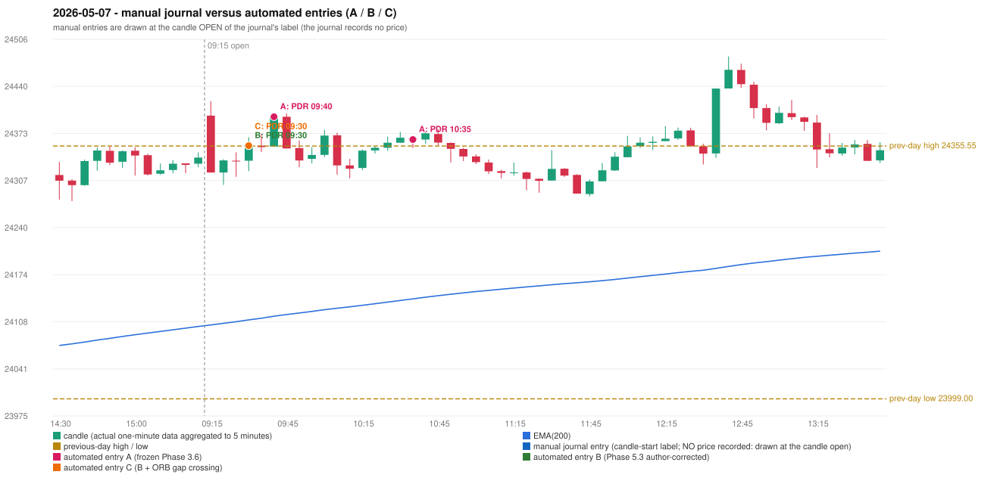

# 2026-05-07 (Thursday) - manual journal versus the automated configurations

> SYNTHETIC index-point P&L; no real option P&L; costs illustrative (Rs 70 per trade + slippage scenarios). Configurations A / B / C are never combined.

## Session

* Open 24398.5; previous official close 24330.95; gap +67.55; previous-day high / low 24355.55 / 23999.0
* First 5-minute candle (09:15-09:20): O24398.5 H24418.9 L24318.25 C24318.25, RED, body 79.7%; EMA(200) at the first candle 24103.23; previous session's last close 24339.3 vs its EMA 24101.07

## Manual journal

no manual trade recorded

## Configuration A

Candidate signals (confirmed): 09:45 PDR/PDR LONG [EXECUTED: trade 1: INITIAL_FULL_STOP]; 10:40 PDR/PDR LONG [EXECUTED: trade 2: INITIAL_FULL_STOP]; 12:40 PDR/PDR LONG [IGNORED: DAY_FINISHED]; 12:55 IRF/Method 1 SHORT [IGNORED: DAY_FINISHED]; 13:20 IRF/Method 2A SHORT [IGNORED: DAY_FINISHED]; 14:25 PDR/PDR LONG [IGNORED: DAY_FINISHED]

Strategies with no confirmed signal: ORB: Method 2 INVALIDATED TRENDLINE_NOT_SUPPORTIVE | PDS: no setup record (the strategy's trigger event never occurred) | RF: RF INVALIDATED GAP_UP_OUTSIDE_YESTERDAYS_RANGE

| trade | strategy / method | dir | signal -> fill | entry | stop / T1 / T2 | leg 1 | leg 2 | outcome | gross Rs | net Rs (70, 0) | net Rs (70, 1.0) |
|---|---|---|---|---|---|---|---|---|---|---|---|
| 1 | PDR/PDR | LONG | 09:45 -> 09:45 | 24396.9 | 24361.9 / 24423.9 / 24466.9 | 09:49 @ 24361.9 | 09:49 @ 24361.9 | INITIAL_FULL_STOP | -13,650 | -13,720 | -14,500 |
| 2 | PDR/PDR | LONG | 10:40 -> 10:40 | 24364.75 | 24329.75 / 24391.75 / 24434.75 | 11:07 @ 24329.75 | 11:07 @ 24329.75 | INITIAL_FULL_STOP | -13,650 | -13,720 | -14,500 |

Selection: This PDR signal was the earliest executable signal of the day: 0 confirmed signal(s) earlier, 0 other in the same minute. 5 later confirmed signal(s) (IRF x2, PDR x3) are logged as ignored or rejected. State of the other four engines at that moment: [IRF: no setup record before this time (a base condition was not met, or nothing triggered)] [ORB: Method 2 invalidated at 09:15: TRENDLINE_NOT_SUPPORTIVE] [PDS: no setup record before this time (a base condition was not met, or nothing triggered)] [RF: no setup record before this time (a base condition was not met, or nothing triggered)]

* Automated PDR 09:40 has no strict / time-tolerant journal counterpart: UNRESOLVED_DISCRETIONARY_SELECTION - the journal records no trade this day; the automated system took PDR PDR LONG (candle 09:40) mechanically
* Automated PDR 10:35 has no strict / time-tolerant journal counterpart: PORTFOLIO_CONTROLLER_CONSTRAINT - second trade of the day: the controller allows a PDR / PDS re-entry after the original full stop of trade 1 (PDR PDR, signal candle 09:40); the journal has no unmatched row that day

## Configuration B

Candidate signals (confirmed): 09:35 PDR/PDR LONG [EXECUTED: trade 1: T1_THEN_BUFFER_STOP]; 09:45 PDR/PDR LONG [IGNORED: POSITION_ACTIVE (signal kept for diagnostics only; never reused)]; 10:05 PDR/PDR LONG [IGNORED: DAY_FINISHED]; 10:25 PDR/PDR LONG [IGNORED: DAY_FINISHED]; 10:35 PDR/PDR LONG [IGNORED: DAY_FINISHED]; 12:05 PDR/PDR LONG [IGNORED: DAY_FINISHED]; 12:40 PDR/PDR LONG [IGNORED: DAY_FINISHED]; 12:55 IRF/Method 1 SHORT [IGNORED: DAY_FINISHED]; 12:55 IRF/Method 2A SHORT [IGNORED: DAY_FINISHED]; 13:30 PDR/PDR LONG [IGNORED: DAY_FINISHED]; 13:45 PDR/PDR LONG [IGNORED: DAY_FINISHED]; 13:55 PDR/PDR LONG [IGNORED: DAY_FINISHED]; 14:10 PDR/PDR LONG [IGNORED: DAY_FINISHED]; 14:25 PDR/PDR LONG [IGNORED: DAY_FINISHED]; 15:00 PDR/PDR LONG [IGNORED: DAY_FINISHED]

Strategies with no confirmed signal: ORB: Method 2 INVALIDATED TRENDLINE_NOT_SUPPORTIVE | PDS: no setup record (the strategy's trigger event never occurred) | RF: RF INVALIDATED GAP_UP_OUTSIDE_YESTERDAYS_RANGE

| trade | strategy / method | dir | signal -> fill | entry | stop / T1 / T2 | leg 1 | leg 2 | outcome | gross Rs | net Rs (70, 0) | net Rs (70, 1.0) |
|---|---|---|---|---|---|---|---|---|---|---|---|
| 1 | PDR/PDR | LONG | 09:35 -> 09:35 | 24356.15 | 24321.15 / 24383.15 / 24426.15 | 09:42 @ 24383.15 | 09:50 @ 24350.15 | T1_THEN_BUFFER_STOP | 4,095 | 4,025 | 3,245 |

Selection: This PDR signal was the earliest executable signal of the day: 0 confirmed signal(s) earlier, 0 other in the same minute. 14 later confirmed signal(s) (IRF x2, PDR x12) are logged as ignored or rejected. State of the other four engines at that moment: [IRF: no setup record before this time (a base condition was not met, or nothing triggered)] [ORB: Method 2 invalidated at 09:15: TRENDLINE_NOT_SUPPORTIVE] [PDS: no setup record before this time (a base condition was not met, or nothing triggered)] [RF: no setup record before this time (a base condition was not met, or nothing triggered)]

* Automated PDR 09:30 has no strict / time-tolerant journal counterpart: UNRESOLVED_DISCRETIONARY_SELECTION - the journal records no trade this day; the automated system took PDR PDR LONG (candle 09:30) mechanically

## Configuration C

Candidate signals (confirmed): 09:35 PDR/PDR LONG [EXECUTED: trade 1: T1_THEN_BUFFER_STOP]; 09:45 PDR/PDR LONG [IGNORED: POSITION_ACTIVE (signal kept for diagnostics only; never reused)]; 10:05 PDR/PDR LONG [IGNORED: DAY_FINISHED]; 10:25 PDR/PDR LONG [IGNORED: DAY_FINISHED]; 10:35 PDR/PDR LONG [IGNORED: DAY_FINISHED]; 12:05 PDR/PDR LONG [IGNORED: DAY_FINISHED]; 12:40 PDR/PDR LONG [IGNORED: DAY_FINISHED]; 12:55 IRF/Method 1 SHORT [IGNORED: DAY_FINISHED]; 12:55 IRF/Method 2A SHORT [IGNORED: DAY_FINISHED]; 13:30 PDR/PDR LONG [IGNORED: DAY_FINISHED]; 13:45 PDR/PDR LONG [IGNORED: DAY_FINISHED]; 13:55 PDR/PDR LONG [IGNORED: DAY_FINISHED]; 14:10 PDR/PDR LONG [IGNORED: DAY_FINISHED]; 14:25 PDR/PDR LONG [IGNORED: DAY_FINISHED]; 15:00 PDR/PDR LONG [IGNORED: DAY_FINISHED]

Strategies with no confirmed signal: ORB: Method 2 INVALIDATED TRENDLINE_NOT_SUPPORTIVE | PDS: no setup record (the strategy's trigger event never occurred) | RF: RF INVALIDATED GAP_UP_OUTSIDE_YESTERDAYS_RANGE

| trade | strategy / method | dir | signal -> fill | entry | stop / T1 / T2 | leg 1 | leg 2 | outcome | gross Rs | net Rs (70, 0) | net Rs (70, 1.0) |
|---|---|---|---|---|---|---|---|---|---|---|---|
| 1 | PDR/PDR | LONG | 09:35 -> 09:35 | 24356.15 | 24321.15 / 24383.15 / 24426.15 | 09:42 @ 24383.15 | 09:50 @ 24350.15 | T1_THEN_BUFFER_STOP | 4,095 | 4,025 | 3,245 |

Selection: This PDR signal was the earliest executable signal of the day: 0 confirmed signal(s) earlier, 0 other in the same minute. 14 later confirmed signal(s) (IRF x2, PDR x12) are logged as ignored or rejected. State of the other four engines at that moment: [IRF: no setup record before this time (a base condition was not met, or nothing triggered)] [ORB: Method 2 invalidated at 09:15: TRENDLINE_NOT_SUPPORTIVE] [PDS: no setup record before this time (a base condition was not met, or nothing triggered)] [RF: no setup record before this time (a base condition was not met, or nothing triggered)]

* Automated PDR 09:30 has no strict / time-tolerant journal counterpart: UNRESOLVED_DISCRETIONARY_SELECTION - the journal records no trade this day; the automated system took PDR PDR LONG (candle 09:30) mechanically

## Chart

