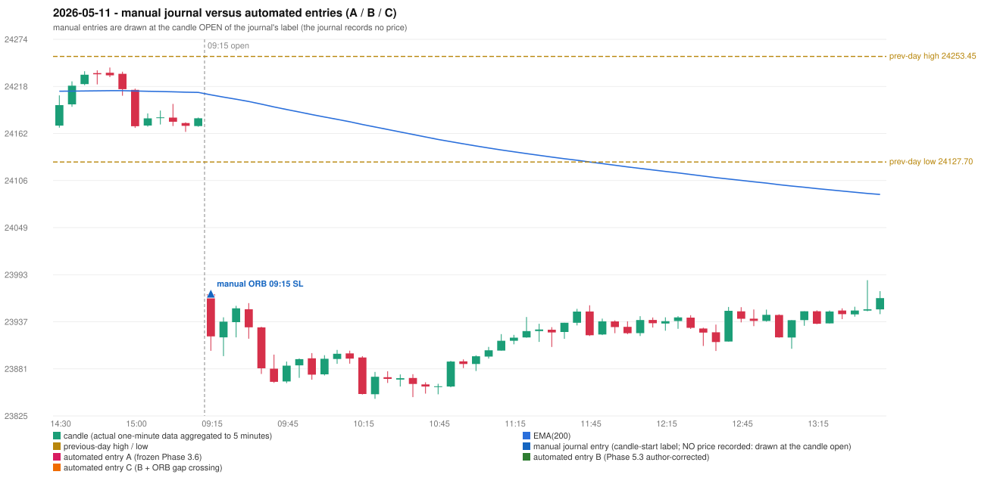

# 2026-05-11 (Monday) - manual journal versus the automated configurations

> SYNTHETIC index-point P&L; no real option P&L; costs illustrative (Rs 70 per trade + slippage scenarios). Configurations A / B / C are never combined.

## Session

* Open 23970.1; previous official close 24176.15; gap -206.05; previous-day high / low 24253.45 / 24127.7
* First 5-minute candle (09:15-09:20): O23970.1 H23975.8 L23902.65 C23919.8, RED, body 68.8%; EMA(200) at the first candle 24207.66; previous session's last close 24179.8 vs its EMA 24210.55

## Manual journal

row 118: ORB labelled 09:15, outcome SL

## Configuration A

Candidate signals (confirmed): 14:00 IRF/Method 1 SHORT [REJECTED: ENTRY_CUTOFF_EXCEEDED(fill 14:00 IST > 13:00)]; 14:15 IRF/Method 2A SHORT [REJECTED: ENTRY_CUTOFF_EXCEEDED(fill 14:15 IST > 13:00)]

Strategies with no confirmed signal: ORB: Method 1 INVALIDATED CANDLE_QUALITY(not a strong body / wick too large); Method 2 INVALIDATED CANDLE_QUALITY | PDR: no setup record (the strategy's trigger event never occurred) | PDS: no setup record (the strategy's trigger event never occurred) | RF: RF INVALIDATED TREND:EMA_PREV_SESSION_CLOSE wrong side

No trade: final day state READY_FOR_FIRST_TRADE. Signals existed but none became a trade (see the dispositions above).

* Journal row 118 (ORB 09:15): **UNMATCHED_MANUAL**; earliest cause CANDLE_STRENGTH_MISMATCH: first candle RED O23970.1 H23975.8 L23902.65 C23919.8 (body 68.8%); direction ASSUMED from the colour (the journal has no direction); TIE-BROKEN BY METHOD ORDER: 2 methods tie at 1 failing predicate(s) (Method 1: candle_quality; Method 2: candle_quality) - the evidence does not single out one cause, the secondary cause is the other tied one; closest method Method 1 (1 failing predicate(s)): first failing 'candle_quality' - body 68.8% opposite wick 23.4% close location 23.4%; all methods: Method 1: 1 fail (candle_quality); Method 2: 1 fail (candle_quality); Gap/200DMA: 2 fail (gap_crosses_200_average)

## Configuration B

Candidate signals (confirmed): 14:00 IRF/Method 1 SHORT [REJECTED: ENTRY_CUTOFF_EXCEEDED(fill 14:00 IST > 13:00)]; 14:05 IRF/Method 2A SHORT [REJECTED: ENTRY_CUTOFF_EXCEEDED(fill 14:05 IST > 13:00)]

Strategies with no confirmed signal: ORB: Method 1 INVALIDATED CANDLE_QUALITY(not a strong body / wick too large); Method 2 INVALIDATED CANDLE_QUALITY | PDR: no setup record (the strategy's trigger event never occurred) | PDS: no setup record (the strategy's trigger event never occurred) | RF: RF INVALIDATED TREND:EMA_PREV_SESSION_CLOSE wrong side

No trade: final day state READY_FOR_FIRST_TRADE. Signals existed but none became a trade (see the dispositions above).

* Journal row 118 (ORB 09:15): **UNMATCHED_MANUAL**; earliest cause CANDLE_STRENGTH_MISMATCH: first candle RED O23970.1 H23975.8 L23902.65 C23919.8 (body 68.8%); direction ASSUMED from the colour (the journal has no direction); TIE-BROKEN BY METHOD ORDER: 2 methods tie at 1 failing predicate(s) (Method 1: candle_quality; Method 2: candle_quality) - the evidence does not single out one cause, the secondary cause is the other tied one; closest method Method 1 (1 failing predicate(s)): first failing 'candle_quality' - body 68.8% opposite wick 23.4% close location 23.4%; all methods: Method 1: 1 fail (candle_quality); Method 2: 1 fail (candle_quality); Gap/200DMA: 2 fail (gap_crosses_200_average)

## Configuration C

Candidate signals (confirmed): 14:00 IRF/Method 1 SHORT [REJECTED: ENTRY_CUTOFF_EXCEEDED(fill 14:00 IST > 13:00)]; 14:05 IRF/Method 2A SHORT [REJECTED: ENTRY_CUTOFF_EXCEEDED(fill 14:05 IST > 13:00)]

Strategies with no confirmed signal: ORB: Method 1 INVALIDATED CANDLE_QUALITY(not a strong body / wick too large); Method 2 INVALIDATED CANDLE_QUALITY | PDR: no setup record (the strategy's trigger event never occurred) | PDS: no setup record (the strategy's trigger event never occurred) | RF: RF INVALIDATED TREND:EMA_PREV_SESSION_CLOSE wrong side

No trade: final day state READY_FOR_FIRST_TRADE. Signals existed but none became a trade (see the dispositions above).

* Journal row 118 (ORB 09:15): **UNMATCHED_MANUAL**; earliest cause CANDLE_STRENGTH_MISMATCH: first candle RED O23970.1 H23975.8 L23902.65 C23919.8 (body 68.8%); direction ASSUMED from the colour (the journal has no direction); TIE-BROKEN BY METHOD ORDER: 2 methods tie at 1 failing predicate(s) (Method 1: candle_quality; Method 2: candle_quality) - the evidence does not single out one cause, the secondary cause is the other tied one; closest method Method 1 (1 failing predicate(s)): first failing 'candle_quality' - body 68.8% opposite wick 23.4% close location 23.4%; all methods: Method 1: 1 fail (candle_quality); Method 2: 1 fail (candle_quality); Gap/200DMA: 2 fail (gap_crosses_200_average)

## Chart

