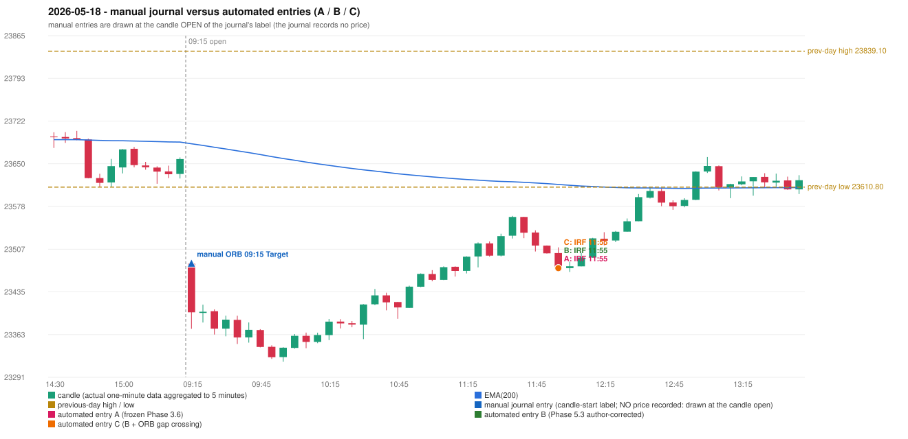

# 2026-05-18 (Monday) - manual journal versus the automated configurations

> SYNTHETIC index-point P&L; no real option P&L; costs illustrative (Rs 70 per trade + slippage scenarios). Configurations A / B / C are never combined.

## Session

* Open 23482.2; previous official close 23643.5; gap -161.30; previous-day high / low 23839.1 / 23610.8
* First 5-minute candle (09:15-09:20): O23482.2 H23485.8 L23372.9 C23400.5, RED, body 72.4%; EMA(200) at the first candle 23683.62; previous session's last close 23657.9 vs its EMA 23686.47

## Manual journal

row 122: ORB labelled 09:15, outcome Target

## Configuration A

Candidate signals (confirmed): 12:00 IRF/Method 1 SHORT [EXECUTED: trade 1: INITIAL_FULL_STOP]; 13:10 PDS/Method 1 SHORT [REJECTED: ENTRY_CUTOFF_EXCEEDED(fill 13:10 IST > 13:00)]; 14:25 IRF/Method 2A SHORT [REJECTED: SECOND_TRADE_RESTRICTED_TO_PDR_PDS]; 14:25 PDS/Method 3 SHORT [REJECTED: ENTRY_CUTOFF_EXCEEDED(fill 14:25 IST > 13:00)]

Strategies with no confirmed signal: ORB: Method 1 INVALIDATED CANDLE_QUALITY(not a strong body / wick too large); Method 2 INVALIDATED CANDLE_QUALITY | PDR: no setup record (the strategy's trigger event never occurred) | RF: RF INVALIDATED TREND:EMA_PREV_SESSION_CLOSE wrong side

| trade | strategy / method | dir | signal -> fill | entry | stop / T1 / T2 | leg 1 | leg 2 | outcome | gross Rs | net Rs (70, 0) | net Rs (70, 1.0) |
|---|---|---|---|---|---|---|---|---|---|---|---|
| 1 | IRF/Method 1 | SHORT | 12:00 -> 12:00 | 23474.75 | 23509.75 / 23447.75 / 23414.75 | 12:11 @ 23509.75 | 12:11 @ 23509.75 | INITIAL_FULL_STOP | -13,650 | -13,720 | -14,500 |

Selection: This IRF Method 1 signal was the earliest executable signal of the day: 0 confirmed signal(s) earlier, 0 other in the same minute. 3 later confirmed signal(s) (IRF x1, PDS x2) are logged as ignored or rejected. State of the other four engines at that moment: [ORB: Method 1 invalidated at 09:15: CANDLE_QUALITY(not a strong body / wick too large); Method 2 invalidated at 09:15: CANDLE_QUALITY] [PDR: no setup record before this time (a base condition was not met, or nothing triggered)] [PDS: no setup record before this time (a base condition was not met, or nothing triggered)] [RF: RF invalidated at 10:15: TREND:EMA_PREV_SESSION_CLOSE wrong side]

* Journal row 122 (ORB 09:15): **UNMATCHED_MANUAL**; earliest cause CANDLE_STRENGTH_MISMATCH: first candle RED O23482.2 H23485.8 L23372.9 C23400.5 (body 72.4%); direction ASSUMED from the colour (the journal has no direction); TIE-BROKEN BY METHOD ORDER: 2 methods tie at 1 failing predicate(s) (Method 1: candle_quality; Method 2: candle_quality) - the evidence does not single out one cause, the secondary cause is the other tied one; closest method Method 1 (1 failing predicate(s)): first failing 'candle_quality' - body 72.4% opposite wick 24.4% close location 24.4%; all methods: Method 1: 1 fail (candle_quality); Method 2: 1 fail (candle_quality); Gap/200DMA: 2 fail (gap_crosses_200_average)
* Automated IRF 11:55 has no strict / time-tolerant journal counterpart: DIFFERENT_STRATEGY_SELECTED - the journal traded ORB 09:15; the automated controller took IRF Method 1 (candle 11:55) as the first valid signal

## Configuration B

Candidate signals (confirmed): 12:00 IRF/Method 1 SHORT [EXECUTED: trade 1: INITIAL_FULL_STOP]; 12:00 IRF/Method 2A SHORT [MERGED_SAME_STRATEGY_METHOD: traded as another method of the same strategy/direction in the same minute]; 13:10 PDS/Method 1 SHORT [REJECTED: ENTRY_CUTOFF_EXCEEDED(fill 13:10 IST > 13:00)]; 13:30 PDS/Method 1 SHORT [REJECTED: ENTRY_CUTOFF_EXCEEDED(fill 13:30 IST > 13:00)]; 13:40 PDS/Method 1 SHORT [REJECTED: ENTRY_CUTOFF_EXCEEDED(fill 13:40 IST > 13:00)]; 14:10 PDS/Method 1 SHORT [REJECTED: ENTRY_CUTOFF_EXCEEDED(fill 14:10 IST > 13:00)]

Strategies with no confirmed signal: ORB: Method 1 INVALIDATED CANDLE_QUALITY(not a strong body / wick too large); Method 2 INVALIDATED CANDLE_QUALITY | PDR: no setup record (the strategy's trigger event never occurred) | RF: RF INVALIDATED TREND:EMA_PREV_SESSION_CLOSE wrong side

| trade | strategy / method | dir | signal -> fill | entry | stop / T1 / T2 | leg 1 | leg 2 | outcome | gross Rs | net Rs (70, 0) | net Rs (70, 1.0) |
|---|---|---|---|---|---|---|---|---|---|---|---|
| 1 | IRF/Method 1 | SHORT | 12:00 -> 12:00 | 23474.75 | 23509.75 / 23447.75 / 23414.75 | 12:11 @ 23509.75 | 12:11 @ 23509.75 | INITIAL_FULL_STOP | -13,650 | -13,720 | -14,500 |

Selection: This IRF Method 1 signal was the earliest executable signal of the day: 0 confirmed signal(s) earlier, 1 other in the same minute. 4 later confirmed signal(s) (PDS x4) are logged as ignored or rejected. State of the other four engines at that moment: [ORB: Method 1 invalidated at 09:15: CANDLE_QUALITY(not a strong body / wick too large); Method 2 invalidated at 09:15: CANDLE_QUALITY] [PDR: no setup record before this time (a base condition was not met, or nothing triggered)] [PDS: no setup record before this time (a base condition was not met, or nothing triggered)] [RF: RF invalidated at 10:15: TREND:EMA_PREV_SESSION_CLOSE wrong side]

* Journal row 122 (ORB 09:15): **UNMATCHED_MANUAL**; earliest cause CANDLE_STRENGTH_MISMATCH: first candle RED O23482.2 H23485.8 L23372.9 C23400.5 (body 72.4%); direction ASSUMED from the colour (the journal has no direction); TIE-BROKEN BY METHOD ORDER: 2 methods tie at 1 failing predicate(s) (Method 1: candle_quality; Method 2: candle_quality) - the evidence does not single out one cause, the secondary cause is the other tied one; closest method Method 1 (1 failing predicate(s)): first failing 'candle_quality' - body 72.4% opposite wick 24.4% close location 24.4%; all methods: Method 1: 1 fail (candle_quality); Method 2: 1 fail (candle_quality); Gap/200DMA: 2 fail (gap_crosses_200_average)
* Automated IRF 11:55 has no strict / time-tolerant journal counterpart: DIFFERENT_STRATEGY_SELECTED - the journal traded ORB 09:15; the automated controller took IRF Method 1 (candle 11:55) as the first valid signal

## Configuration C

Candidate signals (confirmed): 12:00 IRF/Method 1 SHORT [EXECUTED: trade 1: INITIAL_FULL_STOP]; 12:00 IRF/Method 2A SHORT [MERGED_SAME_STRATEGY_METHOD: traded as another method of the same strategy/direction in the same minute]; 13:10 PDS/Method 1 SHORT [REJECTED: ENTRY_CUTOFF_EXCEEDED(fill 13:10 IST > 13:00)]; 13:30 PDS/Method 1 SHORT [REJECTED: ENTRY_CUTOFF_EXCEEDED(fill 13:30 IST > 13:00)]; 13:40 PDS/Method 1 SHORT [REJECTED: ENTRY_CUTOFF_EXCEEDED(fill 13:40 IST > 13:00)]; 14:10 PDS/Method 1 SHORT [REJECTED: ENTRY_CUTOFF_EXCEEDED(fill 14:10 IST > 13:00)]

Strategies with no confirmed signal: ORB: Method 1 INVALIDATED CANDLE_QUALITY(not a strong body / wick too large); Method 2 INVALIDATED CANDLE_QUALITY | PDR: no setup record (the strategy's trigger event never occurred) | RF: RF INVALIDATED TREND:EMA_PREV_SESSION_CLOSE wrong side

| trade | strategy / method | dir | signal -> fill | entry | stop / T1 / T2 | leg 1 | leg 2 | outcome | gross Rs | net Rs (70, 0) | net Rs (70, 1.0) |
|---|---|---|---|---|---|---|---|---|---|---|---|
| 1 | IRF/Method 1 | SHORT | 12:00 -> 12:00 | 23474.75 | 23509.75 / 23447.75 / 23414.75 | 12:11 @ 23509.75 | 12:11 @ 23509.75 | INITIAL_FULL_STOP | -13,650 | -13,720 | -14,500 |

Selection: This IRF Method 1 signal was the earliest executable signal of the day: 0 confirmed signal(s) earlier, 1 other in the same minute. 4 later confirmed signal(s) (PDS x4) are logged as ignored or rejected. State of the other four engines at that moment: [ORB: Method 1 invalidated at 09:15: CANDLE_QUALITY(not a strong body / wick too large); Method 2 invalidated at 09:15: CANDLE_QUALITY] [PDR: no setup record before this time (a base condition was not met, or nothing triggered)] [PDS: no setup record before this time (a base condition was not met, or nothing triggered)] [RF: RF invalidated at 10:15: TREND:EMA_PREV_SESSION_CLOSE wrong side]

* Journal row 122 (ORB 09:15): **UNMATCHED_MANUAL**; earliest cause CANDLE_STRENGTH_MISMATCH: first candle RED O23482.2 H23485.8 L23372.9 C23400.5 (body 72.4%); direction ASSUMED from the colour (the journal has no direction); TIE-BROKEN BY METHOD ORDER: 2 methods tie at 1 failing predicate(s) (Method 1: candle_quality; Method 2: candle_quality) - the evidence does not single out one cause, the secondary cause is the other tied one; closest method Method 1 (1 failing predicate(s)): first failing 'candle_quality' - body 72.4% opposite wick 24.4% close location 24.4%; all methods: Method 1: 1 fail (candle_quality); Method 2: 1 fail (candle_quality); Gap/200DMA: 2 fail (gap_crosses_200_average)
* Automated IRF 11:55 has no strict / time-tolerant journal counterpart: DIFFERENT_STRATEGY_SELECTED - the journal traded ORB 09:15; the automated controller took IRF Method 1 (candle 11:55) as the first valid signal

## Chart

