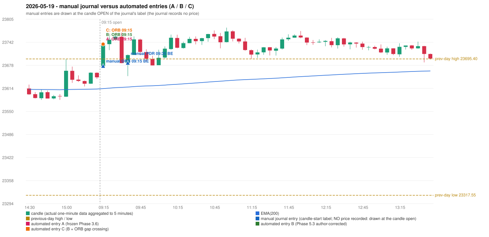

# 2026-05-19 (Tuesday) - manual journal versus the automated configurations

> SYNTHETIC index-point P&L; no real option P&L; costs illustrative (Rs 70 per trade + slippage scenarios). Configurations A / B / C are never combined.

## Session

* Open 23675.3; previous official close 23649.95; gap +25.35; previous-day high / low 23695.4 / 23317.55
* First 5-minute candle (09:15-09:20): O23675.3 H23739.75 L23675.3 C23734.8, GREEN, body 92.3%; EMA(200) at the first candle 23613.22; previous session's last close 23644.45 vs its EMA 23611.99

## Manual journal

row 123: ORB labelled 09:15, outcome BE; row 124: PDR labelled 09:35, outcome BE

## Configuration A

Candidate signals (confirmed): 09:20 ORB/Method 1 LONG [EXECUTED: trade 1: T1_THEN_BUFFER_STOP]; 09:20 ORB/Method 2 LONG [MERGED_SAME_STRATEGY_METHOD: traded as another method of the same strategy/direction in the same minute]; 09:35 IRF/Method 1 SHORT [IGNORED: DAY_FINISHED]; 09:45 PDR/PDR LONG [IGNORED: DAY_FINISHED]; 09:50 IRF/Method 1 SHORT [IGNORED: DAY_FINISHED]; 10:20 IRF/Method 1 SHORT [IGNORED: DAY_FINISHED]; 10:50 IRF/Method 2B SHORT [IGNORED: DAY_FINISHED]; 11:05 IRF/Method 2B SHORT [IGNORED: DAY_FINISHED]; 11:15 IRF/Method 1 SHORT [IGNORED: DAY_FINISHED]; 12:05 IRF/Method 2B SHORT [IGNORED: DAY_FINISHED]; 12:25 IRF/Method 1 SHORT [IGNORED: DAY_FINISHED]; 12:25 IRF/Method 2B SHORT [IGNORED: DAY_FINISHED]; 12:35 IRF/Method 1 SHORT [IGNORED: DAY_FINISHED]; 12:45 IRF/Method 1 SHORT [IGNORED: DAY_FINISHED]

Strategies with no confirmed signal: PDS: no setup record (the strategy's trigger event never occurred) | RF: RF INCOMPLETE_AT_EOD NO_RETURN_INSIDE_BEFORE_SESSION_END

| trade | strategy / method | dir | signal -> fill | entry | stop / T1 / T2 | leg 1 | leg 2 | outcome | gross Rs | net Rs (70, 0) | net Rs (70, 1.0) |
|---|---|---|---|---|---|---|---|---|---|---|---|
| 1 | ORB/Method 1 | LONG | 09:20 -> 09:20 | 23736.45 | 23706.45 / 23763.45 / 23796.45 | 09:27 @ 23763.45 | 09:32 @ 23730.45 | T1_THEN_BUFFER_STOP | 4,095 | 4,025 | 3,245 |

Selection: This ORB Method 1 signal was the earliest executable signal of the day: 0 confirmed signal(s) earlier, 1 other in the same minute. 12 later confirmed signal(s) (IRF x11, PDR x1) are logged as ignored or rejected. State of the other four engines at that moment: [IRF: no setup record before this time (a base condition was not met, or nothing triggered)] [PDR: no setup record before this time (a base condition was not met, or nothing triggered)] [PDS: no setup record before this time (a base condition was not met, or nothing triggered)] [RF: no setup record before this time (a base condition was not met, or nothing triggered)]

* Journal row 123 (ORB 09:15): **STRICT** match with 20260519-1-ORB (delta +0 min); outcome BE vs automated T1_THEN_BUFFER_STOP (same class)
* Journal row 124 (PDR 09:35): **UNMATCHED_MANUAL**; earliest cause DIFFERENT_STRATEGY_SELECTED (+ PORTFOLIO_CONTROLLER_CONSTRAINT): the controller took ORB Method 1 (signal 09:20) first; the PDR signal at 09:45 was IGNORED: DAY_FINISHED

## Configuration B

Candidate signals (confirmed): 09:20 ORB/Method 1 LONG [EXECUTED: trade 1: T1_THEN_BUFFER_STOP]; 09:20 ORB/Method 2 LONG [MERGED_SAME_STRATEGY_METHOD: traded as another method of the same strategy/direction in the same minute]; 09:35 IRF/Method 1 SHORT [IGNORED: DAY_FINISHED]; 09:45 PDR/PDR LONG [IGNORED: DAY_FINISHED]; 09:50 IRF/Method 1 SHORT [IGNORED: DAY_FINISHED]; 10:00 IRF/Method 2A SHORT [IGNORED: DAY_FINISHED]; 10:20 IRF/Method 1 SHORT [IGNORED: DAY_FINISHED]; 10:50 IRF/Method 2B SHORT [IGNORED: DAY_FINISHED]; 11:05 IRF/Method 2B SHORT [IGNORED: DAY_FINISHED]; 11:15 IRF/Method 1 SHORT [IGNORED: DAY_FINISHED]; 12:05 IRF/Method 2B SHORT [IGNORED: DAY_FINISHED]; 12:25 IRF/Method 1 SHORT [IGNORED: DAY_FINISHED]; 12:25 IRF/Method 2B SHORT [IGNORED: DAY_FINISHED]; 12:35 IRF/Method 1 SHORT [IGNORED: DAY_FINISHED]; 12:45 IRF/Method 1 SHORT [IGNORED: DAY_FINISHED]

Strategies with no confirmed signal: PDS: no setup record (the strategy's trigger event never occurred) | RF: RF INCOMPLETE_AT_EOD NO_RETURN_INSIDE_BEFORE_SESSION_END

| trade | strategy / method | dir | signal -> fill | entry | stop / T1 / T2 | leg 1 | leg 2 | outcome | gross Rs | net Rs (70, 0) | net Rs (70, 1.0) |
|---|---|---|---|---|---|---|---|---|---|---|---|
| 1 | ORB/Method 1 | LONG | 09:20 -> 09:20 | 23736.45 | 23706.45 / 23763.45 / 23796.45 | 09:27 @ 23763.45 | 09:32 @ 23730.45 | T1_THEN_BUFFER_STOP | 4,095 | 4,025 | 3,245 |

Selection: This ORB Method 1 signal was the earliest executable signal of the day: 0 confirmed signal(s) earlier, 1 other in the same minute. 13 later confirmed signal(s) (IRF x12, PDR x1) are logged as ignored or rejected. State of the other four engines at that moment: [IRF: no setup record before this time (a base condition was not met, or nothing triggered)] [PDR: no setup record before this time (a base condition was not met, or nothing triggered)] [PDS: no setup record before this time (a base condition was not met, or nothing triggered)] [RF: no setup record before this time (a base condition was not met, or nothing triggered)]

* Journal row 123 (ORB 09:15): **STRICT** match with 20260519-1-ORB (delta +0 min); outcome BE vs automated T1_THEN_BUFFER_STOP (same class)
* Journal row 124 (PDR 09:35): **UNMATCHED_MANUAL**; earliest cause DIFFERENT_STRATEGY_SELECTED (+ PORTFOLIO_CONTROLLER_CONSTRAINT): the controller took ORB Method 1 (signal 09:20) first; the PDR signal at 09:45 was IGNORED: DAY_FINISHED

## Configuration C

Candidate signals (confirmed): 09:20 ORB/Method 1 LONG [EXECUTED: trade 1: T1_THEN_BUFFER_STOP]; 09:20 ORB/Method 2 LONG [MERGED_SAME_STRATEGY_METHOD: traded as another method of the same strategy/direction in the same minute]; 09:35 IRF/Method 1 SHORT [IGNORED: DAY_FINISHED]; 09:45 PDR/PDR LONG [IGNORED: DAY_FINISHED]; 09:50 IRF/Method 1 SHORT [IGNORED: DAY_FINISHED]; 10:00 IRF/Method 2A SHORT [IGNORED: DAY_FINISHED]; 10:20 IRF/Method 1 SHORT [IGNORED: DAY_FINISHED]; 10:50 IRF/Method 2B SHORT [IGNORED: DAY_FINISHED]; 11:05 IRF/Method 2B SHORT [IGNORED: DAY_FINISHED]; 11:15 IRF/Method 1 SHORT [IGNORED: DAY_FINISHED]; 12:05 IRF/Method 2B SHORT [IGNORED: DAY_FINISHED]; 12:25 IRF/Method 1 SHORT [IGNORED: DAY_FINISHED]; 12:25 IRF/Method 2B SHORT [IGNORED: DAY_FINISHED]; 12:35 IRF/Method 1 SHORT [IGNORED: DAY_FINISHED]; 12:45 IRF/Method 1 SHORT [IGNORED: DAY_FINISHED]

Strategies with no confirmed signal: PDS: no setup record (the strategy's trigger event never occurred) | RF: RF INCOMPLETE_AT_EOD NO_RETURN_INSIDE_BEFORE_SESSION_END

| trade | strategy / method | dir | signal -> fill | entry | stop / T1 / T2 | leg 1 | leg 2 | outcome | gross Rs | net Rs (70, 0) | net Rs (70, 1.0) |
|---|---|---|---|---|---|---|---|---|---|---|---|
| 1 | ORB/Method 1 | LONG | 09:20 -> 09:20 | 23736.45 | 23706.45 / 23763.45 / 23796.45 | 09:27 @ 23763.45 | 09:32 @ 23730.45 | T1_THEN_BUFFER_STOP | 4,095 | 4,025 | 3,245 |

Selection: This ORB Method 1 signal was the earliest executable signal of the day: 0 confirmed signal(s) earlier, 1 other in the same minute. 13 later confirmed signal(s) (IRF x12, PDR x1) are logged as ignored or rejected. State of the other four engines at that moment: [IRF: no setup record before this time (a base condition was not met, or nothing triggered)] [PDR: no setup record before this time (a base condition was not met, or nothing triggered)] [PDS: no setup record before this time (a base condition was not met, or nothing triggered)] [RF: no setup record before this time (a base condition was not met, or nothing triggered)]

* Journal row 123 (ORB 09:15): **STRICT** match with 20260519-1-ORB (delta +0 min); outcome BE vs automated T1_THEN_BUFFER_STOP (same class)
* Journal row 124 (PDR 09:35): **UNMATCHED_MANUAL**; earliest cause DIFFERENT_STRATEGY_SELECTED (+ PORTFOLIO_CONTROLLER_CONSTRAINT): the controller took ORB Method 1 (signal 09:20) first; the PDR signal at 09:45 was IGNORED: DAY_FINISHED

## Chart

