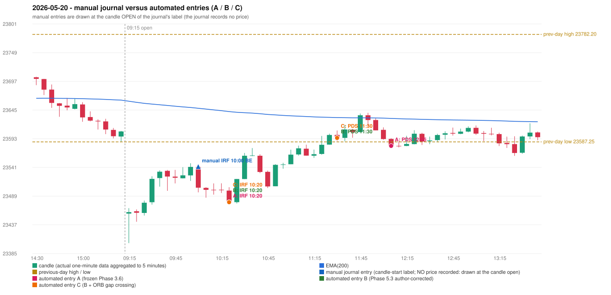

# 2026-05-20 (Wednesday) - manual journal versus the automated configurations

> SYNTHETIC index-point P&L; no real option P&L; costs illustrative (Rs 70 per trade + slippage scenarios). Configurations A / B / C are never combined.

## Session

* Open 23457.25; previous official close 23618.0; gap -160.75; previous-day high / low 23782.2 / 23587.25
* First 5-minute candle (09:15-09:20): O23457.25 H23467.1 L23403.75 C23459.9, GREEN, body 4.2%; EMA(200) at the first candle 23661.03; previous session's last close 23606.2 vs its EMA 23663.05

## Manual journal

row 125: IRF labelled 10:00, outcome BE

## Configuration A

Candidate signals (confirmed): 10:25 IRF/Method 2A SHORT [EXECUTED: trade 1: INITIAL_FULL_STOP]; 11:15 IRF/Method 2B SHORT [REJECTED: SECOND_TRADE_RESTRICTED_TO_PDR_PDS]; 12:10 IRF/Method 2A SHORT [REJECTED: SECOND_TRADE_RESTRICTED_TO_PDR_PDS]; 12:10 IRF/Method 2B SHORT [REJECTED: SECOND_TRADE_RESTRICTED_TO_PDR_PDS]; 12:10 PDS/Method 3 SHORT [EXECUTED: trade 2: INITIAL_FULL_STOP]; 12:15 PDS/Method 2 SHORT [IGNORED: POSITION_ACTIVE (signal kept for diagnostics only; never reused)]; 12:50 IRF/Method 2B SHORT [IGNORED: POSITION_ACTIVE (signal kept for diagnostics only; never reused)]; 13:05 IRF/Method 2B SHORT [IGNORED: DAY_FINISHED]; 13:20 PDS/Method 3 SHORT [IGNORED: DAY_FINISHED]; 13:45 IRF/Method 2B SHORT [IGNORED: DAY_FINISHED]; 14:35 IRF/Method 2B SHORT [IGNORED: DAY_FINISHED]; 15:05 IRF/Method 2A SHORT [IGNORED: DAY_FINISHED]; 15:05 IRF/Method 2B SHORT [IGNORED: DAY_FINISHED]

Strategies with no confirmed signal: ORB: Method 1 INVALIDATED CANDLE_QUALITY(not a strong body / wick too large); Method 2 INVALIDATED CANDLE_QUALITY | PDR: no setup record (the strategy's trigger event never occurred) | RF: no setup record (the strategy's trigger event never occurred)

| trade | strategy / method | dir | signal -> fill | entry | stop / T1 / T2 | leg 1 | leg 2 | outcome | gross Rs | net Rs (70, 0) | net Rs (70, 1.0) |
|---|---|---|---|---|---|---|---|---|---|---|---|
| 1 | IRF/Method 2A | SHORT | 10:25 -> 10:25 | 23477.95 | 23512.95 / 23450.95 / 23417.95 | 10:29 @ 23512.95 | 10:29 @ 23512.95 | INITIAL_FULL_STOP | -13,650 | -13,720 | -14,500 |
| 2 | PDS/Method 3 | SHORT | 12:10 -> 12:10 | 23580.05 | 23615.05 / 23553.05 / 23510.05 | 12:59 @ 23615.05 | 12:59 @ 23615.05 | INITIAL_FULL_STOP | -13,650 | -13,720 | -14,500 |

Selection: This IRF Method 2A signal was the earliest executable signal of the day: 0 confirmed signal(s) earlier, 0 other in the same minute. 12 later confirmed signal(s) (IRF x9, PDS x3) are logged as ignored or rejected. State of the other four engines at that moment: [ORB: Method 1 invalidated at 09:15: CANDLE_QUALITY(not a strong body / wick too large); Method 2 invalidated at 09:15: CANDLE_QUALITY] [PDR: no setup record before this time (a base condition was not met, or nothing triggered)] [PDS: no setup record before this time (a base condition was not met, or nothing triggered)] [RF: no setup record before this time (a base condition was not met, or nothing triggered)]

* Journal row 125 (IRF 10:00): **DATE_STRATEGY_ONLY**; earliest cause LATER_SIGNAL (+ ENTRY_TIME_MISMATCH): the automated IRF trade has its signal candle at 10:20 versus the manual label 10:00 (+20 minutes; outside the 15-minute tolerance)
* Automated IRF 10:20 has no strict / time-tolerant journal counterpart: LATER_SIGNAL - the journal has IRF at 10:00; the automated trade's signal candle is 10:20
* Automated PDS 12:05 has no strict / time-tolerant journal counterpart: PORTFOLIO_CONTROLLER_CONSTRAINT - second trade of the day: the controller allows a PDR / PDS re-entry after the original full stop of trade 1 (IRF Method 2A, signal candle 10:20); the journal rows of the day not matched to another trade: IRF 10:00

## Configuration B

Candidate signals (confirmed): 10:25 IRF/Method 2A SHORT [EXECUTED: trade 1: INITIAL_FULL_STOP]; 10:50 IRF/Method 2A SHORT [REJECTED: SECOND_TRADE_RESTRICTED_TO_PDR_PDS]; 11:35 PDS/Method 2 SHORT [EXECUTED: trade 2: INITIAL_FULL_STOP]; 12:10 IRF/Method 2B SHORT [IGNORED: DAY_FINISHED]; 13:20 PDS/Method 3 SHORT [IGNORED: DAY_FINISHED]; 13:25 IRF/Method 2B SHORT [IGNORED: DAY_FINISHED]; 13:25 PDS/Method 2 SHORT [IGNORED: DAY_FINISHED]; 13:30 PDS/Method 1 SHORT [IGNORED: DAY_FINISHED]; 13:45 PDS/Method 1 SHORT [IGNORED: DAY_FINISHED]

Strategies with no confirmed signal: ORB: Method 1 INVALIDATED CANDLE_QUALITY(not a strong body / wick too large); Method 2 INVALIDATED CANDLE_QUALITY | PDR: no setup record (the strategy's trigger event never occurred) | RF: no setup record (the strategy's trigger event never occurred)

| trade | strategy / method | dir | signal -> fill | entry | stop / T1 / T2 | leg 1 | leg 2 | outcome | gross Rs | net Rs (70, 0) | net Rs (70, 1.0) |
|---|---|---|---|---|---|---|---|---|---|---|---|
| 1 | IRF/Method 2A | SHORT | 10:25 -> 10:25 | 23477.95 | 23512.95 / 23450.95 / 23417.95 | 10:29 @ 23512.95 | 10:29 @ 23512.95 | INITIAL_FULL_STOP | -13,650 | -13,720 | -14,500 |
| 2 | PDS/Method 2 | SHORT | 11:35 -> 11:35 | 23594.5 | 23629.5 / 23567.5 / 23524.5 | 11:49 @ 23629.5 | 11:49 @ 23629.5 | INITIAL_FULL_STOP | -13,650 | -13,720 | -14,500 |

Selection: This IRF Method 2A signal was the earliest executable signal of the day: 0 confirmed signal(s) earlier, 0 other in the same minute. 8 later confirmed signal(s) (IRF x3, PDS x5) are logged as ignored or rejected. State of the other four engines at that moment: [ORB: Method 1 invalidated at 09:15: CANDLE_QUALITY(not a strong body / wick too large); Method 2 invalidated at 09:15: CANDLE_QUALITY] [PDR: no setup record before this time (a base condition was not met, or nothing triggered)] [PDS: no setup record before this time (a base condition was not met, or nothing triggered)] [RF: no setup record before this time (a base condition was not met, or nothing triggered)]

* Journal row 125 (IRF 10:00): **DATE_STRATEGY_ONLY**; earliest cause LATER_SIGNAL (+ ENTRY_TIME_MISMATCH): the automated IRF trade has its signal candle at 10:20 versus the manual label 10:00 (+20 minutes; outside the 15-minute tolerance)
* Automated IRF 10:20 has no strict / time-tolerant journal counterpart: LATER_SIGNAL - the journal has IRF at 10:00; the automated trade's signal candle is 10:20
* Automated PDS 11:30 has no strict / time-tolerant journal counterpart: PORTFOLIO_CONTROLLER_CONSTRAINT - second trade of the day: the controller allows a PDR / PDS re-entry after the original full stop of trade 1 (IRF Method 2A, signal candle 10:20); the journal rows of the day not matched to another trade: IRF 10:00

## Configuration C

Candidate signals (confirmed): 10:25 IRF/Method 2A SHORT [EXECUTED: trade 1: INITIAL_FULL_STOP]; 10:50 IRF/Method 2A SHORT [REJECTED: SECOND_TRADE_RESTRICTED_TO_PDR_PDS]; 11:35 PDS/Method 2 SHORT [EXECUTED: trade 2: INITIAL_FULL_STOP]; 12:10 IRF/Method 2B SHORT [IGNORED: DAY_FINISHED]; 13:20 PDS/Method 3 SHORT [IGNORED: DAY_FINISHED]; 13:25 IRF/Method 2B SHORT [IGNORED: DAY_FINISHED]; 13:25 PDS/Method 2 SHORT [IGNORED: DAY_FINISHED]; 13:30 PDS/Method 1 SHORT [IGNORED: DAY_FINISHED]; 13:45 PDS/Method 1 SHORT [IGNORED: DAY_FINISHED]

Strategies with no confirmed signal: ORB: Method 1 INVALIDATED CANDLE_QUALITY(not a strong body / wick too large); Method 2 INVALIDATED CANDLE_QUALITY | PDR: no setup record (the strategy's trigger event never occurred) | RF: no setup record (the strategy's trigger event never occurred)

| trade | strategy / method | dir | signal -> fill | entry | stop / T1 / T2 | leg 1 | leg 2 | outcome | gross Rs | net Rs (70, 0) | net Rs (70, 1.0) |
|---|---|---|---|---|---|---|---|---|---|---|---|
| 1 | IRF/Method 2A | SHORT | 10:25 -> 10:25 | 23477.95 | 23512.95 / 23450.95 / 23417.95 | 10:29 @ 23512.95 | 10:29 @ 23512.95 | INITIAL_FULL_STOP | -13,650 | -13,720 | -14,500 |
| 2 | PDS/Method 2 | SHORT | 11:35 -> 11:35 | 23594.5 | 23629.5 / 23567.5 / 23524.5 | 11:49 @ 23629.5 | 11:49 @ 23629.5 | INITIAL_FULL_STOP | -13,650 | -13,720 | -14,500 |

Selection: This IRF Method 2A signal was the earliest executable signal of the day: 0 confirmed signal(s) earlier, 0 other in the same minute. 8 later confirmed signal(s) (IRF x3, PDS x5) are logged as ignored or rejected. State of the other four engines at that moment: [ORB: Method 1 invalidated at 09:15: CANDLE_QUALITY(not a strong body / wick too large); Method 2 invalidated at 09:15: CANDLE_QUALITY] [PDR: no setup record before this time (a base condition was not met, or nothing triggered)] [PDS: no setup record before this time (a base condition was not met, or nothing triggered)] [RF: no setup record before this time (a base condition was not met, or nothing triggered)]

* Journal row 125 (IRF 10:00): **DATE_STRATEGY_ONLY**; earliest cause LATER_SIGNAL (+ ENTRY_TIME_MISMATCH): the automated IRF trade has its signal candle at 10:20 versus the manual label 10:00 (+20 minutes; outside the 15-minute tolerance)
* Automated IRF 10:20 has no strict / time-tolerant journal counterpart: LATER_SIGNAL - the journal has IRF at 10:00; the automated trade's signal candle is 10:20
* Automated PDS 11:30 has no strict / time-tolerant journal counterpart: PORTFOLIO_CONTROLLER_CONSTRAINT - second trade of the day: the controller allows a PDR / PDS re-entry after the original full stop of trade 1 (IRF Method 2A, signal candle 10:20); the journal rows of the day not matched to another trade: IRF 10:00

## Chart

