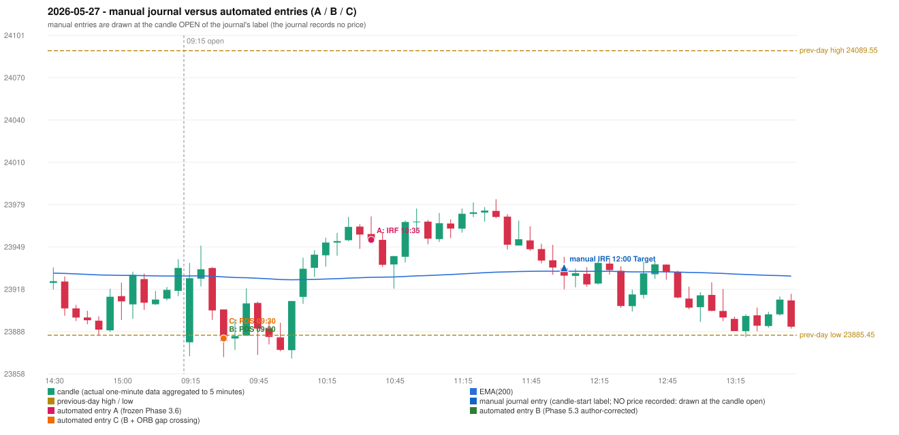

# 2026-05-27 (Wednesday) - manual journal versus the automated configurations

> SYNTHETIC index-point P&L; no real option P&L; costs illustrative (Rs 70 per trade + slippage scenarios). Configurations A / B / C are never combined.

## Session

* Open 23880.35; previous official close 23913.7; gap -33.35; previous-day high / low 24089.55 / 23885.45
* First 5-minute candle (09:15-09:20): O23880.35 H23937.4 L23870.45 C23926.35, GREEN, body 68.7%; EMA(200) at the first candle 23927.96; previous session's last close 23933.75 vs its EMA 23927.98

## Manual journal

row 129: IRF labelled 12:00, outcome Target

## Configuration A

Candidate signals (confirmed): 10:40 IRF/Method 2B SHORT [EXECUTED: trade 1: T1_THEN_BUFFER_STOP]; 10:45 IRF/Method 1 SHORT [IGNORED: POSITION_ACTIVE (signal kept for diagnostics only; never reused)]; 11:35 IRF/Method 2B SHORT [IGNORED: DAY_FINISHED]; 12:00 IRF/Method 1 SHORT [IGNORED: DAY_FINISHED]; 13:20 PDS/Method 3 SHORT [IGNORED: DAY_FINISHED]; 14:30 PDS/Method 3 SHORT [IGNORED: DAY_FINISHED]; 14:35 PDS/Method 1 SHORT [IGNORED: DAY_FINISHED]

Strategies with no confirmed signal: ORB: no setup record (the strategy's trigger event never occurred) | PDR: no setup record (the strategy's trigger event never occurred) | RF: no setup record (the strategy's trigger event never occurred)

| trade | strategy / method | dir | signal -> fill | entry | stop / T1 / T2 | leg 1 | leg 2 | outcome | gross Rs | net Rs (70, 0) | net Rs (70, 1.0) |
|---|---|---|---|---|---|---|---|---|---|---|---|
| 1 | IRF/Method 2B | SHORT | 10:40 -> 10:40 | 23953.85 | 23988.85 / 23926.85 / 23893.85 | 10:45 @ 23926.85 | 10:54 @ 23959.85 | T1_THEN_BUFFER_STOP | 4,095 | 4,025 | 3,245 |

Selection: This IRF Method 2B signal was the earliest executable signal of the day: 0 confirmed signal(s) earlier, 0 other in the same minute. 6 later confirmed signal(s) (IRF x3, PDS x3) are logged as ignored or rejected. State of the other four engines at that moment: [ORB: no setup record before this time (a base condition was not met, or nothing triggered)] [PDR: no setup record before this time (a base condition was not met, or nothing triggered)] [PDS: no setup record before this time (a base condition was not met, or nothing triggered)] [RF: no setup record before this time (a base condition was not met, or nothing triggered)]

* Journal row 129 (IRF 12:00): **DATE_STRATEGY_ONLY**; earliest cause EARLIER_SIGNAL (+ ENTRY_TIME_MISMATCH): the automated IRF trade has its signal candle at 10:35 versus the manual label 12:00 (-85 minutes; outside the 15-minute tolerance)
* Automated IRF 10:35 has no strict / time-tolerant journal counterpart: EARLIER_SIGNAL - the journal has IRF at 12:00; the automated trade's signal candle is 10:35

## Configuration B

Candidate signals (confirmed): 09:35 PDS/Method 1 SHORT [EXECUTED: trade 1: INITIAL_FULL_STOP]; 11:35 IRF/Method 2B SHORT [REJECTED: SECOND_TRADE_RESTRICTED_TO_PDR_PDS]; 13:20 PDS/Method 3 SHORT [REJECTED: ENTRY_CUTOFF_EXCEEDED(fill 13:20 IST > 13:00)]; 13:30 PDS/Method 1 SHORT [REJECTED: ENTRY_CUTOFF_EXCEEDED(fill 13:30 IST > 13:00)]; 13:45 PDS/Method 1 SHORT [REJECTED: ENTRY_CUTOFF_EXCEEDED(fill 13:45 IST > 13:00)]; 14:15 PDS/Method 1 SHORT [REJECTED: ENTRY_CUTOFF_EXCEEDED(fill 14:15 IST > 13:00)]; 14:30 PDS/Method 1 SHORT [REJECTED: ENTRY_CUTOFF_EXCEEDED(fill 14:30 IST > 13:00)]; 14:35 PDS/Method 1 SHORT [REJECTED: ENTRY_CUTOFF_EXCEEDED(fill 14:35 IST > 13:00)]; 14:45 PDS/Method 1 SHORT [REJECTED: ENTRY_CUTOFF_EXCEEDED(fill 14:45 IST > 13:00)]; 15:05 PDS/Method 1 SHORT [REJECTED: ENTRY_CUTOFF_EXCEEDED(fill 15:05 IST > 13:00)]

Strategies with no confirmed signal: ORB: no setup record (the strategy's trigger event never occurred) | PDR: no setup record (the strategy's trigger event never occurred) | RF: no setup record (the strategy's trigger event never occurred)

| trade | strategy / method | dir | signal -> fill | entry | stop / T1 / T2 | leg 1 | leg 2 | outcome | gross Rs | net Rs (70, 0) | net Rs (70, 1.0) |
|---|---|---|---|---|---|---|---|---|---|---|---|
| 1 | PDS/Method 1 | SHORT | 09:35 -> 09:35 | 23883.1 | 23918.1 / 23856.1 / 23813.1 | 09:43 @ 23918.1 | 09:43 @ 23918.1 | INITIAL_FULL_STOP | -13,650 | -13,720 | -14,500 |

Selection: This PDS Method 1 signal was the earliest executable signal of the day: 0 confirmed signal(s) earlier, 0 other in the same minute. 9 later confirmed signal(s) (IRF x1, PDS x8) are logged as ignored or rejected. State of the other four engines at that moment: [IRF: no setup record before this time (a base condition was not met, or nothing triggered)] [ORB: no setup record before this time (a base condition was not met, or nothing triggered)] [PDR: no setup record before this time (a base condition was not met, or nothing triggered)] [RF: no setup record before this time (a base condition was not met, or nothing triggered)]

* Journal row 129 (IRF 12:00): **UNMATCHED_MANUAL**; earliest cause EARLIER_SIGNAL (+ ENTRY_TIME_MISMATCH): the nearest automated IRF signal is at 11:35 (candle 11:30) versus the manual label 12:00; it was REJECTED: SECOND_TRADE_RESTRICTED_TO_PDR_PDS
* Automated PDS 09:30 has no strict / time-tolerant journal counterpart: DIFFERENT_STRATEGY_SELECTED - the journal traded IRF 12:00; the automated controller took PDS Method 1 (candle 09:30) as the first valid signal

## Configuration C

Candidate signals (confirmed): 09:35 PDS/Method 1 SHORT [EXECUTED: trade 1: INITIAL_FULL_STOP]; 11:35 IRF/Method 2B SHORT [REJECTED: SECOND_TRADE_RESTRICTED_TO_PDR_PDS]; 13:20 PDS/Method 3 SHORT [REJECTED: ENTRY_CUTOFF_EXCEEDED(fill 13:20 IST > 13:00)]; 13:30 PDS/Method 1 SHORT [REJECTED: ENTRY_CUTOFF_EXCEEDED(fill 13:30 IST > 13:00)]; 13:45 PDS/Method 1 SHORT [REJECTED: ENTRY_CUTOFF_EXCEEDED(fill 13:45 IST > 13:00)]; 14:15 PDS/Method 1 SHORT [REJECTED: ENTRY_CUTOFF_EXCEEDED(fill 14:15 IST > 13:00)]; 14:30 PDS/Method 1 SHORT [REJECTED: ENTRY_CUTOFF_EXCEEDED(fill 14:30 IST > 13:00)]; 14:35 PDS/Method 1 SHORT [REJECTED: ENTRY_CUTOFF_EXCEEDED(fill 14:35 IST > 13:00)]; 14:45 PDS/Method 1 SHORT [REJECTED: ENTRY_CUTOFF_EXCEEDED(fill 14:45 IST > 13:00)]; 15:05 PDS/Method 1 SHORT [REJECTED: ENTRY_CUTOFF_EXCEEDED(fill 15:05 IST > 13:00)]

Strategies with no confirmed signal: ORB: no setup record (the strategy's trigger event never occurred) | PDR: no setup record (the strategy's trigger event never occurred) | RF: no setup record (the strategy's trigger event never occurred)

| trade | strategy / method | dir | signal -> fill | entry | stop / T1 / T2 | leg 1 | leg 2 | outcome | gross Rs | net Rs (70, 0) | net Rs (70, 1.0) |
|---|---|---|---|---|---|---|---|---|---|---|---|
| 1 | PDS/Method 1 | SHORT | 09:35 -> 09:35 | 23883.1 | 23918.1 / 23856.1 / 23813.1 | 09:43 @ 23918.1 | 09:43 @ 23918.1 | INITIAL_FULL_STOP | -13,650 | -13,720 | -14,500 |

Selection: This PDS Method 1 signal was the earliest executable signal of the day: 0 confirmed signal(s) earlier, 0 other in the same minute. 9 later confirmed signal(s) (IRF x1, PDS x8) are logged as ignored or rejected. State of the other four engines at that moment: [IRF: no setup record before this time (a base condition was not met, or nothing triggered)] [ORB: no setup record before this time (a base condition was not met, or nothing triggered)] [PDR: no setup record before this time (a base condition was not met, or nothing triggered)] [RF: no setup record before this time (a base condition was not met, or nothing triggered)]

* Journal row 129 (IRF 12:00): **UNMATCHED_MANUAL**; earliest cause EARLIER_SIGNAL (+ ENTRY_TIME_MISMATCH): the nearest automated IRF signal is at 11:35 (candle 11:30) versus the manual label 12:00; it was REJECTED: SECOND_TRADE_RESTRICTED_TO_PDR_PDS
* Automated PDS 09:30 has no strict / time-tolerant journal counterpart: DIFFERENT_STRATEGY_SELECTED - the journal traded IRF 12:00; the automated controller took PDS Method 1 (candle 09:30) as the first valid signal

## Chart

