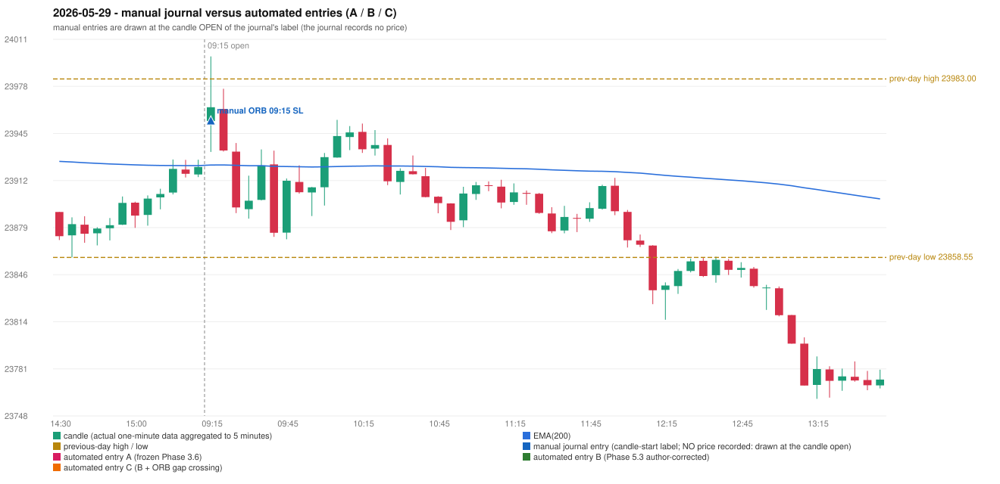

# 2026-05-29 (Friday) - manual journal versus the automated configurations

> SYNTHETIC index-point P&L; no real option P&L; costs illustrative (Rs 70 per trade + slippage scenarios). Configurations A / B / C are never combined.

## Session

* Open 23953.65; previous official close 23907.15; gap +46.50; previous-day high / low 23983.0 / 23858.55
* First 5-minute candle (09:15-09:20): O23953.65 H23998.7 L23932.1 C23963.3, GREEN, body 14.5%; EMA(200) at the first candle 23922.96; previous session's last close 23921.6 vs its EMA 23922.56

## Manual journal

row 130: ORB labelled 09:15, outcome SL

## Configuration A

Candidate signals (confirmed): none

Strategies with no confirmed signal: IRF: no setup record (the strategy's trigger event never occurred) | ORB: Gap/200DMA INVALIDATED CANDLE_QUALITY_OR_REJECTION_WICK; Method 2 INVALIDATED TREND:EMA_PREV_SESSION_CLOSE wrong side | PDR: PDR INVALIDATED OPEN_NOT_STRICTLY_ABOVE_ZONE | PDS: no setup record (the strategy's trigger event never occurred) | RF: RF INVALIDATED TREND:EMA_PREV_SESSION_CLOSE wrong side

No trade: final day state READY_FOR_FIRST_TRADE. No strategy qualified.

* Journal row 130 (ORB 09:15): **UNMATCHED_MANUAL**; earliest cause CANDLE_STRENGTH_MISMATCH: first candle GREEN O23953.65 H23998.7 L23932.1 C23963.3 (body 14.5%); direction ASSUMED from the colour (the journal has no direction); closest method Gap/200DMA (1 failing predicate(s)): first failing 'candle_shape' - body 14.5% opposite wick 53.2% close location 46.8%; rejection wick flag True; all methods: Method 1: 3 fail (level_broken); Method 2: 3 fail (trend); Gap/200DMA: 1 fail (candle_shape)

## Configuration B

Candidate signals (confirmed): none

Strategies with no confirmed signal: IRF: no setup record (the strategy's trigger event never occurred) | ORB: Gap/200DMA INVALIDATED CANDLE_QUALITY_OR_REJECTION_WICK; Method 2 INVALIDATED TREND:EMA_PREV_SESSION_CLOSE wrong side | PDR: PDR INVALIDATED OPEN_NOT_STRICTLY_ABOVE_ZONE | PDS: no setup record (the strategy's trigger event never occurred) | RF: RF INVALIDATED TREND:EMA_PREV_SESSION_CLOSE wrong side

No trade: final day state READY_FOR_FIRST_TRADE. No strategy qualified.

* Journal row 130 (ORB 09:15): **UNMATCHED_MANUAL**; earliest cause CANDLE_STRENGTH_MISMATCH: first candle GREEN O23953.65 H23998.7 L23932.1 C23963.3 (body 14.5%); direction ASSUMED from the colour (the journal has no direction); closest method Gap/200DMA (1 failing predicate(s)): first failing 'candle_shape' - body 14.5% opposite wick 53.2% close location 46.8%; rejection wick flag True; all methods: Method 1: 3 fail (level_broken); Method 2: 3 fail (trend); Gap/200DMA: 1 fail (candle_shape)

## Configuration C

Candidate signals (confirmed): none

Strategies with no confirmed signal: IRF: no setup record (the strategy's trigger event never occurred) | ORB: Gap/200DMA INVALIDATED CANDLE_QUALITY_OR_REJECTION_WICK; Method 2 INVALIDATED TREND:EMA_PREV_SESSION_CLOSE wrong side | PDR: PDR INVALIDATED OPEN_NOT_STRICTLY_ABOVE_ZONE | PDS: no setup record (the strategy's trigger event never occurred) | RF: RF INVALIDATED TREND:EMA_PREV_SESSION_CLOSE wrong side

No trade: final day state READY_FOR_FIRST_TRADE. No strategy qualified.

* Journal row 130 (ORB 09:15): **UNMATCHED_MANUAL**; earliest cause CANDLE_STRENGTH_MISMATCH: first candle GREEN O23953.65 H23998.7 L23932.1 C23963.3 (body 14.5%); direction ASSUMED from the colour (the journal has no direction); closest method Gap/200DMA (1 failing predicate(s)): first failing 'candle_shape' - body 14.5% opposite wick 53.2% close location 46.8%; rejection wick flag True; all methods: Method 1: 3 fail (level_broken); Method 2: 3 fail (trend); Gap/200DMA: 1 fail (candle_shape)

## Chart

