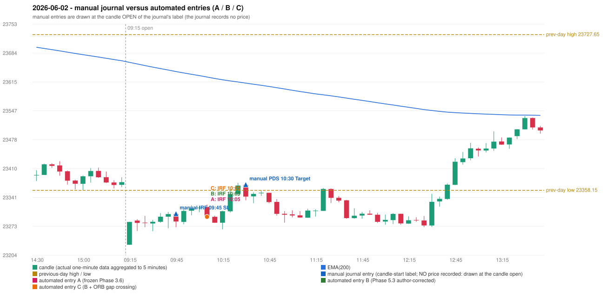

# 2026-06-02 (Tuesday) - manual journal versus the automated configurations

> SYNTHETIC index-point P&L; no real option P&L; costs illustrative (Rs 70 per trade + slippage scenarios). Configurations A / B / C are never combined.

## Session

* Open 23229.15; previous official close 23382.6; gap -153.45; previous-day high / low 23727.65 / 23358.15
* First 5-minute candle (09:15-09:20): O23229.15 H23283.65 L23229.15 C23283.2, GREEN, body 99.2%; EMA(200) at the first candle 23661.84; previous session's last close 23377.65 vs its EMA 23665.65

## Manual journal

row 132: IRF labelled 09:45, outcome SL; row 133: PDS labelled 10:30, outcome Target

## Configuration A

Candidate signals (confirmed): 10:10 IRF/Method 2B SHORT [EXECUTED: trade 1: T1_THEN_BUFFER_STOP]; 10:15 IRF/Method 1 SHORT [IGNORED: POSITION_ACTIVE (signal kept for diagnostics only; never reused)]; 10:55 IRF/Method 2A SHORT [IGNORED: DAY_FINISHED]; 10:55 PDS/Method 3 SHORT [IGNORED: DAY_FINISHED]; 11:40 IRF/Method 2A SHORT [IGNORED: DAY_FINISHED]; 11:40 IRF/Method 2B SHORT [IGNORED: DAY_FINISHED]; 12:00 IRF/Method 1 SHORT [IGNORED: DAY_FINISHED]; 12:00 PDS/Method 3 SHORT [IGNORED: DAY_FINISHED]; 12:15 IRF/Method 1 SHORT [IGNORED: DAY_FINISHED]; 12:30 IRF/Method 1 SHORT [IGNORED: DAY_FINISHED]; 14:40 IRF/Method 2A SHORT [IGNORED: DAY_FINISHED]

Strategies with no confirmed signal: ORB: Method 1 INVALIDATED CANDLE_QUALITY(not a strong body / wick too large); Method 2 INVALIDATED CANDLE_QUALITY | PDR: no setup record (the strategy's trigger event never occurred) | RF: no setup record (the strategy's trigger event never occurred)

| trade | strategy / method | dir | signal -> fill | entry | stop / T1 / T2 | leg 1 | leg 2 | outcome | gross Rs | net Rs (70, 0) | net Rs (70, 1.0) |
|---|---|---|---|---|---|---|---|---|---|---|---|
| 1 | IRF/Method 2B | SHORT | 10:10 -> 10:10 | 23295.45 | 23330.45 / 23268.45 / 23235.45 | 10:16 @ 23268.45 | 10:18 @ 23301.45 | T1_THEN_BUFFER_STOP | 4,095 | 4,025 | 3,245 |

Selection: This IRF Method 2B signal was the earliest executable signal of the day: 0 confirmed signal(s) earlier, 0 other in the same minute. 10 later confirmed signal(s) (IRF x8, PDS x2) are logged as ignored or rejected. State of the other four engines at that moment: [ORB: Method 1 invalidated at 09:15: CANDLE_QUALITY(not a strong body / wick too large); Method 2 invalidated at 09:15: CANDLE_QUALITY] [PDR: no setup record before this time (a base condition was not met, or nothing triggered)] [PDS: no setup record before this time (a base condition was not met, or nothing triggered)] [RF: no setup record before this time (a base condition was not met, or nothing triggered)]

* Journal row 132 (IRF 09:45): **DATE_STRATEGY_ONLY**; earliest cause LATER_SIGNAL (+ ENTRY_TIME_MISMATCH): the automated IRF trade has its signal candle at 10:05 versus the manual label 09:45 (+20 minutes; outside the 15-minute tolerance)
* Journal row 133 (PDS 10:30): **UNMATCHED_MANUAL**; earliest cause LATER_SIGNAL (+ ENTRY_TIME_MISMATCH): the nearest automated PDS signal is at 10:55 (candle 10:50) versus the manual label 10:30; it was IGNORED: DAY_FINISHED
* Automated IRF 10:05 has no strict / time-tolerant journal counterpart: LATER_SIGNAL - the journal has IRF at 09:45; the automated trade's signal candle is 10:05

## Configuration B

Candidate signals (confirmed): 10:10 IRF/Method 2B SHORT [EXECUTED: trade 1: T1_THEN_BUFFER_STOP]; 10:15 IRF/Method 1 SHORT [IGNORED: POSITION_ACTIVE (signal kept for diagnostics only; never reused)]; 10:35 PDS/Method 1 SHORT [IGNORED: DAY_FINISHED]; 10:50 IRF/Method 2A SHORT [IGNORED: DAY_FINISHED]; 11:30 PDS/Method 1 SHORT [IGNORED: DAY_FINISHED]; 11:40 IRF/Method 2A SHORT [IGNORED: DAY_FINISHED]; 11:40 IRF/Method 2B SHORT [IGNORED: DAY_FINISHED]; 12:00 IRF/Method 1 SHORT [IGNORED: DAY_FINISHED]; 12:15 IRF/Method 1 SHORT [IGNORED: DAY_FINISHED]; 12:30 IRF/Method 1 SHORT [IGNORED: DAY_FINISHED]

Strategies with no confirmed signal: ORB: Method 1 INVALIDATED CANDLE_QUALITY(not a strong body / wick too large); Method 2 INVALIDATED CANDLE_QUALITY | PDR: no setup record (the strategy's trigger event never occurred) | RF: no setup record (the strategy's trigger event never occurred)

| trade | strategy / method | dir | signal -> fill | entry | stop / T1 / T2 | leg 1 | leg 2 | outcome | gross Rs | net Rs (70, 0) | net Rs (70, 1.0) |
|---|---|---|---|---|---|---|---|---|---|---|---|
| 1 | IRF/Method 2B | SHORT | 10:10 -> 10:10 | 23295.45 | 23330.45 / 23268.45 / 23235.45 | 10:16 @ 23268.45 | 10:18 @ 23301.45 | T1_THEN_BUFFER_STOP | 4,095 | 4,025 | 3,245 |

Selection: This IRF Method 2B signal was the earliest executable signal of the day: 0 confirmed signal(s) earlier, 0 other in the same minute. 9 later confirmed signal(s) (IRF x7, PDS x2) are logged as ignored or rejected. State of the other four engines at that moment: [ORB: Method 1 invalidated at 09:15: CANDLE_QUALITY(not a strong body / wick too large); Method 2 invalidated at 09:15: CANDLE_QUALITY] [PDR: no setup record before this time (a base condition was not met, or nothing triggered)] [PDS: no setup record before this time (a base condition was not met, or nothing triggered)] [RF: no setup record before this time (a base condition was not met, or nothing triggered)]

* Journal row 132 (IRF 09:45): **DATE_STRATEGY_ONLY**; earliest cause LATER_SIGNAL (+ ENTRY_TIME_MISMATCH): the automated IRF trade has its signal candle at 10:05 versus the manual label 09:45 (+20 minutes; outside the 15-minute tolerance)
* Journal row 133 (PDS 10:30): **UNMATCHED_MANUAL**; earliest cause DIFFERENT_STRATEGY_SELECTED (+ PORTFOLIO_CONTROLLER_CONSTRAINT): the controller took IRF Method 2B (signal 10:10) first; the PDS signal at 10:35 was IGNORED: DAY_FINISHED
* Automated IRF 10:05 has no strict / time-tolerant journal counterpart: LATER_SIGNAL - the journal has IRF at 09:45; the automated trade's signal candle is 10:05

## Configuration C

Candidate signals (confirmed): 10:10 IRF/Method 2B SHORT [EXECUTED: trade 1: T1_THEN_BUFFER_STOP]; 10:15 IRF/Method 1 SHORT [IGNORED: POSITION_ACTIVE (signal kept for diagnostics only; never reused)]; 10:35 PDS/Method 1 SHORT [IGNORED: DAY_FINISHED]; 10:50 IRF/Method 2A SHORT [IGNORED: DAY_FINISHED]; 11:30 PDS/Method 1 SHORT [IGNORED: DAY_FINISHED]; 11:40 IRF/Method 2A SHORT [IGNORED: DAY_FINISHED]; 11:40 IRF/Method 2B SHORT [IGNORED: DAY_FINISHED]; 12:00 IRF/Method 1 SHORT [IGNORED: DAY_FINISHED]; 12:15 IRF/Method 1 SHORT [IGNORED: DAY_FINISHED]; 12:30 IRF/Method 1 SHORT [IGNORED: DAY_FINISHED]

Strategies with no confirmed signal: ORB: Method 1 INVALIDATED CANDLE_QUALITY(not a strong body / wick too large); Method 2 INVALIDATED CANDLE_QUALITY | PDR: no setup record (the strategy's trigger event never occurred) | RF: no setup record (the strategy's trigger event never occurred)

| trade | strategy / method | dir | signal -> fill | entry | stop / T1 / T2 | leg 1 | leg 2 | outcome | gross Rs | net Rs (70, 0) | net Rs (70, 1.0) |
|---|---|---|---|---|---|---|---|---|---|---|---|
| 1 | IRF/Method 2B | SHORT | 10:10 -> 10:10 | 23295.45 | 23330.45 / 23268.45 / 23235.45 | 10:16 @ 23268.45 | 10:18 @ 23301.45 | T1_THEN_BUFFER_STOP | 4,095 | 4,025 | 3,245 |

Selection: This IRF Method 2B signal was the earliest executable signal of the day: 0 confirmed signal(s) earlier, 0 other in the same minute. 9 later confirmed signal(s) (IRF x7, PDS x2) are logged as ignored or rejected. State of the other four engines at that moment: [ORB: Method 1 invalidated at 09:15: CANDLE_QUALITY(not a strong body / wick too large); Method 2 invalidated at 09:15: CANDLE_QUALITY] [PDR: no setup record before this time (a base condition was not met, or nothing triggered)] [PDS: no setup record before this time (a base condition was not met, or nothing triggered)] [RF: no setup record before this time (a base condition was not met, or nothing triggered)]

* Journal row 132 (IRF 09:45): **DATE_STRATEGY_ONLY**; earliest cause LATER_SIGNAL (+ ENTRY_TIME_MISMATCH): the automated IRF trade has its signal candle at 10:05 versus the manual label 09:45 (+20 minutes; outside the 15-minute tolerance)
* Journal row 133 (PDS 10:30): **UNMATCHED_MANUAL**; earliest cause DIFFERENT_STRATEGY_SELECTED (+ PORTFOLIO_CONTROLLER_CONSTRAINT): the controller took IRF Method 2B (signal 10:10) first; the PDS signal at 10:35 was IGNORED: DAY_FINISHED
* Automated IRF 10:05 has no strict / time-tolerant journal counterpart: LATER_SIGNAL - the journal has IRF at 09:45; the automated trade's signal candle is 10:05

## Chart

