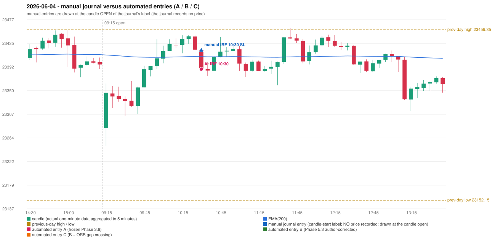

# 2026-06-04 (Thursday) - manual journal versus the automated configurations

> SYNTHETIC index-point P&L; no real option P&L; costs illustrative (Rs 70 per trade + slippage scenarios). Configurations A / B / C are never combined.

## Session

* Open 23282.45; previous official close 23405.6; gap -123.15; previous-day high / low 23459.35 / 23152.15
* First 5-minute candle (09:15-09:20): O23282.45 H23362.5 L23249.6 C23345.9, GREEN, body 56.2%; EMA(200) at the first candle 23413.94; previous session's last close 23396.95 vs its EMA 23414.62

## Manual journal

row 135: IRF labelled 10:30, outcome SL

## Configuration A

Candidate signals (confirmed): 10:35 IRF/Method 2A SHORT [EXECUTED: trade 1: INITIAL_FULL_STOP]; 10:35 IRF/Method 2B SHORT [MERGED_SAME_STRATEGY_METHOD: traded as another method of the same strategy/direction in the same minute]; 11:45 IRF/Method 2B SHORT [REJECTED: SECOND_TRADE_RESTRICTED_TO_PDR_PDS]; 13:15 IRF/Method 1 SHORT [REJECTED: SECOND_TRADE_RESTRICTED_TO_PDR_PDS]; 13:45 IRF/Method 1 SHORT [REJECTED: SECOND_TRADE_RESTRICTED_TO_PDR_PDS]; 14:55 IRF/Method 2B SHORT [REJECTED: SECOND_TRADE_RESTRICTED_TO_PDR_PDS]

Strategies with no confirmed signal: ORB: Method 2 INVALIDATED TRENDLINE_NOT_SUPPORTIVE | PDR: no setup record (the strategy's trigger event never occurred) | PDS: Method 1/2/3 INVALIDATED GAP_DOWN_OPEN_NOT_BELOW_ZONE | RF: no setup record (the strategy's trigger event never occurred)

| trade | strategy / method | dir | signal -> fill | entry | stop / T1 / T2 | leg 1 | leg 2 | outcome | gross Rs | net Rs (70, 0) | net Rs (70, 1.0) |
|---|---|---|---|---|---|---|---|---|---|---|---|
| 1 | IRF/Method 2A | SHORT | 10:35 -> 10:35 | 23388.45 | 23423.45 / 23361.45 / 23328.45 | 10:46 @ 23423.45 | 10:46 @ 23423.45 | INITIAL_FULL_STOP | -13,650 | -13,720 | -14,500 |

Selection: This IRF Method 2A signal was the earliest executable signal of the day: 0 confirmed signal(s) earlier, 1 other in the same minute. 4 later confirmed signal(s) (IRF x4) are logged as ignored or rejected. State of the other four engines at that moment: [ORB: Method 2 invalidated at 09:15: TRENDLINE_NOT_SUPPORTIVE] [PDR: no setup record before this time (a base condition was not met, or nothing triggered)] [PDS: Method 1/2/3 invalidated at 09:15: GAP_DOWN_OPEN_NOT_BELOW_ZONE] [RF: no setup record before this time (a base condition was not met, or nothing triggered)]

* Journal row 135 (IRF 10:30): **STRICT** match with 20260604-1-IRF (delta +0 min); outcome SL vs automated INITIAL_FULL_STOP (same class)

## Configuration B

Candidate signals (confirmed): 13:20 IRF/Method 2A SHORT [REJECTED: ENTRY_CUTOFF_EXCEEDED(fill 13:20 IST > 13:00)]; 13:45 IRF/Method 1 SHORT [REJECTED: ENTRY_CUTOFF_EXCEEDED(fill 13:45 IST > 13:00)]; 13:55 IRF/Method 2B SHORT [REJECTED: ENTRY_CUTOFF_EXCEEDED(fill 13:55 IST > 13:00)]

Strategies with no confirmed signal: ORB: Method 2 INVALIDATED TRENDLINE_NOT_SUPPORTIVE | PDR: no setup record (the strategy's trigger event never occurred) | PDS: Method 1/2/3 INVALIDATED GAP_DOWN_OPEN_NOT_BELOW_ZONE | RF: no setup record (the strategy's trigger event never occurred)

No trade: final day state READY_FOR_FIRST_TRADE. Signals existed but none became a trade (see the dispositions above).

* Journal row 135 (IRF 10:30): **UNMATCHED_MANUAL**; earliest cause EMA_FILTER_MISMATCH: no automated IRF signal within 60 minutes of the manual label 10:30 (nearest: 13:20, candle 13:15, 165 minutes later); an IRF Method 2A candidate at 10:30 was REJECTED by the 28-point EMA clearance (range distance 11.4, EMA EMA_BELOW_CANDLE) - PROVISIONAL_EMA_RANGE_DISTANCE

## Configuration C

Candidate signals (confirmed): 13:20 IRF/Method 2A SHORT [REJECTED: ENTRY_CUTOFF_EXCEEDED(fill 13:20 IST > 13:00)]; 13:45 IRF/Method 1 SHORT [REJECTED: ENTRY_CUTOFF_EXCEEDED(fill 13:45 IST > 13:00)]; 13:55 IRF/Method 2B SHORT [REJECTED: ENTRY_CUTOFF_EXCEEDED(fill 13:55 IST > 13:00)]

Strategies with no confirmed signal: ORB: Method 2 INVALIDATED TRENDLINE_NOT_SUPPORTIVE | PDR: no setup record (the strategy's trigger event never occurred) | PDS: Method 1/2/3 INVALIDATED GAP_DOWN_OPEN_NOT_BELOW_ZONE | RF: no setup record (the strategy's trigger event never occurred)

No trade: final day state READY_FOR_FIRST_TRADE. Signals existed but none became a trade (see the dispositions above).

* Journal row 135 (IRF 10:30): **UNMATCHED_MANUAL**; earliest cause EMA_FILTER_MISMATCH: no automated IRF signal within 60 minutes of the manual label 10:30 (nearest: 13:20, candle 13:15, 165 minutes later); an IRF Method 2A candidate at 10:30 was REJECTED by the 28-point EMA clearance (range distance 11.4, EMA EMA_BELOW_CANDLE) - PROVISIONAL_EMA_RANGE_DISTANCE

## Chart

