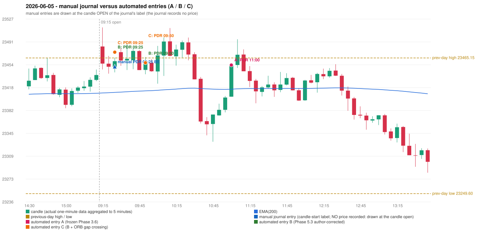

# 2026-06-05 (Friday) - manual journal versus the automated configurations

> SYNTHETIC index-point P&L; no real option P&L; costs illustrative (Rs 70 per trade + slippage scenarios). Configurations A / B / C are never combined.

## Session

* Open 23483.35; previous official close 23416.55; gap +66.80; previous-day high / low 23465.15 / 23249.6
* First 5-minute candle (09:15-09:20): O23483.35 H23513.65 L23446.85 C23456.15, RED, body 40.7%; EMA(200) at the first candle 23409.51; previous session's last close 23438.0 vs its EMA 23409.04

## Manual journal

row 136: PDR labelled 09:25, outcome BE

## Configuration A

Candidate signals (confirmed): 11:05 PDR/PDR LONG [EXECUTED: trade 1: T1_THEN_BUFFER_STOP]

Strategies with no confirmed signal: IRF: no setup record (the strategy's trigger event never occurred) | ORB: Method 2 INVALIDATED TRENDLINE_NOT_SUPPORTIVE | PDS: no setup record (the strategy's trigger event never occurred) | RF: RF INVALIDATED GAP_UP_OUTSIDE_YESTERDAYS_RANGE

| trade | strategy / method | dir | signal -> fill | entry | stop / T1 / T2 | leg 1 | leg 2 | outcome | gross Rs | net Rs (70, 0) | net Rs (70, 1.0) |
|---|---|---|---|---|---|---|---|---|---|---|---|
| 1 | PDR/PDR | LONG | 11:05 -> 11:05 | 23453.9 | 23418.9 / 23480.9 / 23523.9 | 11:06 @ 23480.9 | 11:14 @ 23447.9 | T1_THEN_BUFFER_STOP | 4,095 | 4,025 | 3,245 |

Selection: This PDR signal was the earliest executable signal of the day: 0 confirmed signal(s) earlier, 0 other in the same minute. No later signal was generated. State of the other four engines at that moment: [IRF: no setup record before this time (a base condition was not met, or nothing triggered)] [ORB: Method 2 invalidated at 09:15: TRENDLINE_NOT_SUPPORTIVE] [PDS: no setup record before this time (a base condition was not met, or nothing triggered)] [RF: RF invalidated at 09:50: GAP_UP_OUTSIDE_YESTERDAYS_RANGE]

* Journal row 136 (PDR 09:25): **DATE_STRATEGY_ONLY**; earliest cause LATER_SIGNAL (+ ENTRY_TIME_MISMATCH): the automated PDR trade has its signal candle at 11:00 versus the manual label 09:25 (+95 minutes; outside the 15-minute tolerance)
* Automated PDR 11:00 has no strict / time-tolerant journal counterpart: LATER_SIGNAL - the journal has PDR at 09:25; the automated trade's signal candle is 11:00

## Configuration B

Candidate signals (confirmed): 09:30 PDR/PDR LONG [EXECUTED: trade 1: INITIAL_FULL_STOP]; 09:45 PDR/PDR LONG [IGNORED: POSITION_ACTIVE (signal kept for diagnostics only; never reused)]; 09:55 PDR/PDR LONG [EXECUTED: trade 2: T1_THEN_BUFFER_STOP]; 10:05 PDR/PDR LONG [IGNORED: POSITION_ACTIVE (signal kept for diagnostics only; never reused)]; 10:20 PDR/PDR LONG [IGNORED: POSITION_ACTIVE (signal kept for diagnostics only; never reused)]; 11:05 PDR/PDR LONG [IGNORED: DAY_FINISHED]

Strategies with no confirmed signal: IRF: no setup record (the strategy's trigger event never occurred) | ORB: Method 2 INVALIDATED TRENDLINE_NOT_SUPPORTIVE | PDS: no setup record (the strategy's trigger event never occurred) | RF: RF INVALIDATED GAP_UP_OUTSIDE_YESTERDAYS_RANGE

| trade | strategy / method | dir | signal -> fill | entry | stop / T1 / T2 | leg 1 | leg 2 | outcome | gross Rs | net Rs (70, 0) | net Rs (70, 1.0) |
|---|---|---|---|---|---|---|---|---|---|---|---|
| 1 | PDR/PDR | LONG | 09:30 -> 09:30 | 23474.3 | 23439.3 / 23501.3 / 23544.3 | 09:50 @ 23439.3 | 09:50 @ 23439.3 | INITIAL_FULL_STOP | -13,650 | -13,720 | -14,500 |
| 2 | PDR/PDR | LONG | 09:55 -> 09:55 | 23457.5 | 23422.5 / 23484.5 / 23527.5 | 10:08 @ 23484.5 | 10:33 @ 23451.5 | T1_THEN_BUFFER_STOP | 4,095 | 4,025 | 3,245 |

Selection: This PDR signal was the earliest executable signal of the day: 0 confirmed signal(s) earlier, 0 other in the same minute. 5 later confirmed signal(s) (PDR x5) are logged as ignored or rejected. State of the other four engines at that moment: [IRF: no setup record before this time (a base condition was not met, or nothing triggered)] [ORB: Method 2 invalidated at 09:15: TRENDLINE_NOT_SUPPORTIVE] [PDS: no setup record before this time (a base condition was not met, or nothing triggered)] [RF: no setup record before this time (a base condition was not met, or nothing triggered)]

* Journal row 136 (PDR 09:25): **STRICT** match with 20260605-1-PDR (delta +0 min); outcome BE vs automated INITIAL_FULL_STOP (different class: EXIT_MANAGEMENT_MISMATCH; the journal has no exit price / time)
* Automated PDR 09:50 has no strict / time-tolerant journal counterpart: PORTFOLIO_CONTROLLER_CONSTRAINT - second trade of the day: the controller allows a PDR / PDS re-entry after the original full stop of trade 1 (PDR PDR, signal candle 09:25); the journal has no unmatched row that day

## Configuration C

Candidate signals (confirmed): 09:30 PDR/PDR LONG [EXECUTED: trade 1: INITIAL_FULL_STOP]; 09:45 PDR/PDR LONG [IGNORED: POSITION_ACTIVE (signal kept for diagnostics only; never reused)]; 09:55 PDR/PDR LONG [EXECUTED: trade 2: T1_THEN_BUFFER_STOP]; 10:05 PDR/PDR LONG [IGNORED: POSITION_ACTIVE (signal kept for diagnostics only; never reused)]; 10:20 PDR/PDR LONG [IGNORED: POSITION_ACTIVE (signal kept for diagnostics only; never reused)]; 11:05 PDR/PDR LONG [IGNORED: DAY_FINISHED]

Strategies with no confirmed signal: IRF: no setup record (the strategy's trigger event never occurred) | ORB: Method 2 INVALIDATED TRENDLINE_NOT_SUPPORTIVE | PDS: no setup record (the strategy's trigger event never occurred) | RF: RF INVALIDATED GAP_UP_OUTSIDE_YESTERDAYS_RANGE

| trade | strategy / method | dir | signal -> fill | entry | stop / T1 / T2 | leg 1 | leg 2 | outcome | gross Rs | net Rs (70, 0) | net Rs (70, 1.0) |
|---|---|---|---|---|---|---|---|---|---|---|---|
| 1 | PDR/PDR | LONG | 09:30 -> 09:30 | 23474.3 | 23439.3 / 23501.3 / 23544.3 | 09:50 @ 23439.3 | 09:50 @ 23439.3 | INITIAL_FULL_STOP | -13,650 | -13,720 | -14,500 |
| 2 | PDR/PDR | LONG | 09:55 -> 09:55 | 23457.5 | 23422.5 / 23484.5 / 23527.5 | 10:08 @ 23484.5 | 10:33 @ 23451.5 | T1_THEN_BUFFER_STOP | 4,095 | 4,025 | 3,245 |

Selection: This PDR signal was the earliest executable signal of the day: 0 confirmed signal(s) earlier, 0 other in the same minute. 5 later confirmed signal(s) (PDR x5) are logged as ignored or rejected. State of the other four engines at that moment: [IRF: no setup record before this time (a base condition was not met, or nothing triggered)] [ORB: Method 2 invalidated at 09:15: TRENDLINE_NOT_SUPPORTIVE] [PDS: no setup record before this time (a base condition was not met, or nothing triggered)] [RF: no setup record before this time (a base condition was not met, or nothing triggered)]

* Journal row 136 (PDR 09:25): **STRICT** match with 20260605-1-PDR (delta +0 min); outcome BE vs automated INITIAL_FULL_STOP (different class: EXIT_MANAGEMENT_MISMATCH; the journal has no exit price / time)
* Automated PDR 09:50 has no strict / time-tolerant journal counterpart: PORTFOLIO_CONTROLLER_CONSTRAINT - second trade of the day: the controller allows a PDR / PDS re-entry after the original full stop of trade 1 (PDR PDR, signal candle 09:25); the journal has no unmatched row that day

## Chart

