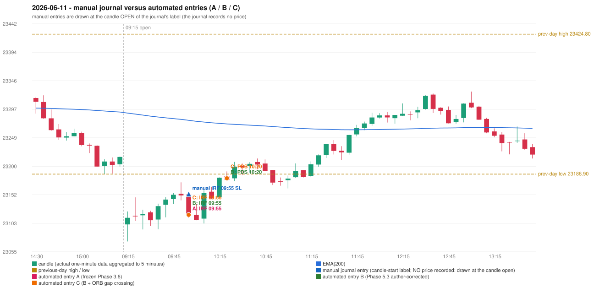

# 2026-06-11 (Thursday) - manual journal versus the automated configurations

> SYNTHETIC index-point P&L; no real option P&L; costs illustrative (Rs 70 per trade + slippage scenarios). Configurations A / B / C are never combined.

## Session

* Open 23101.35; previous official close 23214.95; gap -113.60; previous-day high / low 23424.8 / 23186.9
* First 5-minute candle (09:15-09:20): O23101.35 H23123.35 L23072.4 C23112.65, GREEN, body 22.2%; EMA(200) at the first candle 23290.67; previous session's last close 23216.1 vs its EMA 23292.46

## Manual journal

row 139: IRF labelled 09:55, outcome SL

## Configuration A

Candidate signals (confirmed): 10:00 IRF/Method 1 SHORT [EXECUTED: trade 1: INITIAL_FULL_STOP]; 10:55 IRF/Method 2B SHORT [REJECTED: SECOND_TRADE_RESTRICTED_TO_PDR_PDS]; 12:50 IRF/Method 2A SHORT [REJECTED: SECOND_TRADE_RESTRICTED_TO_PDR_PDS]; 13:05 IRF/Method 2B SHORT [REJECTED: SECOND_TRADE_RESTRICTED_TO_PDR_PDS]; 14:45 PDS/Method 3 SHORT [REJECTED: ENTRY_CUTOFF_EXCEEDED(fill 14:45 IST > 13:00)]; 15:05 PDS/Method 3 SHORT [REJECTED: ENTRY_CUTOFF_EXCEEDED(fill 15:05 IST > 13:00)]

Strategies with no confirmed signal: ORB: Method 1 INVALIDATED CANDLE_QUALITY(not a strong body / wick too large); Method 2 INVALIDATED CANDLE_QUALITY | PDR: no setup record (the strategy's trigger event never occurred) | RF: no setup record (the strategy's trigger event never occurred)

| trade | strategy / method | dir | signal -> fill | entry | stop / T1 / T2 | leg 1 | leg 2 | outcome | gross Rs | net Rs (70, 0) | net Rs (70, 1.0) |
|---|---|---|---|---|---|---|---|---|---|---|---|
| 1 | IRF/Method 1 | SHORT | 10:00 -> 10:00 | 23117.6 | 23152.6 / 23090.6 / 23057.6 | 10:08 @ 23152.6 | 10:08 @ 23152.6 | INITIAL_FULL_STOP | -13,650 | -13,720 | -14,500 |

Selection: This IRF Method 1 signal was the earliest executable signal of the day: 0 confirmed signal(s) earlier, 0 other in the same minute. 5 later confirmed signal(s) (IRF x3, PDS x2) are logged as ignored or rejected. State of the other four engines at that moment: [ORB: Method 1 invalidated at 09:15: CANDLE_QUALITY(not a strong body / wick too large); Method 2 invalidated at 09:15: CANDLE_QUALITY] [PDR: no setup record before this time (a base condition was not met, or nothing triggered)] [PDS: no setup record before this time (a base condition was not met, or nothing triggered)] [RF: no setup record before this time (a base condition was not met, or nothing triggered)]

* Journal row 139 (IRF 09:55): **STRICT** match with 20260611-1-IRF (delta +0 min); outcome SL vs automated INITIAL_FULL_STOP (same class)

## Configuration B

Candidate signals (confirmed): 10:00 IRF/Method 1 SHORT [EXECUTED: trade 1: INITIAL_FULL_STOP]; 10:00 IRF/Method 2A SHORT [MERGED_SAME_STRATEGY_METHOD: traded as another method of the same strategy/direction in the same minute]; 10:25 PDS/Method 2 SHORT [EXECUTED: trade 2: INITIAL_FULL_STOP]; 10:45 IRF/Method 2B SHORT [IGNORED: POSITION_ACTIVE (signal kept for diagnostics only; never reused)]; 14:15 IRF/Method 2A SHORT [IGNORED: DAY_FINISHED]; 14:45 IRF/Method 2A SHORT [IGNORED: DAY_FINISHED]; 14:45 PDS/Method 3 SHORT [IGNORED: DAY_FINISHED]; 15:05 PDS/Method 3 SHORT [IGNORED: DAY_FINISHED]

Strategies with no confirmed signal: ORB: Method 1 INVALIDATED CANDLE_QUALITY(not a strong body / wick too large); Method 2 INVALIDATED CANDLE_QUALITY | PDR: no setup record (the strategy's trigger event never occurred) | RF: no setup record (the strategy's trigger event never occurred)

| trade | strategy / method | dir | signal -> fill | entry | stop / T1 / T2 | leg 1 | leg 2 | outcome | gross Rs | net Rs (70, 0) | net Rs (70, 1.0) |
|---|---|---|---|---|---|---|---|---|---|---|---|
| 1 | IRF/Method 1 | SHORT | 10:00 -> 10:00 | 23117.6 | 23152.6 / 23090.6 / 23057.6 | 10:08 @ 23152.6 | 10:08 @ 23152.6 | INITIAL_FULL_STOP | -13,650 | -13,720 | -14,500 |
| 2 | PDS/Method 2 | SHORT | 10:25 -> 10:25 | 23179.75 | 23214.75 / 23152.75 / 23109.75 | 11:21 @ 23214.75 | 11:21 @ 23214.75 | INITIAL_FULL_STOP | -13,650 | -13,720 | -14,500 |

Selection: This IRF Method 1 signal was the earliest executable signal of the day: 0 confirmed signal(s) earlier, 1 other in the same minute. 6 later confirmed signal(s) (IRF x3, PDS x3) are logged as ignored or rejected. State of the other four engines at that moment: [ORB: Method 1 invalidated at 09:15: CANDLE_QUALITY(not a strong body / wick too large); Method 2 invalidated at 09:15: CANDLE_QUALITY] [PDR: no setup record before this time (a base condition was not met, or nothing triggered)] [PDS: no setup record before this time (a base condition was not met, or nothing triggered)] [RF: no setup record before this time (a base condition was not met, or nothing triggered)]

* Journal row 139 (IRF 09:55): **STRICT** match with 20260611-1-IRF (delta +0 min); outcome SL vs automated INITIAL_FULL_STOP (same class)
* Automated PDS 10:20 has no strict / time-tolerant journal counterpart: PORTFOLIO_CONTROLLER_CONSTRAINT - second trade of the day: the controller allows a PDR / PDS re-entry after the original full stop of trade 1 (IRF Method 1, signal candle 09:55); the journal has no unmatched row that day

## Configuration C

Candidate signals (confirmed): 10:00 IRF/Method 1 SHORT [EXECUTED: trade 1: INITIAL_FULL_STOP]; 10:00 IRF/Method 2A SHORT [MERGED_SAME_STRATEGY_METHOD: traded as another method of the same strategy/direction in the same minute]; 10:25 PDS/Method 2 SHORT [EXECUTED: trade 2: INITIAL_FULL_STOP]; 10:45 IRF/Method 2B SHORT [IGNORED: POSITION_ACTIVE (signal kept for diagnostics only; never reused)]; 14:15 IRF/Method 2A SHORT [IGNORED: DAY_FINISHED]; 14:45 IRF/Method 2A SHORT [IGNORED: DAY_FINISHED]; 14:45 PDS/Method 3 SHORT [IGNORED: DAY_FINISHED]; 15:05 PDS/Method 3 SHORT [IGNORED: DAY_FINISHED]

Strategies with no confirmed signal: ORB: Method 1 INVALIDATED CANDLE_QUALITY(not a strong body / wick too large); Method 2 INVALIDATED CANDLE_QUALITY | PDR: no setup record (the strategy's trigger event never occurred) | RF: no setup record (the strategy's trigger event never occurred)

| trade | strategy / method | dir | signal -> fill | entry | stop / T1 / T2 | leg 1 | leg 2 | outcome | gross Rs | net Rs (70, 0) | net Rs (70, 1.0) |
|---|---|---|---|---|---|---|---|---|---|---|---|
| 1 | IRF/Method 1 | SHORT | 10:00 -> 10:00 | 23117.6 | 23152.6 / 23090.6 / 23057.6 | 10:08 @ 23152.6 | 10:08 @ 23152.6 | INITIAL_FULL_STOP | -13,650 | -13,720 | -14,500 |
| 2 | PDS/Method 2 | SHORT | 10:25 -> 10:25 | 23179.75 | 23214.75 / 23152.75 / 23109.75 | 11:21 @ 23214.75 | 11:21 @ 23214.75 | INITIAL_FULL_STOP | -13,650 | -13,720 | -14,500 |

Selection: This IRF Method 1 signal was the earliest executable signal of the day: 0 confirmed signal(s) earlier, 1 other in the same minute. 6 later confirmed signal(s) (IRF x3, PDS x3) are logged as ignored or rejected. State of the other four engines at that moment: [ORB: Method 1 invalidated at 09:15: CANDLE_QUALITY(not a strong body / wick too large); Method 2 invalidated at 09:15: CANDLE_QUALITY] [PDR: no setup record before this time (a base condition was not met, or nothing triggered)] [PDS: no setup record before this time (a base condition was not met, or nothing triggered)] [RF: no setup record before this time (a base condition was not met, or nothing triggered)]

* Journal row 139 (IRF 09:55): **STRICT** match with 20260611-1-IRF (delta +0 min); outcome SL vs automated INITIAL_FULL_STOP (same class)
* Automated PDS 10:20 has no strict / time-tolerant journal counterpart: PORTFOLIO_CONTROLLER_CONSTRAINT - second trade of the day: the controller allows a PDR / PDS re-entry after the original full stop of trade 1 (IRF Method 1, signal candle 09:55); the journal has no unmatched row that day

## Chart

