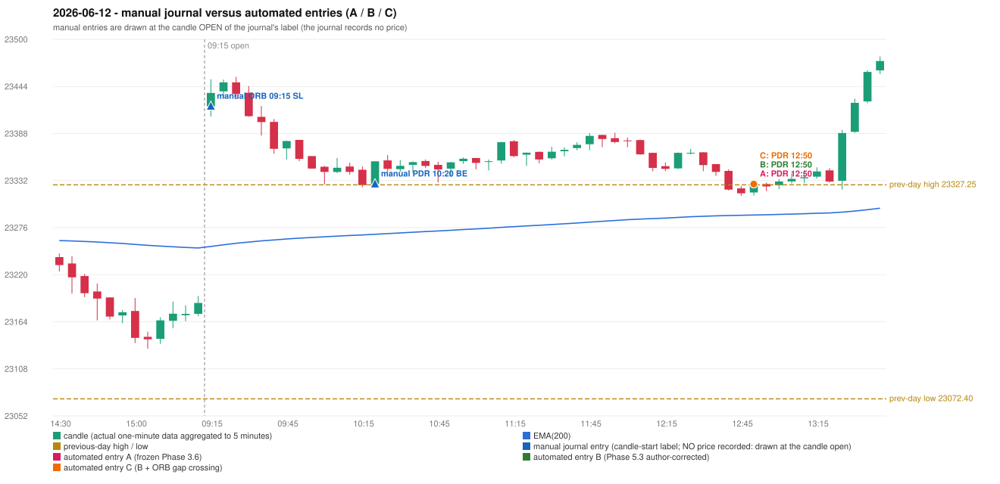

# 2026-06-12 (Friday) - manual journal versus the automated configurations

> SYNTHETIC index-point P&L; no real option P&L; costs illustrative (Rs 70 per trade + slippage scenarios). Configurations A / B / C are never combined.

## Session

* Open 23420.7; previous official close 23161.6; gap +259.10; previous-day high / low 23327.25 / 23072.4
* First 5-minute candle (09:15-09:20): O23420.7 H23452.9 L23408.5 C23436.65, GREEN, body 35.9%; EMA(200) at the first candle 23253.84; previous session's last close 23186.55 vs its EMA 23252.01

## Manual journal

row 140: ORB labelled 09:15, outcome SL; row 141: PDR labelled 10:20, outcome BE

## Configuration A

Candidate signals (confirmed): 12:55 PDR/PDR LONG [EXECUTED: trade 1: TARGET]; 13:30 PDR/PDR LONG [IGNORED: POSITION_ACTIVE (signal kept for diagnostics only; never reused)]

Strategies with no confirmed signal: IRF: Method 1/2 INCOMPLETE_AT_EOD SESSION_ENDED_BEFORE_CONFIRMATION | ORB: Gap/200DMA INVALIDATED CANDLE_QUALITY_OR_REJECTION_WICK; Method 1 INVALIDATED TREND:EMA_PREV_SESSION_CLOSE wrong side; Method 2 INVALIDATED TREND:EMA_PREV_SESSI | PDS: no setup record (the strategy's trigger event never occurred) | RF: RF INVALIDATED TREND:EMA_PREV_SESSION_CLOSE wrong side

| trade | strategy / method | dir | signal -> fill | entry | stop / T1 / T2 | leg 1 | leg 2 | outcome | gross Rs | net Rs (70, 0) | net Rs (70, 1.0) |
|---|---|---|---|---|---|---|---|---|---|---|---|
| 1 | PDR/PDR | LONG | 12:55 -> 12:55 | 23328.1 | 23293.1 / 23355.1 / 23398.1 | 13:26 @ 23355.1 | 13:30 @ 23398.1 | TARGET | 18,915 | 18,845 | 18,065 |

Selection: This PDR signal was the earliest executable signal of the day: 0 confirmed signal(s) earlier, 0 other in the same minute. 1 later confirmed signal(s) (PDR x1) are logged as ignored or rejected. State of the other four engines at that moment: [IRF: no setup record before this time (a base condition was not met, or nothing triggered)] [ORB: Method 1 invalidated at 09:15: TREND:EMA_PREV_SESSION_CLOSE wrong side; Method 2 invalidated at 09:15: TREND:EMA_PREV_SESSION_CLOSE wrong side] [PDS: no setup record before this time (a base condition was not met, or nothing triggered)] [RF: no setup record before this time (a base condition was not met, or nothing triggered)]

* Journal row 140 (ORB 09:15): **UNMATCHED_MANUAL**; earliest cause CANDLE_STRENGTH_MISMATCH: first candle GREEN O23420.7 H23452.9 L23408.5 C23436.65 (body 35.9%); direction ASSUMED from the colour (the journal has no direction); closest method Gap/200DMA (1 failing predicate(s)): first failing 'candle_shape' - body 35.9% opposite wick 36.6% close location 63.4%; rejection wick flag True; all methods: Method 1: 2 fail (trend); Method 2: 3 fail (trend); Gap/200DMA: 1 fail (candle_shape)
* Journal row 141 (PDR 10:20): **DATE_STRATEGY_ONLY**; earliest cause LATER_SIGNAL (+ ENTRY_TIME_MISMATCH): the automated PDR trade has its signal candle at 12:50 versus the manual label 10:20 (+150 minutes; outside the 15-minute tolerance)
* Automated PDR 12:50 has no strict / time-tolerant journal counterpart: LATER_SIGNAL - the journal has PDR at 10:20; the automated trade's signal candle is 12:50

## Configuration B

Candidate signals (confirmed): 12:55 PDR/PDR LONG [EXECUTED: trade 1: TARGET]; 13:05 PDR/PDR LONG [IGNORED: POSITION_ACTIVE (signal kept for diagnostics only; never reused)]; 13:35 PDR/PDR LONG [IGNORED: DAY_FINISHED]

Strategies with no confirmed signal: IRF: Method 1/2 INCOMPLETE_AT_EOD SESSION_ENDED_BEFORE_CONFIRMATION | ORB: Gap/200DMA INVALIDATED CANDLE_QUALITY_OR_REJECTION_WICK; Method 1 INVALIDATED TREND:EMA_PREV_SESSION_CLOSE wrong side; Method 2 INVALIDATED TREND:EMA_PREV_SESSI | PDS: no setup record (the strategy's trigger event never occurred) | RF: RF INVALIDATED TREND:EMA_PREV_SESSION_CLOSE wrong side

| trade | strategy / method | dir | signal -> fill | entry | stop / T1 / T2 | leg 1 | leg 2 | outcome | gross Rs | net Rs (70, 0) | net Rs (70, 1.0) |
|---|---|---|---|---|---|---|---|---|---|---|---|
| 1 | PDR/PDR | LONG | 12:55 -> 12:55 | 23328.1 | 23293.1 / 23355.1 / 23398.1 | 13:26 @ 23355.1 | 13:30 @ 23398.1 | TARGET | 18,915 | 18,845 | 18,065 |

Selection: This PDR signal was the earliest executable signal of the day: 0 confirmed signal(s) earlier, 0 other in the same minute. 2 later confirmed signal(s) (PDR x2) are logged as ignored or rejected. State of the other four engines at that moment: [IRF: no setup record before this time (a base condition was not met, or nothing triggered)] [ORB: Method 1 invalidated at 09:15: TREND:EMA_PREV_SESSION_CLOSE wrong side; Method 2 invalidated at 09:15: TREND:EMA_PREV_SESSION_CLOSE wrong side] [PDS: no setup record before this time (a base condition was not met, or nothing triggered)] [RF: no setup record before this time (a base condition was not met, or nothing triggered)]

* Journal row 140 (ORB 09:15): **UNMATCHED_MANUAL**; earliest cause CANDLE_STRENGTH_MISMATCH: first candle GREEN O23420.7 H23452.9 L23408.5 C23436.65 (body 35.9%); direction ASSUMED from the colour (the journal has no direction); closest method Gap/200DMA (1 failing predicate(s)): first failing 'candle_shape' - body 35.9% opposite wick 36.6% close location 63.4%; rejection wick flag True; all methods: Method 1: 2 fail (trend); Method 2: 3 fail (trend); Gap/200DMA: 1 fail (candle_shape)
* Journal row 141 (PDR 10:20): **DATE_STRATEGY_ONLY**; earliest cause LATER_SIGNAL (+ ENTRY_TIME_MISMATCH): the automated PDR trade has its signal candle at 12:50 versus the manual label 10:20 (+150 minutes; outside the 15-minute tolerance)
* Automated PDR 12:50 has no strict / time-tolerant journal counterpart: LATER_SIGNAL - the journal has PDR at 10:20; the automated trade's signal candle is 12:50

## Configuration C

Candidate signals (confirmed): 12:55 PDR/PDR LONG [EXECUTED: trade 1: TARGET]; 13:05 PDR/PDR LONG [IGNORED: POSITION_ACTIVE (signal kept for diagnostics only; never reused)]; 13:35 PDR/PDR LONG [IGNORED: DAY_FINISHED]

Strategies with no confirmed signal: IRF: Method 1/2 INCOMPLETE_AT_EOD SESSION_ENDED_BEFORE_CONFIRMATION | ORB: Gap/200DMA INVALIDATED CANDLE_QUALITY_OR_REJECTION_WICK; Method 1 INVALIDATED TREND:EMA_PREV_SESSION_CLOSE wrong side; Method 2 INVALIDATED TREND:EMA_PREV_SESSI | PDS: no setup record (the strategy's trigger event never occurred) | RF: RF INVALIDATED TREND:EMA_PREV_SESSION_CLOSE wrong side

| trade | strategy / method | dir | signal -> fill | entry | stop / T1 / T2 | leg 1 | leg 2 | outcome | gross Rs | net Rs (70, 0) | net Rs (70, 1.0) |
|---|---|---|---|---|---|---|---|---|---|---|---|
| 1 | PDR/PDR | LONG | 12:55 -> 12:55 | 23328.1 | 23293.1 / 23355.1 / 23398.1 | 13:26 @ 23355.1 | 13:30 @ 23398.1 | TARGET | 18,915 | 18,845 | 18,065 |

Selection: This PDR signal was the earliest executable signal of the day: 0 confirmed signal(s) earlier, 0 other in the same minute. 2 later confirmed signal(s) (PDR x2) are logged as ignored or rejected. State of the other four engines at that moment: [IRF: no setup record before this time (a base condition was not met, or nothing triggered)] [ORB: Method 1 invalidated at 09:15: TREND:EMA_PREV_SESSION_CLOSE wrong side; Method 2 invalidated at 09:15: TREND:EMA_PREV_SESSION_CLOSE wrong side] [PDS: no setup record before this time (a base condition was not met, or nothing triggered)] [RF: no setup record before this time (a base condition was not met, or nothing triggered)]

* Journal row 140 (ORB 09:15): **UNMATCHED_MANUAL**; earliest cause CANDLE_STRENGTH_MISMATCH: first candle GREEN O23420.7 H23452.9 L23408.5 C23436.65 (body 35.9%); direction ASSUMED from the colour (the journal has no direction); closest method Gap/200DMA (1 failing predicate(s)): first failing 'candle_shape' - body 35.9% opposite wick 36.6% close location 63.4%; rejection wick flag True; all methods: Method 1: 2 fail (trend); Method 2: 3 fail (trend); Gap/200DMA: 1 fail (candle_shape)
* Journal row 141 (PDR 10:20): **DATE_STRATEGY_ONLY**; earliest cause LATER_SIGNAL (+ ENTRY_TIME_MISMATCH): the automated PDR trade has its signal candle at 12:50 versus the manual label 10:20 (+150 minutes; outside the 15-minute tolerance)
* Automated PDR 12:50 has no strict / time-tolerant journal counterpart: LATER_SIGNAL - the journal has PDR at 10:20; the automated trade's signal candle is 12:50

## Chart

