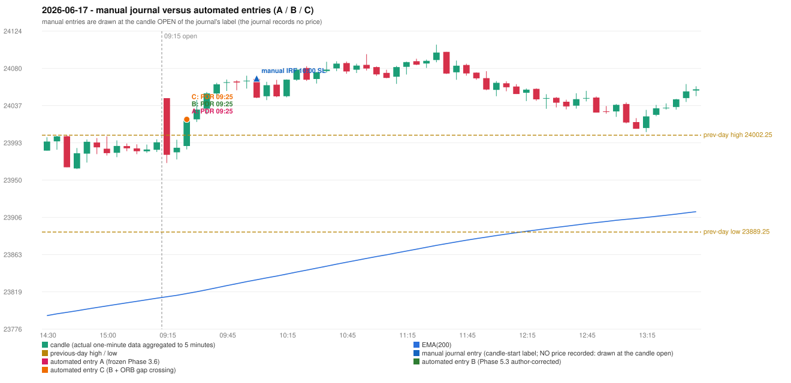

# 2026-06-17 (Wednesday) - manual journal versus the automated configurations

> SYNTHETIC index-point P&L; no real option P&L; costs illustrative (Rs 70 per trade + slippage scenarios). Configurations A / B / C are never combined.

## Session

* Open 24045.45; previous official close 23989.15; gap +56.30; previous-day high / low 24002.25 / 23889.25
* First 5-minute candle (09:15-09:20): O24045.45 H24045.45 L23969.75 C23979.35, RED, body 87.3%; EMA(200) at the first candle 23813.70; previous session's last close 23993.95 vs its EMA 23812.03

## Manual journal

row 143: IRF labelled 10:00, outcome SL

## Configuration A

Candidate signals (confirmed): 09:30 PDR/PDR LONG [EXECUTED: trade 1: TARGET]; 10:05 IRF/Method 2B SHORT [IGNORED: POSITION_ACTIVE (signal kept for diagnostics only; never reused)]; 10:50 IRF/Method 2B SHORT [IGNORED: POSITION_ACTIVE (signal kept for diagnostics only; never reused)]; 11:40 IRF/Method 2A SHORT [IGNORED: DAY_FINISHED]; 11:40 IRF/Method 2B SHORT [IGNORED: DAY_FINISHED]; 12:25 IRF/Method 1 SHORT [IGNORED: DAY_FINISHED]; 12:35 IRF/Method 1 SHORT [IGNORED: DAY_FINISHED]; 12:55 IRF/Method 1 SHORT [IGNORED: DAY_FINISHED]; 14:10 IRF/Method 1 SHORT [IGNORED: DAY_FINISHED]; 14:25 IRF/Method 1 SHORT [IGNORED: DAY_FINISHED]

Strategies with no confirmed signal: ORB: no setup record (the strategy's trigger event never occurred) | PDS: no setup record (the strategy's trigger event never occurred) | RF: no setup record (the strategy's trigger event never occurred)

| trade | strategy / method | dir | signal -> fill | entry | stop / T1 / T2 | leg 1 | leg 2 | outcome | gross Rs | net Rs (70, 0) | net Rs (70, 1.0) |
|---|---|---|---|---|---|---|---|---|---|---|---|
| 1 | PDR/PDR | LONG | 09:30 -> 09:30 | 24020.7 | 23985.7 / 24047.7 / 24090.7 | 09:38 @ 24047.7 | 10:55 @ 24090.7 | TARGET | 18,915 | 18,845 | 18,065 |

Selection: This PDR signal was the earliest executable signal of the day: 0 confirmed signal(s) earlier, 0 other in the same minute. 9 later confirmed signal(s) (IRF x9) are logged as ignored or rejected. State of the other four engines at that moment: [IRF: no setup record before this time (a base condition was not met, or nothing triggered)] [ORB: no setup record before this time (a base condition was not met, or nothing triggered)] [PDS: no setup record before this time (a base condition was not met, or nothing triggered)] [RF: no setup record before this time (a base condition was not met, or nothing triggered)]

* Journal row 143 (IRF 10:00): **UNMATCHED_MANUAL**; earliest cause DIFFERENT_STRATEGY_SELECTED (+ PORTFOLIO_CONTROLLER_CONSTRAINT): the controller took PDR PDR (signal 09:30) first; the IRF signal at 10:05 was IGNORED: POSITION_ACTIVE (signal kept for diagnostics only; never reused)
* Automated PDR 09:25 has no strict / time-tolerant journal counterpart: DIFFERENT_STRATEGY_SELECTED - the journal traded IRF 10:00; the automated controller took PDR PDR (candle 09:25) as the first valid signal

## Configuration B

Candidate signals (confirmed): 09:30 PDR/PDR LONG [EXECUTED: trade 1: TARGET]; 10:05 IRF/Method 2A SHORT [IGNORED: POSITION_ACTIVE (signal kept for diagnostics only; never reused)]; 10:05 IRF/Method 2B SHORT [IGNORED: POSITION_ACTIVE (signal kept for diagnostics only; never reused)]; 10:50 IRF/Method 2B SHORT [IGNORED: POSITION_ACTIVE (signal kept for diagnostics only; never reused)]; 11:10 IRF/Method 2A SHORT [IGNORED: DAY_FINISHED]; 11:40 IRF/Method 2A SHORT [IGNORED: DAY_FINISHED]; 11:40 IRF/Method 2B SHORT [IGNORED: DAY_FINISHED]; 12:25 IRF/Method 1 SHORT [IGNORED: DAY_FINISHED]; 12:35 IRF/Method 1 SHORT [IGNORED: DAY_FINISHED]; 12:55 IRF/Method 1 SHORT [IGNORED: DAY_FINISHED]; 14:10 IRF/Method 1 SHORT [IGNORED: DAY_FINISHED]; 14:25 IRF/Method 1 SHORT [IGNORED: DAY_FINISHED]

Strategies with no confirmed signal: ORB: no setup record (the strategy's trigger event never occurred) | PDS: no setup record (the strategy's trigger event never occurred) | RF: no setup record (the strategy's trigger event never occurred)

| trade | strategy / method | dir | signal -> fill | entry | stop / T1 / T2 | leg 1 | leg 2 | outcome | gross Rs | net Rs (70, 0) | net Rs (70, 1.0) |
|---|---|---|---|---|---|---|---|---|---|---|---|
| 1 | PDR/PDR | LONG | 09:30 -> 09:30 | 24020.7 | 23985.7 / 24047.7 / 24090.7 | 09:38 @ 24047.7 | 10:55 @ 24090.7 | TARGET | 18,915 | 18,845 | 18,065 |

Selection: This PDR signal was the earliest executable signal of the day: 0 confirmed signal(s) earlier, 0 other in the same minute. 11 later confirmed signal(s) (IRF x11) are logged as ignored or rejected. State of the other four engines at that moment: [IRF: no setup record before this time (a base condition was not met, or nothing triggered)] [ORB: no setup record before this time (a base condition was not met, or nothing triggered)] [PDS: no setup record before this time (a base condition was not met, or nothing triggered)] [RF: no setup record before this time (a base condition was not met, or nothing triggered)]

* Journal row 143 (IRF 10:00): **UNMATCHED_MANUAL**; earliest cause DIFFERENT_STRATEGY_SELECTED (+ PORTFOLIO_CONTROLLER_CONSTRAINT): the controller took PDR PDR (signal 09:30) first; the IRF signal at 10:05 was IGNORED: POSITION_ACTIVE (signal kept for diagnostics only; never reused)
* Automated PDR 09:25 has no strict / time-tolerant journal counterpart: DIFFERENT_STRATEGY_SELECTED - the journal traded IRF 10:00; the automated controller took PDR PDR (candle 09:25) as the first valid signal

## Configuration C

Candidate signals (confirmed): 09:30 PDR/PDR LONG [EXECUTED: trade 1: TARGET]; 10:05 IRF/Method 2A SHORT [IGNORED: POSITION_ACTIVE (signal kept for diagnostics only; never reused)]; 10:05 IRF/Method 2B SHORT [IGNORED: POSITION_ACTIVE (signal kept for diagnostics only; never reused)]; 10:50 IRF/Method 2B SHORT [IGNORED: POSITION_ACTIVE (signal kept for diagnostics only; never reused)]; 11:10 IRF/Method 2A SHORT [IGNORED: DAY_FINISHED]; 11:40 IRF/Method 2A SHORT [IGNORED: DAY_FINISHED]; 11:40 IRF/Method 2B SHORT [IGNORED: DAY_FINISHED]; 12:25 IRF/Method 1 SHORT [IGNORED: DAY_FINISHED]; 12:35 IRF/Method 1 SHORT [IGNORED: DAY_FINISHED]; 12:55 IRF/Method 1 SHORT [IGNORED: DAY_FINISHED]; 14:10 IRF/Method 1 SHORT [IGNORED: DAY_FINISHED]; 14:25 IRF/Method 1 SHORT [IGNORED: DAY_FINISHED]

Strategies with no confirmed signal: ORB: no setup record (the strategy's trigger event never occurred) | PDS: no setup record (the strategy's trigger event never occurred) | RF: no setup record (the strategy's trigger event never occurred)

| trade | strategy / method | dir | signal -> fill | entry | stop / T1 / T2 | leg 1 | leg 2 | outcome | gross Rs | net Rs (70, 0) | net Rs (70, 1.0) |
|---|---|---|---|---|---|---|---|---|---|---|---|
| 1 | PDR/PDR | LONG | 09:30 -> 09:30 | 24020.7 | 23985.7 / 24047.7 / 24090.7 | 09:38 @ 24047.7 | 10:55 @ 24090.7 | TARGET | 18,915 | 18,845 | 18,065 |

Selection: This PDR signal was the earliest executable signal of the day: 0 confirmed signal(s) earlier, 0 other in the same minute. 11 later confirmed signal(s) (IRF x11) are logged as ignored or rejected. State of the other four engines at that moment: [IRF: no setup record before this time (a base condition was not met, or nothing triggered)] [ORB: no setup record before this time (a base condition was not met, or nothing triggered)] [PDS: no setup record before this time (a base condition was not met, or nothing triggered)] [RF: no setup record before this time (a base condition was not met, or nothing triggered)]

* Journal row 143 (IRF 10:00): **UNMATCHED_MANUAL**; earliest cause DIFFERENT_STRATEGY_SELECTED (+ PORTFOLIO_CONTROLLER_CONSTRAINT): the controller took PDR PDR (signal 09:30) first; the IRF signal at 10:05 was IGNORED: POSITION_ACTIVE (signal kept for diagnostics only; never reused)
* Automated PDR 09:25 has no strict / time-tolerant journal counterpart: DIFFERENT_STRATEGY_SELECTED - the journal traded IRF 10:00; the automated controller took PDR PDR (candle 09:25) as the first valid signal

## Chart

