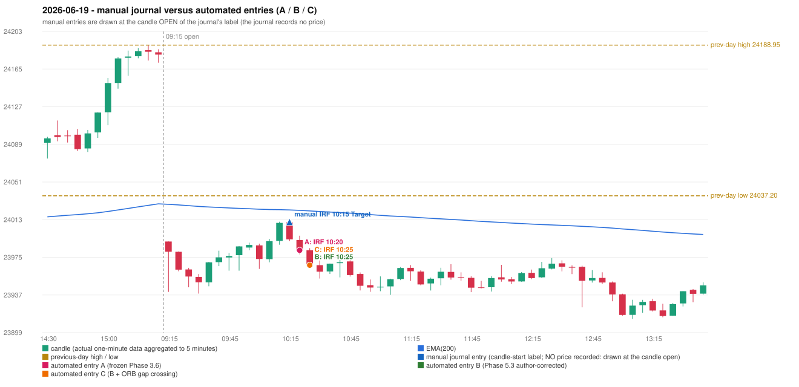

# 2026-06-19 (Friday) - manual journal versus the automated configurations

> SYNTHETIC index-point P&L; no real option P&L; costs illustrative (Rs 70 per trade + slippage scenarios). Configurations A / B / C are never combined.

## Session

* Open 23991.2; previous official close 24168.0; gap -176.80; previous-day high / low 24188.95 / 24037.2
* First 5-minute candle (09:15-09:20): O23991.2 H23991.2 L23940.45 C23980.9, RED, body 20.3%; EMA(200) at the first candle 24028.65; previous session's last close 24179.4 vs its EMA 24029.13

## Manual journal

row 145: IRF labelled 10:15, outcome Target

## Configuration A

Candidate signals (confirmed): 10:25 IRF/Method 1 SHORT [EXECUTED: trade 1: TARGET]; 10:55 IRF/Method 2A SHORT [IGNORED: POSITION_ACTIVE (signal kept for diagnostics only; never reused)]; 14:25 IRF/Method 1 SHORT [IGNORED: DAY_FINISHED]; 14:55 IRF/Method 2A SHORT [IGNORED: DAY_FINISHED]

Strategies with no confirmed signal: ORB: Gap/200DMA INVALIDATED CANDLE_QUALITY_OR_REJECTION_WICK; Method 1 INVALIDATED TREND:EMA_PREV_SESSION_CLOSE wrong side; Method 2 INVALIDATED TREND:EMA_PREV_SESSI | PDR: no setup record (the strategy's trigger event never occurred) | PDS: Method 1/2/3 INCOMPLETE_AT_EOD NO_QUALIFYING_ENTRY_BEFORE_SESSION_END | RF: RF INVALIDATED GAP_NOT_UP(DOWN)

| trade | strategy / method | dir | signal -> fill | entry | stop / T1 / T2 | leg 1 | leg 2 | outcome | gross Rs | net Rs (70, 0) | net Rs (70, 1.0) |
|---|---|---|---|---|---|---|---|---|---|---|---|
| 1 | IRF/Method 1 | SHORT | 10:25 -> 10:25 | 23982.35 | 24017.35 / 23955.35 / 23922.35 | 10:33 @ 23955.35 | 13:03 @ 23922.35 | TARGET | 16,965 | 16,895 | 16,115 |

Selection: This IRF Method 1 signal was the earliest executable signal of the day: 0 confirmed signal(s) earlier, 0 other in the same minute. 3 later confirmed signal(s) (IRF x3) are logged as ignored or rejected. State of the other four engines at that moment: [ORB: Method 1 invalidated at 09:15: TREND:EMA_PREV_SESSION_CLOSE wrong side; Method 2 invalidated at 09:15: TREND:EMA_PREV_SESSION_CLOSE wrong side] [PDR: no setup record before this time (a base condition was not met, or nothing triggered)] [PDS: no setup record before this time (a base condition was not met, or nothing triggered)] [RF: no setup record before this time (a base condition was not met, or nothing triggered)]

* Journal row 145 (IRF 10:15): **TIME_TOLERANT** match with 20260619-1-IRF (delta +5 min); outcome Target vs automated TARGET (same class)

## Configuration B

Candidate signals (confirmed): 10:30 IRF/Method 2A SHORT [EXECUTED: trade 1: T1_THEN_BUFFER_STOP]; 15:00 IRF/Method 2A SHORT [IGNORED: DAY_FINISHED]

Strategies with no confirmed signal: ORB: Gap/200DMA INVALIDATED CANDLE_QUALITY_OR_REJECTION_WICK; Method 1 INVALIDATED TREND:EMA_PREV_SESSION_CLOSE wrong side; Method 2 INVALIDATED TREND:EMA_PREV_SESSI | PDR: no setup record (the strategy's trigger event never occurred) | PDS: Method 1/2/3 INCOMPLETE_AT_EOD NO_QUALIFYING_ENTRY_BEFORE_SESSION_END | RF: RF INVALIDATED GAP_NOT_UP(DOWN)

| trade | strategy / method | dir | signal -> fill | entry | stop / T1 / T2 | leg 1 | leg 2 | outcome | gross Rs | net Rs (70, 0) | net Rs (70, 1.0) |
|---|---|---|---|---|---|---|---|---|---|---|---|
| 1 | IRF/Method 2A | SHORT | 10:30 -> 10:30 | 23967.35 | 24002.35 / 23940.35 / 23907.35 | 11:06 @ 23940.35 | 12:28 @ 23973.35 | T1_THEN_BUFFER_STOP | 4,095 | 4,025 | 3,245 |

Selection: This IRF Method 2A signal was the earliest executable signal of the day: 0 confirmed signal(s) earlier, 0 other in the same minute. 1 later confirmed signal(s) (IRF x1) are logged as ignored or rejected. State of the other four engines at that moment: [ORB: Method 1 invalidated at 09:15: TREND:EMA_PREV_SESSION_CLOSE wrong side; Method 2 invalidated at 09:15: TREND:EMA_PREV_SESSION_CLOSE wrong side] [PDR: no setup record before this time (a base condition was not met, or nothing triggered)] [PDS: no setup record before this time (a base condition was not met, or nothing triggered)] [RF: no setup record before this time (a base condition was not met, or nothing triggered)]

* Journal row 145 (IRF 10:15): **TIME_TOLERANT** match with 20260619-1-IRF (delta +10 min); outcome Target vs automated T1_THEN_BUFFER_STOP (different class: EXIT_MANAGEMENT_MISMATCH; the journal has no exit price / time)

## Configuration C

Candidate signals (confirmed): 10:30 IRF/Method 2A SHORT [EXECUTED: trade 1: T1_THEN_BUFFER_STOP]; 15:00 IRF/Method 2A SHORT [IGNORED: DAY_FINISHED]

Strategies with no confirmed signal: ORB: Gap/200DMA INVALIDATED CANDLE_QUALITY_OR_REJECTION_WICK; Method 1 INVALIDATED TREND:EMA_PREV_SESSION_CLOSE wrong side; Method 2 INVALIDATED TREND:EMA_PREV_SESSI | PDR: no setup record (the strategy's trigger event never occurred) | PDS: Method 1/2/3 INCOMPLETE_AT_EOD NO_QUALIFYING_ENTRY_BEFORE_SESSION_END | RF: RF INVALIDATED GAP_NOT_UP(DOWN)

| trade | strategy / method | dir | signal -> fill | entry | stop / T1 / T2 | leg 1 | leg 2 | outcome | gross Rs | net Rs (70, 0) | net Rs (70, 1.0) |
|---|---|---|---|---|---|---|---|---|---|---|---|
| 1 | IRF/Method 2A | SHORT | 10:30 -> 10:30 | 23967.35 | 24002.35 / 23940.35 / 23907.35 | 11:06 @ 23940.35 | 12:28 @ 23973.35 | T1_THEN_BUFFER_STOP | 4,095 | 4,025 | 3,245 |

Selection: This IRF Method 2A signal was the earliest executable signal of the day: 0 confirmed signal(s) earlier, 0 other in the same minute. 1 later confirmed signal(s) (IRF x1) are logged as ignored or rejected. State of the other four engines at that moment: [ORB: Method 1 invalidated at 09:15: TREND:EMA_PREV_SESSION_CLOSE wrong side; Method 2 invalidated at 09:15: TREND:EMA_PREV_SESSION_CLOSE wrong side] [PDR: no setup record before this time (a base condition was not met, or nothing triggered)] [PDS: no setup record before this time (a base condition was not met, or nothing triggered)] [RF: no setup record before this time (a base condition was not met, or nothing triggered)]

* Journal row 145 (IRF 10:15): **TIME_TOLERANT** match with 20260619-1-IRF (delta +10 min); outcome Target vs automated T1_THEN_BUFFER_STOP (different class: EXIT_MANAGEMENT_MISMATCH; the journal has no exit price / time)

## Chart

