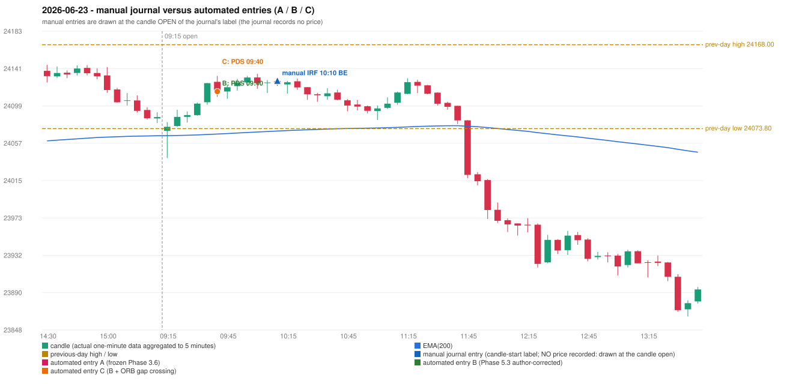

# 2026-06-23 (Tuesday) - manual journal versus the automated configurations

> SYNTHETIC index-point P&L; no real option P&L; costs illustrative (Rs 70 per trade + slippage scenarios). Configurations A / B / C are never combined.

## Session

* Open 24071.3; previous official close 24102.9; gap -31.60; previous-day high / low 24168.0 / 24073.8
* First 5-minute candle (09:15-09:20): O24071.3 H24081.15 L24040.75 C24075.85, GREEN, body 11.3%; EMA(200) at the first candle 24065.93; previous session's last close 24086.85 vs its EMA 24065.83

## Manual journal

row 147: IRF labelled 10:10, outcome BE

## Configuration A

Candidate signals (confirmed): 10:30 IRF/Method 2A SHORT [CONFLICT: SIMULTANEOUS_SIGNAL_CONFLICT_UNRESOLVED: IRF/Method 2A/SHORT, PDS/Method 3/SHORT]; 10:30 PDS/Method 3 SHORT [CONFLICT: SIMULTANEOUS_SIGNAL_CONFLICT_UNRESOLVED: IRF/Method 2A/SHORT, PDS/Method 3/SHORT]; 10:50 PDS/Method 3 SHORT [IGNORED: DAY_UNRESOLVED_EXECUTION]; 11:30 IRF/Method 2B SHORT [IGNORED: DAY_UNRESOLVED_EXECUTION]; 11:45 PDS/Method 3 SHORT [IGNORED: DAY_UNRESOLVED_EXECUTION]; 11:50 PDS/Method 1 SHORT [IGNORED: DAY_UNRESOLVED_EXECUTION]

Strategies with no confirmed signal: ORB: Method 2 INVALIDATED TREND:EMA_PREV_SESSION_CLOSE wrong side | PDR: no setup record (the strategy's trigger event never occurred) | RF: RF INCOMPLETE_AT_EOD NO_RETURN_INSIDE_BEFORE_SESSION_END

No trade: final day state UNRESOLVED_EXECUTION. Signals existed but none became a trade (see the dispositions above).

* Journal row 147 (IRF 10:10): **UNMATCHED_MANUAL**; earliest cause PORTFOLIO_CONTROLLER_CONSTRAINT: the IRF signal at 10:30 was CONFLICT: SIMULTANEOUS_SIGNAL_CONFLICT_UNRESOLVED: IRF/Method 2A/SHORT, PDS/Method 3/SHORT

## Configuration B

Candidate signals (confirmed): 09:45 PDS/Method 1 SHORT [EXECUTED: trade 1: T1_THEN_BUFFER_STOP]; 10:05 PDS/Method 1 SHORT [IGNORED: POSITION_ACTIVE (signal kept for diagnostics only; never reused)]; 10:15 PDS/Method 2 SHORT [IGNORED: POSITION_ACTIVE (signal kept for diagnostics only; never reused)]; 10:25 PDS/Method 1 SHORT [IGNORED: POSITION_ACTIVE (signal kept for diagnostics only; never reused)]; 10:30 PDS/Method 1 SHORT [IGNORED: POSITION_ACTIVE (signal kept for diagnostics only; never reused)]; 10:45 IRF/Method 2A SHORT [IGNORED: POSITION_ACTIVE (signal kept for diagnostics only; never reused)]; 10:50 PDS/Method 3 SHORT [IGNORED: POSITION_ACTIVE (signal kept for diagnostics only; never reused)]; 10:55 PDS/Method 2 SHORT [IGNORED: POSITION_ACTIVE (signal kept for diagnostics only; never reused)]; 11:00 PDS/Method 1 SHORT [IGNORED: POSITION_ACTIVE (signal kept for diagnostics only; never reused)]; 11:30 IRF/Method 2A SHORT [IGNORED: DAY_FINISHED]; 12:25 PDS/Method 3 SHORT [IGNORED: DAY_FINISHED]

Strategies with no confirmed signal: ORB: Method 2 INVALIDATED TREND:EMA_PREV_SESSION_CLOSE wrong side | PDR: no setup record (the strategy's trigger event never occurred) | RF: RF INCOMPLETE_AT_EOD NO_RETURN_INSIDE_BEFORE_SESSION_END

| trade | strategy / method | dir | signal -> fill | entry | stop / T1 / T2 | leg 1 | leg 2 | outcome | gross Rs | net Rs (70, 0) | net Rs (70, 1.0) |
|---|---|---|---|---|---|---|---|---|---|---|---|
| 1 | PDS/Method 1 | SHORT | 09:45 -> 09:45 | 24115.5 | 24150.5 / 24088.5 / 24045.5 | 11:01 @ 24088.5 | 11:16 @ 24121.5 | T1_THEN_BUFFER_STOP | 4,095 | 4,025 | 3,245 |

Selection: This PDS Method 1 signal was the earliest executable signal of the day: 0 confirmed signal(s) earlier, 0 other in the same minute. 10 later confirmed signal(s) (IRF x2, PDS x8) are logged as ignored or rejected. State of the other four engines at that moment: [IRF: no setup record before this time (a base condition was not met, or nothing triggered)] [ORB: Method 2 invalidated at 09:15: TREND:EMA_PREV_SESSION_CLOSE wrong side] [PDR: no setup record before this time (a base condition was not met, or nothing triggered)] [RF: no setup record before this time (a base condition was not met, or nothing triggered)]

* Journal row 147 (IRF 10:10): **UNMATCHED_MANUAL**; earliest cause LATER_SIGNAL (+ ENTRY_TIME_MISMATCH): the nearest automated IRF signal is at 10:45 (candle 10:40) versus the manual label 10:10; it was IGNORED: POSITION_ACTIVE (signal kept for diagnostics only; never reused)
* Automated PDS 09:40 has no strict / time-tolerant journal counterpart: DIFFERENT_STRATEGY_SELECTED - the journal traded IRF 10:10; the automated controller took PDS Method 1 (candle 09:40) as the first valid signal

## Configuration C

Candidate signals (confirmed): 09:45 PDS/Method 1 SHORT [EXECUTED: trade 1: T1_THEN_BUFFER_STOP]; 10:05 PDS/Method 1 SHORT [IGNORED: POSITION_ACTIVE (signal kept for diagnostics only; never reused)]; 10:15 PDS/Method 2 SHORT [IGNORED: POSITION_ACTIVE (signal kept for diagnostics only; never reused)]; 10:25 PDS/Method 1 SHORT [IGNORED: POSITION_ACTIVE (signal kept for diagnostics only; never reused)]; 10:30 PDS/Method 1 SHORT [IGNORED: POSITION_ACTIVE (signal kept for diagnostics only; never reused)]; 10:45 IRF/Method 2A SHORT [IGNORED: POSITION_ACTIVE (signal kept for diagnostics only; never reused)]; 10:50 PDS/Method 3 SHORT [IGNORED: POSITION_ACTIVE (signal kept for diagnostics only; never reused)]; 10:55 PDS/Method 2 SHORT [IGNORED: POSITION_ACTIVE (signal kept for diagnostics only; never reused)]; 11:00 PDS/Method 1 SHORT [IGNORED: POSITION_ACTIVE (signal kept for diagnostics only; never reused)]; 11:30 IRF/Method 2A SHORT [IGNORED: DAY_FINISHED]; 12:25 PDS/Method 3 SHORT [IGNORED: DAY_FINISHED]

Strategies with no confirmed signal: ORB: Gap/200DMA INVALIDATED CLOSE_NOT_BEYOND_MA; Method 2 INVALIDATED TREND:EMA_PREV_SESSION_CLOSE wrong side | PDR: no setup record (the strategy's trigger event never occurred) | RF: RF INCOMPLETE_AT_EOD NO_RETURN_INSIDE_BEFORE_SESSION_END

| trade | strategy / method | dir | signal -> fill | entry | stop / T1 / T2 | leg 1 | leg 2 | outcome | gross Rs | net Rs (70, 0) | net Rs (70, 1.0) |
|---|---|---|---|---|---|---|---|---|---|---|---|
| 1 | PDS/Method 1 | SHORT | 09:45 -> 09:45 | 24115.5 | 24150.5 / 24088.5 / 24045.5 | 11:01 @ 24088.5 | 11:16 @ 24121.5 | T1_THEN_BUFFER_STOP | 4,095 | 4,025 | 3,245 |

Selection: This PDS Method 1 signal was the earliest executable signal of the day: 0 confirmed signal(s) earlier, 0 other in the same minute. 10 later confirmed signal(s) (IRF x2, PDS x8) are logged as ignored or rejected. State of the other four engines at that moment: [IRF: no setup record before this time (a base condition was not met, or nothing triggered)] [ORB: Method 2 invalidated at 09:15: TREND:EMA_PREV_SESSION_CLOSE wrong side; Gap/200DMA invalidated at 09:15: CLOSE_NOT_BEYOND_MA] [PDR: no setup record before this time (a base condition was not met, or nothing triggered)] [RF: no setup record before this time (a base condition was not met, or nothing triggered)]

* Journal row 147 (IRF 10:10): **UNMATCHED_MANUAL**; earliest cause LATER_SIGNAL (+ ENTRY_TIME_MISMATCH): the nearest automated IRF signal is at 10:45 (candle 10:40) versus the manual label 10:10; it was IGNORED: POSITION_ACTIVE (signal kept for diagnostics only; never reused)
* Automated PDS 09:40 has no strict / time-tolerant journal counterpart: DIFFERENT_STRATEGY_SELECTED - the journal traded IRF 10:10; the automated controller took PDS Method 1 (candle 09:40) as the first valid signal

## Chart

