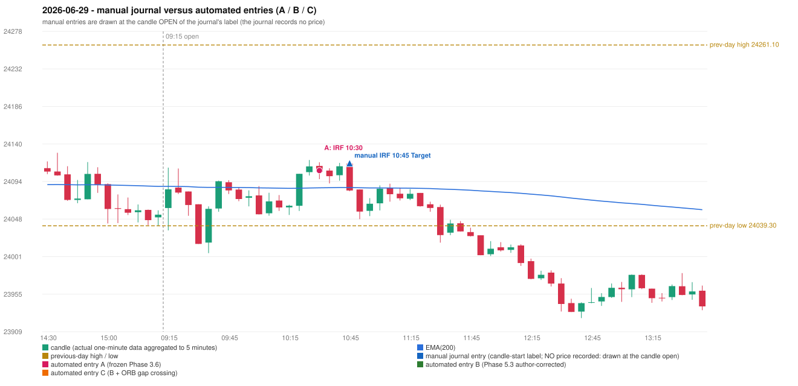

# 2026-06-29 (Monday) - manual journal versus the automated configurations

> SYNTHETIC index-point P&L; no real option P&L; costs illustrative (Rs 70 per trade + slippage scenarios). Configurations A / B / C are never combined.

## Session

* Open 24061.1; previous official close 24056.0; gap +5.10; previous-day high / low 24261.1 / 24039.3
* First 5-minute candle (09:15-09:20): O24061.1 H24110.7 L24033.7 C24084.05, GREEN, body 29.8%; EMA(200) at the first candle 24087.66; previous session's last close 24052.95 vs its EMA 24087.69

## Manual journal

row 150: IRF labelled 10:45, outcome Target

## Configuration A

Candidate signals (confirmed): 10:35 IRF/Method 1 SHORT [EXECUTED: trade 1: TARGET]; 10:50 IRF/Method 1 SHORT [IGNORED: POSITION_ACTIVE (signal kept for diagnostics only; never reused)]

Strategies with no confirmed signal: ORB: no setup record (the strategy's trigger event never occurred) | PDR: PDR INVALIDATED OPEN_NOT_STRICTLY_ABOVE_ZONE | PDS: no setup record (the strategy's trigger event never occurred) | RF: RF INVALIDATED TREND:EMA_PREV_SESSION_CLOSE wrong side

| trade | strategy / method | dir | signal -> fill | entry | stop / T1 / T2 | leg 1 | leg 2 | outcome | gross Rs | net Rs (70, 0) | net Rs (70, 1.0) |
|---|---|---|---|---|---|---|---|---|---|---|---|
| 1 | IRF/Method 1 | SHORT | 10:35 -> 10:35 | 24107.05 | 24142.05 / 24080.05 / 24047.05 | 10:50 @ 24080.05 | 11:32 @ 24047.05 | TARGET | 16,965 | 16,895 | 16,115 |

Selection: This IRF Method 1 signal was the earliest executable signal of the day: 0 confirmed signal(s) earlier, 0 other in the same minute. 1 later confirmed signal(s) (IRF x1) are logged as ignored or rejected. State of the other four engines at that moment: [ORB: no setup record before this time (a base condition was not met, or nothing triggered)] [PDR: PDR invalidated at 09:15: OPEN_NOT_STRICTLY_ABOVE_ZONE] [PDS: no setup record before this time (a base condition was not met, or nothing triggered)] [RF: RF invalidated at 09:35: TREND:EMA_PREV_SESSION_CLOSE wrong side]

* Journal row 150 (IRF 10:45): **TIME_TOLERANT** match with 20260629-1-IRF (delta -15 min); outcome Target vs automated TARGET (same class)

## Configuration B

Candidate signals (confirmed): none

Strategies with no confirmed signal: IRF: no setup record (the strategy's trigger event never occurred) | ORB: no setup record (the strategy's trigger event never occurred) | PDR: PDR INVALIDATED OPEN_NOT_STRICTLY_ABOVE_ZONE | PDS: no setup record (the strategy's trigger event never occurred) | RF: RF INVALIDATED TREND:EMA_PREV_SESSION_CLOSE wrong side

No trade: final day state READY_FOR_FIRST_TRADE. No strategy qualified.

* Journal row 150 (IRF 10:45): **UNMATCHED_MANUAL**; earliest cause EMA_FILTER_MISMATCH: an IRF Method 1 candidate at 10:35 was REJECTED by the 28-point EMA clearance (range distance 10.7, EMA EMA_BELOW_CANDLE) - PROVISIONAL_EMA_RANGE_DISTANCE

## Configuration C

Candidate signals (confirmed): none

Strategies with no confirmed signal: IRF: no setup record (the strategy's trigger event never occurred) | ORB: Gap/200DMA INVALIDATED CLOSE_NOT_BEYOND_MA | PDR: PDR INVALIDATED OPEN_NOT_STRICTLY_ABOVE_ZONE | PDS: no setup record (the strategy's trigger event never occurred) | RF: RF INVALIDATED TREND:EMA_PREV_SESSION_CLOSE wrong side

No trade: final day state READY_FOR_FIRST_TRADE. No strategy qualified.

* Journal row 150 (IRF 10:45): **UNMATCHED_MANUAL**; earliest cause EMA_FILTER_MISMATCH: an IRF Method 1 candidate at 10:35 was REJECTED by the 28-point EMA clearance (range distance 10.7, EMA EMA_BELOW_CANDLE) - PROVISIONAL_EMA_RANGE_DISTANCE

## Chart

