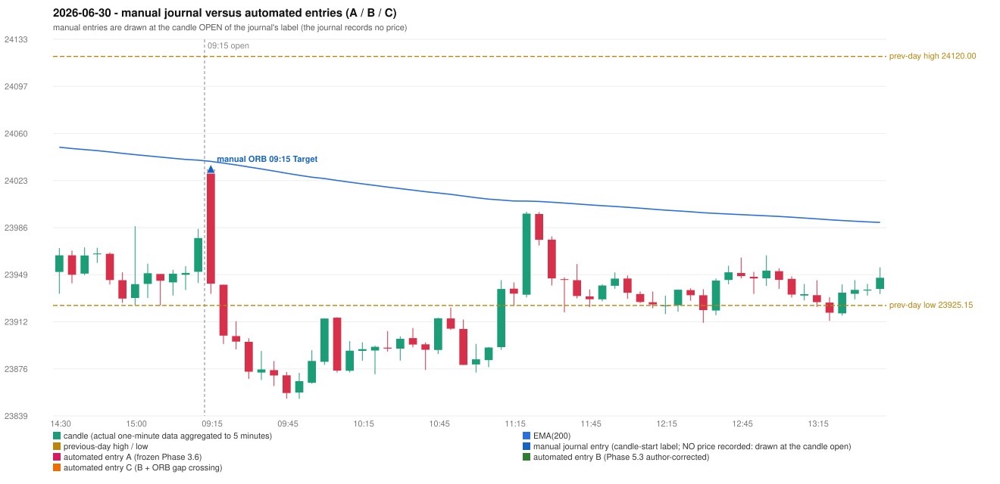

# 2026-06-30 (Tuesday) - manual journal versus the automated configurations

> SYNTHETIC index-point P&L; no real option P&L; costs illustrative (Rs 70 per trade + slippage scenarios). Configurations A / B / C are never combined.

## Session

* Open 24031.6; previous official close 23946.25; gap +85.35; previous-day high / low 24120.0 / 23925.15
* First 5-minute candle (09:15-09:20): O24031.6 H24031.6 L23934.25 C23942.2, RED, body 91.8%; EMA(200) at the first candle 24037.88; previous session's last close 23977.9 vs its EMA 24038.84

## Manual journal

row 151: ORB labelled 09:15, outcome Target

## Configuration A

Candidate signals (confirmed): none

Strategies with no confirmed signal: IRF: no setup record (the strategy's trigger event never occurred) | ORB: no setup record (the strategy's trigger event never occurred) | PDR: PDR INVALIDATED OPEN_NOT_STRICTLY_ABOVE_ZONE | PDS: no setup record (the strategy's trigger event never occurred) | RF: RF INVALIDATED TREND:EMA_PREV_SESSION_CLOSE wrong side

No trade: final day state READY_FOR_FIRST_TRADE. No strategy qualified.

* Journal row 151 (ORB 09:15): **UNMATCHED_MANUAL**; earliest cause LEVEL_CONSTRUCTION_MISMATCH: first candle RED O24031.6 H24031.6 L23934.25 C23942.2 (body 91.8%); direction ASSUMED from the colour (the journal has no direction); closest method Method 1 (1 failing predicate(s)): first failing 'level_broken' - previous-day low 23925.15; candle high/low 23934.25, close 23942.2; all methods: Method 1: 1 fail (level_broken); Method 2: 2 fail (inner_level_broken); Gap/200DMA: 2 fail (gap_in_direction)

## Configuration B

Candidate signals (confirmed): none

Strategies with no confirmed signal: IRF: no setup record (the strategy's trigger event never occurred) | ORB: no setup record (the strategy's trigger event never occurred) | PDR: PDR INVALIDATED OPEN_NOT_STRICTLY_ABOVE_ZONE | PDS: no setup record (the strategy's trigger event never occurred) | RF: RF INVALIDATED TREND:EMA_PREV_SESSION_CLOSE wrong side

No trade: final day state READY_FOR_FIRST_TRADE. No strategy qualified.

* Journal row 151 (ORB 09:15): **UNMATCHED_MANUAL**; earliest cause LEVEL_CONSTRUCTION_MISMATCH: first candle RED O24031.6 H24031.6 L23934.25 C23942.2 (body 91.8%); direction ASSUMED from the colour (the journal has no direction); closest method Method 1 (1 failing predicate(s)): first failing 'level_broken' - previous-day low 23925.15; candle high/low 23934.25, close 23942.2; all methods: Method 1: 1 fail (level_broken); Method 2: 2 fail (inner_level_broken); Gap/200DMA: 2 fail (gap_in_direction)

## Configuration C

Candidate signals (confirmed): none

Strategies with no confirmed signal: IRF: no setup record (the strategy's trigger event never occurred) | ORB: Gap/200DMA INVALIDATED CLOSE_NOT_BEYOND_MA | PDR: PDR INVALIDATED OPEN_NOT_STRICTLY_ABOVE_ZONE | PDS: no setup record (the strategy's trigger event never occurred) | RF: RF INVALIDATED TREND:EMA_PREV_SESSION_CLOSE wrong side

No trade: final day state READY_FOR_FIRST_TRADE. No strategy qualified.

* Journal row 151 (ORB 09:15): **UNMATCHED_MANUAL**; earliest cause LEVEL_CONSTRUCTION_MISMATCH: first candle RED O24031.6 H24031.6 L23934.25 C23942.2 (body 91.8%); direction ASSUMED from the colour (the journal has no direction); closest method Method 1 (1 failing predicate(s)): first failing 'level_broken' - previous-day low 23925.15; candle high/low 23934.25, close 23942.2; all methods: Method 1: 1 fail (level_broken); Method 2: 2 fail (inner_level_broken); Gap/200DMA: 2 fail (gap_in_direction)

## Chart

