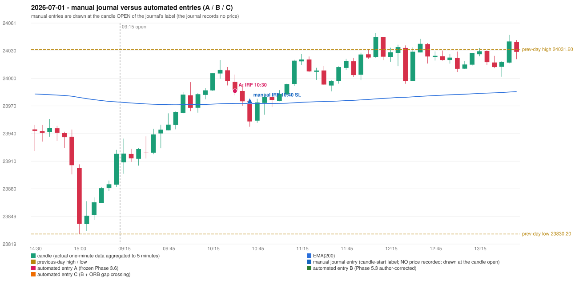

# 2026-07-01 (Wednesday) - manual journal versus the automated configurations

> SYNTHETIC index-point P&L; no real option P&L; costs illustrative (Rs 70 per trade + slippage scenarios). Configurations A / B / C are never combined.

## Session

* Open 23908.55; previous official close 23865.75; gap +42.80; previous-day high / low 24031.6 / 23830.2
* First 5-minute candle (09:15-09:20): O23908.55 H23934.4 L23896.0 C23918.0, GREEN, body 24.6%; EMA(200) at the first candle 23973.92; previous session's last close 23917.75 vs its EMA 23974.48

## Manual journal

row 152: IRF labelled 10:40, outcome SL

## Configuration A

Candidate signals (confirmed): 10:35 IRF/Method 2B SHORT [EXECUTED: trade 1: T1_THEN_BUFFER_STOP]; 12:30 IRF/Method 2A SHORT [IGNORED: DAY_FINISHED]; 13:05 IRF/Method 2A SHORT [IGNORED: DAY_FINISHED]; 13:25 IRF/Method 2B SHORT [IGNORED: DAY_FINISHED]; 14:30 IRF/Method 2A SHORT [IGNORED: DAY_FINISHED]; 15:05 IRF/Method 2B SHORT [IGNORED: DAY_FINISHED]

Strategies with no confirmed signal: ORB: no setup record (the strategy's trigger event never occurred) | PDR: PDR INVALIDATED OPEN_NOT_STRICTLY_ABOVE_ZONE | PDS: no setup record (the strategy's trigger event never occurred) | RF: no setup record (the strategy's trigger event never occurred)

| trade | strategy / method | dir | signal -> fill | entry | stop / T1 / T2 | leg 1 | leg 2 | outcome | gross Rs | net Rs (70, 0) | net Rs (70, 1.0) |
|---|---|---|---|---|---|---|---|---|---|---|---|
| 1 | IRF/Method 2B | SHORT | 10:35 -> 10:35 | 23986.4 | 24021.4 / 23959.4 / 23926.4 | 10:43 @ 23959.4 | 11:09 @ 23992.4 | T1_THEN_BUFFER_STOP | 4,095 | 4,025 | 3,245 |

Selection: This IRF Method 2B signal was the earliest executable signal of the day: 0 confirmed signal(s) earlier, 0 other in the same minute. 5 later confirmed signal(s) (IRF x5) are logged as ignored or rejected. State of the other four engines at that moment: [ORB: no setup record before this time (a base condition was not met, or nothing triggered)] [PDR: PDR invalidated at 09:15: OPEN_NOT_STRICTLY_ABOVE_ZONE] [PDS: no setup record before this time (a base condition was not met, or nothing triggered)] [RF: no setup record before this time (a base condition was not met, or nothing triggered)]

* Journal row 152 (IRF 10:40): **TIME_TOLERANT** match with 20260701-1-IRF (delta -10 min); outcome SL vs automated T1_THEN_BUFFER_STOP (different class: EXIT_MANAGEMENT_MISMATCH; the journal has no exit price / time)

## Configuration B

Candidate signals (confirmed): none

Strategies with no confirmed signal: IRF: Method 1/2 INCOMPLETE_AT_EOD SESSION_ENDED_BEFORE_CONFIRMATION; Method 3 INVALIDATED WICK_SHARE_OUT_OF_BAND | ORB: no setup record (the strategy's trigger event never occurred) | PDR: PDR INVALIDATED OPEN_NOT_STRICTLY_ABOVE_ZONE | PDS: no setup record (the strategy's trigger event never occurred) | RF: no setup record (the strategy's trigger event never occurred)

No trade: final day state READY_FOR_FIRST_TRADE. No strategy qualified.

* Journal row 152 (IRF 10:40): **UNMATCHED_MANUAL**; earliest cause EMA_FILTER_MISMATCH: an IRF Method 2B candidate at 10:35 was REJECTED by the 28-point EMA clearance (range distance 8.9, EMA EMA_BELOW_CANDLE) - PROVISIONAL_EMA_RANGE_DISTANCE

## Configuration C

Candidate signals (confirmed): none

Strategies with no confirmed signal: IRF: Method 1/2 INCOMPLETE_AT_EOD SESSION_ENDED_BEFORE_CONFIRMATION; Method 3 INVALIDATED WICK_SHARE_OUT_OF_BAND | ORB: Gap/200DMA INVALIDATED CLOSE_NOT_BEYOND_MA | PDR: PDR INVALIDATED OPEN_NOT_STRICTLY_ABOVE_ZONE | PDS: no setup record (the strategy's trigger event never occurred) | RF: no setup record (the strategy's trigger event never occurred)

No trade: final day state READY_FOR_FIRST_TRADE. No strategy qualified.

* Journal row 152 (IRF 10:40): **UNMATCHED_MANUAL**; earliest cause EMA_FILTER_MISMATCH: an IRF Method 2B candidate at 10:35 was REJECTED by the 28-point EMA clearance (range distance 8.9, EMA EMA_BELOW_CANDLE) - PROVISIONAL_EMA_RANGE_DISTANCE

## Chart

