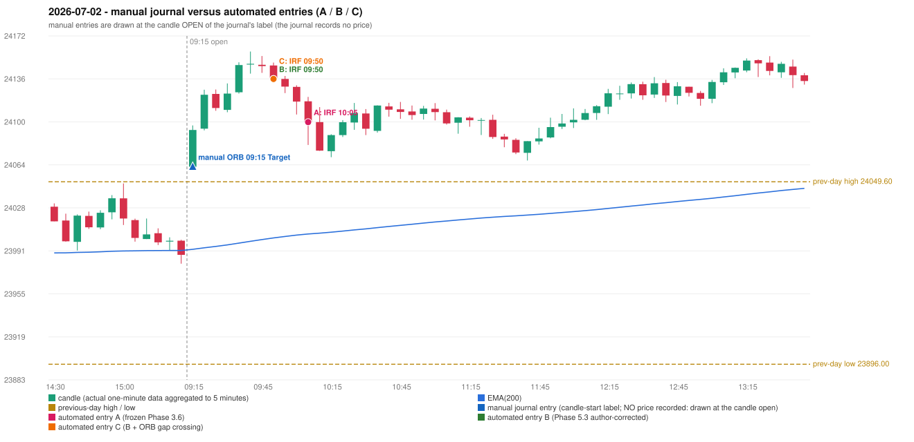

# 2026-07-02 (Thursday) - manual journal versus the automated configurations

> SYNTHETIC index-point P&L; no real option P&L; costs illustrative (Rs 70 per trade + slippage scenarios). Configurations A / B / C are never combined.

## Session

* Open 24062.2; previous official close 24005.85; gap +56.35; previous-day high / low 24049.6 / 23896.0
* First 5-minute candle (09:15-09:20): O24062.2 H24097.0 L24062.2 C24093.2, GREEN, body 89.1%; EMA(200) at the first candle 23992.72; previous session's last close 23988.1 vs its EMA 23991.71

## Manual journal

row 153: ORB labelled 09:15, outcome Target

## Configuration A

Candidate signals (confirmed): 10:10 IRF/Method 2A SHORT [EXECUTED: trade 1: T1_THEN_BUFFER_STOP]; 10:15 IRF/Method 1 SHORT [IGNORED: POSITION_ACTIVE (signal kept for diagnostics only; never reused)]; 10:35 IRF/Method 1 SHORT [IGNORED: DAY_FINISHED]; 10:45 IRF/Method 2B SHORT [IGNORED: DAY_FINISHED]; 11:10 IRF/Method 2A SHORT [IGNORED: DAY_FINISHED]; 11:30 IRF/Method 1 SHORT [IGNORED: DAY_FINISHED]; 11:30 IRF/Method 2B SHORT [IGNORED: DAY_FINISHED]; 13:45 IRF/Method 2A SHORT [IGNORED: DAY_FINISHED]; 14:10 IRF/Method 2B SHORT [IGNORED: DAY_FINISHED]; 14:30 IRF/Method 2B SHORT [IGNORED: DAY_FINISHED]; 15:20 IRF/Method 2A SHORT [IGNORED: DAY_FINISHED]

Strategies with no confirmed signal: ORB: Method 1 INVALIDATED TREND:EMA_PREV_SESSION_CLOSE wrong side; Method 2 INVALIDATED TREND:EMA_PREV_SESSION_CLOSE wrong side | PDR: no setup record (the strategy's trigger event never occurred) | PDS: no setup record (the strategy's trigger event never occurred) | RF: no setup record (the strategy's trigger event never occurred)

| trade | strategy / method | dir | signal -> fill | entry | stop / T1 / T2 | leg 1 | leg 2 | outcome | gross Rs | net Rs (70, 0) | net Rs (70, 1.0) |
|---|---|---|---|---|---|---|---|---|---|---|---|
| 1 | IRF/Method 2A | SHORT | 10:10 -> 10:10 | 24099.8 | 24134.8 / 24072.8 / 24039.8 | 10:15 @ 24072.8 | 10:28 @ 24105.8 | T1_THEN_BUFFER_STOP | 4,095 | 4,025 | 3,245 |

Selection: This IRF Method 2A signal was the earliest executable signal of the day: 0 confirmed signal(s) earlier, 0 other in the same minute. 10 later confirmed signal(s) (IRF x10) are logged as ignored or rejected. State of the other four engines at that moment: [ORB: Method 1 invalidated at 09:15: TREND:EMA_PREV_SESSION_CLOSE wrong side; Method 2 invalidated at 09:15: TREND:EMA_PREV_SESSION_CLOSE wrong side] [PDR: no setup record before this time (a base condition was not met, or nothing triggered)] [PDS: no setup record before this time (a base condition was not met, or nothing triggered)] [RF: no setup record before this time (a base condition was not met, or nothing triggered)]

* Journal row 153 (ORB 09:15): **UNMATCHED_MANUAL**; earliest cause EMA_FILTER_MISMATCH (+ OPENING_GAP_MISMATCH): first candle GREEN O24062.2 H24097.0 L24062.2 C24093.2 (body 89.1%); direction ASSUMED from the colour (the journal has no direction); TIE-BROKEN BY METHOD ORDER: 2 methods tie at 1 failing predicate(s) (Method 1: trend; Gap/200DMA: gap_crosses_200_average) - the evidence does not single out one cause, the secondary cause is the other tied one; closest method Method 1 (1 failing predicate(s)): first failing 'trend' - EMA_PREV_SESSION_CLOSE wrong side; all methods: Method 1: 1 fail (trend); Method 2: 2 fail (trend); Gap/200DMA: 1 fail (gap_crosses_200_average)
* Automated IRF 10:05 has no strict / time-tolerant journal counterpart: DIFFERENT_STRATEGY_SELECTED - the journal traded ORB 09:15; the automated controller took IRF Method 2A (candle 10:05) as the first valid signal

## Configuration B

Candidate signals (confirmed): 09:55 IRF/Method 2A SHORT [EXECUTED: trade 1: TARGET]; 10:15 IRF/Method 1 SHORT [IGNORED: DAY_FINISHED]; 10:35 IRF/Method 1 SHORT [IGNORED: DAY_FINISHED]; 10:45 IRF/Method 2B SHORT [IGNORED: DAY_FINISHED]; 11:10 IRF/Method 2A SHORT [IGNORED: DAY_FINISHED]; 11:30 IRF/Method 1 SHORT [IGNORED: DAY_FINISHED]; 11:30 IRF/Method 2B SHORT [IGNORED: DAY_FINISHED]

Strategies with no confirmed signal: ORB: Method 1 INVALIDATED TREND:EMA_PREV_SESSION_CLOSE wrong side; Method 2 INVALIDATED TREND:EMA_PREV_SESSION_CLOSE wrong side | PDR: no setup record (the strategy's trigger event never occurred) | PDS: no setup record (the strategy's trigger event never occurred) | RF: no setup record (the strategy's trigger event never occurred)

| trade | strategy / method | dir | signal -> fill | entry | stop / T1 / T2 | leg 1 | leg 2 | outcome | gross Rs | net Rs (70, 0) | net Rs (70, 1.0) |
|---|---|---|---|---|---|---|---|---|---|---|---|
| 1 | IRF/Method 2A | SHORT | 09:55 -> 09:55 | 24136.15 | 24171.15 / 24109.15 / 24076.15 | 10:03 @ 24109.15 | 10:14 @ 24076.15 | TARGET | 16,965 | 16,895 | 16,115 |

Selection: This IRF Method 2A signal was the earliest executable signal of the day: 0 confirmed signal(s) earlier, 0 other in the same minute. 6 later confirmed signal(s) (IRF x6) are logged as ignored or rejected. State of the other four engines at that moment: [ORB: Method 1 invalidated at 09:15: TREND:EMA_PREV_SESSION_CLOSE wrong side; Method 2 invalidated at 09:15: TREND:EMA_PREV_SESSION_CLOSE wrong side] [PDR: no setup record before this time (a base condition was not met, or nothing triggered)] [PDS: no setup record before this time (a base condition was not met, or nothing triggered)] [RF: no setup record before this time (a base condition was not met, or nothing triggered)]

* Journal row 153 (ORB 09:15): **UNMATCHED_MANUAL**; earliest cause EMA_FILTER_MISMATCH (+ OPENING_GAP_MISMATCH): first candle GREEN O24062.2 H24097.0 L24062.2 C24093.2 (body 89.1%); direction ASSUMED from the colour (the journal has no direction); TIE-BROKEN BY METHOD ORDER: 2 methods tie at 1 failing predicate(s) (Method 1: trend; Gap/200DMA: gap_crosses_200_average) - the evidence does not single out one cause, the secondary cause is the other tied one; closest method Method 1 (1 failing predicate(s)): first failing 'trend' - EMA_PREV_SESSION_CLOSE wrong side; all methods: Method 1: 1 fail (trend); Method 2: 2 fail (trend); Gap/200DMA: 1 fail (gap_crosses_200_average)
* Automated IRF 09:50 has no strict / time-tolerant journal counterpart: DIFFERENT_STRATEGY_SELECTED - the journal traded ORB 09:15; the automated controller took IRF Method 2A (candle 09:50) as the first valid signal

## Configuration C

Candidate signals (confirmed): 09:55 IRF/Method 2A SHORT [EXECUTED: trade 1: TARGET]; 10:15 IRF/Method 1 SHORT [IGNORED: DAY_FINISHED]; 10:35 IRF/Method 1 SHORT [IGNORED: DAY_FINISHED]; 10:45 IRF/Method 2B SHORT [IGNORED: DAY_FINISHED]; 11:10 IRF/Method 2A SHORT [IGNORED: DAY_FINISHED]; 11:30 IRF/Method 1 SHORT [IGNORED: DAY_FINISHED]; 11:30 IRF/Method 2B SHORT [IGNORED: DAY_FINISHED]

Strategies with no confirmed signal: ORB: Method 1 INVALIDATED TREND:EMA_PREV_SESSION_CLOSE wrong side; Method 2 INVALIDATED TREND:EMA_PREV_SESSION_CLOSE wrong side | PDR: no setup record (the strategy's trigger event never occurred) | PDS: no setup record (the strategy's trigger event never occurred) | RF: no setup record (the strategy's trigger event never occurred)

| trade | strategy / method | dir | signal -> fill | entry | stop / T1 / T2 | leg 1 | leg 2 | outcome | gross Rs | net Rs (70, 0) | net Rs (70, 1.0) |
|---|---|---|---|---|---|---|---|---|---|---|---|
| 1 | IRF/Method 2A | SHORT | 09:55 -> 09:55 | 24136.15 | 24171.15 / 24109.15 / 24076.15 | 10:03 @ 24109.15 | 10:14 @ 24076.15 | TARGET | 16,965 | 16,895 | 16,115 |

Selection: This IRF Method 2A signal was the earliest executable signal of the day: 0 confirmed signal(s) earlier, 0 other in the same minute. 6 later confirmed signal(s) (IRF x6) are logged as ignored or rejected. State of the other four engines at that moment: [ORB: Method 1 invalidated at 09:15: TREND:EMA_PREV_SESSION_CLOSE wrong side; Method 2 invalidated at 09:15: TREND:EMA_PREV_SESSION_CLOSE wrong side] [PDR: no setup record before this time (a base condition was not met, or nothing triggered)] [PDS: no setup record before this time (a base condition was not met, or nothing triggered)] [RF: no setup record before this time (a base condition was not met, or nothing triggered)]

* Journal row 153 (ORB 09:15): **UNMATCHED_MANUAL**; earliest cause EMA_FILTER_MISMATCH (+ OPENING_GAP_MISMATCH): first candle GREEN O24062.2 H24097.0 L24062.2 C24093.2 (body 89.1%); direction ASSUMED from the colour (the journal has no direction); TIE-BROKEN BY METHOD ORDER: 2 methods tie at 1 failing predicate(s) (Method 1: trend; Gap/200DMA: gap_crosses_200_average) - the evidence does not single out one cause, the secondary cause is the other tied one; closest method Method 1 (1 failing predicate(s)): first failing 'trend' - EMA_PREV_SESSION_CLOSE wrong side; all methods: Method 1: 1 fail (trend); Method 2: 2 fail (trend); Gap/200DMA: 1 fail (gap_crosses_200_average)
* Automated IRF 09:50 has no strict / time-tolerant journal counterpart: DIFFERENT_STRATEGY_SELECTED - the journal traded ORB 09:15; the automated controller took IRF Method 2A (candle 09:50) as the first valid signal

## Chart

