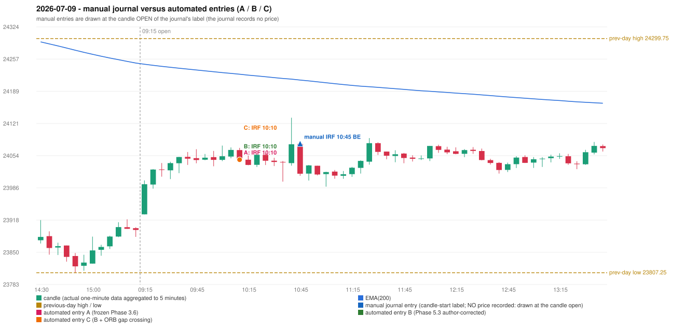

# 2026-07-09 (Thursday) - manual journal versus the automated configurations

> SYNTHETIC index-point P&L; no real option P&L; costs illustrative (Rs 70 per trade + slippage scenarios). Configurations A / B / C are never combined.

## Session

* Open 23930.05; previous official close 23882.05; gap +48.00; previous-day high / low 24299.75 / 23807.25
* First 5-minute candle (09:15-09:20): O23930.05 H24001.5 L23930.05 C23993.4, GREEN, body 88.7%; EMA(200) at the first candle 24245.79; previous session's last close 23897.2 vs its EMA 24248.33

## Manual journal

row 157: IRF labelled 10:45, outcome BE

## Configuration A

Candidate signals (confirmed): 10:15 IRF/Method 2B SHORT [EXECUTED: trade 1: T1_THEN_BUFFER_STOP]; 10:50 IRF/Method 2B SHORT [IGNORED: DAY_FINISHED]; 12:35 IRF/Method 2A SHORT [IGNORED: DAY_FINISHED]; 13:25 IRF/Method 2B SHORT [IGNORED: DAY_FINISHED]; 14:45 IRF/Method 2A SHORT [IGNORED: DAY_FINISHED]; 15:05 IRF/Method 1 SHORT [IGNORED: DAY_FINISHED]

Strategies with no confirmed signal: ORB: no setup record (the strategy's trigger event never occurred) | PDR: PDR INVALIDATED OPEN_NOT_STRICTLY_ABOVE_ZONE | PDS: no setup record (the strategy's trigger event never occurred) | RF: no setup record (the strategy's trigger event never occurred)

| trade | strategy / method | dir | signal -> fill | entry | stop / T1 / T2 | leg 1 | leg 2 | outcome | gross Rs | net Rs (70, 0) | net Rs (70, 1.0) |
|---|---|---|---|---|---|---|---|---|---|---|---|
| 1 | IRF/Method 2B | SHORT | 10:15 -> 10:15 | 24045.05 | 24080.05 / 24018.05 / 23985.05 | 10:36 @ 24018.05 | 10:41 @ 24051.05 | T1_THEN_BUFFER_STOP | 4,095 | 4,025 | 3,245 |

Selection: This IRF Method 2B signal was the earliest executable signal of the day: 0 confirmed signal(s) earlier, 0 other in the same minute. 5 later confirmed signal(s) (IRF x5) are logged as ignored or rejected. State of the other four engines at that moment: [ORB: no setup record before this time (a base condition was not met, or nothing triggered)] [PDR: PDR invalidated at 09:15: OPEN_NOT_STRICTLY_ABOVE_ZONE] [PDS: no setup record before this time (a base condition was not met, or nothing triggered)] [RF: no setup record before this time (a base condition was not met, or nothing triggered)]

* Journal row 157 (IRF 10:45): **DATE_STRATEGY_ONLY**; earliest cause EARLIER_SIGNAL (+ ENTRY_TIME_MISMATCH): the automated IRF trade has its signal candle at 10:10 versus the manual label 10:45 (-35 minutes; outside the 15-minute tolerance)
* Automated IRF 10:10 has no strict / time-tolerant journal counterpart: EARLIER_SIGNAL - the journal has IRF at 10:45; the automated trade's signal candle is 10:10

## Configuration B

Candidate signals (confirmed): 10:15 IRF/Method 2B SHORT [EXECUTED: trade 1: T1_THEN_BUFFER_STOP]; 10:50 IRF/Method 2B SHORT [IGNORED: DAY_FINISHED]; 11:40 IRF/Method 2A SHORT [IGNORED: DAY_FINISHED]; 12:15 IRF/Method 2B SHORT [IGNORED: DAY_FINISHED]; 13:45 IRF/Method 2B SHORT [IGNORED: DAY_FINISHED]; 14:40 IRF/Method 2B SHORT [IGNORED: DAY_FINISHED]; 15:05 IRF/Method 1 SHORT [IGNORED: DAY_FINISHED]

Strategies with no confirmed signal: ORB: no setup record (the strategy's trigger event never occurred) | PDR: PDR INVALIDATED OPEN_NOT_STRICTLY_ABOVE_ZONE | PDS: no setup record (the strategy's trigger event never occurred) | RF: no setup record (the strategy's trigger event never occurred)

| trade | strategy / method | dir | signal -> fill | entry | stop / T1 / T2 | leg 1 | leg 2 | outcome | gross Rs | net Rs (70, 0) | net Rs (70, 1.0) |
|---|---|---|---|---|---|---|---|---|---|---|---|
| 1 | IRF/Method 2B | SHORT | 10:15 -> 10:15 | 24045.05 | 24080.05 / 24018.05 / 23985.05 | 10:36 @ 24018.05 | 10:41 @ 24051.05 | T1_THEN_BUFFER_STOP | 4,095 | 4,025 | 3,245 |

Selection: This IRF Method 2B signal was the earliest executable signal of the day: 0 confirmed signal(s) earlier, 0 other in the same minute. 6 later confirmed signal(s) (IRF x6) are logged as ignored or rejected. State of the other four engines at that moment: [ORB: no setup record before this time (a base condition was not met, or nothing triggered)] [PDR: PDR invalidated at 09:15: OPEN_NOT_STRICTLY_ABOVE_ZONE] [PDS: no setup record before this time (a base condition was not met, or nothing triggered)] [RF: no setup record before this time (a base condition was not met, or nothing triggered)]

* Journal row 157 (IRF 10:45): **DATE_STRATEGY_ONLY**; earliest cause EARLIER_SIGNAL (+ ENTRY_TIME_MISMATCH): the automated IRF trade has its signal candle at 10:10 versus the manual label 10:45 (-35 minutes; outside the 15-minute tolerance)
* Automated IRF 10:10 has no strict / time-tolerant journal counterpart: EARLIER_SIGNAL - the journal has IRF at 10:45; the automated trade's signal candle is 10:10

## Configuration C

Candidate signals (confirmed): 10:15 IRF/Method 2B SHORT [EXECUTED: trade 1: T1_THEN_BUFFER_STOP]; 10:50 IRF/Method 2B SHORT [IGNORED: DAY_FINISHED]; 11:40 IRF/Method 2A SHORT [IGNORED: DAY_FINISHED]; 12:15 IRF/Method 2B SHORT [IGNORED: DAY_FINISHED]; 13:45 IRF/Method 2B SHORT [IGNORED: DAY_FINISHED]; 14:40 IRF/Method 2B SHORT [IGNORED: DAY_FINISHED]; 15:05 IRF/Method 1 SHORT [IGNORED: DAY_FINISHED]

Strategies with no confirmed signal: ORB: Gap/200DMA INVALIDATED CLOSE_NOT_BEYOND_MA | PDR: PDR INVALIDATED OPEN_NOT_STRICTLY_ABOVE_ZONE | PDS: no setup record (the strategy's trigger event never occurred) | RF: no setup record (the strategy's trigger event never occurred)

| trade | strategy / method | dir | signal -> fill | entry | stop / T1 / T2 | leg 1 | leg 2 | outcome | gross Rs | net Rs (70, 0) | net Rs (70, 1.0) |
|---|---|---|---|---|---|---|---|---|---|---|---|
| 1 | IRF/Method 2B | SHORT | 10:15 -> 10:15 | 24045.05 | 24080.05 / 24018.05 / 23985.05 | 10:36 @ 24018.05 | 10:41 @ 24051.05 | T1_THEN_BUFFER_STOP | 4,095 | 4,025 | 3,245 |

Selection: This IRF Method 2B signal was the earliest executable signal of the day: 0 confirmed signal(s) earlier, 0 other in the same minute. 6 later confirmed signal(s) (IRF x6) are logged as ignored or rejected. State of the other four engines at that moment: [ORB: Gap/200DMA invalidated at 09:15: CLOSE_NOT_BEYOND_MA] [PDR: PDR invalidated at 09:15: OPEN_NOT_STRICTLY_ABOVE_ZONE] [PDS: no setup record before this time (a base condition was not met, or nothing triggered)] [RF: no setup record before this time (a base condition was not met, or nothing triggered)]

* Journal row 157 (IRF 10:45): **DATE_STRATEGY_ONLY**; earliest cause EARLIER_SIGNAL (+ ENTRY_TIME_MISMATCH): the automated IRF trade has its signal candle at 10:10 versus the manual label 10:45 (-35 minutes; outside the 15-minute tolerance)
* Automated IRF 10:10 has no strict / time-tolerant journal counterpart: EARLIER_SIGNAL - the journal has IRF at 10:45; the automated trade's signal candle is 10:10

## Chart

