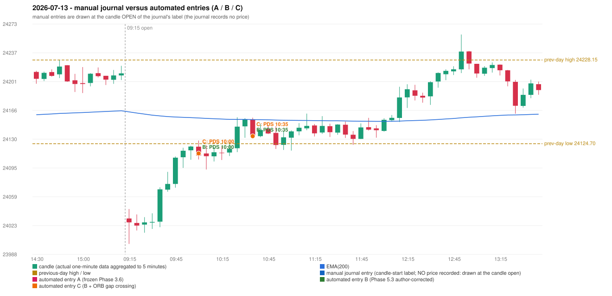

# 2026-07-13 (Monday) - manual journal versus the automated configurations

> SYNTHETIC index-point P&L; no real option P&L; costs illustrative (Rs 70 per trade + slippage scenarios). Configurations A / B / C are never combined.

## Session

* Open 24032.25; previous official close 24206.9; gap -174.65; previous-day high / low 24228.15 / 24124.7
* First 5-minute candle (09:15-09:20): O24032.25 H24044.0 L24000.85 C24027.45, RED, body 11.1%; EMA(200) at the first candle 24164.03; previous session's last close 24211.65 vs its EMA 24165.40

## Manual journal

no manual trade recorded

## Configuration A

Candidate signals (confirmed): 10:55 IRF/Method 2A SHORT [CONFLICT: SIMULTANEOUS_SIGNAL_CONFLICT_UNRESOLVED: IRF/Method 2A/SHORT, IRF/Method 2B/SHORT, PDS/Method 3/SHORT]; 10:55 IRF/Method 2B SHORT [CONFLICT: SIMULTANEOUS_SIGNAL_CONFLICT_UNRESOLVED: IRF/Method 2A/SHORT, IRF/Method 2B/SHORT, PDS/Method 3/SHORT]; 10:55 PDS/Method 3 SHORT [CONFLICT: SIMULTANEOUS_SIGNAL_CONFLICT_UNRESOLVED: IRF/Method 2A/SHORT, IRF/Method 2B/SHORT, PDS/Method 3/SHORT]; 11:45 IRF/Method 2A SHORT [IGNORED: DAY_UNRESOLVED_EXECUTION]; 11:45 PDS/Method 3 SHORT [IGNORED: DAY_UNRESOLVED_EXECUTION]; 11:55 PDS/Method 2 SHORT [IGNORED: DAY_UNRESOLVED_EXECUTION]; 13:25 IRF/Method 2A SHORT [IGNORED: DAY_UNRESOLVED_EXECUTION]; 15:15 IRF/Method 2A SHORT [IGNORED: DAY_UNRESOLVED_EXECUTION]

Strategies with no confirmed signal: ORB: Gap/200DMA INVALIDATED CANDLE_QUALITY_OR_REJECTION_WICK; Method 1 INVALIDATED TREND:EMA_PREV_SESSION_CLOSE wrong side; Method 2 INVALIDATED TREND:EMA_PREV_SESSI | PDR: no setup record (the strategy's trigger event never occurred) | RF: no setup record (the strategy's trigger event never occurred)

No trade: final day state UNRESOLVED_EXECUTION. Signals existed but none became a trade (see the dispositions above).

## Configuration B

Candidate signals (confirmed): 10:05 PDS/Method 1 SHORT [EXECUTED: trade 1: INITIAL_FULL_STOP]; 10:40 PDS/Method 1 SHORT [EXECUTED: trade 2: INITIAL_FULL_STOP]; 10:50 PDS/Method 1 SHORT [IGNORED: POSITION_ACTIVE (signal kept for diagnostics only; never reused)]; 10:55 PDS/Method 1 SHORT [IGNORED: POSITION_ACTIVE (signal kept for diagnostics only; never reused)]; 11:20 PDS/Method 1 SHORT [IGNORED: POSITION_ACTIVE (signal kept for diagnostics only; never reused)]; 11:30 PDS/Method 1 SHORT [IGNORED: POSITION_ACTIVE (signal kept for diagnostics only; never reused)]; 11:40 PDS/Method 1 SHORT [IGNORED: POSITION_ACTIVE (signal kept for diagnostics only; never reused)]

Strategies with no confirmed signal: IRF: Method 1/2 INCOMPLETE_AT_EOD SESSION_ENDED_BEFORE_CONFIRMATION | ORB: Gap/200DMA INVALIDATED CANDLE_QUALITY_OR_REJECTION_WICK; Method 1 INVALIDATED TREND:EMA_PREV_SESSION_CLOSE wrong side; Method 2 INVALIDATED TREND:EMA_PREV_SESSI | PDR: no setup record (the strategy's trigger event never occurred) | RF: no setup record (the strategy's trigger event never occurred)

| trade | strategy / method | dir | signal -> fill | entry | stop / T1 / T2 | leg 1 | leg 2 | outcome | gross Rs | net Rs (70, 0) | net Rs (70, 1.0) |
|---|---|---|---|---|---|---|---|---|---|---|---|
| 1 | PDS/Method 1 | SHORT | 10:05 -> 10:05 | 24112.65 | 24147.65 / 24085.65 / 24042.65 | 10:29 @ 24147.65 | 10:29 @ 24147.65 | INITIAL_FULL_STOP | -13,650 | -13,720 | -14,500 |
| 2 | PDS/Method 1 | SHORT | 10:40 -> 10:40 | 24134.05 | 24169.05 / 24107.05 / 24064.05 | 12:13 @ 24169.05 | 12:13 @ 24169.05 | INITIAL_FULL_STOP | -13,650 | -13,720 | -14,500 |

Selection: This PDS Method 1 signal was the earliest executable signal of the day: 0 confirmed signal(s) earlier, 0 other in the same minute. 6 later confirmed signal(s) (PDS x6) are logged as ignored or rejected. State of the other four engines at that moment: [IRF: no setup record before this time (a base condition was not met, or nothing triggered)] [ORB: Method 1 invalidated at 09:15: TREND:EMA_PREV_SESSION_CLOSE wrong side; Method 2 invalidated at 09:15: TREND:EMA_PREV_SESSION_CLOSE wrong side] [PDR: no setup record before this time (a base condition was not met, or nothing triggered)] [RF: no setup record before this time (a base condition was not met, or nothing triggered)]

* Automated PDS 10:00 has no strict / time-tolerant journal counterpart: UNRESOLVED_DISCRETIONARY_SELECTION - the journal records no trade this day; the automated system took PDS Method 1 SHORT (candle 10:00) mechanically
* Automated PDS 10:35 has no strict / time-tolerant journal counterpart: PORTFOLIO_CONTROLLER_CONSTRAINT - second trade of the day: the controller allows a PDR / PDS re-entry after the original full stop of trade 1 (PDS Method 1, signal candle 10:00); the journal has no unmatched row that day

## Configuration C

Candidate signals (confirmed): 10:05 PDS/Method 1 SHORT [EXECUTED: trade 1: INITIAL_FULL_STOP]; 10:40 PDS/Method 1 SHORT [EXECUTED: trade 2: INITIAL_FULL_STOP]; 10:50 PDS/Method 1 SHORT [IGNORED: POSITION_ACTIVE (signal kept for diagnostics only; never reused)]; 10:55 PDS/Method 1 SHORT [IGNORED: POSITION_ACTIVE (signal kept for diagnostics only; never reused)]; 11:20 PDS/Method 1 SHORT [IGNORED: POSITION_ACTIVE (signal kept for diagnostics only; never reused)]; 11:30 PDS/Method 1 SHORT [IGNORED: POSITION_ACTIVE (signal kept for diagnostics only; never reused)]; 11:40 PDS/Method 1 SHORT [IGNORED: POSITION_ACTIVE (signal kept for diagnostics only; never reused)]

Strategies with no confirmed signal: IRF: Method 1/2 INCOMPLETE_AT_EOD SESSION_ENDED_BEFORE_CONFIRMATION | ORB: Gap/200DMA INVALIDATED CANDLE_QUALITY_OR_REJECTION_WICK; Method 1 INVALIDATED TREND:EMA_PREV_SESSION_CLOSE wrong side; Method 2 INVALIDATED TREND:EMA_PREV_SESSI | PDR: no setup record (the strategy's trigger event never occurred) | RF: no setup record (the strategy's trigger event never occurred)

| trade | strategy / method | dir | signal -> fill | entry | stop / T1 / T2 | leg 1 | leg 2 | outcome | gross Rs | net Rs (70, 0) | net Rs (70, 1.0) |
|---|---|---|---|---|---|---|---|---|---|---|---|
| 1 | PDS/Method 1 | SHORT | 10:05 -> 10:05 | 24112.65 | 24147.65 / 24085.65 / 24042.65 | 10:29 @ 24147.65 | 10:29 @ 24147.65 | INITIAL_FULL_STOP | -13,650 | -13,720 | -14,500 |
| 2 | PDS/Method 1 | SHORT | 10:40 -> 10:40 | 24134.05 | 24169.05 / 24107.05 / 24064.05 | 12:13 @ 24169.05 | 12:13 @ 24169.05 | INITIAL_FULL_STOP | -13,650 | -13,720 | -14,500 |

Selection: This PDS Method 1 signal was the earliest executable signal of the day: 0 confirmed signal(s) earlier, 0 other in the same minute. 6 later confirmed signal(s) (PDS x6) are logged as ignored or rejected. State of the other four engines at that moment: [IRF: no setup record before this time (a base condition was not met, or nothing triggered)] [ORB: Method 1 invalidated at 09:15: TREND:EMA_PREV_SESSION_CLOSE wrong side; Method 2 invalidated at 09:15: TREND:EMA_PREV_SESSION_CLOSE wrong side] [PDR: no setup record before this time (a base condition was not met, or nothing triggered)] [RF: no setup record before this time (a base condition was not met, or nothing triggered)]

* Automated PDS 10:00 has no strict / time-tolerant journal counterpart: UNRESOLVED_DISCRETIONARY_SELECTION - the journal records no trade this day; the automated system took PDS Method 1 SHORT (candle 10:00) mechanically
* Automated PDS 10:35 has no strict / time-tolerant journal counterpart: PORTFOLIO_CONTROLLER_CONSTRAINT - second trade of the day: the controller allows a PDR / PDS re-entry after the original full stop of trade 1 (PDS Method 1, signal candle 10:00); the journal has no unmatched row that day

## Chart

