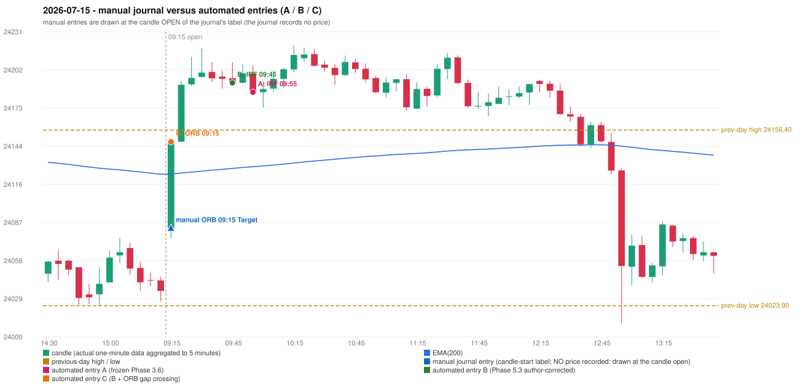

# 2026-07-15 (Wednesday) - manual journal versus the automated configurations

> SYNTHETIC index-point P&L; no real option P&L; costs illustrative (Rs 70 per trade + slippage scenarios). Configurations A / B / C are never combined.

## Session

* Open 24082.45; previous official close 24052.05; gap +30.40; previous-day high / low 24156.4 / 24023.9
* First 5-minute candle (09:15-09:20): O24082.45 H24148.3 L24074.7 C24147.35, GREEN, body 88.2%; EMA(200) at the first candle 24123.36; previous session's last close 24035.15 vs its EMA 24123.12

## Manual journal

row 160: ORB labelled 09:15, outcome Target

## Configuration A

Candidate signals (confirmed): 10:00 IRF/Method 2A SHORT [EXECUTED: trade 1: INITIAL_FULL_STOP]; 11:00 IRF/Method 2A SHORT [REJECTED: SECOND_TRADE_RESTRICTED_TO_PDR_PDS]; 11:40 IRF/Method 2B SHORT [REJECTED: SECOND_TRADE_RESTRICTED_TO_PDR_PDS]; 12:25 IRF/Method 2B SHORT [REJECTED: SECOND_TRADE_RESTRICTED_TO_PDR_PDS]; 12:40 IRF/Method 1 SHORT [REJECTED: SECOND_TRADE_RESTRICTED_TO_PDR_PDS]; 12:50 IRF/Method 1 SHORT [REJECTED: SECOND_TRADE_RESTRICTED_TO_PDR_PDS]

Strategies with no confirmed signal: ORB: Method 2 INVALIDATED TREND:EMA_PREV_SESSION_CLOSE wrong side | PDR: PDR INVALIDATED OPEN_NOT_STRICTLY_ABOVE_ZONE | PDS: no setup record (the strategy's trigger event never occurred) | RF: RF INVALIDATED TREND:EMA_PREV_SESSION_CLOSE wrong side

| trade | strategy / method | dir | signal -> fill | entry | stop / T1 / T2 | leg 1 | leg 2 | outcome | gross Rs | net Rs (70, 0) | net Rs (70, 1.0) |
|---|---|---|---|---|---|---|---|---|---|---|---|
| 1 | IRF/Method 2A | SHORT | 10:00 -> 10:00 | 24185.0 | 24220.0 / 24158.0 / 24125.0 | 10:19 @ 24220.0 | 10:19 @ 24220.0 | INITIAL_FULL_STOP | -13,650 | -13,720 | -14,500 |

Selection: This IRF Method 2A signal was the earliest executable signal of the day: 0 confirmed signal(s) earlier, 0 other in the same minute. 5 later confirmed signal(s) (IRF x5) are logged as ignored or rejected. State of the other four engines at that moment: [ORB: Method 2 invalidated at 09:15: TREND:EMA_PREV_SESSION_CLOSE wrong side] [PDR: PDR invalidated at 09:15: OPEN_NOT_STRICTLY_ABOVE_ZONE] [PDS: no setup record before this time (a base condition was not met, or nothing triggered)] [RF: no setup record before this time (a base condition was not met, or nothing triggered)]

* Journal row 160 (ORB 09:15): **UNMATCHED_MANUAL**; earliest cause OPENING_GAP_MISMATCH: first candle GREEN O24082.45 H24148.3 L24074.7 C24147.35 (body 88.2%); direction ASSUMED from the colour (the journal has no direction); closest method Gap/200DMA (1 failing predicate(s)): first failing 'gap_crosses_200_average' - previous close 24052.05 vs previous EMA 24123.12; open 24082.45 vs EMA 24123.36; all methods: Method 1: 2 fail (level_broken); Method 2: 2 fail (trend); Gap/200DMA: 1 fail (gap_crosses_200_average)
* Automated IRF 09:55 has no strict / time-tolerant journal counterpart: DIFFERENT_STRATEGY_SELECTED - the journal traded ORB 09:15; the automated controller took IRF Method 2A (candle 09:55) as the first valid signal

## Configuration B

Candidate signals (confirmed): 09:50 IRF/Method 2A SHORT [EXECUTED: trade 1: TARGET]; 10:30 IRF/Method 2B SHORT [IGNORED: POSITION_ACTIVE (signal kept for diagnostics only; never reused)]; 11:40 IRF/Method 2B SHORT [IGNORED: POSITION_ACTIVE (signal kept for diagnostics only; never reused)]; 12:25 IRF/Method 2B SHORT [IGNORED: POSITION_ACTIVE (signal kept for diagnostics only; never reused)]

Strategies with no confirmed signal: ORB: Method 2 INVALIDATED TREND:EMA_PREV_SESSION_CLOSE wrong side | PDR: PDR INVALIDATED OPEN_NOT_STRICTLY_ABOVE_ZONE | PDS: no setup record (the strategy's trigger event never occurred) | RF: RF INVALIDATED TREND:EMA_PREV_SESSION_CLOSE wrong side

| trade | strategy / method | dir | signal -> fill | entry | stop / T1 / T2 | leg 1 | leg 2 | outcome | gross Rs | net Rs (70, 0) | net Rs (70, 1.0) |
|---|---|---|---|---|---|---|---|---|---|---|---|
| 1 | IRF/Method 2A | SHORT | 09:50 -> 09:50 | 24192.1 | 24227.1 / 24165.1 / 24132.1 | 12:33 @ 24165.1 | 12:54 @ 24132.1 | TARGET | 16,965 | 16,895 | 16,115 |

Selection: This IRF Method 2A signal was the earliest executable signal of the day: 0 confirmed signal(s) earlier, 0 other in the same minute. 3 later confirmed signal(s) (IRF x3) are logged as ignored or rejected. State of the other four engines at that moment: [ORB: Method 2 invalidated at 09:15: TREND:EMA_PREV_SESSION_CLOSE wrong side] [PDR: PDR invalidated at 09:15: OPEN_NOT_STRICTLY_ABOVE_ZONE] [PDS: no setup record before this time (a base condition was not met, or nothing triggered)] [RF: no setup record before this time (a base condition was not met, or nothing triggered)]

* Journal row 160 (ORB 09:15): **UNMATCHED_MANUAL**; earliest cause OPENING_GAP_MISMATCH: first candle GREEN O24082.45 H24148.3 L24074.7 C24147.35 (body 88.2%); direction ASSUMED from the colour (the journal has no direction); closest method Gap/200DMA (1 failing predicate(s)): first failing 'gap_crosses_200_average' - previous close 24052.05 vs previous EMA 24123.12; open 24082.45 vs EMA 24123.36; all methods: Method 1: 2 fail (level_broken); Method 2: 2 fail (trend); Gap/200DMA: 1 fail (gap_crosses_200_average)
* Automated IRF 09:45 has no strict / time-tolerant journal counterpart: DIFFERENT_STRATEGY_SELECTED - the journal traded ORB 09:15; the automated controller took IRF Method 2A (candle 09:45) as the first valid signal

## Configuration C

Candidate signals (confirmed): 09:20 ORB/Gap/200DMA LONG [EXECUTED: trade 1: TARGET]; 09:50 IRF/Method 2A SHORT [IGNORED: DAY_FINISHED]; 10:30 IRF/Method 2B SHORT [IGNORED: DAY_FINISHED]; 11:40 IRF/Method 2B SHORT [IGNORED: DAY_FINISHED]; 12:25 IRF/Method 2B SHORT [IGNORED: DAY_FINISHED]

Strategies with no confirmed signal: PDR: PDR INVALIDATED OPEN_NOT_STRICTLY_ABOVE_ZONE | PDS: no setup record (the strategy's trigger event never occurred) | RF: RF INVALIDATED TREND:EMA_PREV_SESSION_CLOSE wrong side

| trade | strategy / method | dir | signal -> fill | entry | stop / T1 / T2 | leg 1 | leg 2 | outcome | gross Rs | net Rs (70, 0) | net Rs (70, 1.0) |
|---|---|---|---|---|---|---|---|---|---|---|---|
| 1 | ORB/Gap/200DMA | LONG | 09:20 -> 09:20 | 24147.65 | 24117.65 / 24174.65 / 24207.65 | 09:22 @ 24174.65 | 09:26 @ 24207.65 | TARGET | 16,965 | 16,895 | 16,115 |

Selection: This ORB Gap/200DMA signal was the earliest executable signal of the day: 0 confirmed signal(s) earlier, 0 other in the same minute. 4 later confirmed signal(s) (IRF x4) are logged as ignored or rejected. State of the other four engines at that moment: [IRF: no setup record before this time (a base condition was not met, or nothing triggered)] [PDR: PDR invalidated at 09:15: OPEN_NOT_STRICTLY_ABOVE_ZONE] [PDS: no setup record before this time (a base condition was not met, or nothing triggered)] [RF: no setup record before this time (a base condition was not met, or nothing triggered)]

* Journal row 160 (ORB 09:15): **STRICT** match with 20260715-1-ORB (delta +0 min); outcome Target vs automated TARGET (same class)

## Chart

