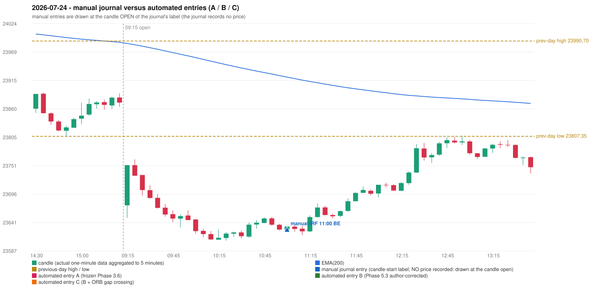

# 2026-07-24 (Friday) - manual journal versus the automated configurations

> SYNTHETIC index-point P&L; no real option P&L; costs illustrative (Rs 70 per trade + slippage scenarios). Configurations A / B / C are never combined.

## Session

* Open 23674.4; previous official close 23869.6; gap -195.20; previous-day high / low 23990.7 / 23807.35
* First 5-minute candle (09:15-09:20): O23674.4 H23752.05 L23650.3 C23751.7, GREEN, body 76.0%; EMA(200) at the first candle 23986.07; previous session's last close 23872.2 vs its EMA 23988.42

## Manual journal

row 167: IRF labelled 11:00, outcome BE

## Configuration A

Candidate signals (confirmed): 13:05 IRF/Method 2B SHORT [REJECTED: ENTRY_CUTOFF_EXCEEDED(fill 13:05 IST > 13:00)]; 13:45 IRF/Method 1 SHORT [REJECTED: ENTRY_CUTOFF_EXCEEDED(fill 13:45 IST > 13:00)]; 14:10 PDS/Method 1 SHORT [REJECTED: ENTRY_CUTOFF_EXCEEDED(fill 14:10 IST > 13:00)]; 14:15 IRF/Method 2B SHORT [REJECTED: ENTRY_CUTOFF_EXCEEDED(fill 14:15 IST > 13:00)]; 15:05 IRF/Method 2A SHORT [REJECTED: ENTRY_CUTOFF_EXCEEDED(fill 15:05 IST > 13:00)]

Strategies with no confirmed signal: ORB: Method 1 INVALIDATED CANDLE_QUALITY(not a strong body / wick too large); Method 2 INVALIDATED CANDLE_QUALITY | PDR: no setup record (the strategy's trigger event never occurred) | RF: RF INVALIDATED TREND:EMA_PREV_SESSION_CLOSE wrong side

No trade: final day state READY_FOR_FIRST_TRADE. Signals existed but none became a trade (see the dispositions above).

* Journal row 167 (IRF 11:00): **UNMATCHED_MANUAL**; earliest cause UNRESOLVED_DISCRETIONARY_SELECTION: no automated IRF signal within 60 minutes of the manual label 11:00 (nearest: 13:05, candle 13:00, 120 minutes later); the engine produced no IRF signal near the manual entry (setup records: Method 1/2: SESSION_ENDED_BEFORE_CONFIRMATION); the journal gives no reason for the manual entry (rule points that are discretionary or unresolved: IRF Method 1 boundary IRF-M1-003, Method 3 wick share, the day's-low rule)

## Configuration B

Candidate signals (confirmed): 13:05 IRF/Method 2A SHORT [REJECTED: ENTRY_CUTOFF_EXCEEDED(fill 13:05 IST > 13:00)]; 13:05 IRF/Method 2B SHORT [REJECTED: ENTRY_CUTOFF_EXCEEDED(fill 13:05 IST > 13:00)]; 13:45 IRF/Method 1 SHORT [REJECTED: ENTRY_CUTOFF_EXCEEDED(fill 13:45 IST > 13:00)]; 14:10 PDS/Method 1 SHORT [REJECTED: ENTRY_CUTOFF_EXCEEDED(fill 14:10 IST > 13:00)]; 14:15 IRF/Method 2A SHORT [REJECTED: ENTRY_CUTOFF_EXCEEDED(fill 14:15 IST > 13:00)]; 14:15 IRF/Method 2B SHORT [REJECTED: ENTRY_CUTOFF_EXCEEDED(fill 14:15 IST > 13:00)]; 14:35 IRF/Method 2A SHORT [REJECTED: ENTRY_CUTOFF_EXCEEDED(fill 14:35 IST > 13:00)]; 15:00 IRF/Method 2B SHORT [REJECTED: ENTRY_CUTOFF_EXCEEDED(fill 15:00 IST > 13:00)]

Strategies with no confirmed signal: ORB: Method 1 INVALIDATED CANDLE_QUALITY(not a strong body / wick too large); Method 2 INVALIDATED CANDLE_QUALITY | PDR: no setup record (the strategy's trigger event never occurred) | RF: RF INVALIDATED TREND:EMA_PREV_SESSION_CLOSE wrong side

No trade: final day state READY_FOR_FIRST_TRADE. Signals existed but none became a trade (see the dispositions above).

* Journal row 167 (IRF 11:00): **UNMATCHED_MANUAL**; earliest cause UNRESOLVED_DISCRETIONARY_SELECTION: no automated IRF signal within 60 minutes of the manual label 11:00 (nearest: 13:05, candle 13:00, 120 minutes later); the engine produced no IRF signal near the manual entry (setup records: Method 1/2: SESSION_ENDED_BEFORE_CONFIRMATION); the journal gives no reason for the manual entry (rule points that are discretionary or unresolved: IRF Method 1 boundary IRF-M1-003, Method 3 wick share, the day's-low rule)

## Configuration C

Candidate signals (confirmed): 13:05 IRF/Method 2A SHORT [REJECTED: ENTRY_CUTOFF_EXCEEDED(fill 13:05 IST > 13:00)]; 13:05 IRF/Method 2B SHORT [REJECTED: ENTRY_CUTOFF_EXCEEDED(fill 13:05 IST > 13:00)]; 13:45 IRF/Method 1 SHORT [REJECTED: ENTRY_CUTOFF_EXCEEDED(fill 13:45 IST > 13:00)]; 14:10 PDS/Method 1 SHORT [REJECTED: ENTRY_CUTOFF_EXCEEDED(fill 14:10 IST > 13:00)]; 14:15 IRF/Method 2A SHORT [REJECTED: ENTRY_CUTOFF_EXCEEDED(fill 14:15 IST > 13:00)]; 14:15 IRF/Method 2B SHORT [REJECTED: ENTRY_CUTOFF_EXCEEDED(fill 14:15 IST > 13:00)]; 14:35 IRF/Method 2A SHORT [REJECTED: ENTRY_CUTOFF_EXCEEDED(fill 14:35 IST > 13:00)]; 15:00 IRF/Method 2B SHORT [REJECTED: ENTRY_CUTOFF_EXCEEDED(fill 15:00 IST > 13:00)]

Strategies with no confirmed signal: ORB: Method 1 INVALIDATED CANDLE_QUALITY(not a strong body / wick too large); Method 2 INVALIDATED CANDLE_QUALITY | PDR: no setup record (the strategy's trigger event never occurred) | RF: RF INVALIDATED TREND:EMA_PREV_SESSION_CLOSE wrong side

No trade: final day state READY_FOR_FIRST_TRADE. Signals existed but none became a trade (see the dispositions above).

* Journal row 167 (IRF 11:00): **UNMATCHED_MANUAL**; earliest cause UNRESOLVED_DISCRETIONARY_SELECTION: no automated IRF signal within 60 minutes of the manual label 11:00 (nearest: 13:05, candle 13:00, 120 minutes later); the engine produced no IRF signal near the manual entry (setup records: Method 1/2: SESSION_ENDED_BEFORE_CONFIRMATION); the journal gives no reason for the manual entry (rule points that are discretionary or unresolved: IRF Method 1 boundary IRF-M1-003, Method 3 wick share, the day's-low rule)

## Chart

