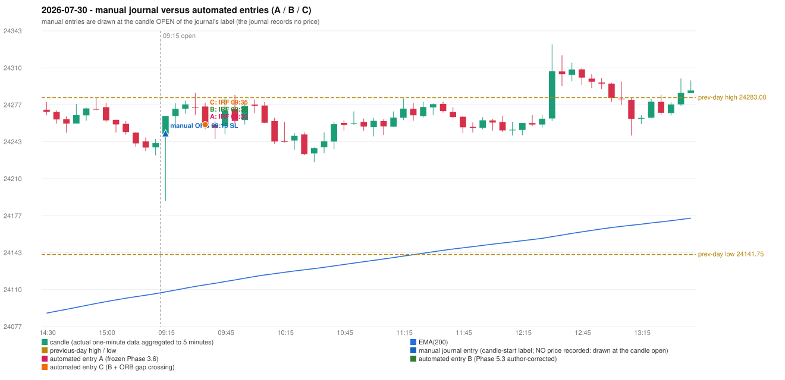

# 2026-07-30 (Thursday) - manual journal versus the automated configurations

> SYNTHETIC index-point P&L; no real option P&L; costs illustrative (Rs 70 per trade + slippage scenarios). Configurations A / B / C are never combined.

## Session

* Open 24250.4; previous official close 24250.2; gap +0.20; previous-day high / low 24283.0 / 24141.75
* First 5-minute candle (09:15-09:20): O24250.4 H24266.65 L24190.0 C24266.55, GREEN, body 21.1%; EMA(200) at the first candle 24108.00; previous session's last close 24242.0 vs its EMA 24106.40

## Manual journal

row 170: ORB labelled 09:15, outcome SL

## Configuration A

Candidate signals (confirmed): 09:40 IRF/Method 1 SHORT [EXECUTED: trade 1: T1_THEN_BUFFER_STOP]; 09:55 IRF/Method 1 SHORT [IGNORED: POSITION_ACTIVE (signal kept for diagnostics only; never reused)]; 10:10 IRF/Method 1 SHORT [IGNORED: POSITION_ACTIVE (signal kept for diagnostics only; never reused)]; 10:15 IRF/Method 2A SHORT [IGNORED: POSITION_ACTIVE (signal kept for diagnostics only; never reused)]; 11:45 IRF/Method 1 SHORT [IGNORED: DAY_FINISHED]; 13:10 IRF/Method 2B SHORT [IGNORED: DAY_FINISHED]; 13:15 IRF/Method 1 SHORT [IGNORED: DAY_FINISHED]; 13:50 IRF/Method 2B SHORT [IGNORED: DAY_FINISHED]; 14:10 IRF/Method 1 SHORT [IGNORED: DAY_FINISHED]; 14:10 IRF/Method 2A SHORT [IGNORED: DAY_FINISHED]; 14:45 IRF/Method 1 SHORT [IGNORED: DAY_FINISHED]; 15:30 IRF/Method 2A SHORT [IGNORED: DAY_FINISHED]

Strategies with no confirmed signal: ORB: no setup record (the strategy's trigger event never occurred) | PDR: PDR INVALIDATED OPEN_NOT_STRICTLY_ABOVE_ZONE | PDS: no setup record (the strategy's trigger event never occurred) | RF: no setup record (the strategy's trigger event never occurred)

| trade | strategy / method | dir | signal -> fill | entry | stop / T1 / T2 | leg 1 | leg 2 | outcome | gross Rs | net Rs (70, 0) | net Rs (70, 1.0) |
|---|---|---|---|---|---|---|---|---|---|---|---|
| 1 | IRF/Method 1 | SHORT | 09:40 -> 09:40 | 24258.7 | 24293.7 / 24231.7 / 24198.7 | 10:29 @ 24231.7 | 10:50 @ 24264.7 | T1_THEN_BUFFER_STOP | 4,095 | 4,025 | 3,245 |

Selection: This IRF Method 1 signal was the earliest executable signal of the day: 0 confirmed signal(s) earlier, 0 other in the same minute. 11 later confirmed signal(s) (IRF x11) are logged as ignored or rejected. State of the other four engines at that moment: [ORB: no setup record before this time (a base condition was not met, or nothing triggered)] [PDR: PDR invalidated at 09:15: OPEN_NOT_STRICTLY_ABOVE_ZONE] [PDS: no setup record before this time (a base condition was not met, or nothing triggered)] [RF: no setup record before this time (a base condition was not met, or nothing triggered)]

* Journal row 170 (ORB 09:15): **UNMATCHED_MANUAL**; earliest cause LEVEL_CONSTRUCTION_MISMATCH (+ OPENING_GAP_MISMATCH): first candle GREEN O24250.4 H24266.65 L24190.0 C24266.55 (body 21.1%); direction ASSUMED from the colour (the journal has no direction); TIE-BROKEN BY METHOD ORDER: 3 methods tie at 1 failing predicate(s) (Method 1: level_broken; Method 2: inner_level_broken; Gap/200DMA: gap_crosses_200_average) - the evidence does not single out one cause, the secondary cause is the other tied one; closest method Method 1 (1 failing predicate(s)): first failing 'level_broken' - previous-day high 24283.0; candle high/low 24266.65, close 24266.55; all methods: Method 1: 1 fail (level_broken); Method 2: 1 fail (inner_level_broken); Gap/200DMA: 1 fail (gap_crosses_200_average)
* Automated IRF 09:35 has no strict / time-tolerant journal counterpart: DIFFERENT_STRATEGY_SELECTED - the journal traded ORB 09:15; the automated controller took IRF Method 1 (candle 09:35) as the first valid signal

## Configuration B

Candidate signals (confirmed): 09:40 IRF/Method 1 SHORT [EXECUTED: trade 1: T1_THEN_BUFFER_STOP]; 09:40 IRF/Method 2A SHORT [MERGED_SAME_STRATEGY_METHOD: traded as another method of the same strategy/direction in the same minute]; 09:55 IRF/Method 1 SHORT [IGNORED: POSITION_ACTIVE (signal kept for diagnostics only; never reused)]; 10:10 IRF/Method 1 SHORT [IGNORED: POSITION_ACTIVE (signal kept for diagnostics only; never reused)]; 10:15 IRF/Method 2A SHORT [IGNORED: POSITION_ACTIVE (signal kept for diagnostics only; never reused)]; 11:45 IRF/Method 1 SHORT [IGNORED: DAY_FINISHED]; 13:05 IRF/Method 2A SHORT [IGNORED: DAY_FINISHED]; 13:15 IRF/Method 1 SHORT [IGNORED: DAY_FINISHED]; 13:50 IRF/Method 2B SHORT [IGNORED: DAY_FINISHED]; 14:10 IRF/Method 1 SHORT [IGNORED: DAY_FINISHED]; 14:10 IRF/Method 2A SHORT [IGNORED: DAY_FINISHED]; 14:45 IRF/Method 1 SHORT [IGNORED: DAY_FINISHED]; 15:20 IRF/Method 2A SHORT [IGNORED: DAY_FINISHED]

Strategies with no confirmed signal: ORB: no setup record (the strategy's trigger event never occurred) | PDR: PDR INVALIDATED OPEN_NOT_STRICTLY_ABOVE_ZONE | PDS: no setup record (the strategy's trigger event never occurred) | RF: no setup record (the strategy's trigger event never occurred)

| trade | strategy / method | dir | signal -> fill | entry | stop / T1 / T2 | leg 1 | leg 2 | outcome | gross Rs | net Rs (70, 0) | net Rs (70, 1.0) |
|---|---|---|---|---|---|---|---|---|---|---|---|
| 1 | IRF/Method 1 | SHORT | 09:40 -> 09:40 | 24258.7 | 24293.7 / 24231.7 / 24198.7 | 10:29 @ 24231.7 | 10:50 @ 24264.7 | T1_THEN_BUFFER_STOP | 4,095 | 4,025 | 3,245 |

Selection: This IRF Method 1 signal was the earliest executable signal of the day: 0 confirmed signal(s) earlier, 1 other in the same minute. 11 later confirmed signal(s) (IRF x11) are logged as ignored or rejected. State of the other four engines at that moment: [ORB: no setup record before this time (a base condition was not met, or nothing triggered)] [PDR: PDR invalidated at 09:15: OPEN_NOT_STRICTLY_ABOVE_ZONE] [PDS: no setup record before this time (a base condition was not met, or nothing triggered)] [RF: no setup record before this time (a base condition was not met, or nothing triggered)]

* Journal row 170 (ORB 09:15): **UNMATCHED_MANUAL**; earliest cause LEVEL_CONSTRUCTION_MISMATCH (+ OPENING_GAP_MISMATCH): first candle GREEN O24250.4 H24266.65 L24190.0 C24266.55 (body 21.1%); direction ASSUMED from the colour (the journal has no direction); TIE-BROKEN BY METHOD ORDER: 3 methods tie at 1 failing predicate(s) (Method 1: level_broken; Method 2: inner_level_broken; Gap/200DMA: gap_crosses_200_average) - the evidence does not single out one cause, the secondary cause is the other tied one; closest method Method 1 (1 failing predicate(s)): first failing 'level_broken' - previous-day high 24283.0; candle high/low 24266.65, close 24266.55; all methods: Method 1: 1 fail (level_broken); Method 2: 1 fail (inner_level_broken); Gap/200DMA: 1 fail (gap_crosses_200_average)
* Automated IRF 09:35 has no strict / time-tolerant journal counterpart: DIFFERENT_STRATEGY_SELECTED - the journal traded ORB 09:15; the automated controller took IRF Method 1 (candle 09:35) as the first valid signal

## Configuration C

Candidate signals (confirmed): 09:40 IRF/Method 1 SHORT [EXECUTED: trade 1: T1_THEN_BUFFER_STOP]; 09:40 IRF/Method 2A SHORT [MERGED_SAME_STRATEGY_METHOD: traded as another method of the same strategy/direction in the same minute]; 09:55 IRF/Method 1 SHORT [IGNORED: POSITION_ACTIVE (signal kept for diagnostics only; never reused)]; 10:10 IRF/Method 1 SHORT [IGNORED: POSITION_ACTIVE (signal kept for diagnostics only; never reused)]; 10:15 IRF/Method 2A SHORT [IGNORED: POSITION_ACTIVE (signal kept for diagnostics only; never reused)]; 11:45 IRF/Method 1 SHORT [IGNORED: DAY_FINISHED]; 13:05 IRF/Method 2A SHORT [IGNORED: DAY_FINISHED]; 13:15 IRF/Method 1 SHORT [IGNORED: DAY_FINISHED]; 13:50 IRF/Method 2B SHORT [IGNORED: DAY_FINISHED]; 14:10 IRF/Method 1 SHORT [IGNORED: DAY_FINISHED]; 14:10 IRF/Method 2A SHORT [IGNORED: DAY_FINISHED]; 14:45 IRF/Method 1 SHORT [IGNORED: DAY_FINISHED]; 15:20 IRF/Method 2A SHORT [IGNORED: DAY_FINISHED]

Strategies with no confirmed signal: ORB: no setup record (the strategy's trigger event never occurred) | PDR: PDR INVALIDATED OPEN_NOT_STRICTLY_ABOVE_ZONE | PDS: no setup record (the strategy's trigger event never occurred) | RF: no setup record (the strategy's trigger event never occurred)

| trade | strategy / method | dir | signal -> fill | entry | stop / T1 / T2 | leg 1 | leg 2 | outcome | gross Rs | net Rs (70, 0) | net Rs (70, 1.0) |
|---|---|---|---|---|---|---|---|---|---|---|---|
| 1 | IRF/Method 1 | SHORT | 09:40 -> 09:40 | 24258.7 | 24293.7 / 24231.7 / 24198.7 | 10:29 @ 24231.7 | 10:50 @ 24264.7 | T1_THEN_BUFFER_STOP | 4,095 | 4,025 | 3,245 |

Selection: This IRF Method 1 signal was the earliest executable signal of the day: 0 confirmed signal(s) earlier, 1 other in the same minute. 11 later confirmed signal(s) (IRF x11) are logged as ignored or rejected. State of the other four engines at that moment: [ORB: no setup record before this time (a base condition was not met, or nothing triggered)] [PDR: PDR invalidated at 09:15: OPEN_NOT_STRICTLY_ABOVE_ZONE] [PDS: no setup record before this time (a base condition was not met, or nothing triggered)] [RF: no setup record before this time (a base condition was not met, or nothing triggered)]

* Journal row 170 (ORB 09:15): **UNMATCHED_MANUAL**; earliest cause LEVEL_CONSTRUCTION_MISMATCH (+ OPENING_GAP_MISMATCH): first candle GREEN O24250.4 H24266.65 L24190.0 C24266.55 (body 21.1%); direction ASSUMED from the colour (the journal has no direction); TIE-BROKEN BY METHOD ORDER: 3 methods tie at 1 failing predicate(s) (Method 1: level_broken; Method 2: inner_level_broken; Gap/200DMA: gap_crosses_200_average) - the evidence does not single out one cause, the secondary cause is the other tied one; closest method Method 1 (1 failing predicate(s)): first failing 'level_broken' - previous-day high 24283.0; candle high/low 24266.65, close 24266.55; all methods: Method 1: 1 fail (level_broken); Method 2: 1 fail (inner_level_broken); Gap/200DMA: 1 fail (gap_crosses_200_average)
* Automated IRF 09:35 has no strict / time-tolerant journal counterpart: DIFFERENT_STRATEGY_SELECTED - the journal traded ORB 09:15; the automated controller took IRF Method 1 (candle 09:35) as the first valid signal

## Chart

