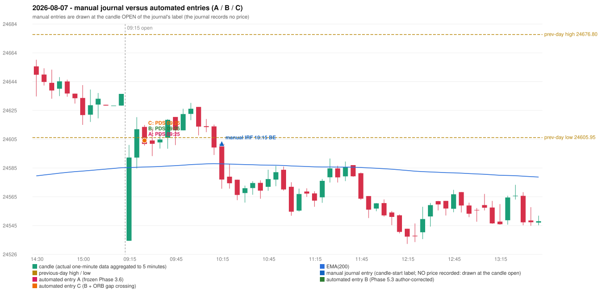

# 2026-08-07 (Friday) - manual journal versus the automated configurations

> SYNTHETIC index-point P&L; no real option P&L; costs illustrative (Rs 70 per trade + slippage scenarios). Configurations A / B / C are never combined.

## Session

* Open 24535.05; previous official close 24636.0; gap -100.95; previous-day high / low 24676.8 / 24605.95
* First 5-minute candle (09:15-09:20): O24535.05 H24600.9 L24535.05 C24592.25, GREEN, body 86.9%; EMA(200) at the first candle 24585.34; previous session's last close 24636.0 vs its EMA 24585.27

## Manual journal

row 175: IRF labelled 10:15, outcome BE

## Configuration A

Candidate signals (confirmed): 09:30 PDS/Method 1 SHORT [EXECUTED: trade 1: TARGET]; 09:50 IRF/Method 2B SHORT [IGNORED: POSITION_ACTIVE (signal kept for diagnostics only; never reused)]; 10:15 IRF/Method 1 SHORT [IGNORED: POSITION_ACTIVE (signal kept for diagnostics only; never reused)]; 10:15 IRF/Method 2A SHORT [IGNORED: POSITION_ACTIVE (signal kept for diagnostics only; never reused)]; 10:15 PDS/Method 3 SHORT [IGNORED: POSITION_ACTIVE (signal kept for diagnostics only; never reused)]

Strategies with no confirmed signal: ORB: Gap/200DMA INVALIDATED CLOSE_NOT_BEYOND_MA; Method 1 INVALIDATED TREND:EMA_PREV_SESSION_CLOSE wrong side; Method 2 INVALIDATED TREND:EMA_PREV_SESSION_CLOSE wron | PDR: no setup record (the strategy's trigger event never occurred) | RF: RF INVALIDATED GAP_NOT_UP(DOWN)

| trade | strategy / method | dir | signal -> fill | entry | stop / T1 / T2 | leg 1 | leg 2 | outcome | gross Rs | net Rs (70, 0) | net Rs (70, 1.0) |
|---|---|---|---|---|---|---|---|---|---|---|---|
| 1 | PDS/Method 1 | SHORT | 09:30 -> 09:30 | 24604.0 | 24639.0 / 24577.0 / 24534.0 | 10:18 @ 24577.0 | 12:17 @ 24534.0 | TARGET | 18,915 | 18,845 | 18,065 |

Selection: This PDS Method 1 signal was the earliest executable signal of the day: 0 confirmed signal(s) earlier, 0 other in the same minute. 4 later confirmed signal(s) (IRF x3, PDS x1) are logged as ignored or rejected. State of the other four engines at that moment: [IRF: no setup record before this time (a base condition was not met, or nothing triggered)] [ORB: Method 1 invalidated at 09:15: TREND:EMA_PREV_SESSION_CLOSE wrong side; Method 2 invalidated at 09:15: TREND:EMA_PREV_SESSION_CLOSE wrong side] [PDR: no setup record before this time (a base condition was not met, or nothing triggered)] [RF: no setup record before this time (a base condition was not met, or nothing triggered)]

* Journal row 175 (IRF 10:15): **UNMATCHED_MANUAL**; earliest cause DIFFERENT_STRATEGY_SELECTED (+ PORTFOLIO_CONTROLLER_CONSTRAINT): the controller took PDS Method 1 (signal 09:30) first; the IRF signal at 10:15 was IGNORED: POSITION_ACTIVE (signal kept for diagnostics only; never reused)
* Automated PDS 09:25 has no strict / time-tolerant journal counterpart: DIFFERENT_STRATEGY_SELECTED - the journal traded IRF 10:15; the automated controller took PDS Method 1 (candle 09:25) as the first valid signal

## Configuration B

Candidate signals (confirmed): 09:30 PDS/Method 1 SHORT [EXECUTED: trade 1: TARGET]; 10:15 PDS/Method 3 SHORT [IGNORED: POSITION_ACTIVE (signal kept for diagnostics only; never reused)]; 12:10 IRF/Method 2A SHORT [IGNORED: POSITION_ACTIVE (signal kept for diagnostics only; never reused)]; 12:10 IRF/Method 2B SHORT [IGNORED: POSITION_ACTIVE (signal kept for diagnostics only; never reused)]

Strategies with no confirmed signal: ORB: Gap/200DMA INVALIDATED CLOSE_NOT_BEYOND_MA; Method 1 INVALIDATED TREND:EMA_PREV_SESSION_CLOSE wrong side; Method 2 INVALIDATED TREND:EMA_PREV_SESSION_CLOSE wron | PDR: no setup record (the strategy's trigger event never occurred) | RF: RF INVALIDATED GAP_NOT_UP(DOWN)

| trade | strategy / method | dir | signal -> fill | entry | stop / T1 / T2 | leg 1 | leg 2 | outcome | gross Rs | net Rs (70, 0) | net Rs (70, 1.0) |
|---|---|---|---|---|---|---|---|---|---|---|---|
| 1 | PDS/Method 1 | SHORT | 09:30 -> 09:30 | 24604.0 | 24639.0 / 24577.0 / 24534.0 | 10:18 @ 24577.0 | 12:17 @ 24534.0 | TARGET | 18,915 | 18,845 | 18,065 |

Selection: This PDS Method 1 signal was the earliest executable signal of the day: 0 confirmed signal(s) earlier, 0 other in the same minute. 3 later confirmed signal(s) (IRF x2, PDS x1) are logged as ignored or rejected. State of the other four engines at that moment: [IRF: no setup record before this time (a base condition was not met, or nothing triggered)] [ORB: Method 1 invalidated at 09:15: TREND:EMA_PREV_SESSION_CLOSE wrong side; Method 2 invalidated at 09:15: TREND:EMA_PREV_SESSION_CLOSE wrong side] [PDR: no setup record before this time (a base condition was not met, or nothing triggered)] [RF: no setup record before this time (a base condition was not met, or nothing triggered)]

* Journal row 175 (IRF 10:15): **UNMATCHED_MANUAL**; earliest cause EMA_FILTER_MISMATCH: no automated IRF signal within 60 minutes of the manual label 10:15 (nearest: 12:10, candle 12:05, 110 minutes later); an IRF Method 2B candidate at 10:05 was REJECTED by the 28-point EMA clearance (range distance 19.8, EMA EMA_BELOW_CANDLE) - PROVISIONAL_EMA_RANGE_DISTANCE
* Automated PDS 09:25 has no strict / time-tolerant journal counterpart: DIFFERENT_STRATEGY_SELECTED - the journal traded IRF 10:15; the automated controller took PDS Method 1 (candle 09:25) as the first valid signal

## Configuration C

Candidate signals (confirmed): 09:30 PDS/Method 1 SHORT [EXECUTED: trade 1: TARGET]; 10:15 PDS/Method 3 SHORT [IGNORED: POSITION_ACTIVE (signal kept for diagnostics only; never reused)]; 12:10 IRF/Method 2A SHORT [IGNORED: POSITION_ACTIVE (signal kept for diagnostics only; never reused)]; 12:10 IRF/Method 2B SHORT [IGNORED: POSITION_ACTIVE (signal kept for diagnostics only; never reused)]

Strategies with no confirmed signal: ORB: Gap/200DMA INVALIDATED CLOSE_NOT_BEYOND_MA; Method 1 INVALIDATED TREND:EMA_PREV_SESSION_CLOSE wrong side; Method 2 INVALIDATED TREND:EMA_PREV_SESSION_CLOSE wron | PDR: no setup record (the strategy's trigger event never occurred) | RF: RF INVALIDATED GAP_NOT_UP(DOWN)

| trade | strategy / method | dir | signal -> fill | entry | stop / T1 / T2 | leg 1 | leg 2 | outcome | gross Rs | net Rs (70, 0) | net Rs (70, 1.0) |
|---|---|---|---|---|---|---|---|---|---|---|---|
| 1 | PDS/Method 1 | SHORT | 09:30 -> 09:30 | 24604.0 | 24639.0 / 24577.0 / 24534.0 | 10:18 @ 24577.0 | 12:17 @ 24534.0 | TARGET | 18,915 | 18,845 | 18,065 |

Selection: This PDS Method 1 signal was the earliest executable signal of the day: 0 confirmed signal(s) earlier, 0 other in the same minute. 3 later confirmed signal(s) (IRF x2, PDS x1) are logged as ignored or rejected. State of the other four engines at that moment: [IRF: no setup record before this time (a base condition was not met, or nothing triggered)] [ORB: Method 1 invalidated at 09:15: TREND:EMA_PREV_SESSION_CLOSE wrong side; Method 2 invalidated at 09:15: TREND:EMA_PREV_SESSION_CLOSE wrong side] [PDR: no setup record before this time (a base condition was not met, or nothing triggered)] [RF: no setup record before this time (a base condition was not met, or nothing triggered)]

* Journal row 175 (IRF 10:15): **UNMATCHED_MANUAL**; earliest cause EMA_FILTER_MISMATCH: no automated IRF signal within 60 minutes of the manual label 10:15 (nearest: 12:10, candle 12:05, 110 minutes later); an IRF Method 2B candidate at 10:05 was REJECTED by the 28-point EMA clearance (range distance 19.8, EMA EMA_BELOW_CANDLE) - PROVISIONAL_EMA_RANGE_DISTANCE
* Automated PDS 09:25 has no strict / time-tolerant journal counterpart: DIFFERENT_STRATEGY_SELECTED - the journal traded IRF 10:15; the automated controller took PDS Method 1 (candle 09:25) as the first valid signal

## Chart

