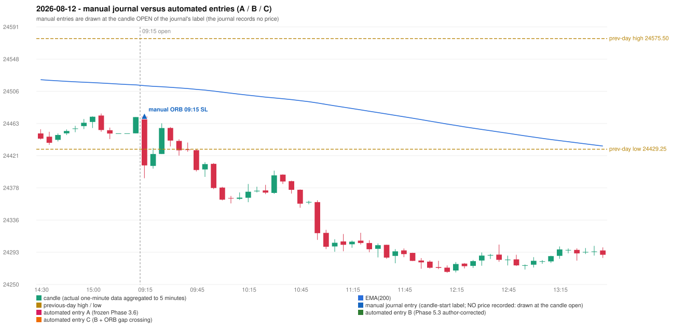

# 2026-08-12 (Wednesday) - manual journal versus the automated configurations

> SYNTHETIC index-point P&L; no real option P&L; costs illustrative (Rs 70 per trade + slippage scenarios). Configurations A / B / C are never combined.

## Session

* Open 24472.45; previous official close 24471.7; gap +0.75; previous-day high / low 24575.5 / 24429.25
* First 5-minute candle (09:15-09:20): O24472.45 H24472.45 L24390.9 C24407.9, RED, body 79.2%; EMA(200) at the first candle 24513.29; previous session's last close 24471.7 vs its EMA 24514.35

## Manual journal

row 178: ORB labelled 09:15, outcome SL

## Configuration A

Candidate signals (confirmed): none

Strategies with no confirmed signal: IRF: no setup record (the strategy's trigger event never occurred) | ORB: Method 1 INVALIDATED CANDLE_QUALITY(not a strong body / wick too large); Method 2 INVALIDATED TRENDLINE_NOT_SUPPORTIVE | PDR: PDR INVALIDATED OPEN_NOT_STRICTLY_ABOVE_ZONE | PDS: no setup record (the strategy's trigger event never occurred) | RF: RF INVALIDATED TREND:EMA_PREV_SESSION_CLOSE wrong side

No trade: final day state READY_FOR_FIRST_TRADE. No strategy qualified.

* Journal row 178 (ORB 09:15): **UNMATCHED_MANUAL**; earliest cause CANDLE_STRENGTH_MISMATCH: first candle RED O24472.45 H24472.45 L24390.9 C24407.9 (body 79.2%); direction ASSUMED from the colour (the journal has no direction); closest method Method 1 (1 failing predicate(s)): first failing 'candle_quality' - body 79.2% opposite wick 20.8% close location 20.8%; all methods: Method 1: 1 fail (candle_quality); Method 2: 2 fail (trendline); Gap/200DMA: 3 fail (gap_in_direction)

## Configuration B

Candidate signals (confirmed): none

Strategies with no confirmed signal: IRF: no setup record (the strategy's trigger event never occurred) | ORB: Method 1 INVALIDATED CANDLE_QUALITY(not a strong body / wick too large); Method 2 INVALIDATED TRENDLINE_NOT_SUPPORTIVE | PDR: PDR INVALIDATED OPEN_NOT_STRICTLY_ABOVE_ZONE | PDS: no setup record (the strategy's trigger event never occurred) | RF: RF INVALIDATED TREND:EMA_PREV_SESSION_CLOSE wrong side

No trade: final day state READY_FOR_FIRST_TRADE. No strategy qualified.

* Journal row 178 (ORB 09:15): **UNMATCHED_MANUAL**; earliest cause CANDLE_STRENGTH_MISMATCH: first candle RED O24472.45 H24472.45 L24390.9 C24407.9 (body 79.2%); direction ASSUMED from the colour (the journal has no direction); closest method Method 1 (1 failing predicate(s)): first failing 'candle_quality' - body 79.2% opposite wick 20.8% close location 20.8%; all methods: Method 1: 1 fail (candle_quality); Method 2: 2 fail (trendline); Gap/200DMA: 3 fail (gap_in_direction)

## Configuration C

Candidate signals (confirmed): none

Strategies with no confirmed signal: IRF: no setup record (the strategy's trigger event never occurred) | ORB: Gap/200DMA INVALIDATED CLOSE_NOT_BEYOND_MA; Method 1 INVALIDATED CANDLE_QUALITY(not a strong body / wick too large); Method 2 INVALIDATED TRENDLINE_NOT_SUPPORTI | PDR: PDR INVALIDATED OPEN_NOT_STRICTLY_ABOVE_ZONE | PDS: no setup record (the strategy's trigger event never occurred) | RF: RF INVALIDATED TREND:EMA_PREV_SESSION_CLOSE wrong side

No trade: final day state READY_FOR_FIRST_TRADE. No strategy qualified.

* Journal row 178 (ORB 09:15): **UNMATCHED_MANUAL**; earliest cause CANDLE_STRENGTH_MISMATCH: first candle RED O24472.45 H24472.45 L24390.9 C24407.9 (body 79.2%); direction ASSUMED from the colour (the journal has no direction); closest method Method 1 (1 failing predicate(s)): first failing 'candle_quality' - body 79.2% opposite wick 20.8% close location 20.8%; all methods: Method 1: 1 fail (candle_quality); Method 2: 2 fail (trendline); Gap/200DMA: 3 fail (gap_in_direction)

## Chart

