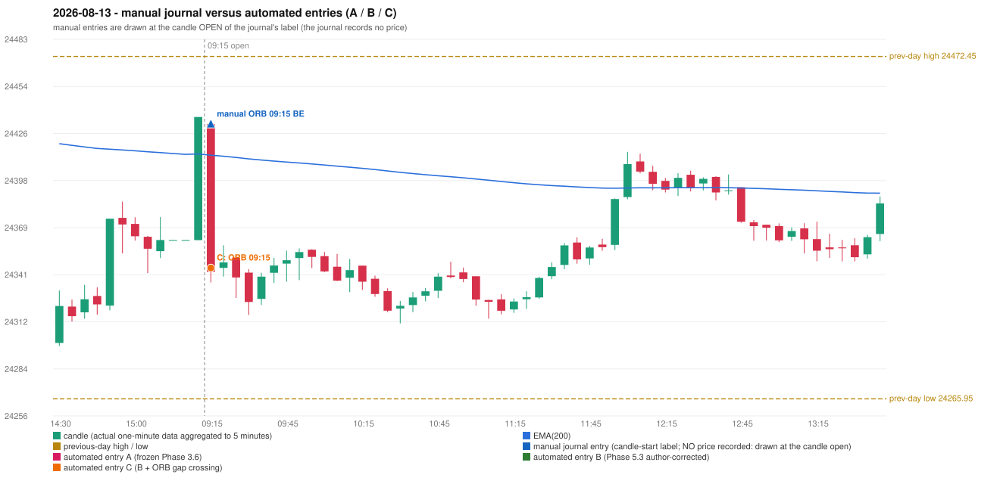

# 2026-08-13 (Thursday) - manual journal versus the automated configurations

> SYNTHETIC index-point P&L; no real option P&L; costs illustrative (Rs 70 per trade + slippage scenarios). Configurations A / B / C are never combined.

## Session

* Open 24431.6; previous official close 24435.95; gap -4.35; previous-day high / low 24472.45 / 24265.95
* First 5-minute candle (09:15-09:20): O24431.6 H24431.6 L24336.15 C24342.55, RED, body 93.3%; EMA(200) at the first candle 24412.90; previous session's last close 24435.95 vs its EMA 24413.61

## Manual journal

row 179: ORB labelled 09:15, outcome BE

## Configuration A

Candidate signals (confirmed): none

Strategies with no confirmed signal: IRF: no setup record (the strategy's trigger event never occurred) | ORB: no setup record (the strategy's trigger event never occurred) | PDR: no setup record (the strategy's trigger event never occurred) | PDS: Method 1/2/3 INVALIDATED GAP_DOWN_OPEN_NOT_BELOW_ZONE | RF: RF INVALIDATED GAP_NOT_UP(DOWN)

No trade: final day state READY_FOR_FIRST_TRADE. No strategy qualified.

* Journal row 179 (ORB 09:15): **UNMATCHED_MANUAL**; earliest cause OPENING_GAP_MISMATCH: first candle RED O24431.6 H24431.6 L24336.15 C24342.55 (body 93.3%); direction ASSUMED from the colour (the journal has no direction); closest method Gap/200DMA (1 failing predicate(s)): first failing 'gap_crosses_200_average' - previous close 24435.95 vs previous EMA 24413.61; open 24431.6 vs EMA 24412.90; all methods: Method 1: 2 fail (level_broken); Method 2: 2 fail (inner_level_broken); Gap/200DMA: 1 fail (gap_crosses_200_average)

## Configuration B

Candidate signals (confirmed): none

Strategies with no confirmed signal: IRF: no setup record (the strategy's trigger event never occurred) | ORB: no setup record (the strategy's trigger event never occurred) | PDR: no setup record (the strategy's trigger event never occurred) | PDS: Method 1/2/3 INVALIDATED GAP_DOWN_OPEN_NOT_BELOW_ZONE | RF: RF INVALIDATED GAP_NOT_UP(DOWN)

No trade: final day state READY_FOR_FIRST_TRADE. No strategy qualified.

* Journal row 179 (ORB 09:15): **UNMATCHED_MANUAL**; earliest cause OPENING_GAP_MISMATCH: first candle RED O24431.6 H24431.6 L24336.15 C24342.55 (body 93.3%); direction ASSUMED from the colour (the journal has no direction); closest method Gap/200DMA (1 failing predicate(s)): first failing 'gap_crosses_200_average' - previous close 24435.95 vs previous EMA 24413.61; open 24431.6 vs EMA 24412.90; all methods: Method 1: 2 fail (level_broken); Method 2: 2 fail (inner_level_broken); Gap/200DMA: 1 fail (gap_crosses_200_average)

## Configuration C

Candidate signals (confirmed): 09:20 ORB/Gap/200DMA SHORT [EXECUTED: trade 1: T1_THEN_BUFFER_STOP]

Strategies with no confirmed signal: IRF: no setup record (the strategy's trigger event never occurred) | PDR: no setup record (the strategy's trigger event never occurred) | PDS: Method 1/2/3 INVALIDATED GAP_DOWN_OPEN_NOT_BELOW_ZONE | RF: RF INVALIDATED GAP_NOT_UP(DOWN)

| trade | strategy / method | dir | signal -> fill | entry | stop / T1 / T2 | leg 1 | leg 2 | outcome | gross Rs | net Rs (70, 0) | net Rs (70, 1.0) |
|---|---|---|---|---|---|---|---|---|---|---|---|
| 1 | ORB/Gap/200DMA | SHORT | 09:20 -> 09:20 | 24344.9 | 24374.9 / 24317.9 / 24284.9 | 09:33 @ 24317.9 | 09:44 @ 24350.9 | T1_THEN_BUFFER_STOP | 4,095 | 4,025 | 3,245 |

Selection: This ORB Gap/200DMA signal was the earliest executable signal of the day: 0 confirmed signal(s) earlier, 0 other in the same minute. No later signal was generated. State of the other four engines at that moment: [IRF: no setup record before this time (a base condition was not met, or nothing triggered)] [PDR: no setup record before this time (a base condition was not met, or nothing triggered)] [PDS: Method 1/2/3 invalidated at 09:15: GAP_DOWN_OPEN_NOT_BELOW_ZONE] [RF: no setup record before this time (a base condition was not met, or nothing triggered)]

* Journal row 179 (ORB 09:15): **STRICT** match with 20260813-1-ORB (delta +0 min); outcome BE vs automated T1_THEN_BUFFER_STOP (same class)

## Chart

