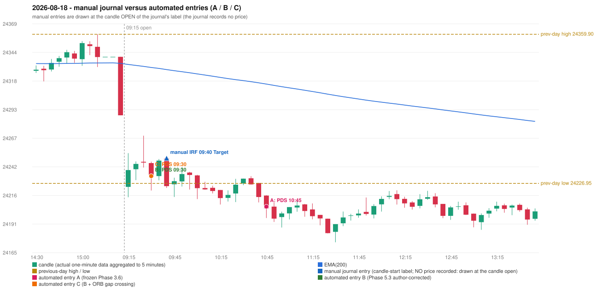

# 2026-08-18 (Tuesday) - manual journal versus the automated configurations

> SYNTHETIC index-point P&L; no real option P&L; costs illustrative (Rs 70 per trade + slippage scenarios). Configurations A / B / C are never combined.

## Session

* Open 24223.85; previous official close 24287.65; gap -63.80; previous-day high / low 24359.9 / 24226.95
* First 5-minute candle (09:15-09:20): O24223.85 H24253.95 L24214.6 C24238.85, GREEN, body 38.1%; EMA(200) at the first candle 24333.02; previous session's last close 24287.65 vs its EMA 24333.97

## Manual journal

row 182: IRF labelled 09:40, outcome Target

## Configuration A

Candidate signals (confirmed): 10:50 PDS/Method 3 SHORT [EXECUTED: trade 1: T1_THEN_BUFFER_STOP]; 15:30 PDS/Method 3 SHORT [IGNORED: DAY_FINISHED]

Strategies with no confirmed signal: IRF: no setup record (the strategy's trigger event never occurred) | ORB: Method 2 INVALIDATED TRENDLINE_NOT_SUPPORTIVE | PDR: no setup record (the strategy's trigger event never occurred) | RF: RF INVALIDATED TREND:EMA_PREV_SESSION_CLOSE wrong side

| trade | strategy / method | dir | signal -> fill | entry | stop / T1 / T2 | leg 1 | leg 2 | outcome | gross Rs | net Rs (70, 0) | net Rs (70, 1.0) |
|---|---|---|---|---|---|---|---|---|---|---|---|
| 1 | PDS/Method 3 | SHORT | 10:50 -> 10:50 | 24206.25 | 24241.25 / 24179.25 / 24136.25 | 11:30 @ 24179.25 | 11:51 @ 24212.25 | T1_THEN_BUFFER_STOP | 4,095 | 4,025 | 3,245 |

Selection: This PDS Method 3 signal was the earliest executable signal of the day: 0 confirmed signal(s) earlier, 0 other in the same minute. 1 later confirmed signal(s) (PDS x1) are logged as ignored or rejected. State of the other four engines at that moment: [IRF: no setup record before this time (a base condition was not met, or nothing triggered)] [ORB: Method 2 invalidated at 09:15: TRENDLINE_NOT_SUPPORTIVE] [PDR: no setup record before this time (a base condition was not met, or nothing triggered)] [RF: RF invalidated at 10:20: TREND:EMA_PREV_SESSION_CLOSE wrong side]

* Journal row 182 (IRF 09:40): **UNMATCHED_MANUAL**; earliest cause UNRESOLVED_DISCRETIONARY_SELECTION: the engine produced no IRF signal near the manual entry (no IRF breakout / failure setup was seen); the journal gives no reason for the manual entry (rule points that are discretionary or unresolved: IRF Method 1 boundary IRF-M1-003, Method 3 wick share, the day's-low rule)
* Automated PDS 10:45 has no strict / time-tolerant journal counterpart: DIFFERENT_STRATEGY_SELECTED - the journal traded IRF 09:40; the automated controller took PDS Method 3 (candle 10:45) as the first valid signal

## Configuration B

Candidate signals (confirmed): 09:35 PDS/Method 1 SHORT [EXECUTED: trade 1: FORCED_EXIT]; 09:45 PDS/Method 1 SHORT [IGNORED: POSITION_ACTIVE (signal kept for diagnostics only; never reused)]; 10:50 PDS/Method 3 SHORT [IGNORED: POSITION_ACTIVE (signal kept for diagnostics only; never reused)]; 15:05 PDS/Method 2 SHORT [IGNORED: POSITION_ACTIVE (signal kept for diagnostics only; never reused)]

Strategies with no confirmed signal: IRF: no setup record (the strategy's trigger event never occurred) | ORB: Method 2 INVALIDATED TRENDLINE_NOT_SUPPORTIVE | PDR: no setup record (the strategy's trigger event never occurred) | RF: RF INVALIDATED TREND:EMA_PREV_SESSION_CLOSE wrong side

| trade | strategy / method | dir | signal -> fill | entry | stop / T1 / T2 | leg 1 | leg 2 | outcome | gross Rs | net Rs (70, 0) | net Rs (70, 1.0) |
|---|---|---|---|---|---|---|---|---|---|---|---|
| 1 | PDS/Method 1 | SHORT | 09:35 -> 09:35 | 24233.5 | 24268.5 / 24206.5 / 24163.5 | 10:46 @ 24206.5 | 15:14 @ 24185.15 | FORCED_EXIT | 14,693 | 14,623 | 13,843 |

Selection: This PDS Method 1 signal was the earliest executable signal of the day: 0 confirmed signal(s) earlier, 0 other in the same minute. 3 later confirmed signal(s) (PDS x3) are logged as ignored or rejected. State of the other four engines at that moment: [IRF: no setup record before this time (a base condition was not met, or nothing triggered)] [ORB: Method 2 invalidated at 09:15: TRENDLINE_NOT_SUPPORTIVE] [PDR: no setup record before this time (a base condition was not met, or nothing triggered)] [RF: no setup record before this time (a base condition was not met, or nothing triggered)]

* Journal row 182 (IRF 09:40): **UNMATCHED_MANUAL**; earliest cause UNRESOLVED_DISCRETIONARY_SELECTION: the engine produced no IRF signal near the manual entry (no IRF breakout / failure setup was seen); the journal gives no reason for the manual entry (rule points that are discretionary or unresolved: IRF Method 1 boundary IRF-M1-003, Method 3 wick share, the day's-low rule)
* Automated PDS 09:30 has no strict / time-tolerant journal counterpart: DIFFERENT_STRATEGY_SELECTED - the journal traded IRF 09:40; the automated controller took PDS Method 1 (candle 09:30) as the first valid signal

## Configuration C

Candidate signals (confirmed): 09:35 PDS/Method 1 SHORT [EXECUTED: trade 1: FORCED_EXIT]; 09:45 PDS/Method 1 SHORT [IGNORED: POSITION_ACTIVE (signal kept for diagnostics only; never reused)]; 10:50 PDS/Method 3 SHORT [IGNORED: POSITION_ACTIVE (signal kept for diagnostics only; never reused)]; 15:05 PDS/Method 2 SHORT [IGNORED: POSITION_ACTIVE (signal kept for diagnostics only; never reused)]

Strategies with no confirmed signal: IRF: no setup record (the strategy's trigger event never occurred) | ORB: Method 2 INVALIDATED TRENDLINE_NOT_SUPPORTIVE | PDR: no setup record (the strategy's trigger event never occurred) | RF: RF INVALIDATED TREND:EMA_PREV_SESSION_CLOSE wrong side

| trade | strategy / method | dir | signal -> fill | entry | stop / T1 / T2 | leg 1 | leg 2 | outcome | gross Rs | net Rs (70, 0) | net Rs (70, 1.0) |
|---|---|---|---|---|---|---|---|---|---|---|---|
| 1 | PDS/Method 1 | SHORT | 09:35 -> 09:35 | 24233.5 | 24268.5 / 24206.5 / 24163.5 | 10:46 @ 24206.5 | 15:14 @ 24185.15 | FORCED_EXIT | 14,693 | 14,623 | 13,843 |

Selection: This PDS Method 1 signal was the earliest executable signal of the day: 0 confirmed signal(s) earlier, 0 other in the same minute. 3 later confirmed signal(s) (PDS x3) are logged as ignored or rejected. State of the other four engines at that moment: [IRF: no setup record before this time (a base condition was not met, or nothing triggered)] [ORB: Method 2 invalidated at 09:15: TRENDLINE_NOT_SUPPORTIVE] [PDR: no setup record before this time (a base condition was not met, or nothing triggered)] [RF: no setup record before this time (a base condition was not met, or nothing triggered)]

* Journal row 182 (IRF 09:40): **UNMATCHED_MANUAL**; earliest cause UNRESOLVED_DISCRETIONARY_SELECTION: the engine produced no IRF signal near the manual entry (no IRF breakout / failure setup was seen); the journal gives no reason for the manual entry (rule points that are discretionary or unresolved: IRF Method 1 boundary IRF-M1-003, Method 3 wick share, the day's-low rule)
* Automated PDS 09:30 has no strict / time-tolerant journal counterpart: DIFFERENT_STRATEGY_SELECTED - the journal traded IRF 09:40; the automated controller took PDS Method 1 (candle 09:30) as the first valid signal

## Chart

