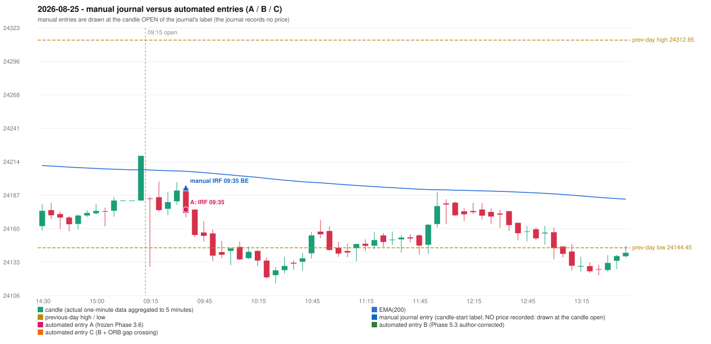

# 2026-08-25 (Tuesday) - manual journal versus the automated configurations

> SYNTHETIC index-point P&L; no real option P&L; costs illustrative (Rs 70 per trade + slippage scenarios). Configurations A / B / C are never combined.

## Session

* Open 24184.45; previous official close 24219.05; gap -34.60; previous-day high / low 24312.85 / 24144.45
* First 5-minute candle (09:15-09:20): O24184.45 H24185.7 L24129.15 C24184.05, RED, body 0.7%; EMA(200) at the first candle 24207.55; previous session's last close 24219.05 vs its EMA 24207.79

## Manual journal

row 186: IRF labelled 09:35, outcome BE

## Configuration A

Candidate signals (confirmed): 09:40 IRF/Method 1 SHORT [EXECUTED: trade 1: T1_THEN_BUFFER_STOP]

Strategies with no confirmed signal: ORB: Gap/200DMA INVALIDATED CANDLE_QUALITY_OR_REJECTION_WICK | PDR: no setup record (the strategy's trigger event never occurred) | PDS: Method 1/2/3 INVALIDATED GAP_DOWN_OPEN_NOT_BELOW_ZONE | RF: RF INVALIDATED GAP_NOT_UP(DOWN)

| trade | strategy / method | dir | signal -> fill | entry | stop / T1 / T2 | leg 1 | leg 2 | outcome | gross Rs | net Rs (70, 0) | net Rs (70, 1.0) |
|---|---|---|---|---|---|---|---|---|---|---|---|
| 1 | IRF/Method 1 | SHORT | 09:40 -> 09:40 | 24175.45 | 24210.45 / 24148.45 / 24115.45 | 09:52 @ 24148.45 | 11:55 @ 24181.45 | T1_THEN_BUFFER_STOP | 4,095 | 4,025 | 3,245 |

Selection: This IRF Method 1 signal was the earliest executable signal of the day: 0 confirmed signal(s) earlier, 0 other in the same minute. No later signal was generated. State of the other four engines at that moment: [ORB: Gap/200DMA invalidated at 09:15: CANDLE_QUALITY_OR_REJECTION_WICK] [PDR: no setup record before this time (a base condition was not met, or nothing triggered)] [PDS: Method 1/2/3 invalidated at 09:15: GAP_DOWN_OPEN_NOT_BELOW_ZONE] [RF: no setup record before this time (a base condition was not met, or nothing triggered)]

* Journal row 186 (IRF 09:35): **STRICT** match with 20260825-1-IRF (delta +0 min); outcome BE vs automated T1_THEN_BUFFER_STOP (same class)

## Configuration B

Candidate signals (confirmed): none

Strategies with no confirmed signal: IRF: Method 1/2 INCOMPLETE_AT_EOD SESSION_ENDED_BEFORE_CONFIRMATION | ORB: Gap/200DMA INVALIDATED CANDLE_QUALITY_OR_REJECTION_WICK | PDR: no setup record (the strategy's trigger event never occurred) | PDS: Method 1/2/3 INVALIDATED GAP_DOWN_OPEN_NOT_BELOW_ZONE | RF: RF INVALIDATED GAP_NOT_UP(DOWN)

No trade: final day state READY_FOR_FIRST_TRADE. No strategy qualified.

* Journal row 186 (IRF 09:35): **UNMATCHED_MANUAL**; earliest cause EMA_FILTER_MISMATCH: an IRF Method 1 candidate at 09:40 was REJECTED by the 28-point EMA clearance (range distance 11.3, EMA EMA_ABOVE_CANDLE) - PROVISIONAL_EMA_RANGE_DISTANCE

## Configuration C

Candidate signals (confirmed): none

Strategies with no confirmed signal: IRF: Method 1/2 INCOMPLETE_AT_EOD SESSION_ENDED_BEFORE_CONFIRMATION | ORB: Gap/200DMA INVALIDATED CANDLE_QUALITY_OR_REJECTION_WICK | PDR: no setup record (the strategy's trigger event never occurred) | PDS: Method 1/2/3 INVALIDATED GAP_DOWN_OPEN_NOT_BELOW_ZONE | RF: RF INVALIDATED GAP_NOT_UP(DOWN)

No trade: final day state READY_FOR_FIRST_TRADE. No strategy qualified.

* Journal row 186 (IRF 09:35): **UNMATCHED_MANUAL**; earliest cause EMA_FILTER_MISMATCH: an IRF Method 1 candidate at 09:40 was REJECTED by the 28-point EMA clearance (range distance 11.3, EMA EMA_ABOVE_CANDLE) - PROVISIONAL_EMA_RANGE_DISTANCE

## Chart

