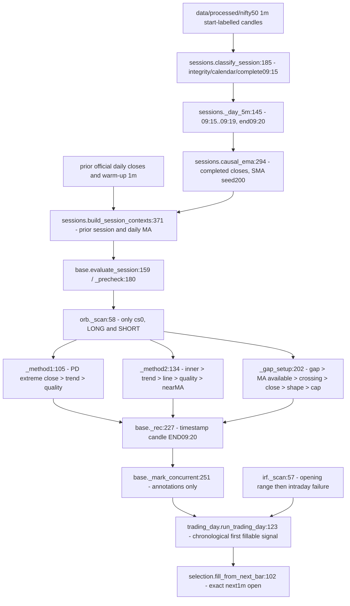

# ORB implementation: complete path review

The executable reference is Phase 3.6 / Phase 5.5 A and B, not ProposalConfig's standalone default. `research/phase3.py:47` explicitly selects `EMA_PREV_SESSION_CLOSE`, lifts cap to99 and uses MODERATE/OWNER_2X_CLOSE30. C changes gap crossing only. Standalone default is STRUCTURE_EMA_SWING2; confusing these would misattribute exclusions. Approval claims below mean repository-recorded owner research approval, not independent evidence of the author's exact discretionary rule.

Every line of orb.py and its helpers was read. [Numbered complete source appendix](source_code_numbered.md) preserves all lines; [every branch and return](code_branches_and_returns.csv) includes all core, wrapper and candidate returns. [Function index](code_function_index.csv) provides exact start lines. [Predicate inventory](orb_all_entry_predicates.csv) answers authority and isolated-removal effects; [observations](orb_predicate_observations.csv) provides every boolean/measurement for both directions, including gates hidden by early returns.

## orb.py line groups

| Lines | Review |
|---|---|
| 1-45 | Imports and source claims. Header says09:20; implementation really uses cs0. No later breakout loop. |
| 48-65 | Class constants, previous-session requirement; both directions and all3 methods once. No signal-ranking or dedup here. `gap_before` is unused by ORB. |
| 68-72 | Copies first high/low/close and previous extrema/official close; reference close is not a fill. |
| 74-79 | Strong OR conditional pin. Pin route has no colour check. Source p.10 allows pin but later author explicitly disallows red longs. |
| 81-86 | Near-MA check uses opening candle EMA under prior-session trend modes; correctly avoids using yesterday's value for this test. |
| 88-100 | Trend dispatch; unknown -> NOT_EVALUATED, false -> INVALIDATED; immediate return before quality. Baseline only last previous5m close vs its EMA. |
| 105-129 | PDH/PDL strict break-and-close; no break -> None (not an invalidated record). New local FSM; trend return first, quality return next, otherwise confirm. |
| 134-166 | Select previous-session latest non-strict5bar pivot inside range. No level or no break -> None. Trend failure masks line/shape/near-MA failures in normal record; audit evaluates all. |
| 168-182 | Two confirmed pivots needed. Last2 low/high anchors; slope per bar; opening projection n-j2; rising/falling and close-side tests. No zone, line-contact distance, or penetration check. |
| 183-197 | Quality then near-MA branch (15 band,5 margin). Far-away wrong-side current price is not explicitly excluded; prior trend is only a proxy. Emits confirmed research result with unresolved inner/MA identifiers. |
| 202-221 | Directional gap; invalid direction -> None. MA warm-up -> NOT_EVALUATED. No established-trend gate (correct exception). |
| 222-232 | Previous official close vs prior EMA plus open vs current EMA. Open not beyond -> None even if body crosses (diagram mismatch). Close must independently be beyond. |
| 233-243 | Strong OR pin and no adverse rejection; separate33% only here. At baseline, M1/M2 already cap adverse wick below33%, so separate omission there does not permit a baseline33%-wick false positive. |
| 244-254 | Optional abs(gap) cap. None leaves extension exclusion unapplied and unresolved. Confirmation has no later re-arm or reset. |

## Numerical definitions and tolerances

`definitions.py:24` EPS=1e-9 applies to shape thresholds, not level/MA breakout strictness. Body/range >=0.60; opposite wick/range <=0.20 (`params.py:26`). STRICT70%/15%, LOOSE50%/25% are alternatives, not PDF numbers. Owner pin: rejection wick>EPS and >=2*body-EPS; favourable-close distance <=0.30*range+EPS (`definitions.py:98`). This can admit opposite-colour/doji candles. A zero-range candle never confirms. Rejection wick >=0.33-EPS. Unused alternative pin profiles are STRICT70% wick/25% body/10% opposite, MODERATE60/33/15, LOOSE55/40/20. k=2 is hardcoded in ORB Method2 (not p.swing_k); fractals allow equal extremes, unlike strict structure-trend swings. Slopes must be >0/<0 exactly; price must be strictly on trend side. No price tick buffer or minimum breakout distance. Near-MA <=15 points and directional margin>=5 with no EPS. Gap minimum0, maximumNone. EMA period200, alpha2/201, SMA seed; daily MA period200. First5m needs5 unique one-minute rows, not4. Optional signal cutoffNone; controller cutoff13:00 inclusive. Owner execution stop30/target60 for ORB and portfolio T1=27 are separate from qualification. No parameter was selected through a grid or outcomes.

## State, returns, resets and suppression

Local variables `out`, `d`, `fn`, `c`, `levels`, `props`, `sat`, `unresolved` and local `SetupFSM` have invocation/method scope. Method2 adds `pcs`, `n`, `piv`, `lvl`, `tl_idx`, `j1/j2`, `slope`, `line_now`, `ok_dir`, `on_side`, `ema`, `beyond`; Gap adds `g`, `mode`, `ma`, `ma_prev`, `crossed`, `closed_beyond`, `shape_ok`, `rejected`. There is no persistent ORB attempt state, per-day fired flag, retry queue, deactivation flag or saved position in ORB. Each evaluate call recomputes deterministically. Terminal local FSM records confirmation/invalidation only. New day means a new context; no state reset bug was found.

Core silent None returns: Method1 no level break; Method2 no inner or no inner break; Gap wrong gap or no MA crossing. All later failures return structured records. `_trend_gate` unknown/false returns stop; caller returns it. Concurrent methods are labelled by base but not removed. `max_signals_per_session` is not consumed by ORB; engine output therefore cannot be reduced by that cap. `signal_window_end` can drop confirmations only if explicitly configured; None here. Colour wrapper invalidates confirmed records post hoc; it leaves stale execution metadata (defect D03). Candidates reuse base methods and replace one family; not selected by default.

## Controller and IRF

The combined controller is `trading_day.py`, not per-strategy `selection.apply_policy`. It groups confirmed signals chronologically, rejects ineligible fills/cutoff, respects one active position and allowed second PDR/PDS after first full stop. Opposite or cross-strategy same-time signals leave an unresolved collision without an approved tie-break. Same-direction same-strategy methods describe one entry. There is no automatic IRF/ORB priority.

IRF baseline builds IRH/IRL from opening candle; later candles above IRH establish the failure attempts. Method1 immediate next close back inside; Method2 extension/pullback and support-break2A or red resistance-failure2B; Method3 compressed sweep plus support break. Baseline Method2B is its own resistance path and does not universally require Method2A's extension/red bookkeeping. B/C change2A support to first-red low and apply provisional28-point EMA clearance. The complete first-IRF levels and state traces are in the selection timeline, not inferred from the journal. Handwritten day's-low restriction is absent in all; no unprovided running-low or final-day-low filter is added.

`base.on_candle:259` is a separate integration adapter: discards timestamp rows beyond now and evaluates only after minute19/24/etc. It rebuilds contexts without explicitly passing official daily or external warm-up frames. That adapter's data contract needs integration validation before a live-use claim. This audit verifies the historical context/engine path used by A/B/C, not broker latency or realtime wiring. Whole-session offline quality classification can exclude a day based on later corruption; this is an offline data-selection policy, not evidence that a09:20 strategy can foresee later data quality. No full-session-quality exclusion explains the13 disputed days.
