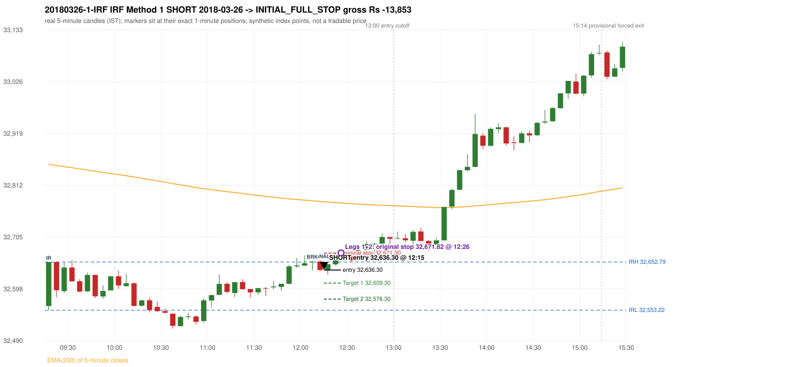

# Trading journal - 2018-03-26 (Monday)

> Phase 5 cross-index test, SENSEX window C (Window C 2018-01-01..2018-12-31 (secondary-source minutes); status EXPLORATORY). The FROZEN Phase 3.6 configuration (IRF, ORB, PDR body-based, PDS, RF; shared controller) with the NIFTY index-point stops and targets UNCHANGED on the SENSEX index price. INDEX-POINT RESULTS ONLY: no option premium is used or estimated. HISTORICAL RESEARCH ONLY: the strategy was developed using later NIFTY data. 5paisa returns no minute data before 2019-03-01, so this year rests on one unattributed vendor with nothing to check it against; the SENSEX file only starts on 2018-03-08 (about 200 of ~246 sessions) Synthetic SENSEX index-point P&L (the index is not tradable). The owner's review status is intentionally blank.

## A. Trading day overview

| item | value |
|---|---|
| Date / weekday | 2018-03-26 / Monday |
| Session type | USABLE_WITH_FLAGS / VALID |
| Original session open (first 1-minute open) | 32,561.91 |
| Previous session | 2018-03-23 |
| Previous-day high / low (wicks included) | 32,720.03 / 32,483.84 |
| Previous-day highest BODY high (the body-based PDR ceiling; wicks ignored) | 32,692.38 |
| Previous-day official close / last 5-minute close | 32,596.54 / 32,579.67 |
| Raw engine records / confirmed signals / fully valid signals | 4 / 1 / 1 |
| Setups that did not complete (invalidated / incomplete) | 3 |
| Executed trades | 1 20180326-1-IRF |
| Gross P&L (Rs, synthetic) | -13,852.80 |
| Illustrative net P&L (Rs; Rs 500/trade + 0.5 pt/fill) | -14,742.80 |
| Day-end portfolio status | SECOND_TRADE_ELIGIBLE |
| Manual journal trades (matched / unmatched) | 0 (0 / 0) |
| Extra automated trades | 0 |

## B. Daily strategy signal timeline (confirmed signals, chronological)

| time | strategy | method | dir | entry-rule status | valid for execution | <= 13:00 | portfolio state | accepted / ignored | specific reason | competing (same minute) |
|---|---|---|---|---|---|---|---|---|---|---|
| 12:15 | IRF | Method 1 | SHORT | PROPOSAL_DEPENDENT | True | True | FIRST_TRADE_ACTIVE | ACCEPTED -> 20180326-1-IRF | first eligible signal of the day; trade 1: INITIAL_FULL_STOP |  |

Engine setups that did not complete (3); the complete list with failed rule ids is in `rejected_signals.csv`:

| candle | strategy | method | dir | status | precise reason | failed rules |
|---|---|---|---|---|---|---|
| 12:20 | IRF | Method 1/2 | SHORT | INCOMPLETE_AT_EOD | SESSION_ENDED_BEFORE_CONFIRMATION |  |
| 09:15 | PDS | Method 1/2/3 | SHORT | INVALIDATED | GAP_DOWN_OPEN_NOT_BELOW_ZONE | PDS-006 |
| 10:55 | RF | RF | LONG | INVALIDATED | TREND:EMA_PREV_SESSION_CLOSE wrong side | RF-001;RF-008 |

## C. Detailed trade journals

### 20180326-1-IRF: IRF Method 1 SHORT (FIRST trade)

Chart: 

**Rule configuration:** CFG-phase36_body_based-866f954e55 - signal verification status **PROPOSAL_DEPENDENT** (never VERIFIED while a rule rests on a proposal).

#### 1. Setup identification

IRF Method 1 SHORT: the completed 12:05 candle closed at 32,653.73, 0.94 points above the initial range high 32,652.79 (range [32,553.22, 32,652.79] from the 09:15 candle); the immediately following completed 12:10 candle closed at 32,636.30, back inside the range. The short signal was confirmed at 12:15 on that close. Entry reference close 32,636.30 is 16.49 points below IRH 32,652.79.

#### 2. Candle and indicator calculations

| role | session | candle | O | H | L | C | range | body % | upper wick % | lower wick % | direction | EMA(200) | strong bull / bear | pin bull / bear | small (body<=30%) | used for |
|---|---|---|---|---|---|---|---|---|---|---|---|---|---|---|---|---|
| initial_range_candle | TODAY | 09:15-09:20 | 32,561.91 | 32,652.79 | 32,553.22 | 32,652.79 | 99.57 | 91.27 | 0.00 | 8.73 | BULLISH | 32,854.82 | True / False | False / False | False | initial range = high/low of the 09:15 candle |
| signal_candle | TODAY | 12:10-12:15 | 32,653.73 | 32,656.23 | 32,633.99 | 32,636.30 | 22.24 | 78.37 | 11.24 | 10.39 | BEARISH | 32,778.13 | False / True | False / False | False | candle whose close completed the trigger |
| breakout_candle | TODAY | 12:05-12:10 | 32,652.41 | 32,655.02 | 32,635.58 | 32,653.73 | 19.44 | 6.79 | 6.64 | 86.57 | BULLISH | 32,779.56 | False / False | True / False | True | breakout candle: a completed candle closing above IRH |

Every condition, with the rule, the calculation, the observed values and the result:

| # | group | rule | result | status / numeric definition | calculation | observed | required | available at | why it matters |
|---|---|---|---|---|---|---|---|---|---|
| 1 | SELECTION | SEL-FIRST-001 | PASS | USER_APPROVED / USER_APPROVED | earliest CONFIRMED signal of the day across IRF/ORB/PDR/PDS/RF that passed the controller's checks | 0 confirmed signal(s) earlier today; 1 confirmed signals in the day in total, this one at 12:15 | no earlier executable signal | 2018-03-26 12:15 | the shared controller trades only the first valid signal; the five strategies are not independent positions |
| 2 | SELECTION | SEL-TIE-001 | PASS | USER_APPROVED / USER_APPROVED | other CONFIRMED signals with exactly the same confirmation timestamp | none | no different-strategy / opposite-direction signal in the same minute (otherwise an unresolved conflict, no trade) | 2018-03-26 12:15 | an unresolved same-minute collision would have produced no trade at all |
| 3 | SELECTION | ENTRY-CUTOFF-001 | PASS | USER_APPROVED / USER_APPROVED | fill timestamp vs 13:00:00 IST | signal confirmed 12:15; fill 12:15 | fill at or before 13:00:00 IST | 2018-03-26 12:15 | no new position may be entered with a fill after 13:00 IST |
| 4 | SELECTION | EXE-FILL-001 | PASS | PROPOSED_FOR_REVIEW / PROPOSED_FOR_REVIEW | fill = open of the 1-minute bar that starts at the signal candle's end | bar 12:15 O 32,636.30 H 32,636.91 L 32,629.75 C 32,630.61; executable=True; entry 32,636.30 | fill bar exists, starts exactly at the signal end, is fillable; entry = its open | 2018-03-26 12:15 | a 5-minute signal is known only when its candle closes; the first price that can be traded is the next minute's open |
| 5 | SELECTION | DAY-MAX-001 | PASS | USER_APPROVED / USER_APPROVED | number of entries today | trade 1 of at most 2 | <= 2 entries per day | 2018-03-26 12:15 | daily trade cap |
| 6 | SETUP | IRF-GLOBAL-001 | PASS | SOURCE_VERIFIED / EXPLICIT_IN_SOURCE | initial range = high and low (wicks included) of the first completed 5-minute candle | 09:15-09:20 IRH 32,652.79, IRL 32,553.22 (range 99.57; engine recorded IRH 32,652.79, IRL 32,553.22) | high/low of the 09:15-09:20 candle | 2018-03-26 09:20 | all three IRF methods measure price against this range |
| 7 | SETUP | IRF-GLOBAL-003 | PASS | SOURCE_VERIFIED / EXPLICIT_IN_SOURCE | closes confirm, wicks do not: every trigger is evaluated on a completed 5-minute candle | trigger candle 12:10-12:15 was complete when the signal was stamped 12:15; decision uses its close 32,636.30 | completed candle close, not an intra-candle wick | 2018-03-26 12:15 | an intra-candle wick can reverse before the candle closes |
| 8 | SETUP | IRF-GLOBAL-002 | PASS | SOURCE_VERIFIED / EXPLICIT_IN_SOURCE | direction | SHORT (IRF trades short only) | short only | 2018-03-26 12:15 | IRF fades failed upside breakouts |
| 9 | SETUP | IRF-M1-001 | PASS | SOURCE_VERIFIED / EXPLICIT_IN_SOURCE | breakout candle close vs IRH | 12:05-12:10 O 32,652.41 H 32,655.02 L 32,635.58 C 32,653.73; range 19.44, body 1.32 (6.79%), upper wick 1.29 (6.64%), lower wick 16.83 (86.57%), bullish; close 32,653.73 is 0.94 points above IRH 32,652.79 | close > IRH (a wick above IRH is not a breakout) | 2018-03-26 12:10 | starts every IRF setup |
| 10 | CONFIRMATION | IRF-M1-002 | PASS | SOURCE_VERIFIED / EXPLICIT_IN_SOURCE | candle after the breakout closes back inside [IRL, IRH) | 12:10-12:15 O 32,653.73 H 32,656.23 L 32,633.99 C 32,636.30; range 22.24, body 17.43 (78.37%), upper wick 2.50 (11.24%), lower wick 2.31 (10.39%), bearish; close 32,636.30 vs range [32,553.22, 32,652.79) | IRL <= close < IRH | 2018-03-26 12:15 | the failed breakout: price could not hold above the opening range |
| 11 | CONFIRMATION | IRF-M1-004 | PASS | SOURCE_VERIFIED / EXPLICIT_IN_SOURCE | failure candle is the candle immediately after the breakout (k = 1) | breakout 12:05, failure candle 12:10: k = 1 | k = 1 (pp.5, 6, 13); the p.14 'next or following' reading (IRF-M1-C001) is CONFLICTING and not used in the baseline | 2018-03-26 12:15 | the guide's worked example enters at the close of the very next candle; no support/resistance break is required |
| 12 | EXECUTION | EXE-STOP-001 | PASS | USER_APPROVED / USER_APPROVED | initial stop = entry + 35 points | entry 32,636.30 -> stop 32,671.30 | stop 35 index points (BASELINE) | 2018-03-26 12:15 | defines the loss if the setup fails before Target 1 |
| 13 | EXECUTION | EXE-T1-001 | PASS | SOURCE_VERIFIED / EXPLICIT_IN_SOURCE | Target 1 = entry +/- 27 points | T1 32,609.30 | 27 points | 2018-03-26 12:15 | Leg 1 (3 lots) is booked at Target 1 |
| 14 | EXECUTION | IRF-TGT-001 | PASS | SOURCE_VERIFIED / EXPLICIT_IN_SOURCE | Target 2 = entry +/- 60 points | T2 32,576.30 | 60 points | 2018-03-26 12:15 | Leg 2 (3 lots) is booked at Target 2 |
| 15 | EXECUTION | POST-T1-STOP-006 | PASS | USER_APPROVED / USER_APPROVED | after T1 the Leg-2 stop = entry + 6 (no trailing) | post-T1 stop 32,642.30 | entry -6 (LONG) / +6 (SHORT) | 2018-03-26 12:15 | protects the remaining three lots once the first three are booked |
| 16 | EXECUTION | SIZE-LOT-001 | PASS | USER_APPROVED / USER_APPROVED | 6 lots x 65 = 390, Leg 1 = 3 lots = 195, Leg 2 = 195 | 6 lots, lot size 65, legs 3+3 | 6 lots in two equal legs | 2018-03-26 12:15 | position size for the synthetic P&L |
| 17 | NOTE | IRF-GLOBAL-004 | UNRESOLVED | UNRESOLVED / UNRESOLVED | which close above IRH of the session produced this attempt; repeat setups | this breakout is upward crossing no. 1 of the session (a close above IRH after a close at/below it) | the source states no first-breakout-only, re-arming, expiry or trades-per-day rule | 2018-03-26 12:15 | IRF re-arms on every later breakout in the code, producing many raw setups; the controller keeps only the first |
| 18 | NOTE | NOTE-IRF-REPEATED-SETUPS | NOT_APPLICABLE | NOT_A_RULE / NOT_A_REGISTRY_RULE | other IRF signals later in the session (not traded) | 0 further confirmed IRF signal(s):  | disclosure of repeated raw setups | 2018-03-26 12:15 | repeated raw IRF setups are not hidden; they are logged as ignored |
| 19 | NOTE | IRF-SL-001 | NOT_APPLICABLE | SOURCE_VERIFIED / QUALITATIVE_SOURCE_NUMERIC_DEFINITION_PROPOSED_FOR_REVIEW | the guide's 35-or-40 rule: 35 if the most recent green candle's high is within 35 points of entry, else 40 | most recent green candle high 32,655.02 is 18.72 points from the entry 32,636.30: the guide's rule would select 35 points; the baseline applies a fixed 35 (USER_APPROVED research baseline; the 35-vs-40 selection and the 40-point variant are separate labelled scenarios) | source selection rule | 2018-03-26 12:15 | the stop distance is a modelling choice and changes losses, not entries |
| 20 | NOTE | NOTE-UNRESOLVED-DEPENDENCIES | UNRESOLVED | NOT_A_RULE / NOT_A_REGISTRY_RULE | rules the signal depends on that the sources leave unresolved | engine-recorded unresolved rule ids: IRF-GLOBAL-004; verification status PROPOSAL_DEPENDENT | n/a (disclosure) | 2018-03-26 12:15 | the entry is only as verified as the rules it rests on |

#### 3. Entry decision and explanation

IRF Method 1 SHORT: the completed 12:05 candle closed at 32,653.73, 0.94 points above the initial range high 32,652.79 (range [32,553.22, 32,652.79] from the 09:15 candle); the immediately following completed 12:10 candle closed at 32,636.30, back inside the range. The short signal was confirmed at 12:15 on that close. Entry reference close 32,636.30 is 16.49 points below IRH 32,652.79.

**Why this trade ahead of the other strategies:** This IRF Method 1 signal was the earliest executable signal of the day: 0 confirmed signal(s) earlier, 0 other in the same minute. No later signal was generated. State of the other four engines at that moment: [ORB: no setup record before this time (a base condition was not met, or nothing triggered)] [PDR: no setup record before this time (a base condition was not met, or nothing triggered)] [PDS: Method 1/2/3 invalidated at 09:15: GAP_DOWN_OPEN_NOT_BELOW_ZONE] [RF: RF invalidated at 10:55: TREND:EMA_PREV_SESSION_CLOSE wrong side]

#### 4. Actual entry execution

| item | value |
|---|---|
| Signal candle | 12:10-12:15 |
| Signal confirmed | 2018-03-26 12:15 |
| Fill timestamp | 2018-03-26 12:15 |
| Entry price | 32,636.30 |
| Source partition / 1-minute bar | data/processed/sensex/KAPRI_1M_SENSEX/minutes/year=2018/month=03/candles.parquet / 2018-03-26 12:15 |
| Source bar O / H / L / C | 32,636.30 / 32,636.91 / 32,629.75 / 32,630.61 |
| Fill assumption | open of the 1-minute bar starting at the signal candle's end (EXE-FILL-001, PROPOSED causal convention) |
| Initial stop / T1 / T2 / post-T1 stop | 32,671.30 / 32,609.30 / 32,576.30 / 32,642.30 |
| Position | 6 lots x 65 = 390 units (Leg 1 195, Leg 2 195) |

#### 5-8. Trade progress, Target 1, post-T1 stop and final exit

Between the 12:15 entry bar and the final exit (12 one-minute bars) the best excursion in favour was 9.92 points at 12:16 and the worst against was 38.88 points at 12:26. At 12:26 price reached the original stop 32,671.30 before Target 1 32,609.30, so all six lots exited together at 32,671.82 (gap through the stop, slippage 0.52 points). This is an INITIAL_FULL_STOP: one more trade is allowed that day, only a newly confirmed PDR/PDS signal.

| leg | qty | exit time | exit price | reason | source 1-minute bar | O / H / L / C | gross points | gross Rs | slippage pts | flags |
|---|---|---|---|---|---|---|---|---|---|---|
| 1 | 195 | 12:26 | 32,671.82 | ORIGINAL_STOP_BEFORE_T1 | 12:26 | 32,671.82 / 32,675.18 / 32,668.54 / 32,672.54 | -35.52 | -6,926.40 | 0.52 |  |
| 2 | 195 | 12:26 | 32,671.82 | ORIGINAL_STOP_BEFORE_T1 | 12:26 | 32,671.82 / 32,675.18 / 32,668.54 / 32,672.54 | -35.52 | -6,926.40 | 0.52 |  |

Exit evidence per leg:

* Leg 1: 1-minute bar 12:26 O 32,671.82 H 32,675.18 L 32,668.54 C 32,672.54: high 32,675.18 reached the original stop 32,671.30 before Target 1 32,609.30 was touched; both legs exit at 32,671.82 (gap through the stop: bar open 32,671.82 is worse than the stop; adverse slippage 0.52 points)
* Leg 2: 1-minute bar 12:26 O 32,671.82 H 32,675.18 L 32,668.54 C 32,672.54: high 32,675.18 reached the original stop 32,671.30 before Target 1 32,609.30 was touched; both legs exit at 32,671.82 (gap through the stop: bar open 32,671.82 is worse than the stop; adverse slippage 0.52 points)

#### 9. Gross and illustrative net P&L

| item | value (Rs) |
|---|---|
| Leg 1 gross | -6,926.40 |
| Leg 2 gross | -6,926.40 |
| Trade gross (= Leg 1 + Leg 2) | -13,852.80 |
| Illustrative fixed cost | -500.00 |
| Illustrative slippage (0.5 pt on every fill, entry + exits, all units) | -390.00 |
| Illustrative net | -14,742.80 |

#### 10. Manual journal comparison

No manual journal exists for this period; no comparison.

## D. Manual journal comparison

No manual journal exists for this period (the manual journal covers 2025-09-01 .. 2026-08-31 only); no comparison is made and no automated trade is labelled 'extra'.

## E. Daily conclusion

* **Traded:** 20180326-1-IRF - IRF Method 1 SHORT at 12:15 (entry 32,636.30), outcome INITIAL_FULL_STOP, gross Rs -13,852.80, illustrative net Rs -14,742.80. **Why:** This IRF Method 1 signal was the earliest executable signal of the day: 0 confirmed signal(s) earlier, 0 other in the same minute. No later signal was generated. State of the other four engines at that moment: [ORB: no setup record before this time (a base condition was not met, or nothing triggered)] [PDR: no setup record before this time (a base condition was not met, or nothing triggered)] [PDS: Method 1/2/3 invalidated at 09:15: GAP_DOWN_OPEN_NOT_BELOW_ZONE] [RF: RF invalidated at 10:55: TREND:EMA_PREV_SESSION_CLOSE wrong side] **How it ended:** At 12:26 price reached the original stop 32,671.30 before Target 1 32,609.30, so all six lots exited together at 32,671.82 (gap through the stop, slippage 0.52 points). This is an INITIAL_FULL_STOP: one more trade is allowed that day, only a newly confirmed PDR/PDS signal.
* **Open strategy-definition issues that affected this day:** IRF-GLOBAL-004 (NOT STATED: how many IRF trades per day, a latest entry time, and whether a new breakout may re-arm a setup after a signal), NOTE-UNRESOLVED-DEPENDENCIES
* **Automated triage (not an approval; the owner's review status stays blank):** TRADED_NO_FLAGS

## Option-execution feasibility (information only; no option trade is simulated)

The index result above is an INDEX-POINT result on SENSEX. It is not an option result: a move of N index points is not a move of N premium points (delta, gamma, theta, vega, spread and liquidity decide the premium).

| trade | strategy | index direction | long option it maps to | historical contract identified? | premium data available? | premium fill supportable? |
|---|---|---|---|---|---|---|
| 20180326-1-IRF | IRF | SHORT | BUY PUT (PE) | no | no | no |

Why: (1) the broker's instrument master lists only contracts that are live today, so the scrip code of a contract that existed on this date is not available; (2) historical candles can only be requested by scrip code; (3) the strike and expiry selection policy is an owner decision that has not been made (`options_feasibility/option_contract_selection_decisions.md`). No option entry, exit, premium or option P&L is shown, and none may be inferred from the index points.
