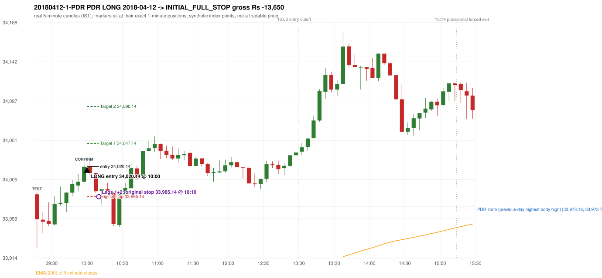
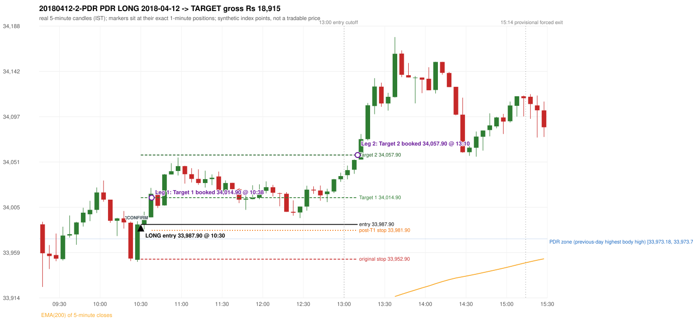

# Trading journal - 2018-04-12 (Thursday)

> Phase 5 cross-index test, SENSEX window C (Window C 2018-01-01..2018-12-31 (secondary-source minutes); status EXPLORATORY). The FROZEN Phase 3.6 configuration (IRF, ORB, PDR body-based, PDS, RF; shared controller) with the NIFTY index-point stops and targets UNCHANGED on the SENSEX index price. INDEX-POINT RESULTS ONLY: no option premium is used or estimated. HISTORICAL RESEARCH ONLY: the strategy was developed using later NIFTY data. 5paisa returns no minute data before 2019-03-01, so this year rests on one unattributed vendor with nothing to check it against; the SENSEX file only starts on 2018-03-08 (about 200 of ~246 sessions) Synthetic SENSEX index-point P&L (the index is not tradable). The owner's review status is intentionally blank.

## A. Trading day overview

| item | value |
|---|---|
| Date / weekday | 2018-04-12 / Thursday |
| Session type | USABLE_WITH_FLAGS / VALID |
| Original session open (first 1-minute open) | 33,988.00 |
| Previous session | 2018-04-11 |
| Previous-day high / low (wicks included) | 33,980.93 / 33,751.62 |
| Previous-day highest BODY high (the body-based PDR ceiling; wicks ignored) | 33,973.71 |
| Previous-day official close / last 5-minute close | 33,940.44 / 33,932.25 |
| Raw engine records / confirmed signals / fully valid signals | 9 / 8 / 7 |
| Setups that did not complete (invalidated / incomplete) | 1 |
| Executed trades | 2 20180412-1-PDR;20180412-2-PDR |
| Gross P&L (Rs, synthetic) | 5,265.00 |
| Illustrative net P&L (Rs; Rs 500/trade + 0.5 pt/fill) | 3,485.00 |
| Day-end portfolio status | DAY_FINISHED |
| Manual journal trades (matched / unmatched) | 0 (0 / 0) |
| Extra automated trades | 0 |

## B. Daily strategy signal timeline (confirmed signals, chronological)

| time | strategy | method | dir | entry-rule status | valid for execution | <= 13:00 | portfolio state | accepted / ignored | specific reason | competing (same minute) |
|---|---|---|---|---|---|---|---|---|---|---|
| 10:00 | PDR | PDR | LONG | RESEARCH_VARIANT | True | True | FIRST_TRADE_ACTIVE | ACCEPTED -> 20180412-1-PDR | first eligible signal of the day; trade 1: INITIAL_FULL_STOP |  |
| 10:20 | IRF | Method 1 | SHORT | PROPOSAL_DEPENDENT | True | True | SECOND_TRADE_ELIGIBLE | REJECTED | SECOND_TRADE_RESTRICTED_TO_PDR_PDS [blocked by PDR#1] |  |
| 10:25 | IRF | Method 2A | SHORT | PROPOSAL_DEPENDENT | True | True | SECOND_TRADE_ELIGIBLE | REJECTED | SECOND_TRADE_RESTRICTED_TO_PDR_PDS [blocked by PDR#1] |  |
| 10:30 | PDR | PDR | LONG | RESEARCH_VARIANT | True | True | SECOND_TRADE_ACTIVE | ACCEPTED -> 20180412-2-PDR | permitted second trade: newly confirmed PDR/PDS after the original full stop; trade 2: TARGET |  |
| 11:30 | IRF | Method 2A | SHORT | PROPOSAL_DEPENDENT | True | True | SECOND_TRADE_ACTIVE | IGNORED | POSITION_ACTIVE (signal kept for diagnostics only; never reused) [blocked by PDR#2] | IRF Method 2B SHORT |
| 11:30 | IRF | Method 2B | SHORT | PROPOSAL_DEPENDENT | True | True | SECOND_TRADE_ACTIVE | IGNORED | POSITION_ACTIVE (signal kept for diagnostics only; never reused) [blocked by PDR#2] | IRF Method 2A SHORT |
| 14:25 | IRF | Method 2A | SHORT | PROPOSAL_DEPENDENT | True | False | DAY_FINISHED | IGNORED | DAY_FINISHED [blocked by PDR#2] |  |
| 15:30 | IRF | Method 2B | SHORT | PROPOSAL_DEPENDENT | False | False | DAY_FINISHED | IGNORED | DAY_FINISHED [blocked by PDR#2] |  |

Engine setups that did not complete (1); the complete list with failed rule ids is in `rejected_signals.csv`:

| candle | strategy | method | dir | status | precise reason | failed rules |
|---|---|---|---|---|---|---|
| 15:25 | IRF | Method 1/2 | SHORT | INCOMPLETE_AT_EOD | SESSION_ENDED_BEFORE_CONFIRMATION |  |

## C. Detailed trade journals

### 20180412-1-PDR: PDR LONG (FIRST trade)

Chart: 

**Rule configuration:** CFG-phase36_body_based-866f954e55 - signal verification status **RESEARCH_VARIANT** (never VERIFIED while a rule rests on a proposal).

#### 1. Setup identification

PDR LONG (body-based engine, A_HIGHEST_BODY_HIGH): the session opened 47.56 points above the previous close and 14.29 points above the previous-day highest BODY high 33,973.71 (zone [33,973.18, 33,973.71] from the 14:05 candle of 2018-04-11; the highest wick 33,980.93 is ignored). The 09:15 candle (33,924.88 - 33,990.60) tested the zone; the 09:55 candle (green, O 34,002.59 H 34,025.21 L 33,999.43 C 34,020.14) passed GOOD_GREEN_BODY and closed 46.43 points above the zone ceiling, confirming the entry at 10:00. The pattern thresholds and the zone's lower boundary are provisional research assumptions, not approved by the strategy author.

#### 2. Candle and indicator calculations

| role | session | candle | O | H | L | C | range | body % | upper wick % | lower wick % | direction | EMA(200) | strong bull / bear | pin bull / bear | small (body<=30%) | used for |
|---|---|---|---|---|---|---|---|---|---|---|---|---|---|---|---|---|
| zone_source_candle | PREVIOUS | 14:05-14:10 | 33,973.18 | 33,979.06 | 33,968.90 | 33,973.71 | 10.16 | 5.22 | 52.66 | 42.13 | BULLISH | 33,817.86 | False / False | False / False | True | candle of the previous session's highest BODY high (A_HIGHEST_BODY_HIGH) |
| prev_day_wick_high_candle | PREVIOUS | 13:35-13:40 | 33,952.34 | 33,980.93 | 33,950.30 | 33,969.09 | 30.63 | 54.68 | 38.65 | 6.66 | BULLISH | 33,809.48 | False / False | False / False | False | candle of the previous session's highest WICK (ignored by the author's rule; shown for comparison) |
| interaction_candle | TODAY | 09:15-09:20 | 33,988.00 | 33,990.60 | 33,924.88 | 33,958.86 | 65.72 | 44.34 | 3.96 | 51.70 | BEARISH | 33,837.59 | False / False | False / False | False | first candle whose range overlaps the zone (the test) |
| confirmation_candle | TODAY | 09:55-10:00 | 34,002.59 | 34,025.21 | 33,999.43 | 34,020.14 | 25.78 | 68.08 | 19.67 | 12.26 | BULLISH | 33,848.93 | True / False | False / False | False | candle that satisfies one of the three patterns and closes above the zone ceiling |

Every condition, with the rule, the calculation, the observed values and the result:

| # | group | rule | result | status / numeric definition | calculation | observed | required | available at | why it matters |
|---|---|---|---|---|---|---|---|---|---|
| 1 | SELECTION | SEL-FIRST-001 | PASS | USER_APPROVED / USER_APPROVED | earliest CONFIRMED signal of the day across IRF/ORB/PDR/PDS/RF that passed the controller's checks | 0 confirmed signal(s) earlier today; 8 confirmed signals in the day in total, this one at 10:00 | no earlier executable signal | 2018-04-12 10:00 | the shared controller trades only the first valid signal; the five strategies are not independent positions |
| 2 | SELECTION | SEL-TIE-001 | PASS | USER_APPROVED / USER_APPROVED | other CONFIRMED signals with exactly the same confirmation timestamp | none | no different-strategy / opposite-direction signal in the same minute (otherwise an unresolved conflict, no trade) | 2018-04-12 10:00 | an unresolved same-minute collision would have produced no trade at all |
| 3 | SELECTION | ENTRY-CUTOFF-001 | PASS | USER_APPROVED / USER_APPROVED | fill timestamp vs 13:00:00 IST | signal confirmed 10:00; fill 10:00 | fill at or before 13:00:00 IST | 2018-04-12 10:00 | no new position may be entered with a fill after 13:00 IST |
| 4 | SELECTION | EXE-FILL-001 | PASS | PROPOSED_FOR_REVIEW / PROPOSED_FOR_REVIEW | fill = open of the 1-minute bar that starts at the signal candle's end | bar 10:00 O 34,020.14 H 34,028.74 L 34,017.48 C 34,027.69; executable=True; entry 34,020.14 | fill bar exists, starts exactly at the signal end, is fillable; entry = its open | 2018-04-12 10:00 | a 5-minute signal is known only when its candle closes; the first price that can be traded is the next minute's open |
| 5 | SELECTION | DAY-MAX-001 | PASS | USER_APPROVED / USER_APPROVED | number of entries today | trade 1 of at most 2 | <= 2 entries per day | 2018-04-12 10:00 | daily trade cap |
| 6 | SETUP | PDR-004 | PASS | SOURCE_VERIFIED / EXPLICIT_WORDING_DETAIL_PROPOSED_FOR_REVIEW | gap = first 1-minute open of today - previous session's OFFICIAL close | today's open 33,988.00 (first 1-minute bar 09:15) - previous close 33,940.44 (DAILY_VENDOR, 2018-04-11) = +47.56 points -> gap UP | gap UP (more than 0 points) | 2018-04-12 09:15 | approved convention: the original first-minute open, never the vendor daily open |
| 7 | SETUP | PDR-B03 | PASS | AUTHOR_APPROVED / AUTHOR_STATEMENT_NUMERIC_DETAILS_ARE_SEPARATE_PROPOSED_ROWS | the session opens strictly above the previous day's resistance zone (author-approved) | today's first 1-minute open 33,988.00 vs zone ceiling 33,973.71: 14.29 points above (open - ceiling = +14.29) | open > zone ceiling (equal or inside the zone rejects the setup) | 2018-04-12 09:15 | the original first-minute open is used, never a vendor daily open |
| 8 | ZONE | PDR-001 | PASS | SOURCE_VERIFIED / EXPLICIT_IN_SOURCE | direction | LONG (PDR is long only) | long-only | 2018-04-12 10:00 | PDR buys a retest of previous-day resistance after a gap up |
| 9 | ZONE | PDR-B01a | PASS | AUTHOR_APPROVED / AUTHOR_STATEMENT_NUMERIC_DETAILS_ARE_SEPARATE_PROPOSED_ROWS | wicks ignored, bodies considered: body_high = max(open, close) of every completed previous-session 5-minute candle; ceiling = the highest body_high; floor = body low of that candle | previous session 2018-04-11: highest body high 33,973.71 on the 14:05 candle (O 33,973.18 C 33,973.71; wick high of that candle 33,979.06, ignored); four highest body highs: 33,973.71 (14:05); 33,973.71 (14:10); 33,972.60 (14:00); 33,969.68 (14:15). Highest WICK of the session 33,980.93 (13:35 candle) is 7.22 points above the ceiling and plays no part. Zone [33,973.18 (body low), 33,973.71 (body high)]; engine recorded [33,973.18, 33,973.71] | ceiling = highest body high of the previous session (author: wick ignored, body considered) | 2018-04-11 15:30 | a wick-only price never becomes resistance; the zone is drawn from candle bodies |
| 10 | ZONE | PDR-B02 | UNRESOLVED | AUTHOR_APPROVED / AUTHOR_STATEMENT_NUMERIC_DETAILS_ARE_SEPARATE_PROPOSED_ROWS | multiple highs connected into one zone (author principle; candidate B) | candidate A (used): [33,973.18, 33,973.71]. Candidate B (multiple-body-high cluster, tolerance 5 points) would be [33,952.34, 33,973.71] (MULTIPLE_BODY_HIGH_CLUSTER, 2 touch(es), member body highs 33,969.09, 33,969.09, 33,973.71, 33,973.71); ceiling difference 0.00 points | a zone that connects all relevant highs (numbers not given by the author) | 2018-04-11 15:30 | candidate B has the same ceiling by construction, so this signal is unaffected by the choice; the lower boundary and the cluster numbers are research parameters |
| 11 | ZONE | PDR-003 | PASS | SOURCE_VERIFIED / EXPLICIT_IN_SOURCE | the zone is an area, not a single price | zone height 0.53 points [33,973.18, 33,973.71] | a rectangle with positive height (a zero-height zone is left unresolved by the engine) | 2018-04-11 15:30 | price may touch any part of the area |
| 12 | CONFIRMATION | PDR-B03b | PASS | PRESERVED_FROM_PHASE2 / PRESERVED_FROM_PHASE2 | the first candle whose [low, high] overlaps the zone (+/- proximity) is the test; the confirmation must come strictly after it | 09:15-09:20 O 33,988.00 H 33,990.60 L 33,924.88 C 33,958.86; range 65.72, body 29.14 (44.34%), upper wick 2.60 (3.96%), lower wick 33.98 (51.70%), bearish; low 33,924.88 vs zone ceiling 33,973.71, high 33,990.60 vs zone floor 33,973.18; proximity 0; confirmation candle 09:55 is candle no. 9, the test candle no. 1 | range overlaps the zone; confirmation after the test | 2018-04-12 09:20 | the retest of the previous-day resistance |
| 13 | CONFIRMATION | PDR-B04c | PASS | PROPOSED_FOR_REVIEW / NUMERIC_DEFINITION_PROPOSED_FOR_REVIEW | Pattern 1: good green body on the 09:55-10:00 candle (O 34,002.59 H 34,025.21 L 33,999.43 C 34,020.14); the numeric thresholds are PROVISIONAL (RESEARCH_DEFAULT), not author-approved | colour green; body 68.08%; upper wick 19.67% -> PASSES | green, body >= 60% and upper wick <= 20% of the range | 2018-04-12 10:00 | one of the three patterns is enough (author: one good green body OR lower price rejection OR hammer); fixed thresholds are not required by the author, so the numbers are a research convention; a pattern that does not pass is not an error |
| 14 | CONFIRMATION | PDR-B04c | NOT_APPLICABLE | PROPOSED_FOR_REVIEW / NUMERIC_DEFINITION_PROPOSED_FOR_REVIEW | Pattern 2: lower-price rejection candle on the 09:55-10:00 candle (O 34,002.59 H 34,025.21 L 33,999.43 C 34,020.14); the numeric thresholds are PROVISIONAL (RESEARCH_DEFAULT), not author-approved | lower wick 3.16 = 0.18 x body 17.55; close 19.67% below the high; low 33,999.43; low did NOT reach the zone ceiling 33,973.71 -> does not pass | lower wick >= 2 x body, close within the top 30% of the range, low <= zone ceiling (colour not required) | 2018-04-12 10:00 | one of the three patterns is enough (author: one good green body OR lower price rejection OR hammer); fixed thresholds are not required by the author, so the numbers are a research convention; a pattern that does not pass is not an error |
| 15 | CONFIRMATION | PDR-B04c | NOT_APPLICABLE | PROPOSED_FOR_REVIEW / NUMERIC_DEFINITION_PROPOSED_FOR_REVIEW | Pattern 3: hammer candle on the 09:55-10:00 candle (O 34,002.59 H 34,025.21 L 33,999.43 C 34,020.14); the numeric thresholds are PROVISIONAL (RESEARCH_DEFAULT), not author-approved | lower wick 3.16 = 0.18 x body; upper wick 19.67%; body bottom at 12.26% of the range -> does not pass | lower wick >= 2 x body, upper wick <= 10%, body bottom >= 60% of the range (colour not required) | 2018-04-12 10:00 | one of the three patterns is enough (author: one good green body OR lower price rejection OR hammer); fixed thresholds are not required by the author, so the numbers are a research convention; a pattern that does not pass is not an error |
| 16 | CONFIRMATION | PDR-B04 | PASS | AUTHOR_APPROVED / AUTHOR_STATEMENT_NUMERIC_DETAILS_ARE_SEPARATE_PROPOSED_ROWS | at least one of the three patterns passes (OR logic; every passing pattern is recorded) | patterns passed: GOOD_GREEN_BODY (engine recorded: GOOD_GREEN_BODY) | at least one pattern | 2018-04-12 10:00 | the author's entry candle requirement |
| 17 | CONFIRMATION | PDR-B05 | PASS | AUTHOR_APPROVED / AUTHOR_STATEMENT_NUMERIC_DETAILS_ARE_SEPARATE_PROPOSED_ROWS | the confirmation candle must close above the zone | close 34,020.14 vs zone ceiling 33,973.71: +46.43 points (floor 33,973.18; low 33,999.43 stayed above the zone) | close > zone ceiling, strictly (lower wick may penetrate the zone) | 2018-04-12 10:00 | no pattern overrides the close rule |
| 18 | CONFIRMATION | PDR-B06 | PASS | USER_APPROVED / USER_APPROVED | no entry at the open and no look-ahead: the order is placed only after the confirmation candle has completed | test candle 09:15 (no. 1) precedes the confirmation candle 09:55-10:00; signal stamped 10:00; fill 10:00 at the open of that 1-minute bar = 34,020.14 | interaction before the confirmation; fill after the confirmation candle's end | 2018-04-12 10:00 | existing causal fill convention (EXE-FILL-001) |
| 19 | EXECUTION | EXE-STOP-001 | PASS | USER_APPROVED / USER_APPROVED | initial stop = entry - 35 points | entry 34,020.14 -> stop 33,985.14 | stop 35 index points (BASELINE) | 2018-04-12 10:00 | defines the loss if the setup fails before Target 1 |
| 20 | EXECUTION | EXE-T1-001 | PASS | SOURCE_VERIFIED / EXPLICIT_IN_SOURCE | Target 1 = entry +/- 27 points | T1 34,047.14 | 27 points | 2018-04-12 10:00 | Leg 1 (3 lots) is booked at Target 1 |
| 21 | EXECUTION | PDR-008 | PASS | SOURCE_VERIFIED / EXPLICIT_IN_SOURCE | Target 2 = entry +/- 70 points | T2 34,090.14 (the guide says 70; the performance report's winners suggest 60 - CONFLICTING, recorded) | 70 points | 2018-04-12 10:00 | Leg 2 (3 lots) is booked at Target 2 |
| 22 | EXECUTION | POST-T1-STOP-006 | PASS | USER_APPROVED / USER_APPROVED | after T1 the Leg-2 stop = entry - 6 (no trailing) | post-T1 stop 34,014.14 | entry -6 (LONG) / +6 (SHORT) | 2018-04-12 10:00 | protects the remaining three lots once the first three are booked |
| 23 | EXECUTION | SIZE-LOT-001 | PASS | USER_APPROVED / USER_APPROVED | 6 lots x 65 = 390, Leg 1 = 3 lots = 195, Leg 2 = 195 | 6 lots, lot size 65, legs 3+3 | 6 lots in two equal legs | 2018-04-12 10:00 | position size for the synthetic P&L |
| 24 | NOTE | PDR-B04x | UNRESOLVED | PROPOSED_FOR_REVIEW / NUMERIC_DEFINITION_PROPOSED_FOR_REVIEW | provisional parameters this signal rests on | pattern thresholds RESEARCH_DEFAULT: {'green_body_min': 0.6, 'green_upper_wick_max': 0.2, 'reject_wick_to_body_min': 2.0, 'reject_close_fraction_max': 0.3, 'hammer_wick_to_body_min': 2.0, 'hammer_upper_wick_max': 0.1, 'hammer_body_position_min': 0.6}; zone lower boundary = hull of the member bodies; zero-height policy UNRESOLVED_NO_SETUP; wait policy WAIT_FOR_QUALIFYING_CANDLE; cluster parameters (candidate B only) tolerance 5, touches 2, separation 2 | n/a (disclosure) | 2018-04-12 10:00 | the strategy author has NOT approved these numbers or conventions; the signal is a RESEARCH_VARIANT, never VERIFIED |
| 25 | NOTE | PDR-012 | NOT_APPLICABLE | PROPOSED_FOR_REVIEW / PROPOSED_FOR_REVIEW | repeated PDR signals today | 2 confirmed PDR signal(s) in the session | n/a (disclosure) | 2018-04-12 10:00 | this engine reports EVERY qualifying signal (the per-session cap is lifted); the controller trades only the first (and a PDR/PDS second trade after an initial full stop) |
| 26 | NOTE | PDR-B07 | UNRESOLVED | PROPOSED_FOR_REVIEW / NUMERIC_DEFINITION_PROPOSED_FOR_REVIEW | state of the zone between the test and the confirmation (the author and the guide are silent on price crossing below the zone) | test candle 09:15 (no. 1), confirmation candle 09:55 (no. 9): 8 candle(s) later; 3 candle(s) in between CLOSED BELOW the zone floor 33,973.18 (lowest close 33,953.40) before price returned above the ceiling | n/a (disclosure; the wait policy is a research parameter) | 2018-04-12 10:00 | the engine keeps a tested setup armed until a candle qualifies; whether a zone that price has closed through should still count is an owner decision |
| 27 | NOTE | PDR-009 | UNRESOLVED | UNRESOLVED / UNRESOLVED | stop 35 or 40 'depending on the situation' | the guide gives no selection rule; baseline fixed 35 points | unresolved in the source | 2018-04-12 10:00 | PDR stop selection is left to the owner |
| 28 | NOTE | NOTE-UNRESOLVED-DEPENDENCIES | UNRESOLVED | NOT_A_RULE / NOT_A_REGISTRY_RULE | rules the signal depends on that the sources leave unresolved | engine-recorded unresolved rule ids: PDR-B01b, PDR-B02a, PDR-B02b, PDR-B02c, PDR-B02d, PDR-B02e, PDR-B02f, PDR-B02g, PDR-B02h, PDR-B04b, PDR-B04c, PDR-B05a, PDR-B07; verification status RESEARCH_VARIANT | n/a (disclosure) | 2018-04-12 10:00 | the entry is only as verified as the rules it rests on |

#### 3. Entry decision and explanation

PDR LONG (body-based engine, A_HIGHEST_BODY_HIGH): the session opened 47.56 points above the previous close and 14.29 points above the previous-day highest BODY high 33,973.71 (zone [33,973.18, 33,973.71] from the 14:05 candle of 2018-04-11; the highest wick 33,980.93 is ignored). The 09:15 candle (33,924.88 - 33,990.60) tested the zone; the 09:55 candle (green, O 34,002.59 H 34,025.21 L 33,999.43 C 34,020.14) passed GOOD_GREEN_BODY and closed 46.43 points above the zone ceiling, confirming the entry at 10:00. The pattern thresholds and the zone's lower boundary are provisional research assumptions, not approved by the strategy author.

**Why this trade ahead of the other strategies:** This PDR signal was the earliest executable signal of the day: 0 confirmed signal(s) earlier, 0 other in the same minute. 7 later confirmed signal(s) (IRF x6, PDR x1) are logged as ignored or rejected. State of the other four engines at that moment: [IRF: no setup record before this time (a base condition was not met, or nothing triggered)] [ORB: no setup record before this time (a base condition was not met, or nothing triggered)] [PDS: no setup record before this time (a base condition was not met, or nothing triggered)] [RF: no setup record before this time (a base condition was not met, or nothing triggered)]

#### 4. Actual entry execution

| item | value |
|---|---|
| Signal candle | 09:55-10:00 |
| Signal confirmed | 2018-04-12 10:00 |
| Fill timestamp | 2018-04-12 10:00 |
| Entry price | 34,020.14 |
| Source partition / 1-minute bar | data/processed/sensex/KAPRI_1M_SENSEX/minutes/year=2018/month=04/candles.parquet / 2018-04-12 10:00 |
| Source bar O / H / L / C | 34,020.14 / 34,028.74 / 34,017.48 / 34,027.69 |
| Fill assumption | open of the 1-minute bar starting at the signal candle's end (EXE-FILL-001, PROPOSED causal convention) |
| Initial stop / T1 / T2 / post-T1 stop | 33,985.14 / 34,047.14 / 34,090.14 / 34,014.14 |
| Position | 6 lots x 65 = 390 units (Leg 1 195, Leg 2 195) |

#### 5-8. Trade progress, Target 1, post-T1 stop and final exit

Between the 10:00 entry bar and the final exit (11 one-minute bars) the best excursion in favour was 12.04 points at 10:01 and the worst against was 36.29 points at 10:10. At 10:10 price reached the original stop 33,985.14 before Target 1 34,047.14, so all six lots exited together at 33,985.14. This is an INITIAL_FULL_STOP: one more trade is allowed that day, only a newly confirmed PDR/PDS signal.

| leg | qty | exit time | exit price | reason | source 1-minute bar | O / H / L / C | gross points | gross Rs | slippage pts | flags |
|---|---|---|---|---|---|---|---|---|---|---|
| 1 | 195 | 10:10 | 33,985.14 | ORIGINAL_STOP_BEFORE_T1 | 10:10 | 33,991.55 / 33,992.38 / 33,983.85 / 33,984.41 | -35.00 | -6,825.00 | 0.00 |  |
| 2 | 195 | 10:10 | 33,985.14 | ORIGINAL_STOP_BEFORE_T1 | 10:10 | 33,991.55 / 33,992.38 / 33,983.85 / 33,984.41 | -35.00 | -6,825.00 | 0.00 |  |

Exit evidence per leg:

* Leg 1: 1-minute bar 10:10 O 33,991.55 H 33,992.38 L 33,983.85 C 33,984.41: low 33,983.85 reached the original stop 33,985.14 before Target 1 34,047.14 was touched; both legs exit at the stop level 33,985.14
* Leg 2: 1-minute bar 10:10 O 33,991.55 H 33,992.38 L 33,983.85 C 33,984.41: low 33,983.85 reached the original stop 33,985.14 before Target 1 34,047.14 was touched; both legs exit at the stop level 33,985.14

#### 9. Gross and illustrative net P&L

| item | value (Rs) |
|---|---|
| Leg 1 gross | -6,825.00 |
| Leg 2 gross | -6,825.00 |
| Trade gross (= Leg 1 + Leg 2) | -13,650.00 |
| Illustrative fixed cost | -500.00 |
| Illustrative slippage (0.5 pt on every fill, entry + exits, all units) | -390.00 |
| Illustrative net | -14,540.00 |

#### 10. Manual journal comparison

No manual journal exists for this period; no comparison.

### 20180412-2-PDR: PDR LONG (SECOND trade)

Chart: 

**Rule configuration:** CFG-phase36_body_based-866f954e55 - signal verification status **RESEARCH_VARIANT** (never VERIFIED while a rule rests on a proposal).

#### 1. Setup identification

PDR LONG (body-based engine, A_HIGHEST_BODY_HIGH): the session opened 47.56 points above the previous close and 14.29 points above the previous-day highest BODY high 33,973.71 (zone [33,973.18, 33,973.71] from the 14:05 candle of 2018-04-11; the highest wick 33,980.93 is ignored). The 10:20 candle (33,950.99 - 33,990.82) tested the zone; the 10:25 candle (green, O 33,952.26 H 33,991.07 L 33,950.17 C 33,987.90) passed GOOD_GREEN_BODY and closed 14.19 points above the zone ceiling, confirming the entry at 10:30. The pattern thresholds and the zone's lower boundary are provisional research assumptions, not approved by the strategy author.

#### 2. Candle and indicator calculations

| role | session | candle | O | H | L | C | range | body % | upper wick % | lower wick % | direction | EMA(200) | strong bull / bear | pin bull / bear | small (body<=30%) | used for |
|---|---|---|---|---|---|---|---|---|---|---|---|---|---|---|---|---|
| zone_source_candle | PREVIOUS | 14:05-14:10 | 33,973.18 | 33,979.06 | 33,968.90 | 33,973.71 | 10.16 | 5.22 | 52.66 | 42.13 | BULLISH | 33,817.86 | False / False | False / False | True | candle of the previous session's highest BODY high (A_HIGHEST_BODY_HIGH) |
| prev_day_wick_high_candle | PREVIOUS | 13:35-13:40 | 33,952.34 | 33,980.93 | 33,950.30 | 33,969.09 | 30.63 | 54.68 | 38.65 | 6.66 | BULLISH | 33,809.48 | False / False | False / False | False | candle of the previous session's highest WICK (ignored by the author's rule; shown for comparison) |
| interaction_candle | TODAY | 10:20-10:25 | 33,989.66 | 33,990.82 | 33,950.99 | 33,953.50 | 39.83 | 90.79 | 2.91 | 6.30 | BEARISH | 33,855.72 | False / True | False / False | False | first candle whose range overlaps the zone (the test) |
| confirmation_candle | TODAY | 10:25-10:30 | 33,952.26 | 33,991.07 | 33,950.17 | 33,987.90 | 40.90 | 87.14 | 7.75 | 5.11 | BULLISH | 33,857.03 | True / False | False / False | False | candle that satisfies one of the three patterns and closes above the zone ceiling |

Every condition, with the rule, the calculation, the observed values and the result:

| # | group | rule | result | status / numeric definition | calculation | observed | required | available at | why it matters |
|---|---|---|---|---|---|---|---|---|---|
| 1 | SELECTION | DAY-SL-001 | PASS | USER_APPROVED / USER_APPROVED | first trade outcome, strategy of this signal, position-close time vs this signal's timestamp | first trade PDR PDR closed as INITIAL_FULL_STOP at 10:10; position free from 10:11; this PDR signal confirmed 10:30 | first trade INITIAL_FULL_STOP before Target 1, and a NEWLY confirmed PDR/PDS signal after the first position closed | 2018-04-12 10:30 | the only way a second trade is allowed |
| 2 | SELECTION | DAY-NOREUSE-001 | PASS | USER_APPROVED / USER_APPROVED | signals confirmed while the first position was open | 1 signal(s) were ignored during the first trade (never reused): PDR PDR LONG @10:00 | this trade comes from a signal confirmed after the first exit, not from an ignored one | 2018-04-12 10:30 | an ignored signal can never become the second trade |
| 3 | SELECTION | ENTRY-CUTOFF-001 | PASS | USER_APPROVED / USER_APPROVED | fill timestamp vs 13:00:00 IST | signal confirmed 10:30; fill 10:30 | fill at or before 13:00:00 IST | 2018-04-12 10:30 | no new position may be entered with a fill after 13:00 IST |
| 4 | SELECTION | EXE-FILL-001 | PASS | PROPOSED_FOR_REVIEW / PROPOSED_FOR_REVIEW | fill = open of the 1-minute bar that starts at the signal candle's end | bar 10:30 O 33,987.90 H 33,992.55 L 33,986.62 C 33,986.79; executable=True; entry 33,987.90 | fill bar exists, starts exactly at the signal end, is fillable; entry = its open | 2018-04-12 10:30 | a 5-minute signal is known only when its candle closes; the first price that can be traded is the next minute's open |
| 5 | SELECTION | DAY-MAX-001 | PASS | USER_APPROVED / USER_APPROVED | number of entries today | trade 2 of at most 2 | <= 2 entries per day | 2018-04-12 10:30 | daily trade cap |
| 6 | SETUP | PDR-004 | PASS | SOURCE_VERIFIED / EXPLICIT_WORDING_DETAIL_PROPOSED_FOR_REVIEW | gap = first 1-minute open of today - previous session's OFFICIAL close | today's open 33,988.00 (first 1-minute bar 09:15) - previous close 33,940.44 (DAILY_VENDOR, 2018-04-11) = +47.56 points -> gap UP | gap UP (more than 0 points) | 2018-04-12 09:15 | approved convention: the original first-minute open, never the vendor daily open |
| 7 | SETUP | PDR-B03 | PASS | AUTHOR_APPROVED / AUTHOR_STATEMENT_NUMERIC_DETAILS_ARE_SEPARATE_PROPOSED_ROWS | the session opens strictly above the previous day's resistance zone (author-approved) | today's first 1-minute open 33,988.00 vs zone ceiling 33,973.71: 14.29 points above (open - ceiling = +14.29) | open > zone ceiling (equal or inside the zone rejects the setup) | 2018-04-12 09:15 | the original first-minute open is used, never a vendor daily open |
| 8 | ZONE | PDR-001 | PASS | SOURCE_VERIFIED / EXPLICIT_IN_SOURCE | direction | LONG (PDR is long only) | long-only | 2018-04-12 10:30 | PDR buys a retest of previous-day resistance after a gap up |
| 9 | ZONE | PDR-B01a | PASS | AUTHOR_APPROVED / AUTHOR_STATEMENT_NUMERIC_DETAILS_ARE_SEPARATE_PROPOSED_ROWS | wicks ignored, bodies considered: body_high = max(open, close) of every completed previous-session 5-minute candle; ceiling = the highest body_high; floor = body low of that candle | previous session 2018-04-11: highest body high 33,973.71 on the 14:05 candle (O 33,973.18 C 33,973.71; wick high of that candle 33,979.06, ignored); four highest body highs: 33,973.71 (14:05); 33,973.71 (14:10); 33,972.60 (14:00); 33,969.68 (14:15). Highest WICK of the session 33,980.93 (13:35 candle) is 7.22 points above the ceiling and plays no part. Zone [33,973.18 (body low), 33,973.71 (body high)]; engine recorded [33,973.18, 33,973.71] | ceiling = highest body high of the previous session (author: wick ignored, body considered) | 2018-04-11 15:30 | a wick-only price never becomes resistance; the zone is drawn from candle bodies |
| 10 | ZONE | PDR-B02 | UNRESOLVED | AUTHOR_APPROVED / AUTHOR_STATEMENT_NUMERIC_DETAILS_ARE_SEPARATE_PROPOSED_ROWS | multiple highs connected into one zone (author principle; candidate B) | candidate A (used): [33,973.18, 33,973.71]. Candidate B (multiple-body-high cluster, tolerance 5 points) would be [33,952.34, 33,973.71] (MULTIPLE_BODY_HIGH_CLUSTER, 2 touch(es), member body highs 33,969.09, 33,969.09, 33,973.71, 33,973.71); ceiling difference 0.00 points | a zone that connects all relevant highs (numbers not given by the author) | 2018-04-11 15:30 | candidate B has the same ceiling by construction, so this signal is unaffected by the choice; the lower boundary and the cluster numbers are research parameters |
| 11 | ZONE | PDR-003 | PASS | SOURCE_VERIFIED / EXPLICIT_IN_SOURCE | the zone is an area, not a single price | zone height 0.53 points [33,973.18, 33,973.71] | a rectangle with positive height (a zero-height zone is left unresolved by the engine) | 2018-04-11 15:30 | price may touch any part of the area |
| 12 | CONFIRMATION | PDR-B03b | PASS | PRESERVED_FROM_PHASE2 / PRESERVED_FROM_PHASE2 | the first candle whose [low, high] overlaps the zone (+/- proximity) is the test; the confirmation must come strictly after it | 10:20-10:25 O 33,989.66 H 33,990.82 L 33,950.99 C 33,953.50; range 39.83, body 36.16 (90.79%), upper wick 1.16 (2.91%), lower wick 2.51 (6.30%), bearish; low 33,950.99 vs zone ceiling 33,973.71, high 33,990.82 vs zone floor 33,973.18; proximity 0; confirmation candle 10:25 is candle no. 15, the test candle no. 14 | range overlaps the zone; confirmation after the test | 2018-04-12 10:25 | the retest of the previous-day resistance (re-armed after the earlier signal: scanning restarted after the 09:55 candle) |
| 13 | CONFIRMATION | PDR-B04c | PASS | PROPOSED_FOR_REVIEW / NUMERIC_DEFINITION_PROPOSED_FOR_REVIEW | Pattern 1: good green body on the 10:25-10:30 candle (O 33,952.26 H 33,991.07 L 33,950.17 C 33,987.90); the numeric thresholds are PROVISIONAL (RESEARCH_DEFAULT), not author-approved | colour green; body 87.14%; upper wick 7.75% -> PASSES | green, body >= 60% and upper wick <= 20% of the range | 2018-04-12 10:30 | one of the three patterns is enough (author: one good green body OR lower price rejection OR hammer); fixed thresholds are not required by the author, so the numbers are a research convention; a pattern that does not pass is not an error |
| 14 | CONFIRMATION | PDR-B04c | NOT_APPLICABLE | PROPOSED_FOR_REVIEW / NUMERIC_DEFINITION_PROPOSED_FOR_REVIEW | Pattern 2: lower-price rejection candle on the 10:25-10:30 candle (O 33,952.26 H 33,991.07 L 33,950.17 C 33,987.90); the numeric thresholds are PROVISIONAL (RESEARCH_DEFAULT), not author-approved | lower wick 2.09 = 0.06 x body 35.64; close 7.75% below the high; low 33,950.17; low reached the zone ceiling 33,973.71 -> does not pass | lower wick >= 2 x body, close within the top 30% of the range, low <= zone ceiling (colour not required) | 2018-04-12 10:30 | one of the three patterns is enough (author: one good green body OR lower price rejection OR hammer); fixed thresholds are not required by the author, so the numbers are a research convention; a pattern that does not pass is not an error |
| 15 | CONFIRMATION | PDR-B04c | NOT_APPLICABLE | PROPOSED_FOR_REVIEW / NUMERIC_DEFINITION_PROPOSED_FOR_REVIEW | Pattern 3: hammer candle on the 10:25-10:30 candle (O 33,952.26 H 33,991.07 L 33,950.17 C 33,987.90); the numeric thresholds are PROVISIONAL (RESEARCH_DEFAULT), not author-approved | lower wick 2.09 = 0.06 x body; upper wick 7.75%; body bottom at 5.11% of the range -> does not pass | lower wick >= 2 x body, upper wick <= 10%, body bottom >= 60% of the range (colour not required) | 2018-04-12 10:30 | one of the three patterns is enough (author: one good green body OR lower price rejection OR hammer); fixed thresholds are not required by the author, so the numbers are a research convention; a pattern that does not pass is not an error |
| 16 | CONFIRMATION | PDR-B04 | PASS | AUTHOR_APPROVED / AUTHOR_STATEMENT_NUMERIC_DETAILS_ARE_SEPARATE_PROPOSED_ROWS | at least one of the three patterns passes (OR logic; every passing pattern is recorded) | patterns passed: GOOD_GREEN_BODY (engine recorded: GOOD_GREEN_BODY) | at least one pattern | 2018-04-12 10:30 | the author's entry candle requirement |
| 17 | CONFIRMATION | PDR-B05 | PASS | AUTHOR_APPROVED / AUTHOR_STATEMENT_NUMERIC_DETAILS_ARE_SEPARATE_PROPOSED_ROWS | the confirmation candle must close above the zone | close 33,987.90 vs zone ceiling 33,973.71: +14.19 points (floor 33,973.18; low 33,950.17 dipped into/below the zone) | close > zone ceiling, strictly (lower wick may penetrate the zone) | 2018-04-12 10:30 | no pattern overrides the close rule |
| 18 | CONFIRMATION | PDR-B06 | PASS | USER_APPROVED / USER_APPROVED | no entry at the open and no look-ahead: the order is placed only after the confirmation candle has completed | test candle 10:20 (no. 14) precedes the confirmation candle 10:25-10:30; signal stamped 10:30; fill 10:30 at the open of that 1-minute bar = 33,987.90 | interaction before the confirmation; fill after the confirmation candle's end | 2018-04-12 10:30 | existing causal fill convention (EXE-FILL-001) |
| 19 | EXECUTION | EXE-STOP-001 | PASS | USER_APPROVED / USER_APPROVED | initial stop = entry - 35 points | entry 33,987.90 -> stop 33,952.90 | stop 35 index points (BASELINE) | 2018-04-12 10:30 | defines the loss if the setup fails before Target 1 |
| 20 | EXECUTION | EXE-T1-001 | PASS | SOURCE_VERIFIED / EXPLICIT_IN_SOURCE | Target 1 = entry +/- 27 points | T1 34,014.90 | 27 points | 2018-04-12 10:30 | Leg 1 (3 lots) is booked at Target 1 |
| 21 | EXECUTION | PDR-008 | PASS | SOURCE_VERIFIED / EXPLICIT_IN_SOURCE | Target 2 = entry +/- 70 points | T2 34,057.90 (the guide says 70; the performance report's winners suggest 60 - CONFLICTING, recorded) | 70 points | 2018-04-12 10:30 | Leg 2 (3 lots) is booked at Target 2 |
| 22 | EXECUTION | POST-T1-STOP-006 | PASS | USER_APPROVED / USER_APPROVED | after T1 the Leg-2 stop = entry - 6 (no trailing) | post-T1 stop 33,981.90 | entry -6 (LONG) / +6 (SHORT) | 2018-04-12 10:30 | protects the remaining three lots once the first three are booked |
| 23 | EXECUTION | SIZE-LOT-001 | PASS | USER_APPROVED / USER_APPROVED | 6 lots x 65 = 390, Leg 1 = 3 lots = 195, Leg 2 = 195 | 6 lots, lot size 65, legs 3+3 | 6 lots in two equal legs | 2018-04-12 10:30 | position size for the synthetic P&L |
| 24 | NOTE | PDR-B04x | UNRESOLVED | PROPOSED_FOR_REVIEW / NUMERIC_DEFINITION_PROPOSED_FOR_REVIEW | provisional parameters this signal rests on | pattern thresholds RESEARCH_DEFAULT: {'green_body_min': 0.6, 'green_upper_wick_max': 0.2, 'reject_wick_to_body_min': 2.0, 'reject_close_fraction_max': 0.3, 'hammer_wick_to_body_min': 2.0, 'hammer_upper_wick_max': 0.1, 'hammer_body_position_min': 0.6}; zone lower boundary = hull of the member bodies; zero-height policy UNRESOLVED_NO_SETUP; wait policy WAIT_FOR_QUALIFYING_CANDLE; cluster parameters (candidate B only) tolerance 5, touches 2, separation 2 | n/a (disclosure) | 2018-04-12 10:30 | the strategy author has NOT approved these numbers or conventions; the signal is a RESEARCH_VARIANT, never VERIFIED |
| 25 | NOTE | PDR-012 | NOT_APPLICABLE | PROPOSED_FOR_REVIEW / PROPOSED_FOR_REVIEW | repeated PDR signals today | 2 confirmed PDR signal(s) in the session | n/a (disclosure) | 2018-04-12 10:30 | this engine reports EVERY qualifying signal (the per-session cap is lifted); the controller trades only the first (and a PDR/PDS second trade after an initial full stop) |
| 26 | NOTE | PDR-B07 | UNRESOLVED | PROPOSED_FOR_REVIEW / NUMERIC_DEFINITION_PROPOSED_FOR_REVIEW | state of the zone between the test and the confirmation (the author and the guide are silent on price crossing below the zone) | test candle 10:20 (no. 14), confirmation candle 10:25 (no. 15): 1 candle(s) later; 1 candle(s) in between CLOSED BELOW the zone floor 33,973.18 (lowest close 33,953.50) before price returned above the ceiling | n/a (disclosure; the wait policy is a research parameter) | 2018-04-12 10:30 | the engine keeps a tested setup armed until a candle qualifies; whether a zone that price has closed through should still count is an owner decision |
| 27 | NOTE | PDR-009 | UNRESOLVED | UNRESOLVED / UNRESOLVED | stop 35 or 40 'depending on the situation' | the guide gives no selection rule; baseline fixed 35 points | unresolved in the source | 2018-04-12 10:30 | PDR stop selection is left to the owner |
| 28 | NOTE | NOTE-UNRESOLVED-DEPENDENCIES | UNRESOLVED | NOT_A_RULE / NOT_A_REGISTRY_RULE | rules the signal depends on that the sources leave unresolved | engine-recorded unresolved rule ids: PDR-B01b, PDR-B02a, PDR-B02b, PDR-B02c, PDR-B02d, PDR-B02e, PDR-B02f, PDR-B02g, PDR-B02h, PDR-B04b, PDR-B04c, PDR-B05a, PDR-B07; verification status RESEARCH_VARIANT | n/a (disclosure) | 2018-04-12 10:30 | the entry is only as verified as the rules it rests on |

#### 3. Entry decision and explanation

PDR LONG (body-based engine, A_HIGHEST_BODY_HIGH): the session opened 47.56 points above the previous close and 14.29 points above the previous-day highest BODY high 33,973.71 (zone [33,973.18, 33,973.71] from the 14:05 candle of 2018-04-11; the highest wick 33,980.93 is ignored). The 10:20 candle (33,950.99 - 33,990.82) tested the zone; the 10:25 candle (green, O 33,952.26 H 33,991.07 L 33,950.17 C 33,987.90) passed GOOD_GREEN_BODY and closed 14.19 points above the zone ceiling, confirming the entry at 10:30. The pattern thresholds and the zone's lower boundary are provisional research assumptions, not approved by the strategy author.

**Why this trade ahead of the other strategies:** The first trade (PDR PDR) was stopped out before Target 1 at 10:10; this newly confirmed PDR signal at 10:30 is the first PDR/PDS signal after that exit, so it is the day's permitted second trade. State of the other engines at that moment: [IRF: 2 confirmed signal(s) up to this time (Method 1@10:20, Method 2A@10:25)] [ORB: no setup record before this time (a base condition was not met, or nothing triggered)] [PDS: no setup record before this time (a base condition was not met, or nothing triggered)] [RF: no setup record before this time (a base condition was not met, or nothing triggered)]

#### 4. Actual entry execution

| item | value |
|---|---|
| Signal candle | 10:25-10:30 |
| Signal confirmed | 2018-04-12 10:30 |
| Fill timestamp | 2018-04-12 10:30 |
| Entry price | 33,987.90 |
| Source partition / 1-minute bar | data/processed/sensex/KAPRI_1M_SENSEX/minutes/year=2018/month=04/candles.parquet / 2018-04-12 10:30 |
| Source bar O / H / L / C | 33,987.90 / 33,992.55 / 33,986.62 / 33,986.79 |
| Fill assumption | open of the 1-minute bar starting at the signal candle's end (EXE-FILL-001, PROPOSED causal convention) |
| Initial stop / T1 / T2 / post-T1 stop | 33,952.90 / 34,014.90 / 34,057.90 / 33,981.90 |
| Position | 6 lots x 65 = 390 units (Leg 1 195, Leg 2 195) |

#### 5-8. Trade progress, Target 1, post-T1 stop and final exit

Between the 10:30 entry bar and the final exit (161 one-minute bars) the best excursion in favour was 80.18 points at 13:10 and the worst against was 5.00 points at 10:32. At 10:38 price reached Target 1 34,014.90 and three lots exited. At 10:38 the remaining three lots' protective stop was set to 33,981.90 (entry - 6; no trailing, no further change); the engine applies it from the Target-1 bar onward and tests it within that same bar. At 13:10 price reached Target 2 34,057.90 and the remaining three lots exited. No further trade that day (DAY-T2-001).

| leg | qty | exit time | exit price | reason | source 1-minute bar | O / H / L / C | gross points | gross Rs | slippage pts | flags |
|---|---|---|---|---|---|---|---|---|---|---|
| 1 | 195 | 10:38 | 34,014.90 | TARGET_1 | 10:38 | 34,011.53 / 34,024.78 / 34,010.68 / 34,024.78 | 27.00 | 5,265.00 | 0.00 |  |
| 2 | 195 | 13:10 | 34,057.90 | TARGET_2 | 13:10 | 34,053.34 / 34,068.08 / 34,053.34 / 34,067.40 | 70.00 | 13,650.00 | 0.00 |  |

Exit evidence per leg:

* Leg 1: 1-minute bar 10:38 O 34,011.53 H 34,024.78 L 34,010.68 C 34,024.78: high 34,024.78 reached Target 1 34,014.90; Leg 1 booked at the target level
* Leg 2: 1-minute bar 13:10 O 34,053.34 H 34,068.08 L 34,053.34 C 34,067.40: high 34,068.08 reached Target 2 34,057.90; Leg 2 booked at the target level

#### 9. Gross and illustrative net P&L

| item | value (Rs) |
|---|---|
| Leg 1 gross | 5,265.00 |
| Leg 2 gross | 13,650.00 |
| Trade gross (= Leg 1 + Leg 2) | 18,915.00 |
| Illustrative fixed cost | -500.00 |
| Illustrative slippage (0.5 pt on every fill, entry + exits, all units) | -390.00 |
| Illustrative net | 18,025.00 |

#### 10. Manual journal comparison

No manual journal exists for this period; no comparison.

## D. Manual journal comparison

No manual journal exists for this period (the manual journal covers 2025-09-01 .. 2026-08-31 only); no comparison is made and no automated trade is labelled 'extra'.

## E. Daily conclusion

* **Traded:** 20180412-1-PDR - PDR PDR LONG at 10:00 (entry 34,020.14), outcome INITIAL_FULL_STOP, gross Rs -13,650.00, illustrative net Rs -14,540.00. **Why:** This PDR signal was the earliest executable signal of the day: 0 confirmed signal(s) earlier, 0 other in the same minute. 7 later confirmed signal(s) (IRF x6, PDR x1) are logged as ignored or rejected. State of the other four engines at that moment: [IRF: no setup record before this time (a base condition was not met, or nothing triggered)] [ORB: no setup record before this time (a base condition was not met, or nothing triggered)] [PDS: no setup record before this time (a base condition was not met, or nothing triggered)] [RF: no setup record before this time (a base condition was not met, or nothing triggered)] **How it ended:** At 10:10 price reached the original stop 33,985.14 before Target 1 34,047.14, so all six lots exited together at 33,985.14. This is an INITIAL_FULL_STOP: one more trade is allowed that day, only a newly confirmed PDR/PDS signal.
* **Traded:** 20180412-2-PDR - PDR PDR LONG at 10:30 (entry 33,987.90), outcome TARGET, gross Rs 18,915.00, illustrative net Rs 18,025.00. **Why:** The first trade (PDR PDR) was stopped out before Target 1 at 10:10; this newly confirmed PDR signal at 10:30 is the first PDR/PDS signal after that exit, so it is the day's permitted second trade. State of the other engines at that moment: [IRF: 2 confirmed signal(s) up to this time (Method 1@10:20, Method 2A@10:25)] [ORB: no setup record before this time (a base condition was not met, or nothing triggered)] [PDS: no setup record before this time (a base condition was not met, or nothing triggered)] [RF: no setup record before this time (a base condition was not met, or nothing triggered)] **How it ended:** At 10:38 price reached Target 1 34,014.90 and three lots exited. At 10:38 the remaining three lots' protective stop was set to 33,981.90 (entry - 6; no trailing, no further change); the engine applies it from the Target-1 bar onward and tests it within that same bar. At 13:10 price reached Target 2 34,057.90 and the remaining three lots exited. No further trade that day (DAY-T2-001).
* **Ignored / rejected signals:** IRF REJECTED SECOND_TRADE_RESTRICTED_TO_PDR_PDS x2; IRF IGNORED POSITION_ACTIVE x2; IRF IGNORED DAY_FINISHED x2
* **Open strategy-definition issues that affected this day:** NOTE-UNRESOLVED-DEPENDENCIES, PDR-009 (Stop-loss 35 or 40 'depending on the situation'; choose before entering, do not move after entry), PDR-B02, PDR-B04x, PDR-B07
* **Automated triage (not an approval; the owner's review status stays blank):** TRADED_NO_FLAGS

## Option-execution feasibility (information only; no option trade is simulated)

The index result above is an INDEX-POINT result on SENSEX. It is not an option result: a move of N index points is not a move of N premium points (delta, gamma, theta, vega, spread and liquidity decide the premium).

| trade | strategy | index direction | long option it maps to | historical contract identified? | premium data available? | premium fill supportable? |
|---|---|---|---|---|---|---|
| 20180412-1-PDR | PDR | LONG | BUY CALL (CE) | no | no | no |
| 20180412-2-PDR | PDR | LONG | BUY CALL (CE) | no | no | no |

Why: (1) the broker's instrument master lists only contracts that are live today, so the scrip code of a contract that existed on this date is not available; (2) historical candles can only be requested by scrip code; (3) the strike and expiry selection policy is an owner decision that has not been made (`options_feasibility/option_contract_selection_decisions.md`). No option entry, exit, premium or option P&L is shown, and none may be inferred from the index points.
