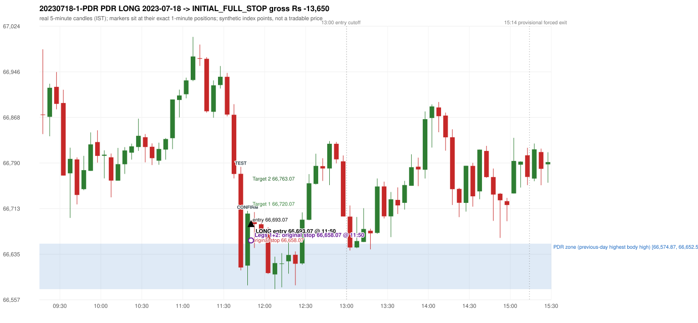
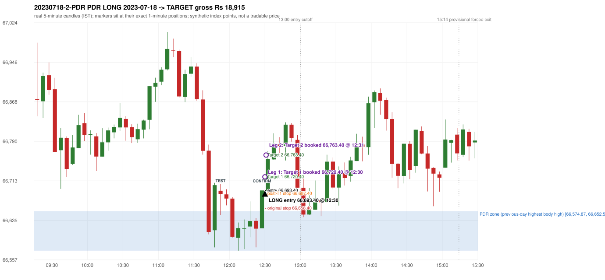

# Trading journal - 2023-07-18 (Tuesday)

> Phase 5 cross-index test, SENSEX window M (Main window 2022-09-01..2026-08-31 (5paisa minutes); status DATA_VALIDATED). The FROZEN Phase 3.6 configuration (IRF, ORB, PDR body-based, PDS, RF; shared controller) with the NIFTY index-point stops and targets UNCHANGED on the SENSEX index price. INDEX-POINT RESULTS ONLY: no option premium is used or estimated. HISTORICAL RESEARCH ONLY: the strategy was developed using later NIFTY data. same provider and download path as the NIFTY Phase 4 / Phase 3.6 runs; the status only says the DATA window passed the quality gate Synthetic SENSEX index-point P&L (the index is not tradable). The owner's review status is intentionally blank.

## A. Trading day overview

| item | value |
|---|---|
| Date / weekday | 2023-07-18 / Tuesday |
| Session type | USABLE / VALID |
| Original session open (first 1-minute open) | 66,873.31 |
| Previous session | 2023-07-17 |
| Previous-day high / low (wicks included) | 66,655.51 / 66,015.63 |
| Previous-day highest BODY high (the body-based PDR ceiling; wicks ignored) | 66,652.59 |
| Previous-day official close / last 5-minute close | 66,589.93 / 66,619.06 |
| Raw engine records / confirmed signals / fully valid signals | 6 / 3 / 3 |
| Setups that did not complete (invalidated / incomplete) | 3 |
| Executed trades | 2 20230718-1-PDR;20230718-2-PDR |
| Gross P&L (Rs, synthetic) | 5,265.00 |
| Illustrative net P&L (Rs; Rs 500/trade + 0.5 pt/fill) | 3,485.00 |
| Day-end portfolio status | DAY_FINISHED |
| Manual journal trades (matched / unmatched) | 0 (0 / 0) |
| Extra automated trades | 0 |

## B. Daily strategy signal timeline (confirmed signals, chronological)

| time | strategy | method | dir | entry-rule status | valid for execution | <= 13:00 | portfolio state | accepted / ignored | specific reason | competing (same minute) |
|---|---|---|---|---|---|---|---|---|---|---|
| 11:50 | PDR | PDR | LONG | RESEARCH_VARIANT | True | True | FIRST_TRADE_ACTIVE | ACCEPTED -> 20230718-1-PDR | first eligible signal of the day; trade 1: INITIAL_FULL_STOP |  |
| 12:30 | PDR | PDR | LONG | RESEARCH_VARIANT | True | True | SECOND_TRADE_ACTIVE | ACCEPTED -> 20230718-2-PDR | permitted second trade: newly confirmed PDR/PDS after the original full stop; trade 2: TARGET |  |
| 13:20 | PDR | PDR | LONG | RESEARCH_VARIANT | True | False | DAY_FINISHED | IGNORED | DAY_FINISHED [blocked by PDR#2] |  |

Engine setups that did not complete (3); the complete list with failed rule ids is in `rejected_signals.csv`:

| candle | strategy | method | dir | status | precise reason | failed rules |
|---|---|---|---|---|---|---|
| 09:15 | ORB | Method 1 | LONG | INVALIDATED | CANDLE_QUALITY(not a strong body / wick too large) | ORB-M1-LONG-003 |
| 09:15 | ORB | Method 2 | LONG | INVALIDATED | CANDLE_QUALITY | ORB-M2-LONG-003 |
| 10:50 | RF | RF | LONG | INVALIDATED | GAP_UP_OUTSIDE_YESTERDAYS_RANGE | RF-004 |

## C. Detailed trade journals

### 20230718-1-PDR: PDR LONG (FIRST trade)

Chart: 

**Rule configuration:** CFG-phase36_body_based-866f954e55 - signal verification status **RESEARCH_VARIANT** (never VERIFIED while a rule rests on a proposal).

#### 1. Setup identification

PDR LONG (body-based engine, A_HIGHEST_BODY_HIGH): the session opened 283.38 points above the previous close and 220.72 points above the previous-day highest BODY high 66,652.59 (zone [66,574.87, 66,652.59] from the 15:10 candle of 2023-07-17; the highest wick 66,655.51 is ignored). The 11:40 candle (66,606.91 - 66,783.99) tested the zone; the 11:45 candle (green, O 66,615.03 H 66,708.62 L 66,581.29 C 66,704.02) passed GOOD_GREEN_BODY and closed 51.43 points above the zone ceiling, confirming the entry at 11:50. The pattern thresholds and the zone's lower boundary are provisional research assumptions, not approved by the strategy author.

#### 2. Candle and indicator calculations

| role | session | candle | O | H | L | C | range | body % | upper wick % | lower wick % | direction | EMA(200) | strong bull / bear | pin bull / bear | small (body<=30%) | used for |
|---|---|---|---|---|---|---|---|---|---|---|---|---|---|---|---|---|
| zone_source_candle | PREVIOUS | 15:10-15:15 | 66,574.87 | 66,652.59 | 66,569.48 | 66,652.59 | 83.11 | 93.51 | 0.00 | 6.49 | BULLISH | 66,050.09 | True / False | False / False | False | candle of the previous session's highest BODY high (A_HIGHEST_BODY_HIGH) |
| prev_day_wick_high_candle | PREVIOUS | 15:15-15:20 | 66,652.19 | 66,655.51 | 66,614.95 | 66,626.42 | 40.56 | 63.54 | 8.19 | 28.28 | BEARISH | 66,055.82 | False / False | False / False | False | candle of the previous session's highest WICK (ignored by the author's rule; shown for comparison) |
| interaction_candle | TODAY | 11:40-11:45 | 66,772.01 | 66,783.99 | 66,606.91 | 66,611.83 | 177.08 | 90.46 | 6.77 | 2.78 | BEARISH | 66,267.32 | False / True | False / False | False | first candle whose range overlaps the zone (the test) |
| confirmation_candle | TODAY | 11:45-11:50 | 66,615.03 | 66,708.62 | 66,581.29 | 66,704.02 | 127.33 | 69.89 | 3.61 | 26.50 | BULLISH | 66,271.67 | True / False | False / False | False | candle that satisfies one of the three patterns and closes above the zone ceiling |

Every condition, with the rule, the calculation, the observed values and the result:

| # | group | rule | result | status / numeric definition | calculation | observed | required | available at | why it matters |
|---|---|---|---|---|---|---|---|---|---|
| 1 | SELECTION | SEL-FIRST-001 | PASS | USER_APPROVED / USER_APPROVED | earliest CONFIRMED signal of the day across IRF/ORB/PDR/PDS/RF that passed the controller's checks | 0 confirmed signal(s) earlier today; 3 confirmed signals in the day in total, this one at 11:50 | no earlier executable signal | 2023-07-18 11:50 | the shared controller trades only the first valid signal; the five strategies are not independent positions |
| 2 | SELECTION | SEL-TIE-001 | PASS | USER_APPROVED / USER_APPROVED | other CONFIRMED signals with exactly the same confirmation timestamp | none | no different-strategy / opposite-direction signal in the same minute (otherwise an unresolved conflict, no trade) | 2023-07-18 11:50 | an unresolved same-minute collision would have produced no trade at all |
| 3 | SELECTION | ENTRY-CUTOFF-001 | PASS | USER_APPROVED / USER_APPROVED | fill timestamp vs 13:00:00 IST | signal confirmed 11:50; fill 11:50 | fill at or before 13:00:00 IST | 2023-07-18 11:50 | no new position may be entered with a fill after 13:00 IST |
| 4 | SELECTION | EXE-FILL-001 | PASS | PROPOSED_FOR_REVIEW / PROPOSED_FOR_REVIEW | fill = open of the 1-minute bar that starts at the signal candle's end | bar 11:50 O 66,693.07 H 66,698.10 L 66,645.26 C 66,656.69; executable=True; entry 66,693.07 | fill bar exists, starts exactly at the signal end, is fillable; entry = its open | 2023-07-18 11:50 | a 5-minute signal is known only when its candle closes; the first price that can be traded is the next minute's open |
| 5 | SELECTION | DAY-MAX-001 | PASS | USER_APPROVED / USER_APPROVED | number of entries today | trade 1 of at most 2 | <= 2 entries per day | 2023-07-18 11:50 | daily trade cap |
| 6 | SETUP | PDR-004 | PASS | SOURCE_VERIFIED / EXPLICIT_WORDING_DETAIL_PROPOSED_FOR_REVIEW | gap = first 1-minute open of today - previous session's OFFICIAL close | today's open 66,873.31 (first 1-minute bar 09:15) - previous close 66,589.93 (DAILY_VENDOR, 2023-07-17) = +283.38 points -> gap UP | gap UP (more than 0 points) | 2023-07-18 09:15 | approved convention: the original first-minute open, never the vendor daily open |
| 7 | SETUP | PDR-B03 | PASS | AUTHOR_APPROVED / AUTHOR_STATEMENT_NUMERIC_DETAILS_ARE_SEPARATE_PROPOSED_ROWS | the session opens strictly above the previous day's resistance zone (author-approved) | today's first 1-minute open 66,873.31 vs zone ceiling 66,652.59: 220.72 points above (open - ceiling = +220.72) | open > zone ceiling (equal or inside the zone rejects the setup) | 2023-07-18 09:15 | the original first-minute open is used, never a vendor daily open |
| 8 | ZONE | PDR-001 | PASS | SOURCE_VERIFIED / EXPLICIT_IN_SOURCE | direction | LONG (PDR is long only) | long-only | 2023-07-18 11:50 | PDR buys a retest of previous-day resistance after a gap up |
| 9 | ZONE | PDR-B01a | PASS | AUTHOR_APPROVED / AUTHOR_STATEMENT_NUMERIC_DETAILS_ARE_SEPARATE_PROPOSED_ROWS | wicks ignored, bodies considered: body_high = max(open, close) of every completed previous-session 5-minute candle; ceiling = the highest body_high; floor = body low of that candle | previous session 2023-07-17: highest body high 66,652.59 on the 15:10 candle (O 66,574.87 C 66,652.59; wick high of that candle 66,652.59, ignored); four highest body highs: 66,652.59 (15:10); 66,652.19 (15:15); 66,638.45 (15:25); 66,637.76 (15:20). Highest WICK of the session 66,655.51 (15:15 candle) is 2.92 points above the ceiling and plays no part. Zone [66,574.87 (body low), 66,652.59 (body high)]; engine recorded [66,574.87, 66,652.59] | ceiling = highest body high of the previous session (author: wick ignored, body considered) | 2023-07-17 15:30 | a wick-only price never becomes resistance; the zone is drawn from candle bodies |
| 10 | ZONE | PDR-B02 | UNRESOLVED | AUTHOR_APPROVED / AUTHOR_STATEMENT_NUMERIC_DETAILS_ARE_SEPARATE_PROPOSED_ROWS | multiple highs connected into one zone (author principle; candidate B) | candidate A (used): [66,574.87, 66,652.59]. Candidate B (multiple-body-high cluster, tolerance 5 points) would be [66,574.87, 66,652.59] (ISOLATED_BODY_HIGH, 1 touch(es), member body highs 66,652.59); ceiling difference 0.00 points | a zone that connects all relevant highs (numbers not given by the author) | 2023-07-17 15:30 | candidate B has the same ceiling by construction, so this signal is unaffected by the choice; the lower boundary and the cluster numbers are research parameters |
| 11 | ZONE | PDR-003 | PASS | SOURCE_VERIFIED / EXPLICIT_IN_SOURCE | the zone is an area, not a single price | zone height 77.72 points [66,574.87, 66,652.59] | a rectangle with positive height (a zero-height zone is left unresolved by the engine) | 2023-07-17 15:30 | price may touch any part of the area |
| 12 | CONFIRMATION | PDR-B03b | PASS | PRESERVED_FROM_PHASE2 / PRESERVED_FROM_PHASE2 | the first candle whose [low, high] overlaps the zone (+/- proximity) is the test; the confirmation must come strictly after it | 11:40-11:45 O 66,772.01 H 66,783.99 L 66,606.91 C 66,611.83; range 177.08, body 160.18 (90.46%), upper wick 11.98 (6.77%), lower wick 4.92 (2.78%), bearish; low 66,606.91 vs zone ceiling 66,652.59, high 66,783.99 vs zone floor 66,574.87; proximity 0; confirmation candle 11:45 is candle no. 31, the test candle no. 30 | range overlaps the zone; confirmation after the test | 2023-07-18 11:45 | the retest of the previous-day resistance |
| 13 | CONFIRMATION | PDR-B04c | PASS | PROPOSED_FOR_REVIEW / NUMERIC_DEFINITION_PROPOSED_FOR_REVIEW | Pattern 1: good green body on the 11:45-11:50 candle (O 66,615.03 H 66,708.62 L 66,581.29 C 66,704.02); the numeric thresholds are PROVISIONAL (RESEARCH_DEFAULT), not author-approved | colour green; body 69.89%; upper wick 3.61% -> PASSES | green, body >= 60% and upper wick <= 20% of the range | 2023-07-18 11:50 | one of the three patterns is enough (author: one good green body OR lower price rejection OR hammer); fixed thresholds are not required by the author, so the numbers are a research convention; a pattern that does not pass is not an error |
| 14 | CONFIRMATION | PDR-B04c | NOT_APPLICABLE | PROPOSED_FOR_REVIEW / NUMERIC_DEFINITION_PROPOSED_FOR_REVIEW | Pattern 2: lower-price rejection candle on the 11:45-11:50 candle (O 66,615.03 H 66,708.62 L 66,581.29 C 66,704.02); the numeric thresholds are PROVISIONAL (RESEARCH_DEFAULT), not author-approved | lower wick 33.74 = 0.38 x body 88.99; close 3.61% below the high; low 66,581.29; low reached the zone ceiling 66,652.59 -> does not pass | lower wick >= 2 x body, close within the top 30% of the range, low <= zone ceiling (colour not required) | 2023-07-18 11:50 | one of the three patterns is enough (author: one good green body OR lower price rejection OR hammer); fixed thresholds are not required by the author, so the numbers are a research convention; a pattern that does not pass is not an error |
| 15 | CONFIRMATION | PDR-B04c | NOT_APPLICABLE | PROPOSED_FOR_REVIEW / NUMERIC_DEFINITION_PROPOSED_FOR_REVIEW | Pattern 3: hammer candle on the 11:45-11:50 candle (O 66,615.03 H 66,708.62 L 66,581.29 C 66,704.02); the numeric thresholds are PROVISIONAL (RESEARCH_DEFAULT), not author-approved | lower wick 33.74 = 0.38 x body; upper wick 3.61%; body bottom at 26.50% of the range -> does not pass | lower wick >= 2 x body, upper wick <= 10%, body bottom >= 60% of the range (colour not required) | 2023-07-18 11:50 | one of the three patterns is enough (author: one good green body OR lower price rejection OR hammer); fixed thresholds are not required by the author, so the numbers are a research convention; a pattern that does not pass is not an error |
| 16 | CONFIRMATION | PDR-B04 | PASS | AUTHOR_APPROVED / AUTHOR_STATEMENT_NUMERIC_DETAILS_ARE_SEPARATE_PROPOSED_ROWS | at least one of the three patterns passes (OR logic; every passing pattern is recorded) | patterns passed: GOOD_GREEN_BODY (engine recorded: GOOD_GREEN_BODY) | at least one pattern | 2023-07-18 11:50 | the author's entry candle requirement |
| 17 | CONFIRMATION | PDR-B05 | PASS | AUTHOR_APPROVED / AUTHOR_STATEMENT_NUMERIC_DETAILS_ARE_SEPARATE_PROPOSED_ROWS | the confirmation candle must close above the zone | close 66,704.02 vs zone ceiling 66,652.59: +51.43 points (floor 66,574.87; low 66,581.29 dipped into/below the zone) | close > zone ceiling, strictly (lower wick may penetrate the zone) | 2023-07-18 11:50 | no pattern overrides the close rule |
| 18 | CONFIRMATION | PDR-B06 | PASS | USER_APPROVED / USER_APPROVED | no entry at the open and no look-ahead: the order is placed only after the confirmation candle has completed | test candle 11:40 (no. 30) precedes the confirmation candle 11:45-11:50; signal stamped 11:50; fill 11:50 at the open of that 1-minute bar = 66,693.07 | interaction before the confirmation; fill after the confirmation candle's end | 2023-07-18 11:50 | existing causal fill convention (EXE-FILL-001) |
| 19 | EXECUTION | EXE-STOP-001 | PASS | USER_APPROVED / USER_APPROVED | initial stop = entry - 35 points | entry 66,693.07 -> stop 66,658.07 | stop 35 index points (BASELINE) | 2023-07-18 11:50 | defines the loss if the setup fails before Target 1 |
| 20 | EXECUTION | EXE-T1-001 | PASS | SOURCE_VERIFIED / EXPLICIT_IN_SOURCE | Target 1 = entry +/- 27 points | T1 66,720.07 | 27 points | 2023-07-18 11:50 | Leg 1 (3 lots) is booked at Target 1 |
| 21 | EXECUTION | PDR-008 | PASS | SOURCE_VERIFIED / EXPLICIT_IN_SOURCE | Target 2 = entry +/- 70 points | T2 66,763.07 (the guide says 70; the performance report's winners suggest 60 - CONFLICTING, recorded) | 70 points | 2023-07-18 11:50 | Leg 2 (3 lots) is booked at Target 2 |
| 22 | EXECUTION | POST-T1-STOP-006 | PASS | USER_APPROVED / USER_APPROVED | after T1 the Leg-2 stop = entry - 6 (no trailing) | post-T1 stop 66,687.07 | entry -6 (LONG) / +6 (SHORT) | 2023-07-18 11:50 | protects the remaining three lots once the first three are booked |
| 23 | EXECUTION | SIZE-LOT-001 | PASS | USER_APPROVED / USER_APPROVED | 6 lots x 65 = 390, Leg 1 = 3 lots = 195, Leg 2 = 195 | 6 lots, lot size 65, legs 3+3 | 6 lots in two equal legs | 2023-07-18 11:50 | position size for the synthetic P&L |
| 24 | NOTE | PDR-B04x | UNRESOLVED | PROPOSED_FOR_REVIEW / NUMERIC_DEFINITION_PROPOSED_FOR_REVIEW | provisional parameters this signal rests on | pattern thresholds RESEARCH_DEFAULT: {'green_body_min': 0.6, 'green_upper_wick_max': 0.2, 'reject_wick_to_body_min': 2.0, 'reject_close_fraction_max': 0.3, 'hammer_wick_to_body_min': 2.0, 'hammer_upper_wick_max': 0.1, 'hammer_body_position_min': 0.6}; zone lower boundary = hull of the member bodies; zero-height policy UNRESOLVED_NO_SETUP; wait policy WAIT_FOR_QUALIFYING_CANDLE; cluster parameters (candidate B only) tolerance 5, touches 2, separation 2 | n/a (disclosure) | 2023-07-18 11:50 | the strategy author has NOT approved these numbers or conventions; the signal is a RESEARCH_VARIANT, never VERIFIED |
| 25 | NOTE | PDR-012 | NOT_APPLICABLE | PROPOSED_FOR_REVIEW / PROPOSED_FOR_REVIEW | repeated PDR signals today | 3 confirmed PDR signal(s) in the session | n/a (disclosure) | 2023-07-18 11:50 | this engine reports EVERY qualifying signal (the per-session cap is lifted); the controller trades only the first (and a PDR/PDS second trade after an initial full stop) |
| 26 | NOTE | PDR-B07 | NOT_APPLICABLE | PROPOSED_FOR_REVIEW / NUMERIC_DEFINITION_PROPOSED_FOR_REVIEW | state of the zone between the test and the confirmation (the author and the guide are silent on price crossing below the zone) | test candle 11:40 (no. 30), confirmation candle 11:45 (no. 31): 1 candle(s) later; no candle in between closed below the zone floor | n/a (disclosure; the wait policy is a research parameter) | 2023-07-18 11:50 | the engine keeps a tested setup armed until a candle qualifies; whether a zone that price has closed through should still count is an owner decision |
| 27 | NOTE | PDR-009 | UNRESOLVED | UNRESOLVED / UNRESOLVED | stop 35 or 40 'depending on the situation' | the guide gives no selection rule; baseline fixed 35 points | unresolved in the source | 2023-07-18 11:50 | PDR stop selection is left to the owner |
| 28 | NOTE | NOTE-UNRESOLVED-DEPENDENCIES | UNRESOLVED | NOT_A_RULE / NOT_A_REGISTRY_RULE | rules the signal depends on that the sources leave unresolved | engine-recorded unresolved rule ids: PDR-B01b, PDR-B02a, PDR-B02b, PDR-B02c, PDR-B02d, PDR-B02e, PDR-B02f, PDR-B02g, PDR-B02h, PDR-B04b, PDR-B04c, PDR-B05a, PDR-B07; verification status RESEARCH_VARIANT | n/a (disclosure) | 2023-07-18 11:50 | the entry is only as verified as the rules it rests on |

#### 3. Entry decision and explanation

PDR LONG (body-based engine, A_HIGHEST_BODY_HIGH): the session opened 283.38 points above the previous close and 220.72 points above the previous-day highest BODY high 66,652.59 (zone [66,574.87, 66,652.59] from the 15:10 candle of 2023-07-17; the highest wick 66,655.51 is ignored). The 11:40 candle (66,606.91 - 66,783.99) tested the zone; the 11:45 candle (green, O 66,615.03 H 66,708.62 L 66,581.29 C 66,704.02) passed GOOD_GREEN_BODY and closed 51.43 points above the zone ceiling, confirming the entry at 11:50. The pattern thresholds and the zone's lower boundary are provisional research assumptions, not approved by the strategy author.

**Why this trade ahead of the other strategies:** This PDR signal was the earliest executable signal of the day: 0 confirmed signal(s) earlier, 0 other in the same minute. 2 later confirmed signal(s) (PDR x2) are logged as ignored or rejected. State of the other four engines at that moment: [IRF: no setup record before this time (a base condition was not met, or nothing triggered)] [ORB: Method 1 invalidated at 09:15: CANDLE_QUALITY(not a strong body / wick too large); Method 2 invalidated at 09:15: CANDLE_QUALITY] [PDS: no setup record before this time (a base condition was not met, or nothing triggered)] [RF: RF invalidated at 10:50: GAP_UP_OUTSIDE_YESTERDAYS_RANGE]

#### 4. Actual entry execution

| item | value |
|---|---|
| Signal candle | 11:45-11:50 |
| Signal confirmed | 2023-07-18 11:50 |
| Fill timestamp | 2023-07-18 11:50 |
| Entry price | 66,693.07 |
| Source partition / 1-minute bar | data/processed/sensex/FIVEPAISA_1M_SENSEX/minutes/year=2023/month=07/candles.parquet / 2023-07-18 11:50 |
| Source bar O / H / L / C | 66,693.07 / 66,698.10 / 66,645.26 / 66,656.69 |
| Fill assumption | open of the 1-minute bar starting at the signal candle's end (EXE-FILL-001, PROPOSED causal convention) |
| Initial stop / T1 / T2 / post-T1 stop | 66,658.07 / 66,720.07 / 66,763.07 / 66,687.07 |
| Position | 6 lots x 65 = 390 units (Leg 1 195, Leg 2 195) |

#### 5-8. Trade progress, Target 1, post-T1 stop and final exit

Between the 11:50 entry bar and the final exit (1 one-minute bars) the best excursion in favour was 5.03 points at 11:50 and the worst against was 47.81 points at 11:50. At 11:50 price reached the original stop 66,658.07 before Target 1 66,720.07, so all six lots exited together at 66,658.07. This is an INITIAL_FULL_STOP: one more trade is allowed that day, only a newly confirmed PDR/PDS signal.

| leg | qty | exit time | exit price | reason | source 1-minute bar | O / H / L / C | gross points | gross Rs | slippage pts | flags |
|---|---|---|---|---|---|---|---|---|---|---|
| 1 | 195 | 11:50 | 66,658.07 | ORIGINAL_STOP_BEFORE_T1 | 11:50 | 66,693.07 / 66,698.10 / 66,645.26 / 66,656.69 | -35.00 | -6,825.00 | 0.00 |  |
| 2 | 195 | 11:50 | 66,658.07 | ORIGINAL_STOP_BEFORE_T1 | 11:50 | 66,693.07 / 66,698.10 / 66,645.26 / 66,656.69 | -35.00 | -6,825.00 | 0.00 |  |

Exit evidence per leg:

* Leg 1: 1-minute bar 11:50 O 66,693.07 H 66,698.10 L 66,645.26 C 66,656.69: low 66,645.26 reached the original stop 66,658.07 before Target 1 66,720.07 was touched; both legs exit at the stop level 66,658.07
* Leg 2: 1-minute bar 11:50 O 66,693.07 H 66,698.10 L 66,645.26 C 66,656.69: low 66,645.26 reached the original stop 66,658.07 before Target 1 66,720.07 was touched; both legs exit at the stop level 66,658.07

#### 9. Gross and illustrative net P&L

| item | value (Rs) |
|---|---|
| Leg 1 gross | -6,825.00 |
| Leg 2 gross | -6,825.00 |
| Trade gross (= Leg 1 + Leg 2) | -13,650.00 |
| Illustrative fixed cost | -500.00 |
| Illustrative slippage (0.5 pt on every fill, entry + exits, all units) | -390.00 |
| Illustrative net | -14,540.00 |

#### 10. Manual journal comparison

No manual journal exists for this period; no comparison.

### 20230718-2-PDR: PDR LONG (SECOND trade)

Chart: 

**Rule configuration:** CFG-phase36_body_based-866f954e55 - signal verification status **RESEARCH_VARIANT** (never VERIFIED while a rule rests on a proposal).

#### 1. Setup identification

PDR LONG (body-based engine, A_HIGHEST_BODY_HIGH): the session opened 283.38 points above the previous close and 220.72 points above the previous-day highest BODY high 66,652.59 (zone [66,574.87, 66,652.59] from the 15:10 candle of 2023-07-17; the highest wick 66,655.51 is ignored). The 11:50 candle (66,645.26 - 66,706.59) tested the zone; the 12:25 candle (green, O 66,618.83 H 66,706.03 L 66,616.68 C 66,693.56) passed GOOD_GREEN_BODY and closed 40.97 points above the zone ceiling, confirming the entry at 12:30. The pattern thresholds and the zone's lower boundary are provisional research assumptions, not approved by the strategy author.

#### 2. Candle and indicator calculations

| role | session | candle | O | H | L | C | range | body % | upper wick % | lower wick % | direction | EMA(200) | strong bull / bear | pin bull / bear | small (body<=30%) | used for |
|---|---|---|---|---|---|---|---|---|---|---|---|---|---|---|---|---|
| zone_source_candle | PREVIOUS | 15:10-15:15 | 66,574.87 | 66,652.59 | 66,569.48 | 66,652.59 | 83.11 | 93.51 | 0.00 | 6.49 | BULLISH | 66,050.09 | True / False | False / False | False | candle of the previous session's highest BODY high (A_HIGHEST_BODY_HIGH) |
| prev_day_wick_high_candle | PREVIOUS | 15:15-15:20 | 66,652.19 | 66,655.51 | 66,614.95 | 66,626.42 | 40.56 | 63.54 | 8.19 | 28.28 | BEARISH | 66,055.82 | False / False | False / False | False | candle of the previous session's highest WICK (ignored by the author's rule; shown for comparison) |
| interaction_candle | TODAY | 11:50-11:55 | 66,693.07 | 66,706.59 | 66,645.26 | 66,686.20 | 61.33 | 11.20 | 22.04 | 66.75 | BEARISH | 66,275.79 | False / False | False / False | True | first candle whose range overlaps the zone (the test) |
| confirmation_candle | TODAY | 12:25-12:30 | 66,618.83 | 66,706.03 | 66,616.68 | 66,693.56 | 89.35 | 83.64 | 13.96 | 2.41 | BULLISH | 66,300.26 | True / False | False / False | False | candle that satisfies one of the three patterns and closes above the zone ceiling |

Every condition, with the rule, the calculation, the observed values and the result:

| # | group | rule | result | status / numeric definition | calculation | observed | required | available at | why it matters |
|---|---|---|---|---|---|---|---|---|---|
| 1 | SELECTION | DAY-SL-001 | PASS | USER_APPROVED / USER_APPROVED | first trade outcome, strategy of this signal, position-close time vs this signal's timestamp | first trade PDR PDR closed as INITIAL_FULL_STOP at 11:50; position free from 11:51; this PDR signal confirmed 12:30 | first trade INITIAL_FULL_STOP before Target 1, and a NEWLY confirmed PDR/PDS signal after the first position closed | 2023-07-18 12:30 | the only way a second trade is allowed |
| 2 | SELECTION | DAY-NOREUSE-001 | PASS | USER_APPROVED / USER_APPROVED | signals confirmed while the first position was open | 1 signal(s) were ignored during the first trade (never reused): PDR PDR LONG @11:50 | this trade comes from a signal confirmed after the first exit, not from an ignored one | 2023-07-18 12:30 | an ignored signal can never become the second trade |
| 3 | SELECTION | ENTRY-CUTOFF-001 | PASS | USER_APPROVED / USER_APPROVED | fill timestamp vs 13:00:00 IST | signal confirmed 12:30; fill 12:30 | fill at or before 13:00:00 IST | 2023-07-18 12:30 | no new position may be entered with a fill after 13:00 IST |
| 4 | SELECTION | EXE-FILL-001 | PASS | PROPOSED_FOR_REVIEW / PROPOSED_FOR_REVIEW | fill = open of the 1-minute bar that starts at the signal candle's end | bar 12:30 O 66,693.40 H 66,741.70 L 66,692.72 C 66,741.70; executable=True; entry 66,693.40 | fill bar exists, starts exactly at the signal end, is fillable; entry = its open | 2023-07-18 12:30 | a 5-minute signal is known only when its candle closes; the first price that can be traded is the next minute's open |
| 5 | SELECTION | DAY-MAX-001 | PASS | USER_APPROVED / USER_APPROVED | number of entries today | trade 2 of at most 2 | <= 2 entries per day | 2023-07-18 12:30 | daily trade cap |
| 6 | SETUP | PDR-004 | PASS | SOURCE_VERIFIED / EXPLICIT_WORDING_DETAIL_PROPOSED_FOR_REVIEW | gap = first 1-minute open of today - previous session's OFFICIAL close | today's open 66,873.31 (first 1-minute bar 09:15) - previous close 66,589.93 (DAILY_VENDOR, 2023-07-17) = +283.38 points -> gap UP | gap UP (more than 0 points) | 2023-07-18 09:15 | approved convention: the original first-minute open, never the vendor daily open |
| 7 | SETUP | PDR-B03 | PASS | AUTHOR_APPROVED / AUTHOR_STATEMENT_NUMERIC_DETAILS_ARE_SEPARATE_PROPOSED_ROWS | the session opens strictly above the previous day's resistance zone (author-approved) | today's first 1-minute open 66,873.31 vs zone ceiling 66,652.59: 220.72 points above (open - ceiling = +220.72) | open > zone ceiling (equal or inside the zone rejects the setup) | 2023-07-18 09:15 | the original first-minute open is used, never a vendor daily open |
| 8 | ZONE | PDR-001 | PASS | SOURCE_VERIFIED / EXPLICIT_IN_SOURCE | direction | LONG (PDR is long only) | long-only | 2023-07-18 12:30 | PDR buys a retest of previous-day resistance after a gap up |
| 9 | ZONE | PDR-B01a | PASS | AUTHOR_APPROVED / AUTHOR_STATEMENT_NUMERIC_DETAILS_ARE_SEPARATE_PROPOSED_ROWS | wicks ignored, bodies considered: body_high = max(open, close) of every completed previous-session 5-minute candle; ceiling = the highest body_high; floor = body low of that candle | previous session 2023-07-17: highest body high 66,652.59 on the 15:10 candle (O 66,574.87 C 66,652.59; wick high of that candle 66,652.59, ignored); four highest body highs: 66,652.59 (15:10); 66,652.19 (15:15); 66,638.45 (15:25); 66,637.76 (15:20). Highest WICK of the session 66,655.51 (15:15 candle) is 2.92 points above the ceiling and plays no part. Zone [66,574.87 (body low), 66,652.59 (body high)]; engine recorded [66,574.87, 66,652.59] | ceiling = highest body high of the previous session (author: wick ignored, body considered) | 2023-07-17 15:30 | a wick-only price never becomes resistance; the zone is drawn from candle bodies |
| 10 | ZONE | PDR-B02 | UNRESOLVED | AUTHOR_APPROVED / AUTHOR_STATEMENT_NUMERIC_DETAILS_ARE_SEPARATE_PROPOSED_ROWS | multiple highs connected into one zone (author principle; candidate B) | candidate A (used): [66,574.87, 66,652.59]. Candidate B (multiple-body-high cluster, tolerance 5 points) would be [66,574.87, 66,652.59] (ISOLATED_BODY_HIGH, 1 touch(es), member body highs 66,652.59); ceiling difference 0.00 points | a zone that connects all relevant highs (numbers not given by the author) | 2023-07-17 15:30 | candidate B has the same ceiling by construction, so this signal is unaffected by the choice; the lower boundary and the cluster numbers are research parameters |
| 11 | ZONE | PDR-003 | PASS | SOURCE_VERIFIED / EXPLICIT_IN_SOURCE | the zone is an area, not a single price | zone height 77.72 points [66,574.87, 66,652.59] | a rectangle with positive height (a zero-height zone is left unresolved by the engine) | 2023-07-17 15:30 | price may touch any part of the area |
| 12 | CONFIRMATION | PDR-B03b | PASS | PRESERVED_FROM_PHASE2 / PRESERVED_FROM_PHASE2 | the first candle whose [low, high] overlaps the zone (+/- proximity) is the test; the confirmation must come strictly after it | 11:50-11:55 O 66,693.07 H 66,706.59 L 66,645.26 C 66,686.20; range 61.33, body 6.87 (11.20%), upper wick 13.52 (22.04%), lower wick 40.94 (66.75%), bearish; low 66,645.26 vs zone ceiling 66,652.59, high 66,706.59 vs zone floor 66,574.87; proximity 0; confirmation candle 12:25 is candle no. 39, the test candle no. 32 | range overlaps the zone; confirmation after the test | 2023-07-18 11:55 | the retest of the previous-day resistance (re-armed after the earlier signal: scanning restarted after the 11:45 candle) |
| 13 | CONFIRMATION | PDR-B04c | PASS | PROPOSED_FOR_REVIEW / NUMERIC_DEFINITION_PROPOSED_FOR_REVIEW | Pattern 1: good green body on the 12:25-12:30 candle (O 66,618.83 H 66,706.03 L 66,616.68 C 66,693.56); the numeric thresholds are PROVISIONAL (RESEARCH_DEFAULT), not author-approved | colour green; body 83.64%; upper wick 13.96% -> PASSES | green, body >= 60% and upper wick <= 20% of the range | 2023-07-18 12:30 | one of the three patterns is enough (author: one good green body OR lower price rejection OR hammer); fixed thresholds are not required by the author, so the numbers are a research convention; a pattern that does not pass is not an error |
| 14 | CONFIRMATION | PDR-B04c | NOT_APPLICABLE | PROPOSED_FOR_REVIEW / NUMERIC_DEFINITION_PROPOSED_FOR_REVIEW | Pattern 2: lower-price rejection candle on the 12:25-12:30 candle (O 66,618.83 H 66,706.03 L 66,616.68 C 66,693.56); the numeric thresholds are PROVISIONAL (RESEARCH_DEFAULT), not author-approved | lower wick 2.15 = 0.03 x body 74.73; close 13.96% below the high; low 66,616.68; low reached the zone ceiling 66,652.59 -> does not pass | lower wick >= 2 x body, close within the top 30% of the range, low <= zone ceiling (colour not required) | 2023-07-18 12:30 | one of the three patterns is enough (author: one good green body OR lower price rejection OR hammer); fixed thresholds are not required by the author, so the numbers are a research convention; a pattern that does not pass is not an error |
| 15 | CONFIRMATION | PDR-B04c | NOT_APPLICABLE | PROPOSED_FOR_REVIEW / NUMERIC_DEFINITION_PROPOSED_FOR_REVIEW | Pattern 3: hammer candle on the 12:25-12:30 candle (O 66,618.83 H 66,706.03 L 66,616.68 C 66,693.56); the numeric thresholds are PROVISIONAL (RESEARCH_DEFAULT), not author-approved | lower wick 2.15 = 0.03 x body; upper wick 13.96%; body bottom at 2.41% of the range -> does not pass | lower wick >= 2 x body, upper wick <= 10%, body bottom >= 60% of the range (colour not required) | 2023-07-18 12:30 | one of the three patterns is enough (author: one good green body OR lower price rejection OR hammer); fixed thresholds are not required by the author, so the numbers are a research convention; a pattern that does not pass is not an error |
| 16 | CONFIRMATION | PDR-B04 | PASS | AUTHOR_APPROVED / AUTHOR_STATEMENT_NUMERIC_DETAILS_ARE_SEPARATE_PROPOSED_ROWS | at least one of the three patterns passes (OR logic; every passing pattern is recorded) | patterns passed: GOOD_GREEN_BODY (engine recorded: GOOD_GREEN_BODY) | at least one pattern | 2023-07-18 12:30 | the author's entry candle requirement |
| 17 | CONFIRMATION | PDR-B05 | PASS | AUTHOR_APPROVED / AUTHOR_STATEMENT_NUMERIC_DETAILS_ARE_SEPARATE_PROPOSED_ROWS | the confirmation candle must close above the zone | close 66,693.56 vs zone ceiling 66,652.59: +40.97 points (floor 66,574.87; low 66,616.68 dipped into/below the zone) | close > zone ceiling, strictly (lower wick may penetrate the zone) | 2023-07-18 12:30 | no pattern overrides the close rule |
| 18 | CONFIRMATION | PDR-B06 | PASS | USER_APPROVED / USER_APPROVED | no entry at the open and no look-ahead: the order is placed only after the confirmation candle has completed | test candle 11:50 (no. 32) precedes the confirmation candle 12:25-12:30; signal stamped 12:30; fill 12:30 at the open of that 1-minute bar = 66,693.40 | interaction before the confirmation; fill after the confirmation candle's end | 2023-07-18 12:30 | existing causal fill convention (EXE-FILL-001) |
| 19 | EXECUTION | EXE-STOP-001 | PASS | USER_APPROVED / USER_APPROVED | initial stop = entry - 35 points | entry 66,693.40 -> stop 66,658.40 | stop 35 index points (BASELINE) | 2023-07-18 12:30 | defines the loss if the setup fails before Target 1 |
| 20 | EXECUTION | EXE-T1-001 | PASS | SOURCE_VERIFIED / EXPLICIT_IN_SOURCE | Target 1 = entry +/- 27 points | T1 66,720.40 | 27 points | 2023-07-18 12:30 | Leg 1 (3 lots) is booked at Target 1 |
| 21 | EXECUTION | PDR-008 | PASS | SOURCE_VERIFIED / EXPLICIT_IN_SOURCE | Target 2 = entry +/- 70 points | T2 66,763.40 (the guide says 70; the performance report's winners suggest 60 - CONFLICTING, recorded) | 70 points | 2023-07-18 12:30 | Leg 2 (3 lots) is booked at Target 2 |
| 22 | EXECUTION | POST-T1-STOP-006 | PASS | USER_APPROVED / USER_APPROVED | after T1 the Leg-2 stop = entry - 6 (no trailing) | post-T1 stop 66,687.40 | entry -6 (LONG) / +6 (SHORT) | 2023-07-18 12:30 | protects the remaining three lots once the first three are booked |
| 23 | EXECUTION | SIZE-LOT-001 | PASS | USER_APPROVED / USER_APPROVED | 6 lots x 65 = 390, Leg 1 = 3 lots = 195, Leg 2 = 195 | 6 lots, lot size 65, legs 3+3 | 6 lots in two equal legs | 2023-07-18 12:30 | position size for the synthetic P&L |
| 24 | NOTE | PDR-B04x | UNRESOLVED | PROPOSED_FOR_REVIEW / NUMERIC_DEFINITION_PROPOSED_FOR_REVIEW | provisional parameters this signal rests on | pattern thresholds RESEARCH_DEFAULT: {'green_body_min': 0.6, 'green_upper_wick_max': 0.2, 'reject_wick_to_body_min': 2.0, 'reject_close_fraction_max': 0.3, 'hammer_wick_to_body_min': 2.0, 'hammer_upper_wick_max': 0.1, 'hammer_body_position_min': 0.6}; zone lower boundary = hull of the member bodies; zero-height policy UNRESOLVED_NO_SETUP; wait policy WAIT_FOR_QUALIFYING_CANDLE; cluster parameters (candidate B only) tolerance 5, touches 2, separation 2 | n/a (disclosure) | 2023-07-18 12:30 | the strategy author has NOT approved these numbers or conventions; the signal is a RESEARCH_VARIANT, never VERIFIED |
| 25 | NOTE | PDR-012 | NOT_APPLICABLE | PROPOSED_FOR_REVIEW / PROPOSED_FOR_REVIEW | repeated PDR signals today | 3 confirmed PDR signal(s) in the session | n/a (disclosure) | 2023-07-18 12:30 | this engine reports EVERY qualifying signal (the per-session cap is lifted); the controller trades only the first (and a PDR/PDS second trade after an initial full stop) |
| 26 | NOTE | PDR-B07 | NOT_APPLICABLE | PROPOSED_FOR_REVIEW / NUMERIC_DEFINITION_PROPOSED_FOR_REVIEW | state of the zone between the test and the confirmation (the author and the guide are silent on price crossing below the zone) | test candle 11:50 (no. 32), confirmation candle 12:25 (no. 39): 7 candle(s) later; no candle in between closed below the zone floor | n/a (disclosure; the wait policy is a research parameter) | 2023-07-18 12:30 | the engine keeps a tested setup armed until a candle qualifies; whether a zone that price has closed through should still count is an owner decision |
| 27 | NOTE | PDR-009 | UNRESOLVED | UNRESOLVED / UNRESOLVED | stop 35 or 40 'depending on the situation' | the guide gives no selection rule; baseline fixed 35 points | unresolved in the source | 2023-07-18 12:30 | PDR stop selection is left to the owner |
| 28 | NOTE | NOTE-UNRESOLVED-DEPENDENCIES | UNRESOLVED | NOT_A_RULE / NOT_A_REGISTRY_RULE | rules the signal depends on that the sources leave unresolved | engine-recorded unresolved rule ids: PDR-B01b, PDR-B02a, PDR-B02b, PDR-B02c, PDR-B02d, PDR-B02e, PDR-B02f, PDR-B02g, PDR-B02h, PDR-B04b, PDR-B04c, PDR-B05a, PDR-B07; verification status RESEARCH_VARIANT | n/a (disclosure) | 2023-07-18 12:30 | the entry is only as verified as the rules it rests on |

#### 3. Entry decision and explanation

PDR LONG (body-based engine, A_HIGHEST_BODY_HIGH): the session opened 283.38 points above the previous close and 220.72 points above the previous-day highest BODY high 66,652.59 (zone [66,574.87, 66,652.59] from the 15:10 candle of 2023-07-17; the highest wick 66,655.51 is ignored). The 11:50 candle (66,645.26 - 66,706.59) tested the zone; the 12:25 candle (green, O 66,618.83 H 66,706.03 L 66,616.68 C 66,693.56) passed GOOD_GREEN_BODY and closed 40.97 points above the zone ceiling, confirming the entry at 12:30. The pattern thresholds and the zone's lower boundary are provisional research assumptions, not approved by the strategy author.

**Why this trade ahead of the other strategies:** The first trade (PDR PDR) was stopped out before Target 1 at 11:50; this newly confirmed PDR signal at 12:30 is the first PDR/PDS signal after that exit, so it is the day's permitted second trade. State of the other engines at that moment: [IRF: no setup record before this time (a base condition was not met, or nothing triggered)] [ORB: Method 1 invalidated at 09:15: CANDLE_QUALITY(not a strong body / wick too large); Method 2 invalidated at 09:15: CANDLE_QUALITY] [PDS: no setup record before this time (a base condition was not met, or nothing triggered)] [RF: RF invalidated at 10:50: GAP_UP_OUTSIDE_YESTERDAYS_RANGE]

#### 4. Actual entry execution

| item | value |
|---|---|
| Signal candle | 12:25-12:30 |
| Signal confirmed | 2023-07-18 12:30 |
| Fill timestamp | 2023-07-18 12:30 |
| Entry price | 66,693.40 |
| Source partition / 1-minute bar | data/processed/sensex/FIVEPAISA_1M_SENSEX/minutes/year=2023/month=07/candles.parquet / 2023-07-18 12:30 |
| Source bar O / H / L / C | 66,693.40 / 66,741.70 / 66,692.72 / 66,741.70 |
| Fill assumption | open of the 1-minute bar starting at the signal candle's end (EXE-FILL-001, PROPOSED causal convention) |
| Initial stop / T1 / T2 / post-T1 stop | 66,658.40 / 66,720.40 / 66,763.40 / 66,687.40 |
| Position | 6 lots x 65 = 390 units (Leg 1 195, Leg 2 195) |

#### 5-8. Trade progress, Target 1, post-T1 stop and final exit

Between the 12:30 entry bar and the final exit (2 one-minute bars) the best excursion in favour was 70.54 points at 12:31 and the worst against was 0.68 points at 12:30. At 12:30 price reached Target 1 66,720.40 and three lots exited. At 12:30 the remaining three lots' protective stop was set to 66,687.40 (entry - 6; no trailing, no further change); the engine applies it from the Target-1 bar onward and tests it within that same bar. At 12:31 price reached Target 2 66,763.40 and the remaining three lots exited. No further trade that day (DAY-T2-001).

| leg | qty | exit time | exit price | reason | source 1-minute bar | O / H / L / C | gross points | gross Rs | slippage pts | flags |
|---|---|---|---|---|---|---|---|---|---|---|
| 1 | 195 | 12:30 | 66,720.40 | TARGET_1 | 12:30 | 66,693.40 / 66,741.70 / 66,692.72 / 66,741.70 | 27.00 | 5,265.00 | 0.00 |  |
| 2 | 195 | 12:31 | 66,763.40 | TARGET_2 | 12:31 | 66,742.02 / 66,763.94 / 66,741.59 / 66,763.62 | 70.00 | 13,650.00 | 0.00 |  |

Exit evidence per leg:

* Leg 1: 1-minute bar 12:30 O 66,693.40 H 66,741.70 L 66,692.72 C 66,741.70: high 66,741.70 reached Target 1 66,720.40; Leg 1 booked at the target level
* Leg 2: 1-minute bar 12:31 O 66,742.02 H 66,763.94 L 66,741.59 C 66,763.62: high 66,763.94 reached Target 2 66,763.40; Leg 2 booked at the target level

#### 9. Gross and illustrative net P&L

| item | value (Rs) |
|---|---|
| Leg 1 gross | 5,265.00 |
| Leg 2 gross | 13,650.00 |
| Trade gross (= Leg 1 + Leg 2) | 18,915.00 |
| Illustrative fixed cost | -500.00 |
| Illustrative slippage (0.5 pt on every fill, entry + exits, all units) | -390.00 |
| Illustrative net | 18,025.00 |

#### 10. Manual journal comparison

No manual journal exists for this period; no comparison.

## D. Manual journal comparison

No manual journal exists for this period (the manual journal covers 2025-09-01 .. 2026-08-31 only); no comparison is made and no automated trade is labelled 'extra'.

## E. Daily conclusion

* **Traded:** 20230718-1-PDR - PDR PDR LONG at 11:50 (entry 66,693.07), outcome INITIAL_FULL_STOP, gross Rs -13,650.00, illustrative net Rs -14,540.00. **Why:** This PDR signal was the earliest executable signal of the day: 0 confirmed signal(s) earlier, 0 other in the same minute. 2 later confirmed signal(s) (PDR x2) are logged as ignored or rejected. State of the other four engines at that moment: [IRF: no setup record before this time (a base condition was not met, or nothing triggered)] [ORB: Method 1 invalidated at 09:15: CANDLE_QUALITY(not a strong body / wick too large); Method 2 invalidated at 09:15: CANDLE_QUALITY] [PDS: no setup record before this time (a base condition was not met, or nothing triggered)] [RF: RF invalidated at 10:50: GAP_UP_OUTSIDE_YESTERDAYS_RANGE] **How it ended:** At 11:50 price reached the original stop 66,658.07 before Target 1 66,720.07, so all six lots exited together at 66,658.07. This is an INITIAL_FULL_STOP: one more trade is allowed that day, only a newly confirmed PDR/PDS signal.
* **Traded:** 20230718-2-PDR - PDR PDR LONG at 12:30 (entry 66,693.40), outcome TARGET, gross Rs 18,915.00, illustrative net Rs 18,025.00. **Why:** The first trade (PDR PDR) was stopped out before Target 1 at 11:50; this newly confirmed PDR signal at 12:30 is the first PDR/PDS signal after that exit, so it is the day's permitted second trade. State of the other engines at that moment: [IRF: no setup record before this time (a base condition was not met, or nothing triggered)] [ORB: Method 1 invalidated at 09:15: CANDLE_QUALITY(not a strong body / wick too large); Method 2 invalidated at 09:15: CANDLE_QUALITY] [PDS: no setup record before this time (a base condition was not met, or nothing triggered)] [RF: RF invalidated at 10:50: GAP_UP_OUTSIDE_YESTERDAYS_RANGE] **How it ended:** At 12:30 price reached Target 1 66,720.40 and three lots exited. At 12:30 the remaining three lots' protective stop was set to 66,687.40 (entry - 6; no trailing, no further change); the engine applies it from the Target-1 bar onward and tests it within that same bar. At 12:31 price reached Target 2 66,763.40 and the remaining three lots exited. No further trade that day (DAY-T2-001).
* **Ignored / rejected signals:** PDR IGNORED DAY_FINISHED x1
* **Open strategy-definition issues that affected this day:** NOTE-UNRESOLVED-DEPENDENCIES, PDR-009 (Stop-loss 35 or 40 'depending on the situation'; choose before entering, do not move after entry), PDR-B02, PDR-B04x
* **Automated triage (not an approval; the owner's review status stays blank):** TRADED_NO_FLAGS

## Option-execution feasibility (information only; no option trade is simulated)

The index result above is an INDEX-POINT result on SENSEX. It is not an option result: a move of N index points is not a move of N premium points (delta, gamma, theta, vega, spread and liquidity decide the premium).

| trade | strategy | index direction | long option it maps to | historical contract identified? | premium data available? | premium fill supportable? |
|---|---|---|---|---|---|---|
| 20230718-1-PDR | PDR | LONG | BUY CALL (CE) | no | no | no |
| 20230718-2-PDR | PDR | LONG | BUY CALL (CE) | no | no | no |

Why: (1) the broker's instrument master lists only contracts that are live today, so the scrip code of a contract that existed on this date is not available; (2) historical candles can only be requested by scrip code; (3) the strike and expiry selection policy is an owner decision that has not been made (`options_feasibility/option_contract_selection_decisions.md`). No option entry, exit, premium or option P&L is shown, and none may be inferred from the index points.
