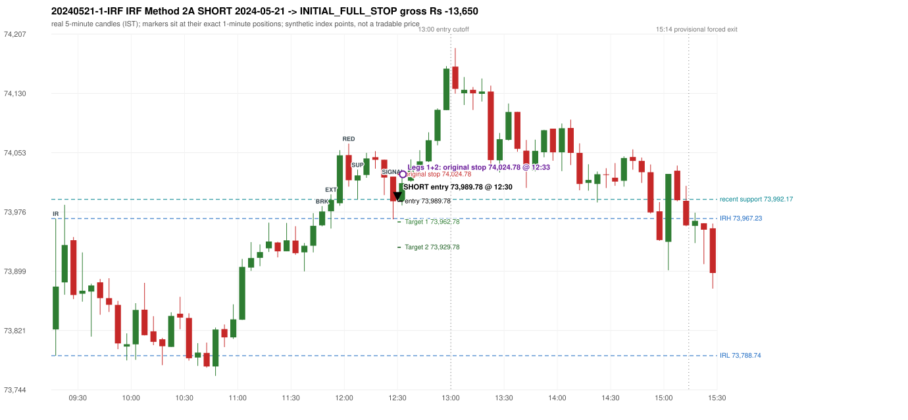

# Trading journal - 2024-05-21 (Tuesday)

> Phase 5 cross-index test, SENSEX window M (Main window 2022-09-01..2026-08-31 (5paisa minutes); status DATA_VALIDATED). The FROZEN Phase 3.6 configuration (IRF, ORB, PDR body-based, PDS, RF; shared controller) with the NIFTY index-point stops and targets UNCHANGED on the SENSEX index price. INDEX-POINT RESULTS ONLY: no option premium is used or estimated. HISTORICAL RESEARCH ONLY: the strategy was developed using later NIFTY data. same provider and download path as the NIFTY Phase 4 / Phase 3.6 runs; the status only says the DATA window passed the quality gate Synthetic SENSEX index-point P&L (the index is not tradable). The owner's review status is intentionally blank.

## A. Trading day overview

| item | value |
|---|---|
| Date / weekday | 2024-05-21 / Tuesday |
| Session type | USABLE / VALID |
| Original session open (first 1-minute open) | 73,822.85 |
| Previous session | 2024-05-17 |
| Previous-day high / low (wicks included) | 74,070.75 / 73,461.44 |
| Previous-day highest BODY high (the body-based PDR ceiling; wicks ignored) | 74,065.64 |
| Previous-day official close / last 5-minute close | 73,917.03 / 73,910.51 |
| Raw engine records / confirmed signals / fully valid signals | 9 / 4 / 4 |
| Setups that did not complete (invalidated / incomplete) | 1 |
| Executed trades | 1 20240521-1-IRF |
| Gross P&L (Rs, synthetic) | -13,650.00 |
| Illustrative net P&L (Rs; Rs 500/trade + 0.5 pt/fill) | -14,540.00 |
| Day-end portfolio status | SECOND_TRADE_ELIGIBLE |
| Manual journal trades (matched / unmatched) | 0 (0 / 0) |
| Extra automated trades | 0 |

## B. Daily strategy signal timeline (confirmed signals, chronological)

| time | strategy | method | dir | entry-rule status | valid for execution | <= 13:00 | portfolio state | accepted / ignored | specific reason | competing (same minute) |
|---|---|---|---|---|---|---|---|---|---|---|
| 12:30 | IRF | Method 2A | SHORT | PROPOSAL_DEPENDENT | True | True | FIRST_TRADE_ACTIVE | ACCEPTED -> 20240521-1-IRF | first eligible signal of the day; trade 1: INITIAL_FULL_STOP |  |
| 13:25 | IRF | Method 2A | SHORT | PROPOSAL_DEPENDENT | True | False | SECOND_TRADE_ELIGIBLE | REJECTED | SECOND_TRADE_RESTRICTED_TO_PDR_PDS [blocked by IRF#1] |  |
| 15:00 | IRF | Method 1 | SHORT | PROPOSAL_DEPENDENT | True | False | SECOND_TRADE_ELIGIBLE | REJECTED | SECOND_TRADE_RESTRICTED_TO_PDR_PDS [blocked by IRF#1] |  |
| 15:15 | IRF | Method 1 | SHORT | PROPOSAL_DEPENDENT | True | False | SECOND_TRADE_ELIGIBLE | REJECTED | SECOND_TRADE_RESTRICTED_TO_PDR_PDS [blocked by IRF#1] |  |

Engine setups that did not complete (5); the complete list with failed rule ids is in `rejected_signals.csv`:

| candle | strategy | method | dir | status | precise reason | failed rules |
|---|---|---|---|---|---|---|
| 13:20 | IRF | Method 1/2 | SHORT | INCOMPLETE_AT_EOD | SESSION_ENDED_BEFORE_CONFIRMATION |  |
|  | ORB | ALL | BOTH | NOT_EVALUATED | PREV_SESSION_UNVERIFIED(PREV_SESSION_SKIPS_EXCLUDED_SESSION:2024-05-18) |  |
|  | PDR | ALL | LONG | NOT_EVALUATED | PREV_SESSION_UNVERIFIED(PREV_SESSION_SKIPS_EXCLUDED_SESSION:2024-05-18) |  |
|  | PDS | ALL | SHORT | NOT_EVALUATED | PREV_SESSION_UNVERIFIED(PREV_SESSION_SKIPS_EXCLUDED_SESSION:2024-05-18) |  |
|  | RF | ALL | LONG | NOT_EVALUATED | PREV_SESSION_UNVERIFIED(PREV_SESSION_SKIPS_EXCLUDED_SESSION:2024-05-18) |  |

## C. Detailed trade journals

### 20240521-1-IRF: IRF Method 2A SHORT (FIRST trade)

Chart: 

**Rule configuration:** CFG-phase36_body_based-866f954e55 - signal verification status **PROPOSAL_DEPENDENT** (never VERIFIED while a rule rests on a proposal).

#### 1. Setup identification

IRF Method 2A SHORT: the 11:45-11:50 candle closed at 73,976.30, above IRH 73,967.23, and the next candle did not close back inside the range, so the setup is Method 2 and price stayed above it until the trigger. Extension candle 11:50-11:55, red candle 12:00-12:05. The trigger came 8 candles after the breakout candle: a completed candle closed below the recent pullback-low support (12:25-12:30); confirmed at 12:30 with close 73,989.63. Entry reference close 73,989.63 is 22.40 points above IRH 73,967.23.

#### 2. Candle and indicator calculations

| role | session | candle | O | H | L | C | range | body % | upper wick % | lower wick % | direction | EMA(200) | strong bull / bear | pin bull / bear | small (body<=30%) | used for |
|---|---|---|---|---|---|---|---|---|---|---|---|---|---|---|---|---|
| initial_range_candle | TODAY | 09:15-09:20 | 73,822.85 | 73,967.23 | 73,788.74 | 73,878.64 | 178.49 | 31.26 | 49.63 | 19.11 | BULLISH | 73,458.64 | False / False | False / False | False | initial range = high/low of the 09:15 candle |
| signal_candle | TODAY | 12:25-12:30 | 74,021.77 | 74,021.77 | 73,966.19 | 73,989.63 | 55.58 | 57.83 | 0.00 | 42.17 | BEARISH | 73,600.15 | False / False | False / False | False | candle whose close completed the trigger |
| breakout_candle | TODAY | 11:45-11:50 | 73,958.27 | 73,983.33 | 73,957.02 | 73,976.30 | 26.31 | 68.53 | 26.72 | 4.75 | BULLISH | 73,564.97 | False / False | False / False | False | breakout candle: a completed candle closing above IRH |
| extension_candle | TODAY | 11:50-11:55 | 73,976.70 | 73,998.66 | 73,954.16 | 73,991.56 | 44.50 | 33.39 | 15.96 | 50.65 | BULLISH | 73,569.21 | False / False | False / False | False | extension: first later candle trading above the breakout candle's high |
| red_candle | TODAY | 12:00-12:05 | 74,049.80 | 74,064.73 | 74,008.70 | 74,017.06 | 56.03 | 58.43 | 26.65 | 14.92 | BEARISH | 73,578.40 | False / False | False / False | False | first red candle during the extension |
| support_pivot | TODAY | 12:05-12:10 | 74,016.70 | 74,030.81 | 73,992.17 | 74,023.35 | 38.64 | 17.21 | 19.31 | 63.48 | BULLISH | 73,582.83 | False / False | True / False | True | recent support: latest 3-candle fractal low formed after the breakout |

Every condition, with the rule, the calculation, the observed values and the result:

| # | group | rule | result | status / numeric definition | calculation | observed | required | available at | why it matters |
|---|---|---|---|---|---|---|---|---|---|
| 1 | SELECTION | SEL-FIRST-001 | PASS | USER_APPROVED / USER_APPROVED | earliest CONFIRMED signal of the day across IRF/ORB/PDR/PDS/RF that passed the controller's checks | 0 confirmed signal(s) earlier today; 4 confirmed signals in the day in total, this one at 12:30 | no earlier executable signal | 2024-05-21 12:30 | the shared controller trades only the first valid signal; the five strategies are not independent positions |
| 2 | SELECTION | SEL-TIE-001 | PASS | USER_APPROVED / USER_APPROVED | other CONFIRMED signals with exactly the same confirmation timestamp | none | no different-strategy / opposite-direction signal in the same minute (otherwise an unresolved conflict, no trade) | 2024-05-21 12:30 | an unresolved same-minute collision would have produced no trade at all |
| 3 | SELECTION | ENTRY-CUTOFF-001 | PASS | USER_APPROVED / USER_APPROVED | fill timestamp vs 13:00:00 IST | signal confirmed 12:30; fill 12:30 | fill at or before 13:00:00 IST | 2024-05-21 12:30 | no new position may be entered with a fill after 13:00 IST |
| 4 | SELECTION | EXE-FILL-001 | PASS | PROPOSED_FOR_REVIEW / PROPOSED_FOR_REVIEW | fill = open of the 1-minute bar that starts at the signal candle's end | bar 12:30 O 73,989.78 H 73,997.93 L 73,984.19 C 73,995.72; executable=True; entry 73,989.78 | fill bar exists, starts exactly at the signal end, is fillable; entry = its open | 2024-05-21 12:30 | a 5-minute signal is known only when its candle closes; the first price that can be traded is the next minute's open |
| 5 | SELECTION | DAY-MAX-001 | PASS | USER_APPROVED / USER_APPROVED | number of entries today | trade 1 of at most 2 | <= 2 entries per day | 2024-05-21 12:30 | daily trade cap |
| 6 | SETUP | IRF-GLOBAL-001 | PASS | SOURCE_VERIFIED / EXPLICIT_IN_SOURCE | initial range = high and low (wicks included) of the first completed 5-minute candle | 09:15-09:20 IRH 73,967.23, IRL 73,788.74 (range 178.49; engine recorded IRH 73,967.23, IRL 73,788.74) | high/low of the 09:15-09:20 candle | 2024-05-21 09:20 | all three IRF methods measure price against this range |
| 7 | SETUP | IRF-GLOBAL-003 | PASS | SOURCE_VERIFIED / EXPLICIT_IN_SOURCE | closes confirm, wicks do not: every trigger is evaluated on a completed 5-minute candle | trigger candle 12:25-12:30 was complete when the signal was stamped 12:30; decision uses its close 73,989.63 | completed candle close, not an intra-candle wick | 2024-05-21 12:30 | an intra-candle wick can reverse before the candle closes |
| 8 | SETUP | IRF-GLOBAL-002 | PASS | SOURCE_VERIFIED / EXPLICIT_IN_SOURCE | direction | SHORT (IRF trades short only) | short only | 2024-05-21 12:30 | IRF fades failed upside breakouts |
| 9 | SETUP | IRF-M2-001 | PASS | SOURCE_VERIFIED / EXPLICIT_IN_SOURCE | breakout candle close vs IRH | 11:45-11:50 O 73,958.27 H 73,983.33 L 73,957.02 C 73,976.30; range 26.31, body 18.03 (68.53%), upper wick 7.03 (26.72%), lower wick 1.25 (4.75%), bullish; close 73,976.30 is 9.07 points above IRH 73,967.23 | close > IRH (a wick above IRH is not a breakout) | 2024-05-21 11:50 | starts every IRF setup |
| 10 | SETUP | IRF-M2-004 | PASS | SOURCE_VERIFIED / EXPLICIT_IN_SOURCE | the candle after the breakout must NOT close back inside the range (else the setup is Method 1) | 11:50 close 73,991.56 vs [73,788.74, 73,967.23) | not (IRL <= close < IRH) | 2024-05-21 11:55 | separates Method 2 (price holds above) from Method 1 (immediate failure) |
| 11 | SETUP | IRF-M2-002 | PASS | SOURCE_VERIFIED / QUALITATIVE_SOURCE_NUMERIC_DEFINITION_PROPOSED_FOR_REVIEW | extension = a later candle whose high exceeds the breakout candle's high (research definition E1) | 11:50 high 73,998.66 vs breakout candle high 73,983.33 (+15.33) | high > breakout candle high | 2024-05-21 11:55 | the guide says price 'extends further upward'; the numeric test is a proposal |
| 12 | SETUP | IRF-M2-003 | PASS | SOURCE_VERIFIED / QUALITATIVE_SOURCE_NUMERIC_DEFINITION_PROPOSED_FOR_REVIEW | a red candle (close < open) forms after the extension | 12:00-12:05 O 74,049.80 H 74,064.73 L 74,008.70 C 74,017.06; range 56.03, body 32.74 (58.43%), upper wick 14.93 (26.65%), lower wick 8.36 (14.92%), bearish | close < open, at or after the candle following the extension | 2024-05-21 12:05 | the red candle shows the first pause/reversal inside the extension |
| 13 | CONFIRMATION | IRF-M2A-001 | PASS | SOURCE_VERIFIED / QUALITATIVE_SOURCE_NUMERIC_DEFINITION_PROPOSED_FOR_REVIEW | recent support = latest 3-candle fractal low (k=1) among candles b+1 ... i-2 | 12:05 low 73,992.17; neighbours' lows 74,008.70 (12:00) and 74,020.19 (12:10) are not lower; engine recorded support 73,992.17 | pivot low known before the trigger candle | 2024-05-21 12:15 | the support is the level whose break completes Method 2A (the exact 'pullback low' definition is a proposal) |
| 14 | CONFIRMATION | IRF-M2A-002 | PASS | SOURCE_VERIFIED / EXPLICIT_WORDING_DETAIL_PROPOSED_FOR_REVIEW | trigger candle closes below recent support | 12:25 close 73,989.63 vs support 73,992.17: 2.54 points below | close < support (close, not wick) | 2024-05-21 12:30 | completes Method 2A |
| 15 | CONFIRMATION | IRF-M2-005 | PASS | SOURCE_VERIFIED / EXPLICIT_IN_SOURCE | chronology: the red candle precedes the break candle | red candle 12:00, break candle 12:25 | red candle index < break candle index (m2a_break_may_be_red_candle = False) | 2024-05-21 12:30 | a red candle alone is not confirmation; a level break is required |
| 16 | EXECUTION | EXE-STOP-001 | PASS | USER_APPROVED / USER_APPROVED | initial stop = entry + 35 points | entry 73,989.78 -> stop 74,024.78 | stop 35 index points (BASELINE) | 2024-05-21 12:30 | defines the loss if the setup fails before Target 1 |
| 17 | EXECUTION | EXE-T1-001 | PASS | SOURCE_VERIFIED / EXPLICIT_IN_SOURCE | Target 1 = entry +/- 27 points | T1 73,962.78 | 27 points | 2024-05-21 12:30 | Leg 1 (3 lots) is booked at Target 1 |
| 18 | EXECUTION | IRF-TGT-001 | PASS | SOURCE_VERIFIED / EXPLICIT_IN_SOURCE | Target 2 = entry +/- 60 points | T2 73,929.78 | 60 points | 2024-05-21 12:30 | Leg 2 (3 lots) is booked at Target 2 |
| 19 | EXECUTION | POST-T1-STOP-006 | PASS | USER_APPROVED / USER_APPROVED | after T1 the Leg-2 stop = entry + 6 (no trailing) | post-T1 stop 73,995.78 | entry -6 (LONG) / +6 (SHORT) | 2024-05-21 12:30 | protects the remaining three lots once the first three are booked |
| 20 | EXECUTION | SIZE-LOT-001 | PASS | USER_APPROVED / USER_APPROVED | 6 lots x 65 = 390, Leg 1 = 3 lots = 195, Leg 2 = 195 | 6 lots, lot size 65, legs 3+3 | 6 lots in two equal legs | 2024-05-21 12:30 | position size for the synthetic P&L |
| 21 | NOTE | IRF-M2-006 | UNRESOLVED | UNRESOLVED / UNRESOLVED | delay between the breakout candle and this trigger; expiry rule | 8 candles after the breakout; expiry none configured | the source states no expiry | 2024-05-21 12:30 | an old breakout can still trigger hours later |
| 22 | NOTE | IRF-M2-006 | UNRESOLVED | UNRESOLVED / UNRESOLVED | did price stay above IRH between the breakout and the trigger? | 0 closes at or below IRH between 11:50 and 12:25; trigger close 73,989.63 above IRH 73,967.23 | the engine does not require price to stay above IRH | 2024-05-21 12:30 | the guide describes price 'holding above IRH and keeping rising'; the code only needs the level break |
| 23 | NOTE | IRF-GLOBAL-004 | UNRESOLVED | UNRESOLVED / UNRESOLVED | which close above IRH of the session produced this attempt; repeat setups | this breakout is upward crossing no. 1 of the session (a close above IRH after a close at/below it) | the source states no first-breakout-only, re-arming, expiry or trades-per-day rule | 2024-05-21 12:30 | IRF re-arms on every later breakout in the code, producing many raw setups; the controller keeps only the first |
| 24 | NOTE | NOTE-IRF-REPEATED-SETUPS | NOT_APPLICABLE | NOT_A_RULE / NOT_A_REGISTRY_RULE | other IRF signals later in the session (not traded) | 3 further confirmed IRF signal(s): Method 2A@13:25, Method 1@15:00, Method 1@15:15 | disclosure of repeated raw setups | 2024-05-21 12:30 | repeated raw IRF setups are not hidden; they are logged as ignored |
| 25 | NOTE | IRF-SL-001 | NOT_APPLICABLE | SOURCE_VERIFIED / QUALITATIVE_SOURCE_NUMERIC_DEFINITION_PROPOSED_FOR_REVIEW | the guide's 35-or-40 rule: 35 if the most recent green candle's high is within 35 points of entry, else 40 | most recent green candle high 74,052.66 is 62.88 points from the entry 73,989.78: the guide's rule would select 40 points; the baseline applies a fixed 35 (USER_APPROVED research baseline; the 35-vs-40 selection and the 40-point variant are separate labelled scenarios) | source selection rule | 2024-05-21 12:30 | the stop distance is a modelling choice and changes losses, not entries |
| 26 | NOTE | NOTE-UNRESOLVED-DEPENDENCIES | UNRESOLVED | NOT_A_RULE / NOT_A_REGISTRY_RULE | rules the signal depends on that the sources leave unresolved | engine-recorded unresolved rule ids: IRF-GLOBAL-004; verification status PROPOSAL_DEPENDENT | n/a (disclosure) | 2024-05-21 12:30 | the entry is only as verified as the rules it rests on |

#### 3. Entry decision and explanation

IRF Method 2A SHORT: the 11:45-11:50 candle closed at 73,976.30, above IRH 73,967.23, and the next candle did not close back inside the range, so the setup is Method 2 and price stayed above it until the trigger. Extension candle 11:50-11:55, red candle 12:00-12:05. The trigger came 8 candles after the breakout candle: a completed candle closed below the recent pullback-low support (12:25-12:30); confirmed at 12:30 with close 73,989.63. Entry reference close 73,989.63 is 22.40 points above IRH 73,967.23.

**Why this trade ahead of the other strategies:** This IRF Method 2A signal was the earliest executable signal of the day: 0 confirmed signal(s) earlier, 0 other in the same minute. 3 later confirmed signal(s) (IRF x3) are logged as ignored or rejected. State of the other four engines at that moment: [ORB: no setup record before this time (a base condition was not met, or nothing triggered)] [PDR: no setup record before this time (a base condition was not met, or nothing triggered)] [PDS: no setup record before this time (a base condition was not met, or nothing triggered)] [RF: no setup record before this time (a base condition was not met, or nothing triggered)]

#### 4. Actual entry execution

| item | value |
|---|---|
| Signal candle | 12:25-12:30 |
| Signal confirmed | 2024-05-21 12:30 |
| Fill timestamp | 2024-05-21 12:30 |
| Entry price | 73,989.78 |
| Source partition / 1-minute bar | data/processed/sensex/FIVEPAISA_1M_SENSEX/minutes/year=2024/month=05/candles.parquet / 2024-05-21 12:30 |
| Source bar O / H / L / C | 73,989.78 / 73,997.93 / 73,984.19 / 73,995.72 |
| Fill assumption | open of the 1-minute bar starting at the signal candle's end (EXE-FILL-001, PROPOSED causal convention) |
| Initial stop / T1 / T2 / post-T1 stop | 74,024.78 / 73,962.78 / 73,929.78 / 73,995.78 |
| Position | 6 lots x 65 = 390 units (Leg 1 195, Leg 2 195) |

#### 5-8. Trade progress, Target 1, post-T1 stop and final exit

Between the 12:30 entry bar and the final exit (4 one-minute bars) the best excursion in favour was 5.59 points at 12:30 and the worst against was 36.85 points at 12:33. At 12:33 price reached the original stop 74,024.78 before Target 1 73,962.78, so all six lots exited together at 74,024.78. This is an INITIAL_FULL_STOP: one more trade is allowed that day, only a newly confirmed PDR/PDS signal.

| leg | qty | exit time | exit price | reason | source 1-minute bar | O / H / L / C | gross points | gross Rs | slippage pts | flags |
|---|---|---|---|---|---|---|---|---|---|---|
| 1 | 195 | 12:33 | 74,024.78 | ORIGINAL_STOP_BEFORE_T1 | 12:33 | 74,016.64 / 74,026.63 / 74,003.59 / 74,026.01 | -35.00 | -6,825.00 | 0.00 |  |
| 2 | 195 | 12:33 | 74,024.78 | ORIGINAL_STOP_BEFORE_T1 | 12:33 | 74,016.64 / 74,026.63 / 74,003.59 / 74,026.01 | -35.00 | -6,825.00 | 0.00 |  |

Exit evidence per leg:

* Leg 1: 1-minute bar 12:33 O 74,016.64 H 74,026.63 L 74,003.59 C 74,026.01: high 74,026.63 reached the original stop 74,024.78 before Target 1 73,962.78 was touched; both legs exit at the stop level 74,024.78
* Leg 2: 1-minute bar 12:33 O 74,016.64 H 74,026.63 L 74,003.59 C 74,026.01: high 74,026.63 reached the original stop 74,024.78 before Target 1 73,962.78 was touched; both legs exit at the stop level 74,024.78

#### 9. Gross and illustrative net P&L

| item | value (Rs) |
|---|---|
| Leg 1 gross | -6,825.00 |
| Leg 2 gross | -6,825.00 |
| Trade gross (= Leg 1 + Leg 2) | -13,650.00 |
| Illustrative fixed cost | -500.00 |
| Illustrative slippage (0.5 pt on every fill, entry + exits, all units) | -390.00 |
| Illustrative net | -14,540.00 |

#### 10. Manual journal comparison

No manual journal exists for this period; no comparison.

## D. Manual journal comparison

No manual journal exists for this period (the manual journal covers 2025-09-01 .. 2026-08-31 only); no comparison is made and no automated trade is labelled 'extra'.

## E. Daily conclusion

* **Traded:** 20240521-1-IRF - IRF Method 2A SHORT at 12:30 (entry 73,989.78), outcome INITIAL_FULL_STOP, gross Rs -13,650.00, illustrative net Rs -14,540.00. **Why:** This IRF Method 2A signal was the earliest executable signal of the day: 0 confirmed signal(s) earlier, 0 other in the same minute. 3 later confirmed signal(s) (IRF x3) are logged as ignored or rejected. State of the other four engines at that moment: [ORB: no setup record before this time (a base condition was not met, or nothing triggered)] [PDR: no setup record before this time (a base condition was not met, or nothing triggered)] [PDS: no setup record before this time (a base condition was not met, or nothing triggered)] [RF: no setup record before this time (a base condition was not met, or nothing triggered)] **How it ended:** At 12:33 price reached the original stop 74,024.78 before Target 1 73,962.78, so all six lots exited together at 74,024.78. This is an INITIAL_FULL_STOP: one more trade is allowed that day, only a newly confirmed PDR/PDS signal.
* **Ignored / rejected signals:** IRF REJECTED SECOND_TRADE_RESTRICTED_TO_PDR_PDS x3
* **Partial strategy coverage:** some engines could not be evaluated on this day (ORB: PREV_SESSION_UNVERIFIED(PREV_SESSION_SKIPS_EXCLUDED_SESSION:2024-05-18) | PDR: PREV_SESSION_UNVERIFIED(PREV_SESSION_SKIPS_EXCLUDED_SESSION:2024-05-18) | PDS: PREV_SESSION_UNVERIFIED(PREV_SESSION_SKIPS_EXCLUDED_SESSION:2024-05-18) | RF: PREV_SESSION_UNVERIFIED(PREV_SESSION_SKIPS_EXCLUDED_SESSION:2024-05-18)); no signal from them can exist, so a missing signal is not evidence of a non-setup. The previous session is separated from this one by the excluded 2025-10-21 Diwali Muhurat session (a one-hour special session), so the previous-day levels of ORB/PDR/PDS/RF cannot be verified.
* **Open strategy-definition issues that affected this day:** IRF-GLOBAL-004 (NOT STATED: how many IRF trades per day, a latest entry time, and whether a new breakout may re-arm a setup after a signal), IRF-M2-006 (How long a Method 2 setup stays valid (expiry / invalidation before a level breaks) is not stated), NOTE-UNRESOLVED-DEPENDENCIES
* **Automated triage (not an approval; the owner's review status stays blank):** REVIEW: PARTIAL_STRATEGY_COVERAGE

## Option-execution feasibility (information only; no option trade is simulated)

The index result above is an INDEX-POINT result on SENSEX. It is not an option result: a move of N index points is not a move of N premium points (delta, gamma, theta, vega, spread and liquidity decide the premium).

| trade | strategy | index direction | long option it maps to | historical contract identified? | premium data available? | premium fill supportable? |
|---|---|---|---|---|---|---|
| 20240521-1-IRF | IRF | SHORT | BUY PUT (PE) | no | no | no |

Why: (1) the broker's instrument master lists only contracts that are live today, so the scrip code of a contract that existed on this date is not available; (2) historical candles can only be requested by scrip code; (3) the strike and expiry selection policy is an owner decision that has not been made (`options_feasibility/option_contract_selection_decisions.md`). No option entry, exit, premium or option P&L is shown, and none may be inferred from the index points.
