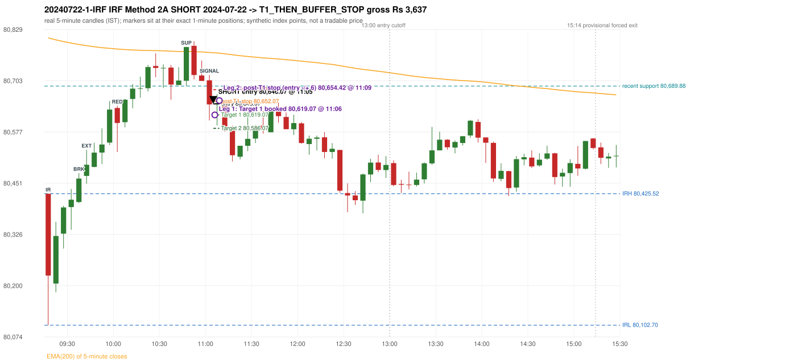

# Trading journal - 2024-07-22 (Monday)

> Phase 5 cross-index test, SENSEX window M (Main window 2022-09-01..2026-08-31 (5paisa minutes); status DATA_VALIDATED). The FROZEN Phase 3.6 configuration (IRF, ORB, PDR body-based, PDS, RF; shared controller) with the NIFTY index-point stops and targets UNCHANGED on the SENSEX index price. INDEX-POINT RESULTS ONLY: no option premium is used or estimated. HISTORICAL RESEARCH ONLY: the strategy was developed using later NIFTY data. same provider and download path as the NIFTY Phase 4 / Phase 3.6 runs; the status only says the DATA window passed the quality gate Synthetic SENSEX index-point P&L (the index is not tradable). The owner's review status is intentionally blank.

## A. Trading day overview

| item | value |
|---|---|
| Date / weekday | 2024-07-22 / Monday |
| Session type | USABLE / VALID |
| Original session open (first 1-minute open) | 80,425.52 |
| Previous session | 2024-07-18 |
| Previous-day high / low (wicks included) | 81,521.23 / 80,391.69 |
| Previous-day highest BODY high (the body-based PDR ceiling; wicks ignored) | 81,454.38 |
| Previous-day official close / last 5-minute close | 81,343.46 / 81,300.59 |
| Raw engine records / confirmed signals / fully valid signals | 13 / 8 / 8 |
| Setups that did not complete (invalidated / incomplete) | 1 |
| Executed trades | 1 20240722-1-IRF |
| Gross P&L (Rs, synthetic) | 3,636.75 |
| Illustrative net P&L (Rs; Rs 500/trade + 0.5 pt/fill) | 2,746.75 |
| Day-end portfolio status | DAY_FINISHED |
| Manual journal trades (matched / unmatched) | 0 (0 / 0) |
| Extra automated trades | 0 |

## B. Daily strategy signal timeline (confirmed signals, chronological)

| time | strategy | method | dir | entry-rule status | valid for execution | <= 13:00 | portfolio state | accepted / ignored | specific reason | competing (same minute) |
|---|---|---|---|---|---|---|---|---|---|---|
| 11:05 | IRF | Method 2A | SHORT | PROPOSAL_DEPENDENT | True | True | FIRST_TRADE_ACTIVE | ACCEPTED -> 20240722-1-IRF | first eligible signal of the day; trade 1: T1_THEN_BUFFER_STOP | IRF Method 2B SHORT |
| 11:05 | IRF | Method 2B | SHORT | PROPOSAL_DEPENDENT | True | True | FIRST_TRADE_ACTIVE | MERGED_SAME_STRATEGY_METHOD | traded as another method of the same strategy/direction in the same minute | IRF Method 2A SHORT |
| 11:40 | IRF | Method 2B | SHORT | PROPOSAL_DEPENDENT | True | True | DAY_FINISHED | IGNORED | DAY_FINISHED [blocked by IRF#1] |  |
| 12:30 | IRF | Method 2A | SHORT | PROPOSAL_DEPENDENT | True | True | DAY_FINISHED | IGNORED | DAY_FINISHED [blocked by IRF#1] |  |
| 12:35 | IRF | Method 1 | SHORT | PROPOSAL_DEPENDENT | True | True | DAY_FINISHED | IGNORED | DAY_FINISHED [blocked by IRF#1] |  |
| 14:10 | IRF | Method 2A | SHORT | PROPOSAL_DEPENDENT | True | False | DAY_FINISHED | IGNORED | DAY_FINISHED [blocked by IRF#1] | IRF Method 2B SHORT |
| 14:10 | IRF | Method 2B | SHORT | PROPOSAL_DEPENDENT | True | False | DAY_FINISHED | IGNORED | DAY_FINISHED [blocked by IRF#1] | IRF Method 2A SHORT |
| 14:50 | IRF | Method 2B | SHORT | PROPOSAL_DEPENDENT | True | False | DAY_FINISHED | IGNORED | DAY_FINISHED [blocked by IRF#1] |  |

Engine setups that did not complete (5); the complete list with failed rule ids is in `rejected_signals.csv`:

| candle | strategy | method | dir | status | precise reason | failed rules |
|---|---|---|---|---|---|---|
| 14:45 | IRF | Method 1/2 | SHORT | INCOMPLETE_AT_EOD | SESSION_ENDED_BEFORE_CONFIRMATION |  |
|  | ORB | ALL | BOTH | NOT_EVALUATED | PREV_SESSION_UNVERIFIED(PREV_SESSION_GAP_UNVERIFIED:2024-07-19; PREV_CLOSE_DAY_DIFFERS_FROM_PREV_SESSION(2024-07-18)) |  |
|  | PDR | ALL | LONG | NOT_EVALUATED | PREV_SESSION_UNVERIFIED(PREV_SESSION_GAP_UNVERIFIED:2024-07-19; PREV_CLOSE_DAY_DIFFERS_FROM_PREV_SESSION(2024-07-18)) |  |
|  | PDS | ALL | SHORT | NOT_EVALUATED | PREV_SESSION_UNVERIFIED(PREV_SESSION_GAP_UNVERIFIED:2024-07-19; PREV_CLOSE_DAY_DIFFERS_FROM_PREV_SESSION(2024-07-18)) |  |
|  | RF | ALL | LONG | NOT_EVALUATED | PREV_SESSION_UNVERIFIED(PREV_SESSION_GAP_UNVERIFIED:2024-07-19; PREV_CLOSE_DAY_DIFFERS_FROM_PREV_SESSION(2024-07-18)) |  |

## C. Detailed trade journals

### 20240722-1-IRF: IRF Method 2A SHORT (FIRST trade)

Chart: 

**Rule configuration:** CFG-phase36_body_based-866f954e55 - signal verification status **PROPOSAL_DEPENDENT** (never VERIFIED while a rule rests on a proposal).

#### 1. Setup identification

IRF Method 2A SHORT: the 09:35-09:40 candle closed at 80,462.78, above IRH 80,425.52, and the next candle did not close back inside the range, so the setup is Method 2 and price stayed above it until the trigger. Extension candle 09:40-09:45, red candle 10:00-10:05. The trigger came 17 candles after the breakout candle: a completed candle closed below the recent pullback-low support (11:00-11:05); confirmed at 11:05 with close 80,644.89. Entry reference close 80,644.89 is 219.37 points above IRH 80,425.52.

#### 2. Candle and indicator calculations

| role | session | candle | O | H | L | C | range | body % | upper wick % | lower wick % | direction | EMA(200) | strong bull / bear | pin bull / bear | small (body<=30%) | used for |
|---|---|---|---|---|---|---|---|---|---|---|---|---|---|---|---|---|
| initial_range_candle | TODAY | 09:15-09:20 | 80,425.52 | 80,425.52 | 80,102.70 | 80,224.57 | 322.82 | 62.25 | 0.00 | 37.75 | BEARISH | 80,808.26 | False / False | False / False | False | initial range = high/low of the 09:15 candle |
| signal_candle | TODAY | 11:00-11:05 | 80,704.11 | 80,717.31 | 80,605.61 | 80,644.89 | 111.70 | 53.02 | 11.82 | 35.17 | BEARISH | 80,772.48 | False / False | False / False | False | candle whose close completed the trigger |
| breakout_candle | TODAY | 09:35-09:40 | 80,405.12 | 80,476.05 | 80,402.42 | 80,462.78 | 73.63 | 78.31 | 18.02 | 3.67 | BULLISH | 80,792.14 | True / False | False / False | False | breakout candle: a completed candle closing above IRH |
| extension_candle | TODAY | 09:40-09:45 | 80,469.34 | 80,533.33 | 80,450.29 | 80,496.64 | 83.04 | 32.88 | 44.18 | 22.94 | BULLISH | 80,789.20 | False / False | False / False | False | extension: first later candle trading above the breakout candle's high |
| red_candle | TODAY | 10:00-10:05 | 80,636.15 | 80,641.49 | 80,527.89 | 80,599.39 | 113.60 | 32.36 | 4.70 | 62.94 | BEARISH | 80,780.86 | False / False | False / False | False | first red candle during the extension |
| support_pivot | TODAY | 10:45-10:50 | 80,702.92 | 80,786.33 | 80,689.88 | 80,785.88 | 96.45 | 86.01 | 0.47 | 13.52 | BULLISH | 80,775.05 | True / False | False / False | False | recent support: latest 3-candle fractal low formed after the breakout |

Every condition, with the rule, the calculation, the observed values and the result:

| # | group | rule | result | status / numeric definition | calculation | observed | required | available at | why it matters |
|---|---|---|---|---|---|---|---|---|---|
| 1 | SELECTION | SEL-FIRST-001 | PASS | USER_APPROVED / USER_APPROVED | earliest CONFIRMED signal of the day across IRF/ORB/PDR/PDS/RF that passed the controller's checks | 0 confirmed signal(s) earlier today; 8 confirmed signals in the day in total, this one at 11:05 | no earlier executable signal | 2024-07-22 11:05 | the shared controller trades only the first valid signal; the five strategies are not independent positions |
| 2 | SELECTION | SEL-TIE-001 | PASS | USER_APPROVED / USER_APPROVED | other CONFIRMED signals with exactly the same confirmation timestamp | IRF Method 2B SHORT @11:05 [NOTE: SAME_STRATEGY_CONCURRENT_METHOD]; merged same-strategy methods: Method 2B | no different-strategy / opposite-direction signal in the same minute (otherwise an unresolved conflict, no trade) | 2024-07-22 11:05 | an unresolved same-minute collision would have produced no trade at all |
| 3 | SELECTION | ENTRY-CUTOFF-001 | PASS | USER_APPROVED / USER_APPROVED | fill timestamp vs 13:00:00 IST | signal confirmed 11:05; fill 11:05 | fill at or before 13:00:00 IST | 2024-07-22 11:05 | no new position may be entered with a fill after 13:00 IST |
| 4 | SELECTION | EXE-FILL-001 | PASS | PROPOSED_FOR_REVIEW / PROPOSED_FOR_REVIEW | fill = open of the 1-minute bar that starts at the signal candle's end | bar 11:05 O 80,646.07 H 80,654.74 L 80,636.60 C 80,645.24; executable=True; entry 80,646.07 | fill bar exists, starts exactly at the signal end, is fillable; entry = its open | 2024-07-22 11:05 | a 5-minute signal is known only when its candle closes; the first price that can be traded is the next minute's open |
| 5 | SELECTION | DAY-MAX-001 | PASS | USER_APPROVED / USER_APPROVED | number of entries today | trade 1 of at most 2 | <= 2 entries per day | 2024-07-22 11:05 | daily trade cap |
| 6 | SETUP | IRF-GLOBAL-001 | PASS | SOURCE_VERIFIED / EXPLICIT_IN_SOURCE | initial range = high and low (wicks included) of the first completed 5-minute candle | 09:15-09:20 IRH 80,425.52, IRL 80,102.70 (range 322.82; engine recorded IRH 80,425.52, IRL 80,102.70) | high/low of the 09:15-09:20 candle | 2024-07-22 09:20 | all three IRF methods measure price against this range |
| 7 | SETUP | IRF-GLOBAL-003 | PASS | SOURCE_VERIFIED / EXPLICIT_IN_SOURCE | closes confirm, wicks do not: every trigger is evaluated on a completed 5-minute candle | trigger candle 11:00-11:05 was complete when the signal was stamped 11:05; decision uses its close 80,644.89 | completed candle close, not an intra-candle wick | 2024-07-22 11:05 | an intra-candle wick can reverse before the candle closes |
| 8 | SETUP | IRF-GLOBAL-002 | PASS | SOURCE_VERIFIED / EXPLICIT_IN_SOURCE | direction | SHORT (IRF trades short only) | short only | 2024-07-22 11:05 | IRF fades failed upside breakouts |
| 9 | SETUP | IRF-M2-001 | PASS | SOURCE_VERIFIED / EXPLICIT_IN_SOURCE | breakout candle close vs IRH | 09:35-09:40 O 80,405.12 H 80,476.05 L 80,402.42 C 80,462.78; range 73.63, body 57.66 (78.31%), upper wick 13.27 (18.02%), lower wick 2.70 (3.67%), bullish; close 80,462.78 is 37.26 points above IRH 80,425.52 | close > IRH (a wick above IRH is not a breakout) | 2024-07-22 09:40 | starts every IRF setup |
| 10 | SETUP | IRF-M2-004 | PASS | SOURCE_VERIFIED / EXPLICIT_IN_SOURCE | the candle after the breakout must NOT close back inside the range (else the setup is Method 1) | 09:40 close 80,496.64 vs [80,102.70, 80,425.52) | not (IRL <= close < IRH) | 2024-07-22 09:45 | separates Method 2 (price holds above) from Method 1 (immediate failure) |
| 11 | SETUP | IRF-M2-002 | PASS | SOURCE_VERIFIED / QUALITATIVE_SOURCE_NUMERIC_DEFINITION_PROPOSED_FOR_REVIEW | extension = a later candle whose high exceeds the breakout candle's high (research definition E1) | 09:40 high 80,533.33 vs breakout candle high 80,476.05 (+57.28) | high > breakout candle high | 2024-07-22 09:45 | the guide says price 'extends further upward'; the numeric test is a proposal |
| 12 | SETUP | IRF-M2-003 | PASS | SOURCE_VERIFIED / QUALITATIVE_SOURCE_NUMERIC_DEFINITION_PROPOSED_FOR_REVIEW | a red candle (close < open) forms after the extension | 10:00-10:05 O 80,636.15 H 80,641.49 L 80,527.89 C 80,599.39; range 113.60, body 36.76 (32.36%), upper wick 5.34 (4.70%), lower wick 71.50 (62.94%), bearish | close < open, at or after the candle following the extension | 2024-07-22 10:05 | the red candle shows the first pause/reversal inside the extension |
| 13 | CONFIRMATION | IRF-M2A-001 | PASS | SOURCE_VERIFIED / QUALITATIVE_SOURCE_NUMERIC_DEFINITION_PROPOSED_FOR_REVIEW | recent support = latest 3-candle fractal low (k=1) among candles b+1 ... i-2 | 10:45 low 80,689.88; neighbours' lows 80,692.64 (10:40) and 80,706.26 (10:50) are not lower; engine recorded support 80,689.88 | pivot low known before the trigger candle | 2024-07-22 10:55 | the support is the level whose break completes Method 2A (the exact 'pullback low' definition is a proposal) |
| 14 | CONFIRMATION | IRF-M2A-002 | PASS | SOURCE_VERIFIED / EXPLICIT_WORDING_DETAIL_PROPOSED_FOR_REVIEW | trigger candle closes below recent support | 11:00 close 80,644.89 vs support 80,689.88: 44.99 points below | close < support (close, not wick) | 2024-07-22 11:05 | completes Method 2A |
| 15 | CONFIRMATION | IRF-M2-005 | PASS | SOURCE_VERIFIED / EXPLICIT_IN_SOURCE | chronology: the red candle precedes the break candle | red candle 10:00, break candle 11:00 | red candle index < break candle index (m2a_break_may_be_red_candle = False) | 2024-07-22 11:05 | a red candle alone is not confirmation; a level break is required |
| 16 | EXECUTION | EXE-STOP-001 | PASS | USER_APPROVED / USER_APPROVED | initial stop = entry + 35 points | entry 80,646.07 -> stop 80,681.07 | stop 35 index points (BASELINE) | 2024-07-22 11:05 | defines the loss if the setup fails before Target 1 |
| 17 | EXECUTION | EXE-T1-001 | PASS | SOURCE_VERIFIED / EXPLICIT_IN_SOURCE | Target 1 = entry +/- 27 points | T1 80,619.07 | 27 points | 2024-07-22 11:05 | Leg 1 (3 lots) is booked at Target 1 |
| 18 | EXECUTION | IRF-TGT-001 | PASS | SOURCE_VERIFIED / EXPLICIT_IN_SOURCE | Target 2 = entry +/- 60 points | T2 80,586.07 | 60 points | 2024-07-22 11:05 | Leg 2 (3 lots) is booked at Target 2 |
| 19 | EXECUTION | POST-T1-STOP-006 | PASS | USER_APPROVED / USER_APPROVED | after T1 the Leg-2 stop = entry + 6 (no trailing) | post-T1 stop 80,652.07 | entry -6 (LONG) / +6 (SHORT) | 2024-07-22 11:05 | protects the remaining three lots once the first three are booked |
| 20 | EXECUTION | SIZE-LOT-001 | PASS | USER_APPROVED / USER_APPROVED | 6 lots x 65 = 390, Leg 1 = 3 lots = 195, Leg 2 = 195 | 6 lots, lot size 65, legs 3+3 | 6 lots in two equal legs | 2024-07-22 11:05 | position size for the synthetic P&L |
| 21 | NOTE | IRF-M2-006 | UNRESOLVED | UNRESOLVED / UNRESOLVED | delay between the breakout candle and this trigger; expiry rule | 17 candles after the breakout; expiry none configured | the source states no expiry | 2024-07-22 11:05 | an old breakout can still trigger hours later |
| 22 | NOTE | IRF-M2-006 | UNRESOLVED | UNRESOLVED / UNRESOLVED | did price stay above IRH between the breakout and the trigger? | 0 closes at or below IRH between 09:40 and 11:00; trigger close 80,644.89 above IRH 80,425.52 | the engine does not require price to stay above IRH | 2024-07-22 11:05 | the guide describes price 'holding above IRH and keeping rising'; the code only needs the level break |
| 23 | NOTE | IRF-GLOBAL-004 | UNRESOLVED | UNRESOLVED / UNRESOLVED | which close above IRH of the session produced this attempt; repeat setups | this breakout is upward crossing no. 1 of the session (a close above IRH after a close at/below it) | the source states no first-breakout-only, re-arming, expiry or trades-per-day rule | 2024-07-22 11:05 | IRF re-arms on every later breakout in the code, producing many raw setups; the controller keeps only the first |
| 24 | NOTE | NOTE-IRF-REPEATED-SETUPS | NOT_APPLICABLE | NOT_A_RULE / NOT_A_REGISTRY_RULE | other IRF signals later in the session (not traded) | 6 further confirmed IRF signal(s): Method 2B@11:40, Method 2A@12:30, Method 1@12:35, Method 2A@14:10, Method 2B@14:10, Method 2B@14:50; concurrent methods merged in this minute: Method 2B | disclosure of repeated raw setups | 2024-07-22 11:05 | repeated raw IRF setups are not hidden; they are logged as ignored |
| 25 | NOTE | IRF-SL-001 | NOT_APPLICABLE | SOURCE_VERIFIED / QUALITATIVE_SOURCE_NUMERIC_DEFINITION_PROPOSED_FOR_REVIEW | the guide's 35-or-40 rule: 35 if the most recent green candle's high is within 35 points of entry, else 40 | most recent green candle high 80,786.33 is 140.26 points from the entry 80,646.07: the guide's rule would select 40 points; the baseline applies a fixed 35 (USER_APPROVED research baseline; the 35-vs-40 selection and the 40-point variant are separate labelled scenarios) | source selection rule | 2024-07-22 11:05 | the stop distance is a modelling choice and changes losses, not entries |
| 26 | NOTE | NOTE-UNRESOLVED-DEPENDENCIES | UNRESOLVED | NOT_A_RULE / NOT_A_REGISTRY_RULE | rules the signal depends on that the sources leave unresolved | engine-recorded unresolved rule ids: IRF-GLOBAL-004; verification status PROPOSAL_DEPENDENT | n/a (disclosure) | 2024-07-22 11:05 | the entry is only as verified as the rules it rests on |

#### 3. Entry decision and explanation

IRF Method 2A SHORT: the 09:35-09:40 candle closed at 80,462.78, above IRH 80,425.52, and the next candle did not close back inside the range, so the setup is Method 2 and price stayed above it until the trigger. Extension candle 09:40-09:45, red candle 10:00-10:05. The trigger came 17 candles after the breakout candle: a completed candle closed below the recent pullback-low support (11:00-11:05); confirmed at 11:05 with close 80,644.89. Entry reference close 80,644.89 is 219.37 points above IRH 80,425.52.

**Why this trade ahead of the other strategies:** This IRF Method 2A signal was the earliest executable signal of the day: 0 confirmed signal(s) earlier, 1 other in the same minute. 6 later confirmed signal(s) (IRF x6) are logged as ignored or rejected. State of the other four engines at that moment: [ORB: no setup record before this time (a base condition was not met, or nothing triggered)] [PDR: no setup record before this time (a base condition was not met, or nothing triggered)] [PDS: no setup record before this time (a base condition was not met, or nothing triggered)] [RF: no setup record before this time (a base condition was not met, or nothing triggered)]

#### 4. Actual entry execution

| item | value |
|---|---|
| Signal candle | 11:00-11:05 |
| Signal confirmed | 2024-07-22 11:05 |
| Fill timestamp | 2024-07-22 11:05 |
| Entry price | 80,646.07 |
| Source partition / 1-minute bar | data/processed/sensex/FIVEPAISA_1M_SENSEX/minutes/year=2024/month=07/candles.parquet / 2024-07-22 11:05 |
| Source bar O / H / L / C | 80,646.07 / 80,654.74 / 80,636.60 / 80,645.24 |
| Fill assumption | open of the 1-minute bar starting at the signal candle's end (EXE-FILL-001, PROPOSED causal convention) |
| Initial stop / T1 / T2 / post-T1 stop | 80,681.07 / 80,619.07 / 80,586.07 / 80,652.07 |
| Position | 6 lots x 65 = 390 units (Leg 1 195, Leg 2 195) |

#### 5-8. Trade progress, Target 1, post-T1 stop and final exit

Between the 11:05 entry bar and the final exit (5 one-minute bars) the best excursion in favour was 52.92 points at 11:06 and the worst against was 23.94 points at 11:09. At 11:06 price reached Target 1 80,619.07 and three lots exited. At 11:06 the remaining three lots' protective stop was set to 80,652.07 (entry + 6; no trailing, no further change); the engine applies it from the Target-1 bar onward and tests it within that same bar. At 11:09 the remaining three lots stopped out at 80,654.42 (slippage 2.35 points). T1_THEN_BUFFER_STOP: no second trade that day (DAY-BUF-001).

| leg | qty | exit time | exit price | reason | source 1-minute bar | O / H / L / C | gross points | gross Rs | slippage pts | flags |
|---|---|---|---|---|---|---|---|---|---|---|
| 1 | 195 | 11:06 | 80,619.07 | TARGET_1 | 11:06 | 80,644.75 / 80,644.75 / 80,593.15 / 80,593.15 | 27.00 | 5,265.00 | 0.00 |  |
| 2 | 195 | 11:09 | 80,654.42 | POST_T1_STOP_ENTRY_MINUS_PLUS_6 | 11:09 | 80,654.42 / 80,670.01 / 80,637.04 / 80,647.95 | -8.35 | -1,628.25 | 2.35 |  |

Exit evidence per leg:

* Leg 1: 1-minute bar 11:06 O 80,644.75 H 80,644.75 L 80,593.15 C 80,593.15: low 80,593.15 reached Target 1 80,619.07; Leg 1 booked at the target level
* Leg 2: 1-minute bar 11:09 O 80,654.42 H 80,670.01 L 80,637.04 C 80,647.95: high 80,670.01 reached the post-T1 stop 80,652.07; Leg 2 exits at 80,654.42 (adverse slippage 2.35 points: the bar opened beyond the stop)

#### 9. Gross and illustrative net P&L

| item | value (Rs) |
|---|---|
| Leg 1 gross | 5,265.00 |
| Leg 2 gross | -1,628.25 |
| Trade gross (= Leg 1 + Leg 2) | 3,636.75 |
| Illustrative fixed cost | -500.00 |
| Illustrative slippage (0.5 pt on every fill, entry + exits, all units) | -390.00 |
| Illustrative net | 2,746.75 |

#### 10. Manual journal comparison

No manual journal exists for this period; no comparison.

## D. Manual journal comparison

No manual journal exists for this period (the manual journal covers 2025-09-01 .. 2026-08-31 only); no comparison is made and no automated trade is labelled 'extra'.

## E. Daily conclusion

* **Traded:** 20240722-1-IRF - IRF Method 2A SHORT at 11:05 (entry 80,646.07), outcome T1_THEN_BUFFER_STOP, gross Rs 3,636.75, illustrative net Rs 2,746.75. **Why:** This IRF Method 2A signal was the earliest executable signal of the day: 0 confirmed signal(s) earlier, 1 other in the same minute. 6 later confirmed signal(s) (IRF x6) are logged as ignored or rejected. State of the other four engines at that moment: [ORB: no setup record before this time (a base condition was not met, or nothing triggered)] [PDR: no setup record before this time (a base condition was not met, or nothing triggered)] [PDS: no setup record before this time (a base condition was not met, or nothing triggered)] [RF: no setup record before this time (a base condition was not met, or nothing triggered)] **How it ended:** At 11:06 price reached Target 1 80,619.07 and three lots exited. At 11:06 the remaining three lots' protective stop was set to 80,652.07 (entry + 6; no trailing, no further change); the engine applies it from the Target-1 bar onward and tests it within that same bar. At 11:09 the remaining three lots stopped out at 80,654.42 (slippage 2.35 points). T1_THEN_BUFFER_STOP: no second trade that day (DA
* **Ignored / rejected signals:** IRF IGNORED DAY_FINISHED x6; IRF MERGED_SAME_STRATEGY_METHOD traded as another method of the same strategy/direction in the same minute x1
* **Partial strategy coverage:** some engines could not be evaluated on this day (ORB: PREV_SESSION_UNVERIFIED(PREV_SESSION_GAP_UNVERIFIED:2024-07-19; PREV_CLOSE_DAY_DIFFERS_FROM_PREV_SESSION(2024-07-18)) | PDR: PREV_SESSION_UNVERIFIED(PREV_SESSION_GAP_UNVERIFIED:2024-07-19; PREV_CLOSE_DAY_DIFFERS_FROM_PREV_SESSION(2024-07-18)) | PDS: PREV_SESSION_UNVERIFIED(PREV_SESSION_GAP_UNVERIFIED:2024-07-19; PREV_CLOSE_DAY_DIFFERS_FROM_PREV_SESSION(2024-07-18)) | RF: PREV_SESSION_UNVERIFIED(PREV_SESSION_GAP_UNVERIFIED:2024-07-19; PREV_CLOSE_DAY_DIFFERS_FROM_PREV_SESSION(2024-07-18))); no signal from them can exist, so a missing signal is not evidence of a non-setup.
* **Open strategy-definition issues that affected this day:** IRF-GLOBAL-004 (NOT STATED: how many IRF trades per day, a latest entry time, and whether a new breakout may re-arm a setup after a signal), IRF-M2-006 (How long a Method 2 setup stays valid (expiry / invalidation before a level breaks) is not stated), NOTE-UNRESOLVED-DEPENDENCIES
* **Automated triage (not an approval; the owner's review status stays blank):** REVIEW: PARTIAL_STRATEGY_COVERAGE

## Option-execution feasibility (information only; no option trade is simulated)

The index result above is an INDEX-POINT result on SENSEX. It is not an option result: a move of N index points is not a move of N premium points (delta, gamma, theta, vega, spread and liquidity decide the premium).

| trade | strategy | index direction | long option it maps to | historical contract identified? | premium data available? | premium fill supportable? |
|---|---|---|---|---|---|---|
| 20240722-1-IRF | IRF | SHORT | BUY PUT (PE) | no | no | no |

Why: (1) the broker's instrument master lists only contracts that are live today, so the scrip code of a contract that existed on this date is not available; (2) historical candles can only be requested by scrip code; (3) the strike and expiry selection policy is an owner decision that has not been made (`options_feasibility/option_contract_selection_decisions.md`). No option entry, exit, premium or option P&L is shown, and none may be inferred from the index points.
