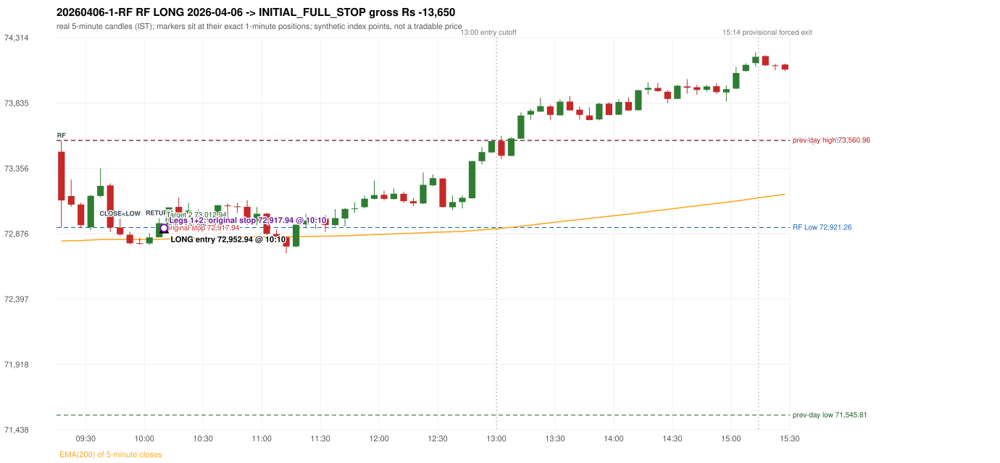
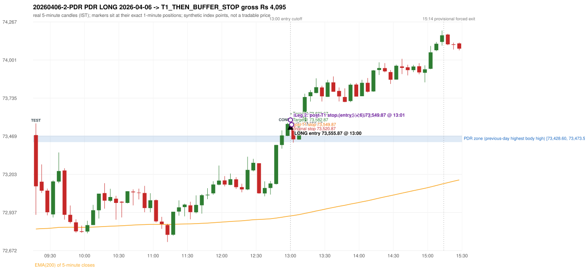

# Trading journal - 2026-04-06 (Monday)

> Phase 5 cross-index test, SENSEX window M (Main window 2022-09-01..2026-08-31 (5paisa minutes); status DATA_VALIDATED). The FROZEN Phase 3.6 configuration (IRF, ORB, PDR body-based, PDS, RF; shared controller) with the NIFTY index-point stops and targets UNCHANGED on the SENSEX index price. INDEX-POINT RESULTS ONLY: no option premium is used or estimated. HISTORICAL RESEARCH ONLY: the strategy was developed using later NIFTY data. same provider and download path as the NIFTY Phase 4 / Phase 3.6 runs; the status only says the DATA window passed the quality gate Synthetic SENSEX index-point P&L (the index is not tradable). The owner's review status is intentionally blank.

## A. Trading day overview

| item | value |
|---|---|
| Date / weekday | 2026-04-06 / Monday |
| Session type | USABLE / VALID |
| Original session open (first 1-minute open) | 73,477.53 |
| Previous session | 2026-04-02 |
| Previous-day high / low (wicks included) | 73,560.96 / 71,545.81 |
| Previous-day highest BODY high (the body-based PDR ceiling; wicks ignored) | 73,473.59 |
| Previous-day official close / last 5-minute close | 73,319.55 / 73,315.38 |
| Raw engine records / confirmed signals / fully valid signals | 6 / 5 / 5 |
| Setups that did not complete (invalidated / incomplete) | 1 |
| Executed trades | 2 20260406-1-RF;20260406-2-PDR |
| Gross P&L (Rs, synthetic) | -9,555.00 |
| Illustrative net P&L (Rs; Rs 500/trade + 0.5 pt/fill) | -11,335.00 |
| Day-end portfolio status | DAY_FINISHED |
| Manual journal trades (matched / unmatched) | 0 (0 / 0) |
| Extra automated trades | 0 |

## B. Daily strategy signal timeline (confirmed signals, chronological)

| time | strategy | method | dir | entry-rule status | valid for execution | <= 13:00 | portfolio state | accepted / ignored | specific reason | competing (same minute) |
|---|---|---|---|---|---|---|---|---|---|---|
| 10:10 | RF | RF | LONG | PROPOSAL_DEPENDENT | True | True | FIRST_TRADE_ACTIVE | ACCEPTED -> 20260406-1-RF | first eligible signal of the day; trade 1: INITIAL_FULL_STOP |  |
| 13:00 | PDR | PDR | LONG | RESEARCH_VARIANT | True | True | SECOND_TRADE_ACTIVE | ACCEPTED -> 20260406-2-PDR | permitted second trade: newly confirmed PDR/PDS after the original full stop; trade 2: T1_THEN_BUFFER_STOP |  |
| 13:10 | PDR | PDR | LONG | RESEARCH_VARIANT | True | False | DAY_FINISHED | IGNORED | DAY_FINISHED [blocked by PDR#2] |  |
| 13:40 | IRF | Method 2B | SHORT | PROPOSAL_DEPENDENT | True | False | DAY_FINISHED | IGNORED | DAY_FINISHED [blocked by PDR#2] |  |
| 14:30 | IRF | Method 2B | SHORT | PROPOSAL_DEPENDENT | True | False | DAY_FINISHED | IGNORED | DAY_FINISHED [blocked by PDR#2] |  |

Engine setups that did not complete (1); the complete list with failed rule ids is in `rejected_signals.csv`:

| candle | strategy | method | dir | status | precise reason | failed rules |
|---|---|---|---|---|---|---|
| 14:25 | IRF | Method 1/2 | SHORT | INCOMPLETE_AT_EOD | SESSION_ENDED_BEFORE_CONFIRMATION |  |

## C. Detailed trade journals

### 20260406-1-RF: RF LONG (FIRST trade)

Chart: 

**Rule configuration:** CFG-phase36_body_based-866f954e55 - signal verification status **PROPOSAL_DEPENDENT** (never VERIFIED while a rule rests on a proposal).

#### 1. Setup identification

RF LONG (research proposal for direction/target): the session gapped +157.98 points up inside yesterday's range [71,545.81, 73,560.96] after an EMA-only uptrend; the 09:45 candle closed at 72,871.13, 50.13 points below RF Low 72,921.26, and the 10:05 candle closed back inside the range at 72,953.30, activating the setup at 10:10.

#### 2. Candle and indicator calculations

| role | session | candle | O | H | L | C | range | body % | upper wick % | lower wick % | direction | EMA(200) | strong bull / bear | pin bull / bear | small (body<=30%) | used for |
|---|---|---|---|---|---|---|---|---|---|---|---|---|---|---|---|---|
| rf_range_candle | TODAY | 09:15-09:20 | 73,477.53 | 73,559.04 | 72,921.26 | 73,120.32 | 637.78 | 56.01 | 12.78 | 31.21 | BEARISH | 72,822.41 | False / False | False / False | False | first 5-minute candle: RF High / RF Low |
| prev_session_last_candle | PREVIOUS | 15:25-15:30 | 73,233.06 | 73,324.54 | 73,157.31 | 73,315.38 | 167.23 | 49.23 | 5.48 | 45.30 | BULLISH | 72,819.42 | False / False | False / False | False | trend: previous session's last 5-minute close vs its EMA(200) |
| close_below_candle | TODAY | 09:45-09:50 | 72,921.15 | 72,986.19 | 72,861.06 | 72,871.13 | 125.13 | 39.97 | 51.98 | 8.05 | BEARISH | 72,834.66 | False / False | False / False | False | first candle closing below RF Low |
| return_inside_candle | TODAY | 10:05-10:10 | 72,849.86 | 72,990.78 | 72,849.86 | 72,953.30 | 140.92 | 73.40 | 26.60 | 0.00 | BULLISH | 72,835.39 | False / False | False / False | False | first later candle closing back inside the first-candle range |

Every condition, with the rule, the calculation, the observed values and the result:

| # | group | rule | result | status / numeric definition | calculation | observed | required | available at | why it matters |
|---|---|---|---|---|---|---|---|---|---|
| 1 | SELECTION | SEL-FIRST-001 | PASS | USER_APPROVED / USER_APPROVED | earliest CONFIRMED signal of the day across IRF/ORB/PDR/PDS/RF that passed the controller's checks | 0 confirmed signal(s) earlier today; 5 confirmed signals in the day in total, this one at 10:10 | no earlier executable signal | 2026-04-06 10:10 | the shared controller trades only the first valid signal; the five strategies are not independent positions |
| 2 | SELECTION | SEL-TIE-001 | PASS | USER_APPROVED / USER_APPROVED | other CONFIRMED signals with exactly the same confirmation timestamp | none | no different-strategy / opposite-direction signal in the same minute (otherwise an unresolved conflict, no trade) | 2026-04-06 10:10 | an unresolved same-minute collision would have produced no trade at all |
| 3 | SELECTION | ENTRY-CUTOFF-001 | PASS | USER_APPROVED / USER_APPROVED | fill timestamp vs 13:00:00 IST | signal confirmed 10:10; fill 10:10 | fill at or before 13:00:00 IST | 2026-04-06 10:10 | no new position may be entered with a fill after 13:00 IST |
| 4 | SELECTION | EXE-FILL-001 | PASS | PROPOSED_FOR_REVIEW / PROPOSED_FOR_REVIEW | fill = open of the 1-minute bar that starts at the signal candle's end | bar 10:10 O 72,952.94 H 72,952.94 L 72,902.18 C 72,902.18; executable=True; entry 72,952.94 | fill bar exists, starts exactly at the signal end, is fillable; entry = its open | 2026-04-06 10:10 | a 5-minute signal is known only when its candle closes; the first price that can be traded is the next minute's open |
| 5 | SELECTION | DAY-MAX-001 | PASS | USER_APPROVED / USER_APPROVED | number of entries today | trade 1 of at most 2 | <= 2 entries per day | 2026-04-06 10:10 | daily trade cap |
| 6 | SETUP | RF-002 | PASS | SOURCE_VERIFIED / EXPLICIT_IN_SOURCE | RF High / Low = high / low (wicks included) of the first 5-minute candle | 09:15-09:20 RF High 73,559.04, RF Low 72,921.26 (engine recorded 73,559.04 / 72,921.26) | first-candle range | 2026-04-06 09:20 | the zone price must dip below and return into |
| 7 | SETUP | RF-003 | PASS | SOURCE_VERIFIED / EXPLICIT_WORDING_DETAIL_PROPOSED_FOR_REVIEW | gap = first 1-minute open of today - previous session's OFFICIAL close | today's open 73,477.53 (first 1-minute bar 09:15) - previous close 73,319.55 (DAILY_VENDOR, 2026-04-02) = +157.98 points -> gap UP | gap UP (more than 0 points) | 2026-04-06 09:15 | approved convention: the original first-minute open, never the vendor daily open |
| 8 | SETUP | RF-004 | PASS | SOURCE_VERIFIED / EXPLICIT_IN_SOURCE | gap-up open inside yesterday's trading range | open 73,477.53 vs previous session 2026-04-02 range [71,545.81, 73,560.96]: inside (previous close 73,319.55, gap +157.98) | previous low <= open <= previous high | 2026-04-06 09:15 | a huge gap beyond yesterday's range is rejected; the source gives no number, the test is the previous session's high/low |
| 9 | TREND | RF-001 | PASS | SOURCE_VERIFIED / QUALITATIVE_SOURCE_NUMERIC_DEFINITION_PROPOSED_FOR_REVIEW | previous session's final completed 5-minute candle: close vs its EMA(200 of 5-minute closes) | previous session 2026-04-02 last candle 15:25-15:30 close 73,315.38 vs EMA(200) 72,819.42: 495.96 points above the EMA -> trend bullish (EMA_PREV_SESSION_CLOSE; research variant A, EMA-only) | close > EMA(200) | 2026-04-02 15:30 | the opening gap can never create the trend: only information that existed before today's open is used |
| 10 | TREND | RF-008 | PASS | SOURCE_VERIFIED / QUALITATIVE_SOURCE_NUMERIC_DEFINITION_PROPOSED_FOR_REVIEW | the uptrend must exist BEFORE the gap (a gap cannot create it) | trend measured on the previous session only (2026-04-02); today's gap is not used | established uptrend, not a sudden gap above the EMA | 2026-04-02 15:30 | RF rejects a previous downtrend followed by a sudden large gap above the EMA |
| 11 | TREND | TREND-SWING-001 | NOT_APPLICABLE | PROPOSED_FOR_REVIEW / PROPOSED_FOR_REVIEW | confirmed swing structure | not required by the active trend variant (variant A is the EMA price location only) | n/a | 2026-04-02 15:30 | variant B would additionally require higher-high/higher-low swings; it is a separate labelled scenario |
| 12 | CONFIRMATION | RF-005 | PASS | SOURCE_VERIFIED / EXPLICIT_IN_SOURCE | a candle CLOSES below RF Low (a wick is not enough) | 09:45-09:50 O 72,921.15 H 72,986.19 L 72,861.06 C 72,871.13; range 125.13, body 50.02 (39.97%), upper wick 65.04 (51.98%), lower wick 10.07 (8.05%), bearish; close 72,871.13 vs RF Low 72,921.26: 50.13 points below | close < RF Low | 2026-04-06 09:50 | the failed-breakdown leg of the setup |
| 13 | CONFIRMATION | RF-006 | PASS | SOURCE_VERIFIED / QUALITATIVE_SOURCE_NUMERIC_DEFINITION_PROPOSED_FOR_REVIEW | price returns inside the first-candle range - definition R1 (first later candle whose CLOSE is within [RF Low, RF High]) | 10:05-10:10 O 72,849.86 H 72,990.78 L 72,849.86 C 72,953.30; range 140.92, body 103.44 (73.40%), upper wick 37.48 (26.60%), lower wick 0.00 (0.00%), bullish; close 72,953.30 within [72,921.26, 73,559.04]; 4 candle(s) after the close-below candle (09:45) | RF Low <= close <= RF High | 2026-04-06 10:10 | completes the activation; the source does not say 'close' vs 'touch' nor any time limit |
| 14 | CONFIRMATION | RF-007 | PASS | SOURCE_VERIFIED / EXPLICIT_IN_SOURCE | order of the four steps | trend (previous session) -> gap 09:15 open -> close below 09:45 -> return 10:05 | uptrend, gap up in range, close below, return | 2026-04-06 10:10 | the source requires this order |
| 15 | CONFIRMATION | RF-013 | PASS | SOURCE_VERIFIED / EXPLICIT_IN_SOURCE | gap up without the break-and-return sequence gives no RF activation | sequence complete: close below 09:45, return inside 10:05 | both steps present | 2026-04-06 10:10 | the gap alone never activates RF |
| 16 | EXECUTION | EXE-STOP-001 | PASS | USER_APPROVED / USER_APPROVED | initial stop = entry - 35 points | entry 72,952.94 -> stop 72,917.94 | stop 35 index points (BASELINE) | 2026-04-06 10:10 | defines the loss if the setup fails before Target 1 |
| 17 | EXECUTION | EXE-T1-001 | PASS | SOURCE_VERIFIED / EXPLICIT_IN_SOURCE | Target 1 = entry +/- 27 points | T1 72,979.94 | 27 points | 2026-04-06 10:10 | Leg 1 (3 lots) is booked at Target 1 |
| 18 | EXECUTION | RF-011 | UNRESOLVED | UNRESOLVED / UNRESOLVED | Target 2 = entry +/- 60 points | T2 73,012.94 (the RF guide leaves the target OPEN: 60 is a research proposal) | 60 points | 2026-04-06 10:10 | Leg 2 (3 lots) is booked at Target 2 |
| 19 | EXECUTION | POST-T1-STOP-006 | PASS | USER_APPROVED / USER_APPROVED | after T1 the Leg-2 stop = entry - 6 (no trailing) | post-T1 stop 72,946.94 | entry -6 (LONG) / +6 (SHORT) | 2026-04-06 10:10 | protects the remaining three lots once the first three are booked |
| 20 | EXECUTION | SIZE-LOT-001 | PASS | USER_APPROVED / USER_APPROVED | 6 lots x 65 = 390, Leg 1 = 3 lots = 195, Leg 2 = 195 | 6 lots, lot size 65, legs 3+3 | 6 lots in two equal legs | 2026-04-06 10:10 | position size for the synthetic P&L |
| 21 | NOTE | RF-014 | NOT_APPLICABLE | PROPOSED_FOR_REVIEW / PROPOSED_FOR_REVIEW | first activation per session | only the first completed sequence of the session is reported | n/a (engineering proposal) | 2026-04-06 10:10 | the source is silent on re-activation |
| 22 | NOTE | RF-009 | UNRESOLVED | UNRESOLVED / UNRESOLVED | stop selection | baseline stop 35 points (USER_APPROVED research baseline) | the guide: 35-40 'depending on what is logical', fixed vs candle-extreme not stated | 2026-04-06 10:10 | the source does not define the RF stop rule |
| 23 | NOTE | RF-012 | UNRESOLVED | PROPOSED_FOR_REVIEW / PROPOSED_FOR_REVIEW | trade direction | LONG (implied: 'opposite of IRF', 'uptrend only' and the long-position reference screenshots; the word long never appears) | the guide does not state the direction | 2026-04-06 10:10 | the direction is a labelled research proposal, not source-verified |
| 24 | NOTE | RF-010 | UNRESOLVED | UNRESOLVED / UNRESOLVED | entry price | signal reference = close of the return candle 72,953.30; fill = next minute open 72,952.94 | the guide's rule-readiness table lists the exact entry price as OPEN, i.e. unspecified | 2026-04-06 10:10 | causal convention applied to every strategy |
| 25 | NOTE | NOTE-UNRESOLVED-DEPENDENCIES | UNRESOLVED | NOT_A_RULE / NOT_A_REGISTRY_RULE | rules the signal depends on that the sources leave unresolved | engine-recorded unresolved rule ids: RF-009, RF-011; verification status PROPOSAL_DEPENDENT | n/a (disclosure) | 2026-04-06 10:10 | the entry is only as verified as the rules it rests on |

#### 3. Entry decision and explanation

RF LONG (research proposal for direction/target): the session gapped +157.98 points up inside yesterday's range [71,545.81, 73,560.96] after an EMA-only uptrend; the 09:45 candle closed at 72,871.13, 50.13 points below RF Low 72,921.26, and the 10:05 candle closed back inside the range at 72,953.30, activating the setup at 10:10.

**Why this trade ahead of the other strategies:** This RF signal was the earliest executable signal of the day: 0 confirmed signal(s) earlier, 0 other in the same minute. 4 later confirmed signal(s) (IRF x2, PDR x2) are logged as ignored or rejected. State of the other four engines at that moment: [IRF: no setup record before this time (a base condition was not met, or nothing triggered)] [ORB: no setup record before this time (a base condition was not met, or nothing triggered)] [PDR: no setup record before this time (a base condition was not met, or nothing triggered)] [PDS: no setup record before this time (a base condition was not met, or nothing triggered)]

#### 4. Actual entry execution

| item | value |
|---|---|
| Signal candle | 10:05-10:10 |
| Signal confirmed | 2026-04-06 10:10 |
| Fill timestamp | 2026-04-06 10:10 |
| Entry price | 72,952.94 |
| Source partition / 1-minute bar | data/processed/sensex/FIVEPAISA_1M_SENSEX/minutes/year=2026/month=04/candles.parquet / 2026-04-06 10:10 |
| Source bar O / H / L / C | 72,952.94 / 72,952.94 / 72,902.18 / 72,902.18 |
| Fill assumption | open of the 1-minute bar starting at the signal candle's end (EXE-FILL-001, PROPOSED causal convention) |
| Initial stop / T1 / T2 / post-T1 stop | 72,917.94 / 72,979.94 / 73,012.94 / 72,946.94 |
| Position | 6 lots x 65 = 390 units (Leg 1 195, Leg 2 195) |

#### 5-8. Trade progress, Target 1, post-T1 stop and final exit

Between the 10:10 entry bar and the final exit (1 one-minute bars) the best excursion in favour was 0.00 points at 10:10 and the worst against was 50.76 points at 10:10. At 10:10 price reached the original stop 72,917.94 before Target 1 72,979.94, so all six lots exited together at 72,917.94. This is an INITIAL_FULL_STOP: one more trade is allowed that day, only a newly confirmed PDR/PDS signal.

| leg | qty | exit time | exit price | reason | source 1-minute bar | O / H / L / C | gross points | gross Rs | slippage pts | flags |
|---|---|---|---|---|---|---|---|---|---|---|
| 1 | 195 | 10:10 | 72,917.94 | ORIGINAL_STOP_BEFORE_T1 | 10:10 | 72,952.94 / 72,952.94 / 72,902.18 / 72,902.18 | -35.00 | -6,825.00 | 0.00 |  |
| 2 | 195 | 10:10 | 72,917.94 | ORIGINAL_STOP_BEFORE_T1 | 10:10 | 72,952.94 / 72,952.94 / 72,902.18 / 72,902.18 | -35.00 | -6,825.00 | 0.00 |  |

Exit evidence per leg:

* Leg 1: 1-minute bar 10:10 O 72,952.94 H 72,952.94 L 72,902.18 C 72,902.18: low 72,902.18 reached the original stop 72,917.94 before Target 1 72,979.94 was touched; both legs exit at the stop level 72,917.94
* Leg 2: 1-minute bar 10:10 O 72,952.94 H 72,952.94 L 72,902.18 C 72,902.18: low 72,902.18 reached the original stop 72,917.94 before Target 1 72,979.94 was touched; both legs exit at the stop level 72,917.94

#### 9. Gross and illustrative net P&L

| item | value (Rs) |
|---|---|
| Leg 1 gross | -6,825.00 |
| Leg 2 gross | -6,825.00 |
| Trade gross (= Leg 1 + Leg 2) | -13,650.00 |
| Illustrative fixed cost | -500.00 |
| Illustrative slippage (0.5 pt on every fill, entry + exits, all units) | -390.00 |
| Illustrative net | -14,540.00 |

#### 10. Manual journal comparison

No manual journal exists for this period; no comparison.

### 20260406-2-PDR: PDR LONG (SECOND trade)

Chart: 

**Rule configuration:** CFG-phase36_body_based-866f954e55 - signal verification status **RESEARCH_VARIANT** (never VERIFIED while a rule rests on a proposal).

#### 1. Setup identification

PDR LONG (body-based engine, A_HIGHEST_BODY_HIGH): the session opened 157.98 points above the previous close and 3.94 points above the previous-day highest BODY high 73,473.59 (zone [73,428.60, 73,473.59] from the 15:10 candle of 2026-04-02; the highest wick 73,560.96 is ignored). The 09:15 candle (72,921.26 - 73,559.04) tested the zone; the 12:55 candle (green, O 73,472.04 H 73,563.53 L 73,470.10 C 73,555.42) passed GOOD_GREEN_BODY and closed 81.83 points above the zone ceiling, confirming the entry at 13:00. The pattern thresholds and the zone's lower boundary are provisional research assumptions, not approved by the strategy author.

#### 2. Candle and indicator calculations

| role | session | candle | O | H | L | C | range | body % | upper wick % | lower wick % | direction | EMA(200) | strong bull / bear | pin bull / bear | small (body<=30%) | used for |
|---|---|---|---|---|---|---|---|---|---|---|---|---|---|---|---|---|
| zone_source_candle | PREVIOUS | 15:10-15:15 | 73,428.60 | 73,490.13 | 73,376.11 | 73,473.59 | 114.02 | 39.46 | 14.51 | 46.04 | BULLISH | 72,804.82 | False / False | False / False | False | candle of the previous session's highest BODY high (A_HIGHEST_BODY_HIGH) |
| prev_day_wick_high_candle | PREVIOUS | 15:15-15:20 | 73,471.93 | 73,560.96 | 73,346.40 | 73,346.74 | 214.56 | 58.35 | 41.49 | 0.16 | BEARISH | 72,810.21 | False / False | False / False | False | candle of the previous session's highest WICK (ignored by the author's rule; shown for comparison) |
| interaction_candle | TODAY | 09:15-09:20 | 73,477.53 | 73,559.04 | 72,921.26 | 73,120.32 | 637.78 | 56.01 | 12.78 | 31.21 | BEARISH | 72,822.41 | False / False | False / False | False | first candle whose range overlaps the zone (the test) |
| confirmation_candle | TODAY | 12:55-13:00 | 73,472.04 | 73,563.53 | 73,470.10 | 73,555.42 | 93.43 | 89.24 | 8.68 | 2.08 | BULLISH | 72,910.74 | True / False | False / False | False | candle that satisfies one of the three patterns and closes above the zone ceiling |

Every condition, with the rule, the calculation, the observed values and the result:

| # | group | rule | result | status / numeric definition | calculation | observed | required | available at | why it matters |
|---|---|---|---|---|---|---|---|---|---|
| 1 | SELECTION | DAY-SL-001 | PASS | USER_APPROVED / USER_APPROVED | first trade outcome, strategy of this signal, position-close time vs this signal's timestamp | first trade RF RF closed as INITIAL_FULL_STOP at 10:10; position free from 10:11; this PDR signal confirmed 13:00 | first trade INITIAL_FULL_STOP before Target 1, and a NEWLY confirmed PDR/PDS signal after the first position closed | 2026-04-06 13:00 | the only way a second trade is allowed |
| 2 | SELECTION | DAY-NOREUSE-001 | PASS | USER_APPROVED / USER_APPROVED | signals confirmed while the first position was open | 1 signal(s) were ignored during the first trade (never reused): RF RF LONG @10:10 | this trade comes from a signal confirmed after the first exit, not from an ignored one | 2026-04-06 13:00 | an ignored signal can never become the second trade |
| 3 | SELECTION | ENTRY-CUTOFF-001 | PASS | USER_APPROVED / USER_APPROVED | fill timestamp vs 13:00:00 IST | signal confirmed 13:00; fill 13:00 | fill at or before 13:00:00 IST | 2026-04-06 13:00 | no new position may be entered with a fill after 13:00 IST |
| 4 | SELECTION | EXE-FILL-001 | PASS | PROPOSED_FOR_REVIEW / PROPOSED_FOR_REVIEW | fill = open of the 1-minute bar that starts at the signal candle's end | bar 13:00 O 73,555.87 H 73,594.44 L 73,555.87 C 73,585.44; executable=True; entry 73,555.87 | fill bar exists, starts exactly at the signal end, is fillable; entry = its open | 2026-04-06 13:00 | a 5-minute signal is known only when its candle closes; the first price that can be traded is the next minute's open |
| 5 | SELECTION | DAY-MAX-001 | PASS | USER_APPROVED / USER_APPROVED | number of entries today | trade 2 of at most 2 | <= 2 entries per day | 2026-04-06 13:00 | daily trade cap |
| 6 | SETUP | PDR-004 | PASS | SOURCE_VERIFIED / EXPLICIT_WORDING_DETAIL_PROPOSED_FOR_REVIEW | gap = first 1-minute open of today - previous session's OFFICIAL close | today's open 73,477.53 (first 1-minute bar 09:15) - previous close 73,319.55 (DAILY_VENDOR, 2026-04-02) = +157.98 points -> gap UP | gap UP (more than 0 points) | 2026-04-06 09:15 | approved convention: the original first-minute open, never the vendor daily open |
| 7 | SETUP | PDR-B03 | PASS | AUTHOR_APPROVED / AUTHOR_STATEMENT_NUMERIC_DETAILS_ARE_SEPARATE_PROPOSED_ROWS | the session opens strictly above the previous day's resistance zone (author-approved) | today's first 1-minute open 73,477.53 vs zone ceiling 73,473.59: 3.94 points above (open - ceiling = +3.94) | open > zone ceiling (equal or inside the zone rejects the setup) | 2026-04-06 09:15 | the original first-minute open is used, never a vendor daily open |
| 8 | ZONE | PDR-001 | PASS | SOURCE_VERIFIED / EXPLICIT_IN_SOURCE | direction | LONG (PDR is long only) | long-only | 2026-04-06 13:00 | PDR buys a retest of previous-day resistance after a gap up |
| 9 | ZONE | PDR-B01a | PASS | AUTHOR_APPROVED / AUTHOR_STATEMENT_NUMERIC_DETAILS_ARE_SEPARATE_PROPOSED_ROWS | wicks ignored, bodies considered: body_high = max(open, close) of every completed previous-session 5-minute candle; ceiling = the highest body_high; floor = body low of that candle | previous session 2026-04-02: highest body high 73,473.59 on the 15:10 candle (O 73,428.60 C 73,473.59; wick high of that candle 73,490.13, ignored); four highest body highs: 73,473.59 (15:10); 73,471.93 (15:15); 73,428.74 (15:05); 73,344.99 (15:20). Highest WICK of the session 73,560.96 (15:15 candle) is 87.37 points above the ceiling and plays no part. Zone [73,428.60 (body low), 73,473.59 (body high)]; engine recorded [73,428.60, 73,473.59] | ceiling = highest body high of the previous session (author: wick ignored, body considered) | 2026-04-02 15:30 | a wick-only price never becomes resistance; the zone is drawn from candle bodies |
| 10 | ZONE | PDR-B02 | UNRESOLVED | AUTHOR_APPROVED / AUTHOR_STATEMENT_NUMERIC_DETAILS_ARE_SEPARATE_PROPOSED_ROWS | multiple highs connected into one zone (author principle; candidate B) | candidate A (used): [73,428.60, 73,473.59]. Candidate B (multiple-body-high cluster, tolerance 5 points) would be [73,428.60, 73,473.59] (ISOLATED_BODY_HIGH, 1 touch(es), member body highs 73,473.59); ceiling difference 0.00 points | a zone that connects all relevant highs (numbers not given by the author) | 2026-04-02 15:30 | candidate B has the same ceiling by construction, so this signal is unaffected by the choice; the lower boundary and the cluster numbers are research parameters |
| 11 | ZONE | PDR-003 | PASS | SOURCE_VERIFIED / EXPLICIT_IN_SOURCE | the zone is an area, not a single price | zone height 44.99 points [73,428.60, 73,473.59] | a rectangle with positive height (a zero-height zone is left unresolved by the engine) | 2026-04-02 15:30 | price may touch any part of the area |
| 12 | CONFIRMATION | PDR-B03b | PASS | PRESERVED_FROM_PHASE2 / PRESERVED_FROM_PHASE2 | the first candle whose [low, high] overlaps the zone (+/- proximity) is the test; the confirmation must come strictly after it | 09:15-09:20 O 73,477.53 H 73,559.04 L 72,921.26 C 73,120.32; range 637.78, body 357.21 (56.01%), upper wick 81.51 (12.78%), lower wick 199.06 (31.21%), bearish; low 72,921.26 vs zone ceiling 73,473.59, high 73,559.04 vs zone floor 73,428.60; proximity 0; confirmation candle 12:55 is candle no. 45, the test candle no. 1 | range overlaps the zone; confirmation after the test | 2026-04-06 09:20 | the retest of the previous-day resistance |
| 13 | CONFIRMATION | PDR-B04c | PASS | PROPOSED_FOR_REVIEW / NUMERIC_DEFINITION_PROPOSED_FOR_REVIEW | Pattern 1: good green body on the 12:55-13:00 candle (O 73,472.04 H 73,563.53 L 73,470.10 C 73,555.42); the numeric thresholds are PROVISIONAL (RESEARCH_DEFAULT), not author-approved | colour green; body 89.24%; upper wick 8.68% -> PASSES | green, body >= 60% and upper wick <= 20% of the range | 2026-04-06 13:00 | one of the three patterns is enough (author: one good green body OR lower price rejection OR hammer); fixed thresholds are not required by the author, so the numbers are a research convention; a pattern that does not pass is not an error |
| 14 | CONFIRMATION | PDR-B04c | NOT_APPLICABLE | PROPOSED_FOR_REVIEW / NUMERIC_DEFINITION_PROPOSED_FOR_REVIEW | Pattern 2: lower-price rejection candle on the 12:55-13:00 candle (O 73,472.04 H 73,563.53 L 73,470.10 C 73,555.42); the numeric thresholds are PROVISIONAL (RESEARCH_DEFAULT), not author-approved | lower wick 1.94 = 0.02 x body 83.38; close 8.68% below the high; low 73,470.10; low reached the zone ceiling 73,473.59 -> does not pass | lower wick >= 2 x body, close within the top 30% of the range, low <= zone ceiling (colour not required) | 2026-04-06 13:00 | one of the three patterns is enough (author: one good green body OR lower price rejection OR hammer); fixed thresholds are not required by the author, so the numbers are a research convention; a pattern that does not pass is not an error |
| 15 | CONFIRMATION | PDR-B04c | NOT_APPLICABLE | PROPOSED_FOR_REVIEW / NUMERIC_DEFINITION_PROPOSED_FOR_REVIEW | Pattern 3: hammer candle on the 12:55-13:00 candle (O 73,472.04 H 73,563.53 L 73,470.10 C 73,555.42); the numeric thresholds are PROVISIONAL (RESEARCH_DEFAULT), not author-approved | lower wick 1.94 = 0.02 x body; upper wick 8.68%; body bottom at 2.08% of the range -> does not pass | lower wick >= 2 x body, upper wick <= 10%, body bottom >= 60% of the range (colour not required) | 2026-04-06 13:00 | one of the three patterns is enough (author: one good green body OR lower price rejection OR hammer); fixed thresholds are not required by the author, so the numbers are a research convention; a pattern that does not pass is not an error |
| 16 | CONFIRMATION | PDR-B04 | PASS | AUTHOR_APPROVED / AUTHOR_STATEMENT_NUMERIC_DETAILS_ARE_SEPARATE_PROPOSED_ROWS | at least one of the three patterns passes (OR logic; every passing pattern is recorded) | patterns passed: GOOD_GREEN_BODY (engine recorded: GOOD_GREEN_BODY) | at least one pattern | 2026-04-06 13:00 | the author's entry candle requirement |
| 17 | CONFIRMATION | PDR-B05 | PASS | AUTHOR_APPROVED / AUTHOR_STATEMENT_NUMERIC_DETAILS_ARE_SEPARATE_PROPOSED_ROWS | the confirmation candle must close above the zone | close 73,555.42 vs zone ceiling 73,473.59: +81.83 points (floor 73,428.60; low 73,470.10 dipped into/below the zone) | close > zone ceiling, strictly (lower wick may penetrate the zone) | 2026-04-06 13:00 | no pattern overrides the close rule |
| 18 | CONFIRMATION | PDR-B06 | PASS | USER_APPROVED / USER_APPROVED | no entry at the open and no look-ahead: the order is placed only after the confirmation candle has completed | test candle 09:15 (no. 1) precedes the confirmation candle 12:55-13:00; signal stamped 13:00; fill 13:00 at the open of that 1-minute bar = 73,555.87 | interaction before the confirmation; fill after the confirmation candle's end | 2026-04-06 13:00 | existing causal fill convention (EXE-FILL-001) |
| 19 | EXECUTION | EXE-STOP-001 | PASS | USER_APPROVED / USER_APPROVED | initial stop = entry - 35 points | entry 73,555.87 -> stop 73,520.87 | stop 35 index points (BASELINE) | 2026-04-06 13:00 | defines the loss if the setup fails before Target 1 |
| 20 | EXECUTION | EXE-T1-001 | PASS | SOURCE_VERIFIED / EXPLICIT_IN_SOURCE | Target 1 = entry +/- 27 points | T1 73,582.87 | 27 points | 2026-04-06 13:00 | Leg 1 (3 lots) is booked at Target 1 |
| 21 | EXECUTION | PDR-008 | PASS | SOURCE_VERIFIED / EXPLICIT_IN_SOURCE | Target 2 = entry +/- 70 points | T2 73,625.87 (the guide says 70; the performance report's winners suggest 60 - CONFLICTING, recorded) | 70 points | 2026-04-06 13:00 | Leg 2 (3 lots) is booked at Target 2 |
| 22 | EXECUTION | POST-T1-STOP-006 | PASS | USER_APPROVED / USER_APPROVED | after T1 the Leg-2 stop = entry - 6 (no trailing) | post-T1 stop 73,549.87 | entry -6 (LONG) / +6 (SHORT) | 2026-04-06 13:00 | protects the remaining three lots once the first three are booked |
| 23 | EXECUTION | SIZE-LOT-001 | PASS | USER_APPROVED / USER_APPROVED | 6 lots x 65 = 390, Leg 1 = 3 lots = 195, Leg 2 = 195 | 6 lots, lot size 65, legs 3+3 | 6 lots in two equal legs | 2026-04-06 13:00 | position size for the synthetic P&L |
| 24 | NOTE | PDR-B04x | UNRESOLVED | PROPOSED_FOR_REVIEW / NUMERIC_DEFINITION_PROPOSED_FOR_REVIEW | provisional parameters this signal rests on | pattern thresholds RESEARCH_DEFAULT: {'green_body_min': 0.6, 'green_upper_wick_max': 0.2, 'reject_wick_to_body_min': 2.0, 'reject_close_fraction_max': 0.3, 'hammer_wick_to_body_min': 2.0, 'hammer_upper_wick_max': 0.1, 'hammer_body_position_min': 0.6}; zone lower boundary = hull of the member bodies; zero-height policy UNRESOLVED_NO_SETUP; wait policy WAIT_FOR_QUALIFYING_CANDLE; cluster parameters (candidate B only) tolerance 5, touches 2, separation 2 | n/a (disclosure) | 2026-04-06 13:00 | the strategy author has NOT approved these numbers or conventions; the signal is a RESEARCH_VARIANT, never VERIFIED |
| 25 | NOTE | PDR-012 | NOT_APPLICABLE | PROPOSED_FOR_REVIEW / PROPOSED_FOR_REVIEW | repeated PDR signals today | 2 confirmed PDR signal(s) in the session | n/a (disclosure) | 2026-04-06 13:00 | this engine reports EVERY qualifying signal (the per-session cap is lifted); the controller trades only the first (and a PDR/PDS second trade after an initial full stop) |
| 26 | NOTE | PDR-B07 | UNRESOLVED | PROPOSED_FOR_REVIEW / NUMERIC_DEFINITION_PROPOSED_FOR_REVIEW | state of the zone between the test and the confirmation (the author and the guide are silent on price crossing below the zone) | test candle 09:15 (no. 1), confirmation candle 12:55 (no. 45): 44 candle(s) later; 43 candle(s) in between CLOSED BELOW the zone floor 73,428.60 (lowest close 72,781.71) before price returned above the ceiling | n/a (disclosure; the wait policy is a research parameter) | 2026-04-06 13:00 | the engine keeps a tested setup armed until a candle qualifies; whether a zone that price has closed through should still count is an owner decision |
| 27 | NOTE | PDR-009 | UNRESOLVED | UNRESOLVED / UNRESOLVED | stop 35 or 40 'depending on the situation' | the guide gives no selection rule; baseline fixed 35 points | unresolved in the source | 2026-04-06 13:00 | PDR stop selection is left to the owner |
| 28 | NOTE | NOTE-UNRESOLVED-DEPENDENCIES | UNRESOLVED | NOT_A_RULE / NOT_A_REGISTRY_RULE | rules the signal depends on that the sources leave unresolved | engine-recorded unresolved rule ids: PDR-B01b, PDR-B02a, PDR-B02b, PDR-B02c, PDR-B02d, PDR-B02e, PDR-B02f, PDR-B02g, PDR-B02h, PDR-B04b, PDR-B04c, PDR-B05a, PDR-B07; verification status RESEARCH_VARIANT | n/a (disclosure) | 2026-04-06 13:00 | the entry is only as verified as the rules it rests on |

#### 3. Entry decision and explanation

PDR LONG (body-based engine, A_HIGHEST_BODY_HIGH): the session opened 157.98 points above the previous close and 3.94 points above the previous-day highest BODY high 73,473.59 (zone [73,428.60, 73,473.59] from the 15:10 candle of 2026-04-02; the highest wick 73,560.96 is ignored). The 09:15 candle (72,921.26 - 73,559.04) tested the zone; the 12:55 candle (green, O 73,472.04 H 73,563.53 L 73,470.10 C 73,555.42) passed GOOD_GREEN_BODY and closed 81.83 points above the zone ceiling, confirming the entry at 13:00. The pattern thresholds and the zone's lower boundary are provisional research assumptions, not approved by the strategy author.

**Why this trade ahead of the other strategies:** The first trade (RF RF) was stopped out before Target 1 at 10:10; this newly confirmed PDR signal at 13:00 is the first PDR/PDS signal after that exit, so it is the day's permitted second trade. State of the other engines at that moment: [IRF: no setup record before this time (a base condition was not met, or nothing triggered)] [ORB: no setup record before this time (a base condition was not met, or nothing triggered)] [PDS: no setup record before this time (a base condition was not met, or nothing triggered)] [RF: 1 confirmed signal(s) up to this time (RF@10:10)]

#### 4. Actual entry execution

| item | value |
|---|---|
| Signal candle | 12:55-13:00 |
| Signal confirmed | 2026-04-06 13:00 |
| Fill timestamp | 2026-04-06 13:00 |
| Entry price | 73,555.87 |
| Source partition / 1-minute bar | data/processed/sensex/FIVEPAISA_1M_SENSEX/minutes/year=2026/month=04/candles.parquet / 2026-04-06 13:00 |
| Source bar O / H / L / C | 73,555.87 / 73,594.44 / 73,555.87 / 73,585.44 |
| Fill assumption | open of the 1-minute bar starting at the signal candle's end (EXE-FILL-001, PROPOSED causal convention) |
| Initial stop / T1 / T2 / post-T1 stop | 73,520.87 / 73,582.87 / 73,625.87 / 73,549.87 |
| Position | 6 lots x 65 = 390 units (Leg 1 195, Leg 2 195) |

#### 5-8. Trade progress, Target 1, post-T1 stop and final exit

Between the 13:00 entry bar and the final exit (2 one-minute bars) the best excursion in favour was 38.57 points at 13:00 and the worst against was 7.15 points at 13:01. At 13:00 price reached Target 1 73,582.87 and three lots exited. At 13:00 the remaining three lots' protective stop was set to 73,549.87 (entry - 6; no trailing, no further change); the engine applies it from the Target-1 bar onward and tests it within that same bar. At 13:01 the remaining three lots stopped out at 73,549.87. T1_THEN_BUFFER_STOP: no second trade that day (DAY-BUF-001).

| leg | qty | exit time | exit price | reason | source 1-minute bar | O / H / L / C | gross points | gross Rs | slippage pts | flags |
|---|---|---|---|---|---|---|---|---|---|---|
| 1 | 195 | 13:00 | 73,582.87 | TARGET_1 | 13:00 | 73,555.87 / 73,594.44 / 73,555.87 / 73,585.44 | 27.00 | 5,265.00 | 0.00 |  |
| 2 | 195 | 13:01 | 73,549.87 | POST_T1_STOP_ENTRY_MINUS_PLUS_6 | 13:01 | 73,585.10 / 73,585.10 / 73,548.72 / 73,548.86 | -6.00 | -1,170.00 | 0.00 |  |

Exit evidence per leg:

* Leg 1: 1-minute bar 13:00 O 73,555.87 H 73,594.44 L 73,555.87 C 73,585.44: high 73,594.44 reached Target 1 73,582.87; Leg 1 booked at the target level
* Leg 2: 1-minute bar 13:01 O 73,585.10 H 73,585.10 L 73,548.72 C 73,548.86: low 73,548.72 reached the post-T1 stop 73,549.87; Leg 2 exits at 73,549.87 at the stop level

#### 9. Gross and illustrative net P&L

| item | value (Rs) |
|---|---|
| Leg 1 gross | 5,265.00 |
| Leg 2 gross | -1,170.00 |
| Trade gross (= Leg 1 + Leg 2) | 4,095.00 |
| Illustrative fixed cost | -500.00 |
| Illustrative slippage (0.5 pt on every fill, entry + exits, all units) | -390.00 |
| Illustrative net | 3,205.00 |

#### 10. Manual journal comparison

No manual journal exists for this period; no comparison.

## D. Manual journal comparison

No manual journal exists for this period (the manual journal covers 2025-09-01 .. 2026-08-31 only); no comparison is made and no automated trade is labelled 'extra'.

## E. Daily conclusion

* **Traded:** 20260406-1-RF - RF RF LONG at 10:10 (entry 72,952.94), outcome INITIAL_FULL_STOP, gross Rs -13,650.00, illustrative net Rs -14,540.00. **Why:** This RF signal was the earliest executable signal of the day: 0 confirmed signal(s) earlier, 0 other in the same minute. 4 later confirmed signal(s) (IRF x2, PDR x2) are logged as ignored or rejected. State of the other four engines at that moment: [IRF: no setup record before this time (a base condition was not met, or nothing triggered)] [ORB: no setup record before this time (a base condition was not met, or nothing triggered)] [PDR: no setup record before this time (a base condition was not met, or nothing triggered)] [PDS: no setup record before this time (a base condition was not met, or nothing triggered)] **How it ended:** At 10:10 price reached the original stop 72,917.94 before Target 1 72,979.94, so all six lots exited together at 72,917.94. This is an INITIAL_FULL_STOP: one more trade is allowed that day, only a newly confirmed PDR/PDS signal.
* **Traded:** 20260406-2-PDR - PDR PDR LONG at 13:00 (entry 73,555.87), outcome T1_THEN_BUFFER_STOP, gross Rs 4,095.00, illustrative net Rs 3,205.00. **Why:** The first trade (RF RF) was stopped out before Target 1 at 10:10; this newly confirmed PDR signal at 13:00 is the first PDR/PDS signal after that exit, so it is the day's permitted second trade. State of the other engines at that moment: [IRF: no setup record before this time (a base condition was not met, or nothing triggered)] [ORB: no setup record before this time (a base condition was not met, or nothing triggered)] [PDS: no setup record before this time (a base condition was not met, or nothing triggered)] [RF: 1 confirmed signal(s) up to this time (RF@10:10)] **How it ended:** At 13:00 price reached Target 1 73,582.87 and three lots exited. At 13:00 the remaining three lots' protective stop was set to 73,549.87 (entry - 6; no trailing, no further change); the engine applies it from the Target-1 bar onward and tests it within that same bar. At 13:01 the remaining three lots stopped out at 73,549.87. T1_THEN_BUFFER_STOP: no second trade that day (DAY-BUF-001).
* **Ignored / rejected signals:** IRF IGNORED DAY_FINISHED x2; PDR IGNORED DAY_FINISHED x1
* **Open strategy-definition issues that affected this day:** NOTE-UNRESOLVED-DEPENDENCIES, PDR-009 (Stop-loss 35 or 40 'depending on the situation'; choose before entering, do not move after entry), PDR-B02, PDR-B04x, PDR-B07, RF-009 (Stop-loss 35-40 'depending on what is logical'; fixed vs candle-extreme not stated (PARTIAL)), RF-010 (Exact entry price is OPEN (not specified)), RF-011 (Target is OPEN (not specified)), RF-012 (Trade direction is never stated)
* **Automated triage (not an approval; the owner's review status stays blank):** TRADED_NO_FLAGS

## Option-execution feasibility (information only; no option trade is simulated)

The index result above is an INDEX-POINT result on SENSEX. It is not an option result: a move of N index points is not a move of N premium points (delta, gamma, theta, vega, spread and liquidity decide the premium).

| trade | strategy | index direction | long option it maps to | historical contract identified? | premium data available? | premium fill supportable? |
|---|---|---|---|---|---|---|
| 20260406-1-RF | RF | LONG | BUY CALL (CE) | no | no | no |
| 20260406-2-PDR | PDR | LONG | BUY CALL (CE) | no | no | no |

Why: (1) the broker's instrument master lists only contracts that are live today, so the scrip code of a contract that existed on this date is not available; (2) historical candles can only be requested by scrip code; (3) the strike and expiry selection policy is an owner decision that has not been made (`options_feasibility/option_contract_selection_decisions.md`). No option entry, exit, premium or option P&L is shown, and none may be inferred from the index points.
