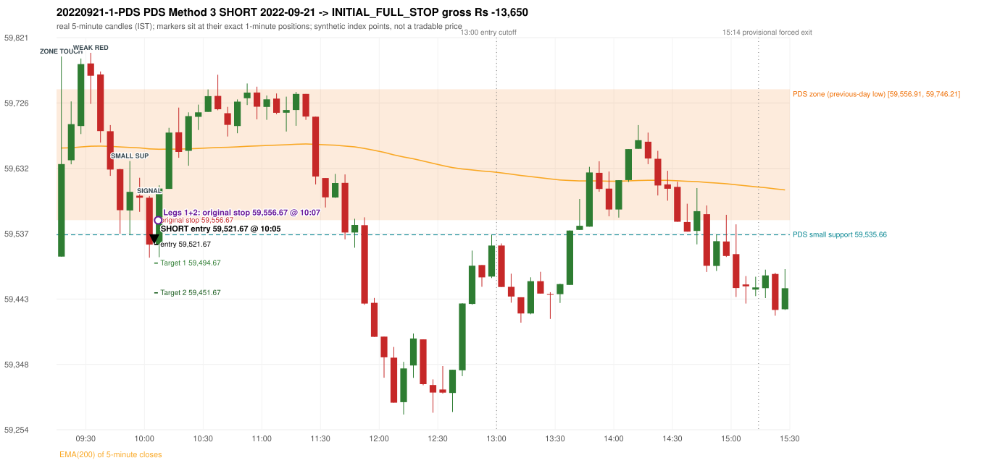
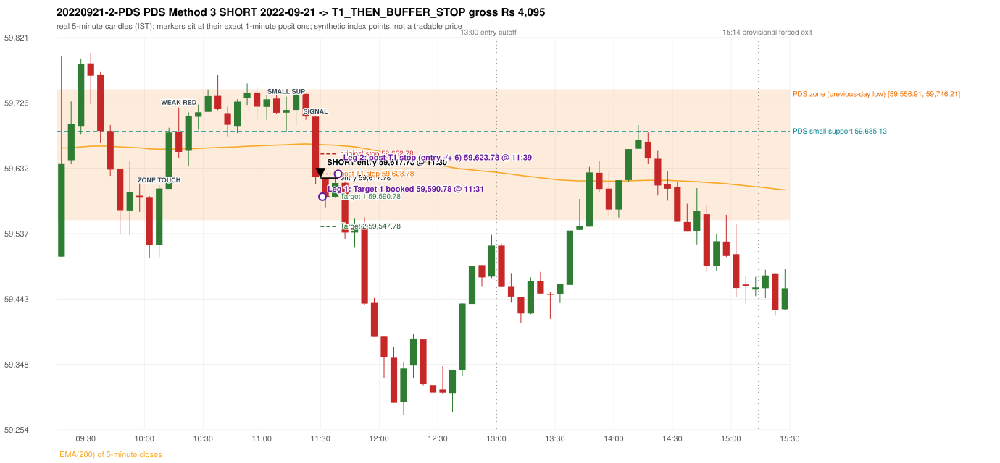

# Trading journal - 2022-09-21 (Wednesday)

> Phase 5 cross-index test, SENSEX window MS (Vendor sensitivity 2022-09-01..2024-03-22 (secondary-source minutes); status VENDOR_SENSITIVITY). The FROZEN Phase 3.6 configuration (IRF, ORB, PDR body-based, PDS, RF; shared controller) with the NIFTY index-point stops and targets UNCHANGED on the SENSEX index price. INDEX-POINT RESULTS ONLY: no option premium is used or estimated. HISTORICAL RESEARCH ONLY: the strategy was developed using later NIFTY data. the same dates with the secondary repository's minute bars (daily series still 5paisa); quantifies sensitivity to the data source, not a second independent result Synthetic SENSEX index-point P&L (the index is not tradable). The owner's review status is intentionally blank.

## A. Trading day overview

| item | value |
|---|---|
| Date / weekday | 2022-09-21 / Wednesday |
| Session type | USABLE_WITH_FLAGS / VALID |
| Original session open (first 1-minute open) | 59,504.14 |
| Previous session | 2022-09-20 |
| Previous-day high / low (wicks included) | 60,105.79 / 59,556.91 |
| Previous-day highest BODY high (the body-based PDR ceiling; wicks ignored) | 60,086.15 |
| Previous-day official close / last 5-minute close | 59,719.74 / 59,649.80 |
| Raw engine records / confirmed signals / fully valid signals | 10 / 6 / 6 |
| Setups that did not complete (invalidated / incomplete) | 4 |
| Executed trades | 2 20220921-1-PDS;20220921-2-PDS |
| Gross P&L (Rs, synthetic) | -9,555.00 |
| Illustrative net P&L (Rs; Rs 500/trade + 0.5 pt/fill) | -11,335.00 |
| Day-end portfolio status | DAY_FINISHED |
| Manual journal trades (matched / unmatched) | 0 (0 / 0) |
| Extra automated trades | 0 |

## B. Daily strategy signal timeline (confirmed signals, chronological)

| time | strategy | method | dir | entry-rule status | valid for execution | <= 13:00 | portfolio state | accepted / ignored | specific reason | competing (same minute) |
|---|---|---|---|---|---|---|---|---|---|---|
| 10:05 | PDS | Method 3 | SHORT | PROPOSAL_DEPENDENT | True | True | FIRST_TRADE_ACTIVE | ACCEPTED -> 20220921-1-PDS | first eligible signal of the day; trade 1: INITIAL_FULL_STOP |  |
| 11:30 | PDS | Method 3 | SHORT | PROPOSAL_DEPENDENT | True | True | SECOND_TRADE_ACTIVE | ACCEPTED -> 20220921-2-PDS | permitted second trade: newly confirmed PDR/PDS after the original full stop; trade 2: T1_THEN_BUFFER_STOP |  |
| 11:45 | PDS | Method 3 | SHORT | PROPOSAL_DEPENDENT | True | True | DAY_FINISHED | IGNORED | DAY_FINISHED [blocked by PDS#2] |  |
| 11:55 | PDS | Method 1 | SHORT | PROPOSAL_DEPENDENT | True | True | DAY_FINISHED | IGNORED | DAY_FINISHED [blocked by PDS#2] |  |
| 14:35 | PDS | Method 3 | SHORT | PROPOSAL_DEPENDENT | True | False | DAY_FINISHED | IGNORED | DAY_FINISHED [blocked by PDS#2] |  |
| 15:05 | PDS | Method 3 | SHORT | PROPOSAL_DEPENDENT | True | False | DAY_FINISHED | IGNORED | DAY_FINISHED [blocked by PDS#2] |  |

Engine setups that did not complete (4); the complete list with failed rule ids is in `rejected_signals.csv`:

| candle | strategy | method | dir | status | precise reason | failed rules |
|---|---|---|---|---|---|---|
| 09:30 | IRF | Method 3 | SHORT | INVALIDATED | WICK_SHARE_OUT_OF_BAND | IRF-M3-003 |
| 09:15 | ORB | Method 2 | SHORT | INVALIDATED | CANDLE_QUALITY | ORB-M2-SHORT-003 |
| 09:15 | ORB | Gap/200DMA | SHORT | INVALIDATED | CANDLE_QUALITY_OR_REJECTION_WICK | ORB-GAP-SHORT-003 |
| 12:55 | RF | RF | LONG | INVALIDATED | TREND:EMA_PREV_SESSION_CLOSE wrong side | RF-001;RF-008 |

## C. Detailed trade journals

### 20220921-1-PDS: PDS Method 3 SHORT (FIRST trade)

Chart: 

**Rule configuration:** CFG-phase36_body_based-866f954e55 - signal verification status **PROPOSAL_DEPENDENT** (never VERIFIED while a rule rests on a proposal).

#### 1. Setup identification

PDS Method 3 SHORT: the session opened 52.77 points below the previous-day-low zone [59,556.91, 59,746.21]; the first red candle at the zone (09:30) was weak (body 24.02%), so the engine waited for a small support; the 09:50 candle's low 59,535.66 (21.25 points below the zone floor) was broken by the close of the 10:00 candle (59,521.57); confirmed 10:05.

#### 2. Candle and indicator calculations

| role | session | candle | O | H | L | C | range | body % | upper wick % | lower wick % | direction | EMA(200) | strong bull / bear | pin bull / bear | small (body<=30%) | used for |
|---|---|---|---|---|---|---|---|---|---|---|---|---|---|---|---|---|
| zone_source_candle | PREVIOUS | 09:15-09:20 | 59,556.91 | 59,751.72 | 59,556.91 | 59,746.21 | 194.81 | 97.17 | 2.83 | 0.00 | BULLISH | 59,374.61 | True / False | False / False | False | previous-day low candle that defines the zone (A_LOWEST_LOW) |
| zone_retest_candle | TODAY | 09:15-09:20 | 59,504.14 | 59,793.59 | 59,504.14 | 59,637.96 | 289.45 | 46.23 | 53.77 | 0.00 | BULLISH | 59,661.22 | False / False | False / False | False | first candle whose range reaches the zone from below |
| signal_candle | TODAY | 10:00-10:05 | 59,589.35 | 59,591.81 | 59,502.53 | 59,521.57 | 89.28 | 75.92 | 2.76 | 21.33 | BEARISH | 59,660.00 | False / False | False / False | False | trigger candle |
| weak_first_red_candle | TODAY | 09:30-09:35 | 59,783.58 | 59,799.01 | 59,725.06 | 59,765.82 | 73.95 | 24.02 | 20.87 | 55.12 | BEARISH | 59,663.80 | False / False | False / False | True | first red candle at the zone that failed the quality rule |
| small_support_pivot | TODAY | 09:50-09:55 | 59,570.91 | 59,642.35 | 59,535.66 | 59,597.76 | 106.69 | 25.17 | 41.79 | 33.04 | BULLISH | 59,662.11 | False / False | False / False | True | small support: latest 3-candle fractal low after the weak candle |

Every condition, with the rule, the calculation, the observed values and the result:

| # | group | rule | result | status / numeric definition | calculation | observed | required | available at | why it matters |
|---|---|---|---|---|---|---|---|---|---|
| 1 | SELECTION | SEL-FIRST-001 | PASS | USER_APPROVED / USER_APPROVED | earliest CONFIRMED signal of the day across IRF/ORB/PDR/PDS/RF that passed the controller's checks | 0 confirmed signal(s) earlier today; 6 confirmed signals in the day in total, this one at 10:05 | no earlier executable signal | 2022-09-21 10:05 | the shared controller trades only the first valid signal; the five strategies are not independent positions |
| 2 | SELECTION | SEL-TIE-001 | PASS | USER_APPROVED / USER_APPROVED | other CONFIRMED signals with exactly the same confirmation timestamp | none | no different-strategy / opposite-direction signal in the same minute (otherwise an unresolved conflict, no trade) | 2022-09-21 10:05 | an unresolved same-minute collision would have produced no trade at all |
| 3 | SELECTION | ENTRY-CUTOFF-001 | PASS | USER_APPROVED / USER_APPROVED | fill timestamp vs 13:00:00 IST | signal confirmed 10:05; fill 10:05 | fill at or before 13:00:00 IST | 2022-09-21 10:05 | no new position may be entered with a fill after 13:00 IST |
| 4 | SELECTION | EXE-FILL-001 | PASS | PROPOSED_FOR_REVIEW / PROPOSED_FOR_REVIEW | fill = open of the 1-minute bar that starts at the signal candle's end | bar 10:05 O 59,521.67 H 59,528.88 L 59,511.72 C 59,524.71; executable=True; entry 59,521.67 | fill bar exists, starts exactly at the signal end, is fillable; entry = its open | 2022-09-21 10:05 | a 5-minute signal is known only when its candle closes; the first price that can be traded is the next minute's open |
| 5 | SELECTION | DAY-MAX-001 | PASS | USER_APPROVED / USER_APPROVED | number of entries today | trade 1 of at most 2 | <= 2 entries per day | 2022-09-21 10:05 | daily trade cap |
| 6 | SETUP | PDS-003 | PASS | SOURCE_VERIFIED / EXPLICIT_WORDING_DETAIL_PROPOSED_FOR_REVIEW | gap = first 1-minute open of today - previous session's OFFICIAL close | today's open 59,504.14 (first 1-minute bar 09:15) - previous close 59,719.74 (DAILY_VENDOR, 2022-09-20) = -215.60 points -> gap DOWN | gap DOWN (more than 0 points) | 2022-09-21 09:15 | approved convention: the original first-minute open, never the vendor daily open |
| 7 | SETUP | PDS-006 | PASS | SOURCE_VERIFIED / QUALITATIVE_SOURCE_NUMERIC_DEFINITION_PROPOSED_FOR_REVIEW | gap-down open below the zone | today's open 59,504.14 vs zone low 59,556.91: 52.77 points below | open < zone low | 2022-09-21 09:15 | the guide: 'price is trading below the previous day's support zone' after the gap; a PROPOSED strict reading |
| 8 | SETUP | PDS-004 | PASS | SOURCE_VERIFIED / EXPLICIT_IN_SOURCE | PDS is not a breakdown strategy: the zone must be tested from below first | open 59,504.14 below the zone floor 59,556.91; the first candle to reach the zone is 09:15 | price rises to the zone before any short | 2022-09-21 09:15 | a short below the level without a retest is not this strategy |
| 9 | SETUP | PDS-005 | PASS | SOURCE_VERIFIED / QUALITATIVE_SOURCE_NUMERIC_DEFINITION_PROPOSED_FOR_REVIEW | price comes up to the zone: first candle whose [low, high] intersects it (+/- proximity) | 09:15-09:20 O 59,504.14 H 59,793.59 L 59,504.14 C 59,637.96; range 289.45, body 133.82 (46.23%), upper wick 155.63 (53.77%), lower wick 0.00 (0.00%), bullish; high 59,793.59 vs zone low 59,556.91 | range intersects the zone | 2022-09-21 09:20 | PDS is not a breakdown strategy: the zone must be tested from below first |
| 10 | ZONE | PDS-001 | PASS | SOURCE_VERIFIED / EXPLICIT_IN_SOURCE | direction | SHORT (PDS is short only) | short-only | 2022-09-21 10:05 | PDS sells a retest of previous-day support from below |
| 11 | ZONE | PDS-002 | PASS | SOURCE_VERIFIED / QUALITATIVE_SOURCE_NUMERIC_DEFINITION_PROPOSED_FOR_REVIEW | zone = [lowest low, body top] of the previous session's absolute-low candle (method A_LOWEST_LOW; the lower wick is part of the zone) | zone [59,556.91, 59,746.21] from the 09:15 candle of 2022-09-20 (09:15-09:20 O 59,556.91 H 59,751.72 L 59,556.91 C 59,746.21; range 194.81, body 189.30 (97.17%), upper wick 5.51 (2.83%), lower wick 0.00 (0.00%), bullish); engine recorded [59,556.91, 59,746.21] | previous trading day's low where price took support (body + lower wick) | 2022-09-20 09:20 | the reference level of the strategy; the exact candle(s) are a research choice (PDS-ZONE-002) |
| 12 | CONFIRMATION | PDS-M-001 | PASS | SOURCE_VERIFIED / QUALITATIVE_SOURCE_NUMERIC_DEFINITION_PROPOSED_FOR_REVIEW | Method 3 is used when the first red candle at the zone is not satisfying | first red candle at the zone: 09:30-09:35 O 59,783.58 H 59,799.01 L 59,725.06 C 59,765.82; range 73.95, body 17.76 (24.02%), upper wick 15.43 (20.87%), lower wick 40.76 (55.12%), bearish; strong-bearish test body >= 60%, lower wick <= 20% -> not met; pin bar -> not met | first red candle is neither strong nor a pin bar | 2022-09-21 09:35 | the quality rule keeps weak candles out; Method 3 waits for a support break instead |
| 13 | CONFIRMATION | PDS-M3-001 | PASS | SOURCE_VERIFIED / QUALITATIVE_SOURCE_NUMERIC_DEFINITION_PROPOSED_FOR_REVIEW | small support = latest 3-candle fractal low (k=1) formed at/after the weak candle with low <= zone high (59,746.21); definition SWING_K1_NEAR_ZONE | support 59,535.66 from the 09:50 candle; engine recorded 59,535.66; distance below the zone floor 21.25 points (zone floor 59,556.91); the guide says 'near the zone' but defines no distance - the code has no lower bound | a small support near the zone | 2022-09-21 10:00 | 'near' and the size of the small support are undefined in the guide |
| 14 | CONFIRMATION | PDS-M3-001 | PASS | SOURCE_VERIFIED / QUALITATIVE_SOURCE_NUMERIC_DEFINITION_PROPOSED_FOR_REVIEW | trigger: candle closes below the small support (break basis CLOSE) | 10:00 close 59,521.57 vs support 59,535.66: 14.09 points below | close < support | 2022-09-21 10:05 | the guide does not say close or touch; the close is used |
| 15 | EXECUTION | EXE-STOP-001 | PASS | USER_APPROVED / USER_APPROVED | initial stop = entry + 35 points | entry 59,521.67 -> stop 59,556.67 | stop 35 index points (BASELINE) | 2022-09-21 10:05 | defines the loss if the setup fails before Target 1 |
| 16 | EXECUTION | EXE-T1-001 | PASS | SOURCE_VERIFIED / EXPLICIT_IN_SOURCE | Target 1 = entry +/- 27 points | T1 59,494.67 | 27 points | 2022-09-21 10:05 | Leg 1 (3 lots) is booked at Target 1 |
| 17 | EXECUTION | PDS-TGT-001 | PASS | SOURCE_VERIFIED / EXPLICIT_IN_SOURCE | Target 2 = entry +/- 70 points | T2 59,451.67 (the guide says 70; the report suggests 60 - CONFLICTING) | 70 points | 2022-09-21 10:05 | Leg 2 (3 lots) is booked at Target 2 |
| 18 | EXECUTION | POST-T1-STOP-006 | PASS | USER_APPROVED / USER_APPROVED | after T1 the Leg-2 stop = entry + 6 (no trailing) | post-T1 stop 59,527.67 | entry -6 (LONG) / +6 (SHORT) | 2022-09-21 10:05 | protects the remaining three lots once the first three are booked |
| 19 | EXECUTION | SIZE-LOT-001 | PASS | USER_APPROVED / USER_APPROVED | 6 lots x 65 = 390, Leg 1 = 3 lots = 195, Leg 2 = 195 | 6 lots, lot size 65, legs 3+3 | 6 lots in two equal legs | 2022-09-21 10:05 | position size for the synthetic P&L |
| 20 | NOTE | PDS-007 | NOT_APPLICABLE | PROPOSED_FOR_REVIEW / PROPOSED_FOR_REVIEW | repeated PDS signals today | 6 confirmed PDS signal(s) in the session | n/a (disclosure) | 2022-09-21 10:05 | the per-session cap is lifted for the controller runs; the controller trades only the first (or the permitted second) trade |
| 21 | NOTE | PDS-MISSING-001 | UNRESOLVED | UNRESOLVED / UNRESOLVED | entry timing | signal on the candle close; fill at the next minute's open | the guide does not say whether entry is intra-candle or after the close | 2022-09-21 10:05 | causal convention: nothing is entered before the trigger candle has closed |
| 22 | NOTE | PDS-SL-001 | NOT_APPLICABLE | SOURCE_VERIFIED / QUALITATIVE_SOURCE_NUMERIC_DEFINITION_PROPOSED_FOR_REVIEW | the guide's 35-or-40 rule: 35 if the most recent green candle's high is within 35 points of entry, else 40 | most recent green candle high 59,642.35 is 120.68 points from the entry 59,521.67: the guide's rule would select 40 points; the baseline applies a fixed 35 (USER_APPROVED research baseline; the 35-vs-40 selection and the 40-point variant are separate labelled scenarios) | source selection rule | 2022-09-21 10:05 | the stop distance is a modelling choice and changes losses, not entries |
| 23 | NOTE | NOTE-UNRESOLVED-DEPENDENCIES | NOT_APPLICABLE | NOT_A_RULE / NOT_A_REGISTRY_RULE | rules the signal depends on that the sources leave unresolved | engine-recorded unresolved rule ids: none; verification status PROPOSAL_DEPENDENT | n/a (disclosure) | 2022-09-21 10:05 | the entry is only as verified as the rules it rests on |

#### 3. Entry decision and explanation

PDS Method 3 SHORT: the session opened 52.77 points below the previous-day-low zone [59,556.91, 59,746.21]; the first red candle at the zone (09:30) was weak (body 24.02%), so the engine waited for a small support; the 09:50 candle's low 59,535.66 (21.25 points below the zone floor) was broken by the close of the 10:00 candle (59,521.57); confirmed 10:05.

**Why this trade ahead of the other strategies:** This PDS Method 3 signal was the earliest executable signal of the day: 0 confirmed signal(s) earlier, 0 other in the same minute. 5 later confirmed signal(s) (PDS x5) are logged as ignored or rejected. State of the other four engines at that moment: [IRF: Method 3 invalidated at 09:30: WICK_SHARE_OUT_OF_BAND] [ORB: Method 2 invalidated at 09:15: CANDLE_QUALITY; Gap/200DMA invalidated at 09:15: CANDLE_QUALITY_OR_REJECTION_WICK] [PDR: no setup record before this time (a base condition was not met, or nothing triggered)] [RF: no setup record before this time (a base condition was not met, or nothing triggered)]

#### 4. Actual entry execution

| item | value |
|---|---|
| Signal candle | 10:00-10:05 |
| Signal confirmed | 2022-09-21 10:05 |
| Fill timestamp | 2022-09-21 10:05 |
| Entry price | 59,521.67 |
| Source partition / 1-minute bar | data/processed/sensex/KAPRI_1M_SENSEX/minutes/year=2022/month=09/candles.parquet / 2022-09-21 10:05 |
| Source bar O / H / L / C | 59,521.67 / 59,528.88 / 59,511.72 / 59,524.71 |
| Fill assumption | open of the 1-minute bar starting at the signal candle's end (EXE-FILL-001, PROPOSED causal convention) |
| Initial stop / T1 / T2 / post-T1 stop | 59,556.67 / 59,494.67 / 59,451.67 / 59,527.67 |
| Position | 6 lots x 65 = 390 units (Leg 1 195, Leg 2 195) |

#### 5-8. Trade progress, Target 1, post-T1 stop and final exit

Between the 10:05 entry bar and the final exit (3 one-minute bars) the best excursion in favour was 18.33 points at 10:06 and the worst against was 46.11 points at 10:07. At 10:07 price reached the original stop 59,556.67 before Target 1 59,494.67, so all six lots exited together at 59,556.67. This is an INITIAL_FULL_STOP: one more trade is allowed that day, only a newly confirmed PDR/PDS signal.

| leg | qty | exit time | exit price | reason | source 1-minute bar | O / H / L / C | gross points | gross Rs | slippage pts | flags |
|---|---|---|---|---|---|---|---|---|---|---|
| 1 | 195 | 10:07 | 59,556.67 | ORIGINAL_STOP_BEFORE_T1 | 10:07 | 59,544.16 / 59,567.78 / 59,544.16 / 59,551.94 | -35.00 | -6,825.00 | 0.00 |  |
| 2 | 195 | 10:07 | 59,556.67 | ORIGINAL_STOP_BEFORE_T1 | 10:07 | 59,544.16 / 59,567.78 / 59,544.16 / 59,551.94 | -35.00 | -6,825.00 | 0.00 |  |

Exit evidence per leg:

* Leg 1: 1-minute bar 10:07 O 59,544.16 H 59,567.78 L 59,544.16 C 59,551.94: high 59,567.78 reached the original stop 59,556.67 before Target 1 59,494.67 was touched; both legs exit at the stop level 59,556.67
* Leg 2: 1-minute bar 10:07 O 59,544.16 H 59,567.78 L 59,544.16 C 59,551.94: high 59,567.78 reached the original stop 59,556.67 before Target 1 59,494.67 was touched; both legs exit at the stop level 59,556.67

#### 9. Gross and illustrative net P&L

| item | value (Rs) |
|---|---|
| Leg 1 gross | -6,825.00 |
| Leg 2 gross | -6,825.00 |
| Trade gross (= Leg 1 + Leg 2) | -13,650.00 |
| Illustrative fixed cost | -500.00 |
| Illustrative slippage (0.5 pt on every fill, entry + exits, all units) | -390.00 |
| Illustrative net | -14,540.00 |

#### 10. Manual journal comparison

No manual journal exists for this period; no comparison.

### 20220921-2-PDS: PDS Method 3 SHORT (SECOND trade)

Chart: 

**Rule configuration:** CFG-phase36_body_based-866f954e55 - signal verification status **PROPOSAL_DEPENDENT** (never VERIFIED while a rule rests on a proposal).

#### 1. Setup identification

PDS Method 3 SHORT: the session opened 52.77 points below the previous-day-low zone [59,556.91, 59,746.21]; the first red candle at the zone (10:15) was weak (body 39.05%), so the engine waited for a small support; the 11:10 candle's low 59,685.13 (-128.22 points below the zone floor) was broken by the close of the 11:25 candle (59,619.99); confirmed 11:30.

#### 2. Candle and indicator calculations

| role | session | candle | O | H | L | C | range | body % | upper wick % | lower wick % | direction | EMA(200) | strong bull / bear | pin bull / bear | small (body<=30%) | used for |
|---|---|---|---|---|---|---|---|---|---|---|---|---|---|---|---|---|
| zone_source_candle | PREVIOUS | 09:15-09:20 | 59,556.91 | 59,751.72 | 59,556.91 | 59,746.21 | 194.81 | 97.17 | 2.83 | 0.00 | BULLISH | 59,374.61 | True / False | False / False | False | previous-day low candle that defines the zone (A_LOWEST_LOW) |
| zone_retest_candle | TODAY | 10:05-10:10 | 59,521.67 | 59,607.28 | 59,503.34 | 59,602.63 | 103.94 | 77.89 | 4.47 | 17.64 | BULLISH | 59,659.42 | True / False | False / False | False | first candle whose range reaches the zone from below |
| signal_candle | TODAY | 11:25-11:30 | 59,706.59 | 59,706.66 | 59,608.62 | 59,619.99 | 98.04 | 88.33 | 0.07 | 11.60 | BEARISH | 59,666.58 | False / True | False / False | False | trigger candle |
| weak_first_red_candle | TODAY | 10:15-10:20 | 59,683.93 | 59,719.70 | 59,647.10 | 59,655.58 | 72.60 | 39.05 | 49.27 | 11.68 | BEARISH | 59,659.62 | False / False | False / False | False | first red candle at the zone that failed the quality rule |
| small_support_pivot | TODAY | 11:10-11:15 | 59,712.31 | 59,735.54 | 59,685.13 | 59,716.18 | 50.41 | 7.68 | 38.41 | 53.92 | BULLISH | 59,665.91 | False / False | False / False | True | small support: latest 3-candle fractal low after the weak candle |

Every condition, with the rule, the calculation, the observed values and the result:

| # | group | rule | result | status / numeric definition | calculation | observed | required | available at | why it matters |
|---|---|---|---|---|---|---|---|---|---|
| 1 | SELECTION | DAY-SL-001 | PASS | USER_APPROVED / USER_APPROVED | first trade outcome, strategy of this signal, position-close time vs this signal's timestamp | first trade PDS Method 3 closed as INITIAL_FULL_STOP at 10:07; position free from 10:08; this PDS signal confirmed 11:30 | first trade INITIAL_FULL_STOP before Target 1, and a NEWLY confirmed PDR/PDS signal after the first position closed | 2022-09-21 11:30 | the only way a second trade is allowed |
| 2 | SELECTION | DAY-NOREUSE-001 | PASS | USER_APPROVED / USER_APPROVED | signals confirmed while the first position was open | 1 signal(s) were ignored during the first trade (never reused): PDS Method 3 SHORT @10:05 | this trade comes from a signal confirmed after the first exit, not from an ignored one | 2022-09-21 11:30 | an ignored signal can never become the second trade |
| 3 | SELECTION | ENTRY-CUTOFF-001 | PASS | USER_APPROVED / USER_APPROVED | fill timestamp vs 13:00:00 IST | signal confirmed 11:30; fill 11:30 | fill at or before 13:00:00 IST | 2022-09-21 11:30 | no new position may be entered with a fill after 13:00 IST |
| 4 | SELECTION | EXE-FILL-001 | PASS | PROPOSED_FOR_REVIEW / PROPOSED_FOR_REVIEW | fill = open of the 1-minute bar that starts at the signal candle's end | bar 11:30 O 59,617.78 H 59,617.78 L 59,597.60 C 59,599.12; executable=True; entry 59,617.78 | fill bar exists, starts exactly at the signal end, is fillable; entry = its open | 2022-09-21 11:30 | a 5-minute signal is known only when its candle closes; the first price that can be traded is the next minute's open |
| 5 | SELECTION | DAY-MAX-001 | PASS | USER_APPROVED / USER_APPROVED | number of entries today | trade 2 of at most 2 | <= 2 entries per day | 2022-09-21 11:30 | daily trade cap |
| 6 | SETUP | PDS-003 | PASS | SOURCE_VERIFIED / EXPLICIT_WORDING_DETAIL_PROPOSED_FOR_REVIEW | gap = first 1-minute open of today - previous session's OFFICIAL close | today's open 59,504.14 (first 1-minute bar 09:15) - previous close 59,719.74 (DAILY_VENDOR, 2022-09-20) = -215.60 points -> gap DOWN | gap DOWN (more than 0 points) | 2022-09-21 09:15 | approved convention: the original first-minute open, never the vendor daily open |
| 7 | SETUP | PDS-006 | PASS | SOURCE_VERIFIED / QUALITATIVE_SOURCE_NUMERIC_DEFINITION_PROPOSED_FOR_REVIEW | gap-down open below the zone | today's open 59,504.14 vs zone low 59,556.91: 52.77 points below | open < zone low | 2022-09-21 09:15 | the guide: 'price is trading below the previous day's support zone' after the gap; a PROPOSED strict reading |
| 8 | SETUP | PDS-004 | PASS | SOURCE_VERIFIED / EXPLICIT_IN_SOURCE | PDS is not a breakdown strategy: the zone must be tested from below first | open 59,504.14 below the zone floor 59,556.91; the first candle to reach the zone is 10:05 | price rises to the zone before any short | 2022-09-21 09:15 | a short below the level without a retest is not this strategy |
| 9 | SETUP | PDS-005 | PASS | SOURCE_VERIFIED / QUALITATIVE_SOURCE_NUMERIC_DEFINITION_PROPOSED_FOR_REVIEW | price comes up to the zone: first candle whose [low, high] intersects it (+/- proximity) | 10:05-10:10 O 59,521.67 H 59,607.28 L 59,503.34 C 59,602.63; range 103.94, body 80.96 (77.89%), upper wick 4.65 (4.47%), lower wick 18.33 (17.64%), bullish; high 59,607.28 vs zone low 59,556.91 | range intersects the zone | 2022-09-21 10:10 | PDS is not a breakdown strategy: the zone must be tested from below first |
| 10 | ZONE | PDS-001 | PASS | SOURCE_VERIFIED / EXPLICIT_IN_SOURCE | direction | SHORT (PDS is short only) | short-only | 2022-09-21 11:30 | PDS sells a retest of previous-day support from below |
| 11 | ZONE | PDS-002 | PASS | SOURCE_VERIFIED / QUALITATIVE_SOURCE_NUMERIC_DEFINITION_PROPOSED_FOR_REVIEW | zone = [lowest low, body top] of the previous session's absolute-low candle (method A_LOWEST_LOW; the lower wick is part of the zone) | zone [59,556.91, 59,746.21] from the 09:15 candle of 2022-09-20 (09:15-09:20 O 59,556.91 H 59,751.72 L 59,556.91 C 59,746.21; range 194.81, body 189.30 (97.17%), upper wick 5.51 (2.83%), lower wick 0.00 (0.00%), bullish); engine recorded [59,556.91, 59,746.21] | previous trading day's low where price took support (body + lower wick) | 2022-09-20 09:20 | the reference level of the strategy; the exact candle(s) are a research choice (PDS-ZONE-002) |
| 12 | CONFIRMATION | PDS-M-001 | PASS | SOURCE_VERIFIED / QUALITATIVE_SOURCE_NUMERIC_DEFINITION_PROPOSED_FOR_REVIEW | Method 3 is used when the first red candle at the zone is not satisfying | first red candle at the zone: 10:15-10:20 O 59,683.93 H 59,719.70 L 59,647.10 C 59,655.58; range 72.60, body 28.35 (39.05%), upper wick 35.77 (49.27%), lower wick 8.48 (11.68%), bearish; strong-bearish test body >= 60%, lower wick <= 20% -> not met; pin bar -> not met | first red candle is neither strong nor a pin bar | 2022-09-21 10:20 | the quality rule keeps weak candles out; Method 3 waits for a support break instead |
| 13 | CONFIRMATION | PDS-M3-001 | PASS | SOURCE_VERIFIED / QUALITATIVE_SOURCE_NUMERIC_DEFINITION_PROPOSED_FOR_REVIEW | small support = latest 3-candle fractal low (k=1) formed at/after the weak candle with low <= zone high (59,746.21); definition SWING_K1_NEAR_ZONE | support 59,685.13 from the 11:10 candle; engine recorded 59,685.13; distance below the zone floor -128.22 points (negative: the support lies ABOVE the floor) (zone floor 59,556.91); the guide says 'near the zone' but defines no distance - the code has no lower bound | a small support near the zone | 2022-09-21 11:20 | 'near' and the size of the small support are undefined in the guide |
| 14 | CONFIRMATION | PDS-M3-001 | PASS | SOURCE_VERIFIED / QUALITATIVE_SOURCE_NUMERIC_DEFINITION_PROPOSED_FOR_REVIEW | trigger: candle closes below the small support (break basis CLOSE) | 11:25 close 59,619.99 vs support 59,685.13: 65.14 points below | close < support | 2022-09-21 11:30 | the guide does not say close or touch; the close is used |
| 15 | EXECUTION | EXE-STOP-001 | PASS | USER_APPROVED / USER_APPROVED | initial stop = entry + 35 points | entry 59,617.78 -> stop 59,652.78 | stop 35 index points (BASELINE) | 2022-09-21 11:30 | defines the loss if the setup fails before Target 1 |
| 16 | EXECUTION | EXE-T1-001 | PASS | SOURCE_VERIFIED / EXPLICIT_IN_SOURCE | Target 1 = entry +/- 27 points | T1 59,590.78 | 27 points | 2022-09-21 11:30 | Leg 1 (3 lots) is booked at Target 1 |
| 17 | EXECUTION | PDS-TGT-001 | PASS | SOURCE_VERIFIED / EXPLICIT_IN_SOURCE | Target 2 = entry +/- 70 points | T2 59,547.78 (the guide says 70; the report suggests 60 - CONFLICTING) | 70 points | 2022-09-21 11:30 | Leg 2 (3 lots) is booked at Target 2 |
| 18 | EXECUTION | POST-T1-STOP-006 | PASS | USER_APPROVED / USER_APPROVED | after T1 the Leg-2 stop = entry + 6 (no trailing) | post-T1 stop 59,623.78 | entry -6 (LONG) / +6 (SHORT) | 2022-09-21 11:30 | protects the remaining three lots once the first three are booked |
| 19 | EXECUTION | SIZE-LOT-001 | PASS | USER_APPROVED / USER_APPROVED | 6 lots x 65 = 390, Leg 1 = 3 lots = 195, Leg 2 = 195 | 6 lots, lot size 65, legs 3+3 | 6 lots in two equal legs | 2022-09-21 11:30 | position size for the synthetic P&L |
| 20 | NOTE | PDS-007 | NOT_APPLICABLE | PROPOSED_FOR_REVIEW / PROPOSED_FOR_REVIEW | repeated PDS signals today | 6 confirmed PDS signal(s) in the session | n/a (disclosure) | 2022-09-21 11:30 | the per-session cap is lifted for the controller runs; the controller trades only the first (or the permitted second) trade |
| 21 | NOTE | PDS-MISSING-001 | UNRESOLVED | UNRESOLVED / UNRESOLVED | entry timing | signal on the candle close; fill at the next minute's open | the guide does not say whether entry is intra-candle or after the close | 2022-09-21 11:30 | causal convention: nothing is entered before the trigger candle has closed |
| 22 | NOTE | PDS-SL-001 | NOT_APPLICABLE | SOURCE_VERIFIED / QUALITATIVE_SOURCE_NUMERIC_DEFINITION_PROPOSED_FOR_REVIEW | the guide's 35-or-40 rule: 35 if the most recent green candle's high is within 35 points of entry, else 40 | most recent green candle high 59,742.50 is 124.72 points from the entry 59,617.78: the guide's rule would select 40 points; the baseline applies a fixed 35 (USER_APPROVED research baseline; the 35-vs-40 selection and the 40-point variant are separate labelled scenarios) | source selection rule | 2022-09-21 11:30 | the stop distance is a modelling choice and changes losses, not entries |
| 23 | NOTE | NOTE-UNRESOLVED-DEPENDENCIES | NOT_APPLICABLE | NOT_A_RULE / NOT_A_REGISTRY_RULE | rules the signal depends on that the sources leave unresolved | engine-recorded unresolved rule ids: none; verification status PROPOSAL_DEPENDENT | n/a (disclosure) | 2022-09-21 11:30 | the entry is only as verified as the rules it rests on |

#### 3. Entry decision and explanation

PDS Method 3 SHORT: the session opened 52.77 points below the previous-day-low zone [59,556.91, 59,746.21]; the first red candle at the zone (10:15) was weak (body 39.05%), so the engine waited for a small support; the 11:10 candle's low 59,685.13 (-128.22 points below the zone floor) was broken by the close of the 11:25 candle (59,619.99); confirmed 11:30.

**Why this trade ahead of the other strategies:** The first trade (PDS Method 3) was stopped out before Target 1 at 10:07; this newly confirmed PDS signal at 11:30 is the first PDR/PDS signal after that exit, so it is the day's permitted second trade. State of the other engines at that moment: [IRF: Method 3 invalidated at 09:30: WICK_SHARE_OUT_OF_BAND] [ORB: Method 2 invalidated at 09:15: CANDLE_QUALITY; Gap/200DMA invalidated at 09:15: CANDLE_QUALITY_OR_REJECTION_WICK] [PDR: no setup record before this time (a base condition was not met, or nothing triggered)] [RF: no setup record before this time (a base condition was not met, or nothing triggered)]

#### 4. Actual entry execution

| item | value |
|---|---|
| Signal candle | 11:25-11:30 |
| Signal confirmed | 2022-09-21 11:30 |
| Fill timestamp | 2022-09-21 11:30 |
| Entry price | 59,617.78 |
| Source partition / 1-minute bar | data/processed/sensex/KAPRI_1M_SENSEX/minutes/year=2022/month=09/candles.parquet / 2022-09-21 11:30 |
| Source bar O / H / L / C | 59,617.78 / 59,617.78 / 59,597.60 / 59,599.12 |
| Fill assumption | open of the 1-minute bar starting at the signal candle's end (EXE-FILL-001, PROPOSED causal convention) |
| Initial stop / T1 / T2 / post-T1 stop | 59,652.78 / 59,590.78 / 59,547.78 / 59,623.78 |
| Position | 6 lots x 65 = 390 units (Leg 1 195, Leg 2 195) |

#### 5-8. Trade progress, Target 1, post-T1 stop and final exit

Between the 11:30 entry bar and the final exit (10 one-minute bars) the best excursion in favour was 42.54 points at 11:34 and the worst against was 6.03 points at 11:39. At 11:31 price reached Target 1 59,590.78 and three lots exited. At 11:31 the remaining three lots' protective stop was set to 59,623.78 (entry + 6; no trailing, no further change); the engine applies it from the Target-1 bar onward and tests it within that same bar. At 11:39 the remaining three lots stopped out at 59,623.78. T1_THEN_BUFFER_STOP: no second trade that day (DAY-BUF-001).

| leg | qty | exit time | exit price | reason | source 1-minute bar | O / H / L / C | gross points | gross Rs | slippage pts | flags |
|---|---|---|---|---|---|---|---|---|---|---|
| 1 | 195 | 11:31 | 59,590.78 | TARGET_1 | 11:31 | 59,595.95 / 59,616.43 / 59,589.17 / 59,610.56 | 27.00 | 5,265.00 | 0.00 |  |
| 2 | 195 | 11:39 | 59,623.78 | POST_T1_STOP_ENTRY_MINUS_PLUS_6 | 11:39 | 59,615.79 / 59,623.81 / 59,610.52 / 59,610.52 | -6.00 | -1,170.00 | 0.00 |  |

Exit evidence per leg:

* Leg 1: 1-minute bar 11:31 O 59,595.95 H 59,616.43 L 59,589.17 C 59,610.56: low 59,589.17 reached Target 1 59,590.78; Leg 1 booked at the target level
* Leg 2: 1-minute bar 11:39 O 59,615.79 H 59,623.81 L 59,610.52 C 59,610.52: high 59,623.81 reached the post-T1 stop 59,623.78; Leg 2 exits at 59,623.78 at the stop level

#### 9. Gross and illustrative net P&L

| item | value (Rs) |
|---|---|
| Leg 1 gross | 5,265.00 |
| Leg 2 gross | -1,170.00 |
| Trade gross (= Leg 1 + Leg 2) | 4,095.00 |
| Illustrative fixed cost | -500.00 |
| Illustrative slippage (0.5 pt on every fill, entry + exits, all units) | -390.00 |
| Illustrative net | 3,205.00 |

#### 10. Manual journal comparison

No manual journal exists for this period; no comparison.

## D. Manual journal comparison

No manual journal exists for this period (the manual journal covers 2025-09-01 .. 2026-08-31 only); no comparison is made and no automated trade is labelled 'extra'.

## E. Daily conclusion

* **Traded:** 20220921-1-PDS - PDS Method 3 SHORT at 10:05 (entry 59,521.67), outcome INITIAL_FULL_STOP, gross Rs -13,650.00, illustrative net Rs -14,540.00. **Why:** This PDS Method 3 signal was the earliest executable signal of the day: 0 confirmed signal(s) earlier, 0 other in the same minute. 5 later confirmed signal(s) (PDS x5) are logged as ignored or rejected. State of the other four engines at that moment: [IRF: Method 3 invalidated at 09:30: WICK_SHARE_OUT_OF_BAND] [ORB: Method 2 invalidated at 09:15: CANDLE_QUALITY; Gap/200DMA invalidated at 09:15: CANDLE_QUALITY_OR_REJECTION_WICK] [PDR: no setup record before this time (a base condition was not met, or nothing triggered)] [RF: no setup record before this time (a base condition was not met, or nothing triggered)] **How it ended:** At 10:07 price reached the original stop 59,556.67 before Target 1 59,494.67, so all six lots exited together at 59,556.67. This is an INITIAL_FULL_STOP: one more trade is allowed that day, only a newly confirmed PDR/PDS signal.
* **Traded:** 20220921-2-PDS - PDS Method 3 SHORT at 11:30 (entry 59,617.78), outcome T1_THEN_BUFFER_STOP, gross Rs 4,095.00, illustrative net Rs 3,205.00. **Why:** The first trade (PDS Method 3) was stopped out before Target 1 at 10:07; this newly confirmed PDS signal at 11:30 is the first PDR/PDS signal after that exit, so it is the day's permitted second trade. State of the other engines at that moment: [IRF: Method 3 invalidated at 09:30: WICK_SHARE_OUT_OF_BAND] [ORB: Method 2 invalidated at 09:15: CANDLE_QUALITY; Gap/200DMA invalidated at 09:15: CANDLE_QUALITY_OR_REJECTION_WICK] [PDR: no setup record before this time (a base condition was not met, or nothing triggered)] [RF: no setup record before this time (a base condition was not met, or nothing triggered)] **How it ended:** At 11:31 price reached Target 1 59,590.78 and three lots exited. At 11:31 the remaining three lots' protective stop was set to 59,623.78 (entry + 6; no trailing, no further change); the engine applies it from the Target-1 bar onward and tests it within that same bar. At 11:39 the remaining three lots stopped out at 59,623.78. T1_THEN_BUFFER_STOP: no second trade that day (DAY-BUF-001).
* **Ignored / rejected signals:** PDS IGNORED DAY_FINISHED x4
* **Open strategy-definition issues that affected this day:** PDS-MISSING-001 (Entry timing (during the candle or after it closes) is not specified)
* **Automated triage (not an approval; the owner's review status stays blank):** TRADED_NO_FLAGS

## Option-execution feasibility (information only; no option trade is simulated)

The index result above is an INDEX-POINT result on SENSEX. It is not an option result: a move of N index points is not a move of N premium points (delta, gamma, theta, vega, spread and liquidity decide the premium).

| trade | strategy | index direction | long option it maps to | historical contract identified? | premium data available? | premium fill supportable? |
|---|---|---|---|---|---|---|
| 20220921-1-PDS | PDS | SHORT | BUY PUT (PE) | no | no | no |
| 20220921-2-PDS | PDS | SHORT | BUY PUT (PE) | no | no | no |

Why: (1) the broker's instrument master lists only contracts that are live today, so the scrip code of a contract that existed on this date is not available; (2) historical candles can only be requested by scrip code; (3) the strike and expiry selection policy is an owner decision that has not been made (`options_feasibility/option_contract_selection_decisions.md`). No option entry, exit, premium or option P&L is shown, and none may be inferred from the index points.
